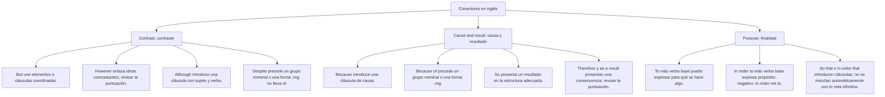

## 1. APPLIED GRAMMAR & ADVANCED STRUCTURES - PART II
   - \mathbf{Before} + \mathbf{Verb\text{-}ING}: *Turn off the computer **before leaving** the room.*
   - \mathbf{After} + \mathbf{Verb\text{-}ING}: ***After finishing** the exam, submit your test sheet.*

---

### 3.4. Conectores Lógicos de Cohesión (Linking Words)

#### A. Conectores de Contraste: *Although* vs. *Despite / In spite of*
- **Although / Even though + Cláusula (Sujeto + Verbo):**
  *He passed the entrance examination **although he was** very nervous.*
- **Despite / In spite of + Sintagma Nominal o Gerundio (-ING):**
  *He passed the entrance examination **despite his nervousness**.*
  *He passed the entrance examination **in spite of being** very nervous.* (NUNCA: \times *despite of*).

#### B. Conectores de Causa: *Because* vs. *Because of*
- **Because + Cláusula completa (S + V):**
  *The university cancelled classes **because the heavy rain flooded** the campus.*
- **Because of + Sintagma Nominal (Noun \ Phrase):**
  *The university cancelled classes **because of the heavy rain**.*

#### C. Conectores de Consecuencia: *So* vs. *Therefore*
- **So (Coordinante informal):** *She studied day and night, **so** she obtained the highest score.*
- **Therefore / Consequently (Formal con punto y coma):** *She studied day and night**; therefore,** she obtained the highest score.*

#### D. Conectores de Finalidad (Purpose)
- \mathbf{To \ / \ In \ order \ to} + \mathbf{Base \ Verb}: *He woke up early **in order to arrive** on time.*
- \mathbf{So \ that} + \mathbf{Subject} + \mathbf{can \ / \ could \ / \ will} + \mathbf{Verb}: *He woke up early **so that he could catch** the bus.*

---

## 2. PRE-UNIVERSITY HACKS & MNEMOTECHNICS
\text{Despite / In spite of} & \mathbf{+ \ \text{Noun Phrase \ / \ Verb-ING}} \ (\text{Sin verbo conjugado}) \\ \hline
\text{Because} & \mathbf{+ \ \text{Subject} + \text{Verb}} \\ \hline
\text{Because of / Due to} & \mathbf{+ \ \text{Noun Phrase \ / \ Pronoun}} \\ \hline
\text{In order to / So as to} & \mathbf{+ \ \text{Base Verb}} \\ \hline
\text{So that} & \mathbf{+ \ \text{Subject} + \text{Modal (can/could)} + \text{Verb}} \\ \hline
\end{array}

---

## 6. PRE-UNIVERSITY HACKS Y MNEMOTÉCNIAS

### 1. El Hack de "Would you mind": Siempre pide -ING
\mathbf{Would \ you \ mind} + \mathbf{VERB\text{-}ING} \quad (\text{NO:} \ \times \text{Would you mind open the door?})
- *Correcto:* \checkmark *Would you mind **opening** the door?*
- *Dato clave:* Si respondes cortésmente que NO te molesta abrir la puerta, debes decir: **"No, not at all"** o **"Of course not"**. (Decir "Yes" significa que SÍ te molesta).

### 2. Mnemotécnia de Contraste: "A-C" vs. "D-S"
- **A**lthough \longrightarrow **C**láusula (Sujeto + Verbo).
- **D**espite \longrightarrow **S**ustantivo / **S**intagma nominal.

---

## 3. COMMON PITFALLS & ADMISSION EXAM TRAPS
## 7. ERRORES FRECUENTES Y TRAMPAS DE EXAMEN

1. **La Trampa de "Despite of":**
   - *Error común:* Escribir \times *despite of the rain*.
   - *Regla inviolable:* O se usa **despite** solo, o se usa **in spite of**:
     - \checkmark *despite the rain*
     - \checkmark *in spite of the rain*
     - \times *despite of the rain* (¡Inexistente en inglés culto!).
2. **Confundir "Enjoy to do" con "Enjoy doing":**
   - El verbo *enjoy* exige **gerundio (-ING)** en el 100% de los casos: \checkmark *I enjoy studying*, NUNCA \times *I enjoy to study*.
3. **Usar "prefer than" en lugar de "prefer to":**
   - *Error:* \times *I prefer tea than coffee.*
   - *Correcto:* \checkmark *I prefer tea **to** coffee.*

---

## 4. REAL-WORLD CONTEXT & READING PASSAGES
## 5. CASOS PRÁCTICOS Y MODELIZACIONES DEL MUNDO REAL

### Caso 1: Redacción de Ensayos Académicos Universitarios
En un párrafo expositivo sobre cambio climático:
> *"Global temperatures continue to rise rapidly; **furthermore**, sea levels are threatening coastal cities. **Although** governments have signed international climate treaties, carbon emissions remain alarmingly high. **Because of** severe industrial pollution, urgent policies are required **so that** future generations can survive."*

- **Análisis de Cohesión:**
  - *Furthermore:* Conector de adición formal que suma un segundo impacto ecológico.
  - *Although:* Introduce una cláusula subordinada concesiva (S+V: *governments have signed*).
  - *Because of:* Introduce la causa mediante un sintagma nominal (*severe industrial pollution*).
  - *So that:* Conecta con la finalidad del propósito introduciendo un sujeto y modal (*future generations can survive*).

---
