## 1. COURSE OVERVIEW & CONCEPTUAL FRAMEWORK
## 1. PORTADA Y METADATOS CURRICULARES

| Campo | Detalle |
| :--- | :--- |
| **Eje Temático** | Eje 07: Idioma Extranjero (Inglés) |
| **Materia** | Gramática, Sintaxis y Morfosintaxis Inglesa (A2 - B1 CEFR) |
| **Nivel de Dificultad** | Preuniversitario Avanzado (UNSA / CEPRUNSA) |
| **Tiempo de Estudio Recomendado** | 4.5 horas |
| **Resolución Curricular** | R.C.U. N.° 0028-2026 (Admisión 2027) |
| **Prerrequisitos** | Tiempos Verbales, Modales y Conectores Lógicos (Temas 01 al 04) |
| **Objetivo Pedagógico** | Dominar el sistema pronominal completo (subject, object, possessive adjectives/pronouns, reflexive pronouns); aplicar según el contexto las preposiciones esenciales (*at, on, in* de tiempo y lugar, y preposiciones de movimiento); internalizar el orden sintáctico canónico de la oración inglesa (SVO y orden de adjetivos OSASCOMP); y resolver ejercicios de transformación de enunciados, paráfrasis y detección de errores de admisión. |

---

## 2. MAPA CONCEPTUAL SINTÉTICO (MERMAID)

```mermaid
graph TD
 ROOT["Pronombres, preposiciones y orden"]
 B1["Pronombres y posesión"]
 B1N1["Sujeto: I, you, he, she, it, we, they. Ejemplo: She studies."]
 B1N2["Objeto: me, you, him, her, it, us, them. Ejemplo: I called her."]
 B1N3["Posesivo ante un sustantivo: my book. Posesivo independiente: This book is mine."]
 B1N4["Reflexivo: el objeto remite al sujeto; también puede dar énfasis. She introduced herself."]
 B2["Tiempo y lugar"]
 B2N1["Tiempo: at para horas; on para días y fechas; in para meses, años y algunas partes del día."]
 B2N2["Lugar: at presenta un punto o actividad; on una superficie; in un interior o área."]
 B2N3["Son patrones de uso, no una ley de tamaño. Aprender también expresiones como at home y at night."]
 B3["Movimiento"]
 B3N1["To indica destino; towards indica dirección, sin afirmar llegada."]
 B3N2["Into y out of indican entrada y salida; across y through describen recorridos distintos."]
 B4["Orden y contexto"]
 B4N1["En una afirmación transitiva neutra suele aparecer sujeto, verbo y objeto. No toda oración lleva objeto."]
 B4N2["Lugar y tiempo pueden cambiar de posición: Yesterday, John bought a book es una oración válida."]
 B4N3["Los adjetivos antepuestos siguen tendencias de orden; no toda descripción exige una secuencia de ocho adjetivos."]
 ROOT --> B1
 B1 --> B1N1
 B1 --> B1N2
 B1 --> B1N3
 B1 --> B1N4
 ROOT --> B2
 B2 --> B2N1
 B2 --> B2N2
 B2 --> B2N3
 ROOT --> B3
 B3 --> B3N1
 B3 --> B3N2
 ROOT --> B4
 B4 --> B4N1
 B4 --> B4N2
 B4 --> B4N3
```

---

## 2. FORMAL THEORETICAL FOUNDATIONS - PART I
## 3. FUNDAMENTACIÓN TEÓRICA RIGUROSA

### 3.1. El Sistema Pronominal del Inglés
En la gramática inglesa, los pronombres y determinantes se articulan en un sistema jerárquico estricto según su función sintáctica oracional:

| Persona y Número | Subject Pronoun (Sujeto) | Object Pronoun (Objeto) | Possessive Adjective (+ Noun) | Possessive Pronoun (Solo) | Reflexive Pronoun |
| :--- | :--- | :--- | :--- | :--- | :--- |
| **1.ª sing.** | **I** | **me** | **my** (*my book*) | **mine** (*It is mine*) | **myself** |
| **2.ª sing.** | **you** | **you** | **your** (*your car*) | **yours** (*It is yours*) | **yourself** |
| **3.ª sing. masc.** | **he** | **him** | **his** (*his phone*) | **his** (*It is his*) | **himself** |
| **3.ª sing. fem.** | **she** | **her** | **her** (*her bag*) | **hers** (*It is hers*) | **herself** |
| **3.ª neutro** | **it** | **it** | **its** (*its color*) | — | **itself** |
| **1.ª plural** | **we** | **us** | **our** (*our class*) | **ours** (*It is ours*) | **ourselves** |
| **2.ª plural** | **you** | **you** | **your** (*your tasks*) | **yours** (*They are yours*) | **yourselves** |
| **3.ª plural** | **they** | **them** | **their** (*their lab*) | **theirs** (*It is theirs*) | **themselves** |

#### Contrastes pronominales:
1. **Possessive Adjective vs. Possessive Pronoun:**
   - El *Possessive Adjective* acompaña **obligatoriamente** a un sustantivo (Adj + N): *This is **my laptop**.*
   - El *Possessive Pronoun* sustituye al sustantivo y no funciona como determinante ante el sustantivo poseído: *This laptop is **mine**.* (NUNCA: \times *This is mine laptop*).
2. **Cuidado con "Its" vs. "It's":**
   - *Its:* Adjetivo posesivo neutro sin apóstrofo (*The cat licked **its** paw*).
   - *It's:* Contracción de *it is* o *it has* (*It's raining* / *It's been a long time*).
3. **Reflexive Pronouns:** Indican que el sujeto y el objeto de la acción verbal son idénticos (*He cut **himself** while slicing fruit*) o añaden énfasis enfático (*The dean **himself** signed the diplomas*).

---

### 3.2. Preposiciones: usos y contexto

### Elegir una preposición de tiempo

| Uso habitual | Forma | Ejemplo |
|---|---|---|
| Hora o momento puntual | at | at 8:30; at noon |
| Día o fecha | on | on Monday; on 15 May |
| Mes, año o estación | in | in July; in 2027; in winter |
| Partes habituales del día | in the | in the morning; in the evening |
| Noche, en sentido general | at | at night |

**Importante:** estas asociaciones son una guía, no una regla basada únicamente en el tamaño del intervalo. *On Monday morning* incluye un día concreto. Con *next Monday*, *last year* y *every morning* normalmente no añadimos at, on o in. *In the night* también existe cuando se habla de un momento durante una noche determinada.

Para el lugar, compara **at the bus stop**, **on the table** e **in the classroom**. Son relaciones de punto, superficie e interior; la continuación desarrolla sus usos y el movimiento con ejemplos.
