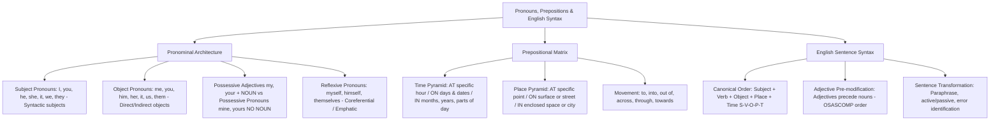

## 1. COURSE OVERVIEW & CONCEPTUAL FRAMEWORK
## 1. PORTADA Y METADATOS CURRICULARES

| Campo | Detalle |
| :--- | :--- |
| **Eje Temático** | Eje 07: Idioma Extranjero (Inglés) |
| **Materia** | Gramática, Sintaxis y Morfosintaxis Inglesa (A2 - B1 CEFR) |
| **Nivel de Dificultad** | Preuniversitario Avanzado (UNSA / CEPRUNSA) |
| **Tiempo de Estudio Recomendado** | 4.5 horas |
| **Resolución Curricular** | R.C.U. N.° 0028-2026 (Admisión 2027) |
| **Prerrequisitos** | Tiempos Verbales, Modales y Conectores Lógicos (Temas 01 al 04) |
| **Objetivo Pedagógico** | Dominar el sistema pronominal completo (subject, object, possessive adjectives/pronouns, reflexive pronouns); aplicar con exactitud matemática las preposiciones esenciales (*at, on, in* de tiempo y lugar, y preposiciones de movimiento); internalizar el orden sintáctico canónico de la oración inglesa (SVO y orden de adjetivos OSASCOMP); y resolver ejercicios de transformación de enunciados, paráfrasis y detección de errores de admisión. |

---

## 2. MAPA CONCEPTUAL SINTÉTICO (MERMAID)



---


## 2. FORMAL THEORETICAL FOUNDATIONS - PART I
## 3. FUNDAMENTACIÓN TEÓRICA RIGUROSA

### 3.1. El Sistema Pronominal del Inglés
En la gramática inglesa, los pronombres y determinantes se articulan en un sistema jerárquico estricto según su función sintáctica oracional:

| Persona y Número | Subject Pronoun (Sujeto) | Object Pronoun (Objeto) | Possessive Adjective (+ Noun) | Possessive Pronoun (Solo) | Reflexive Pronoun |
| :--- | :--- | :--- | :--- | :--- | :--- |
| **1.ª sing.** | **I** | **me** | **my** (*my book*) | **mine** (*It is mine*) | **myself** |
| **2.ª sing.** | **you** | **you** | **your** (*your car*) | **yours** (*It is yours*) | **yourself** |
| **3.ª sing. masc.** | **he** | **him** | **his** (*his phone*) | **his** (*It is his*) | **himself** |
| **3.ª sing. fem.** | **she** | **her** | **her** (*her bag*) | **hers** (*It is hers*) | **herself** |
| **3.ª neutro** | **it** | **it** | **its** (*its color*) | — | **itself** |
| **1.ª plural** | **we** | **us** | **our** (*our class*) | **ours** (*It is ours*) | **ourselves** |
| **2.ª plural** | **you** | **you** | **your** (*your tasks*) | **yours** (*They are yours*) | **yourselves** |
| **3.ª plural** | **they** | **them** | **their** (*their lab*) | **theirs** (*It is theirs*) | **themselves** |

#### Reglas de Oro Pronominales:
1. **Possessive Adjective vs. Possessive Pronoun:**
   - El *Possessive Adjective* acompaña **obligatoriamente** a un sustantivo (Adj + N): *This is **my laptop**.*
   - El *Possessive Pronoun* sustituye al sustantivo y **NUNCA** va seguido de un nombre: *This laptop is **mine**.* (NUNCA: \times *This is mine laptop*).
2. **Cuidado con "Its" vs. "It's":**
   - *Its:* Adjetivo posesivo neutro sin apóstrofo (*The cat licked **its** paw*).
   - *It's:* Contracción de *it is* o *it has* (*It's raining* / *It's been a long time*).
3. **Reflexive Pronouns:** Indican que el sujeto y el objeto de la acción verbal son idénticos (*He cut **himself** while slicing fruit*) o añaden énfasis enfático (*The dean **himself** signed the diplomas*).

---

### 3.2. La Matriz Preposicional: Preposiciones de Tiempo, Lugar y Movimiento

#### A. La Pirámide de Especificidad: *AT, ON, IN*
Tanto para el tiempo como para el espacio, el inglés opera mediante una pirámide conceptual de lo más general a lo más específico:

```
                  ▲
                 / \
                /   \     AT (Muy específico: Horas puntuales / Puntos exactos)
               /  AT \    Time: at 8:30 AM, at noon, at midnight, at night.
              /───────\   Place: at the bus stop, at the door, at home.

## 3. GRAMMAR PATTERNS & STRUCTURE TAXONOMY
## 4. FÓRMULAS, TAXONOMÍAS Y LEYES FUNDAMENTALES

### 4.1. Reglas Mnemotécnicas de Selección Preposicional

\begin{array}{|l|l|l|}
\hline
\textbf{Categoría} & \textbf{Preposición} & \textbf{Ejemplos Obligatorios} \\ \hline
