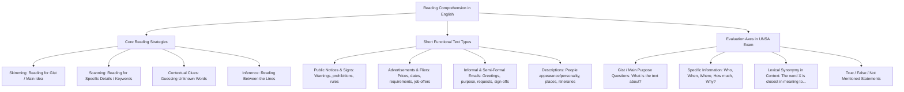

## 1. COURSE OVERVIEW & CONCEPTUAL FRAMEWORK
## 1. PORTADA Y METADATOS CURRICULARES

| Campo | Detalle |
| :--- | :--- |
| **Eje Temático** | Eje 07: Idioma Extranjero (Inglés) |
| **Materia** | Lectura y Comprensión de Textos en Inglés (A2 - B1 CEFR) |
| **Nivel de Dificultad** | Preuniversitario Avanzado (UNSA / CEPRUNSA) |
| **Tiempo de Estudio Recomendado** | 4.0 horas |
| **Resolución Curricular** | R.C.U. N.° 0028-2026 (Admisión 2027) |
| **Prerrequisitos** | Vocabulario básico en lengua inglesa, nociones de lectura global |
| **Objetivo Pedagógico** | Dominar las técnicas de lectura rápida (*Skimming* para la idea principal y *Scanning* para información puntual); reconocer tipologías textuales funcionales (notices, job advertisements, emails, personal profiles, brochures); e inferir significados contextuales con exactitud rigurosa para el examen de admisión UNSA. |

---

## 2. MAPA CONCEPTUAL SINTÉTICO (MERMAID)

---

## 2. FORMAL THEORETICAL FOUNDATIONS - PART I
## 3. FUNDAMENTACIÓN TEÓRICA RIGUROSA

### 3.1. Estrategias Cognitivas de Lectura en Inglés

#### A. Skimming (Lectura Veloz para la Idea Global / Gist)
- **Definición:** Técnica de lectura superficial rápida para captar la idea central, el propósito comunicativo o el tono general del texto sin detenerse en cada palabra.
- **Protocolo de Ejecución:**
  1. Leer el **título**, subtítulos y encabezados.
  2. Leer minuciosamente la **primera oración de cada párrafo** (*topic sentence*).
  3. Identificar palabras clave repetidas (*keywords*) y cognados verdaderos.
  4. Leer la oración de cierre o conclusión.
- **Preguntas Típicas en Admisión:**
  - *What is the main topic of the text?*
  - *What is the author's primary purpose?* (To inform, persuade, invite, warn).
  - *What is the best title for this passage?*

#### B. Scanning (Lectura de Barrido para Datos Específicos)
- **Definición:** Búsqueda rápida de una información puntual (fechas, cifras numéricas, nombres propios, lugares, horarios o requisitos específicos) sin leer el resto del contenido.
- **Protocolo de Ejecución:**
  1. Identificar en la pregunta la **palabra clave de búsqueda** (e.g., *price, deadline, salary, London, Dr. Harrison*).
  2. Desplazar la mirada en zig-zag sobre el texto buscando únicamente esa palabra o sus sinónimos directos.
  3. Una vez localizada la palabra clave, leer con detenimiento la oración completa circundante.
- **Preguntas Típicas en Admisión:**
  - *According to the text, when will the event take place?*
  - *How much does a student ticket cost?*
  - *Who is eligible for the discount?*

#### C. Context Clues (Deducción por Contexto)
Deducción del significado de términos desconocidos mediante:
1. *Sinonimia o paráfrasis en el texto:* *The manager was furious; he was extremely angry about the delay.*
2. *Contraste / Antónimos:* *Unlike his brother who was very cautious, Peter was reckless.*
3. *Causa y Efecto:* *Due to torrential rains, the flight was delayed.*

---

## 3. GRAMMAR PATTERNS & STRUCTURE TAXONOMY
## 4. FÓRMULAS, TAXONOMÍAS Y LEYES FUNDAMENTALES

### 4.1. Cuadro de Preguntas Clave y Estrategia de Resolución

\begin{array}{|l|l|l|}
\hline
\textbf{Tipo de Pregunta} & \textbf{Pregunta Modelo en Examen} & \textbf{Estrategia Cognitiva} \\ \hline
