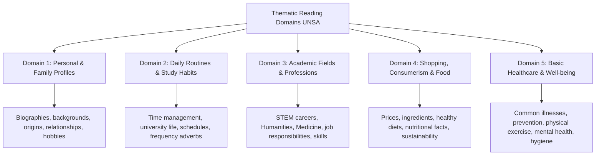

## 1. COURSE OVERVIEW & CONCEPTUAL FRAMEWORK
## 1. PORTADA Y METADATOS CURRICULARES

| Campo | Detalle |
| :--- | :--- |
| **Eje Temático** | Eje 07: Idioma Extranjero (Inglés) |
| **Materia** | Lectura y Comprensión Temática (A2 - B1 CEFR) |
| **Nivel de Dificultad** | Preuniversitario Avanzado (UNSA / CEPRUNSA) |
| **Tiempo de Estudio Recomendado** | 4.0 horas |
| **Resolución Curricular** | R.C.U. N.° 0028-2026 (Admisión 2027) |
| **Prerrequisitos** | Estrategias de Lectura: Skimming & Scanning (Tema 01) |
| **Objetivo Pedagógico** | Interpretar textos informativos, descriptivos y expositivos breves centrados en los 5 ejes temáticos obligatorios del prospecto de admisión UNSA: datos personales y perfiles familiares, rutinas de vida y hábitos de estudio, carreras y profesiones universitarias, compras y alimentos balanceados, y prevención en salud básica y bienestar físico. |

---

## 2. MAPA CONCEPTUAL SINTÉTICO (MERMAID)

---

## 2. FORMAL THEORETICAL FOUNDATIONS - PART I
## 3. FUNDAMENTACIÓN TEÓRICA RIGUROSA

### 3.1. Ejes Temáticos del Prospecto UNSA y su Vocabulario Clave

#### Eje 1: Personal & Family Information (Perfiles Personales y Familiares)
- **Campos Léxicos:** *Origin, nationality, marital status, siblings, relatives, upbringing, personal background, leisure activities, personality traits (reliable, ambitious, easy-going, conscientious).*
- **Estructuras Textuales Típicas:** Textos autobiográficos breves, perfiles de postulantes a becas internacionales, entrevistas de presentación.

#### Eje 2: Daily Routines and Academic Life (Rutinas y Vida Universitaria)
- **Campos Léxicos:** *Schedule, commute, attend lectures, submit assignments, revise notes, cram for exams, library resources, campus facilities, extracurricular activities.*
- **Phrasal Verbs Clave:**
  - *Wake up / Get up:* Despertar / Levantarse de la cama.
  - *Head to:* Dirigirse hacia (*He heads to campus at 7:00 AM*).
  - *Catch up on:* Ponerse al día con los estudios (*catching up on readings*).
  - *Drop out:* Abandonar los estudios (*drop out of university*).
  - *Hand in / Turn in:* Entregar trabajos académicos (*hand in the lab report*).

#### Eje 3: Studies, University Careers and Occupations (Carreras y Profesiones)
- **Campos Léxicos:** *Undergraduate degree, syllabus, major, internship, tuition fees, faculty, career prospects, vocational training, engineering, biomedical sciences, law.*

## 3. GRAMMAR PATTERNS & STRUCTURE TAXONOMY
## 4. FÓRMULAS, TAXONOMÍAS Y LEYES FUNDAMENTALES

### 4.1. Cuadro de Conectores Discursivos en Textos Temáticos

\begin{array}{|l|l|l|}
\hline
\textbf{Función Textual} & \textbf{Conectores en Inglés} & \textbf{Significado y Uso} \\ \hline
