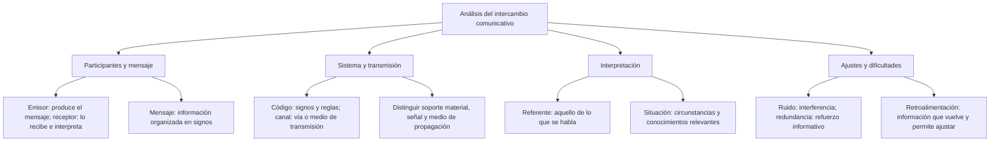

# El Circuito Comunicativo: Fases, Elementos y Fenómenos Interferentes

Cuando una profesora explica una tarea y un estudiante pregunta qué debe entregar, se produce un intercambio de mensajes. Para analizarlo conviene distinguir quién participa, qué signos utiliza, por qué medio se transmite la señal y en qué situación se interpreta. Estas distinciones ayudan a describir el caso; no convierten la comunicación en un mecanismo sin ambigüedades.

En esta lección se separa **referente**, aquello de lo que se habla, de **situación comunicativa**, las circunstancias del intercambio. Otros modelos usan contexto con un alcance más amplio e incluyen en él el referente. Al resolver una pregunta, identifica la distinción que establece el caso antes de contar elementos de memoria.

## Mapa para organizar el análisis

El mapa agrupa conceptos. Sus ramas no representan el recorrido físico de una señal ni etapas que deban suceder siempre una después de otra.

## 1.1.1 — Comunicación, codificación y fases

### Elaborar e interpretar un mensaje

La comunicación humana comprende intercambios de información mediante signos e interpretación en una situación. Muchos mensajes se producen con una intención reconocible: informar, pedir, explicar o expresar una emoción. Sin embargo, también podemos interpretar una conducta que alguien no realizó para comunicarnos algo. Por eso no se debe afirmar que toda información que recibimos fue enviada deliberadamente.

**Codificar**, también llamado encodificar en algunos materiales, es seleccionar y organizar signos para elaborar un mensaje. Ana quiere avisar que la biblioteca cerrará a las seis y elige esas palabras. **Decodificar** es reconocer e interpretar los signos recibidos: Luis lee el aviso y relaciona las palabras con su significado.

Interpretar no consiste en recuperar mecánicamente la intención exacta de otra persona. El lector puede reconocer todas las palabras y aun así desconocer a qué biblioteca se refiere el aviso. La situación y los conocimientos disponibles intervienen en esa interpretación. Tampoco es necesario que todos los signos sean palabras: una señal acordada con la mano puede comunicar una instrucción.

### Las fases como modelo de estudio

El modelo escolar distingue actividades psíquicas, fisiológicas y físicas. Sirve para identificar qué aspecto se describe en un ejemplo. **No es una secuencia rígida para toda forma de comunicación**: en una conversación escuchamos, interpretamos y preparamos una respuesta con procesos que pueden solaparse.

| Fase | Qué se analiza | Ejemplo acotado |
|---|---|---|
| Psíquica | Elaboración e interpretación del mensaje | Elegir mentalmente las palabras de un aviso o interpretar una frase leída |
| Fisiológica | Actividad corporal que participa en emitir o percibir | Movimientos de articulación al hablar o participación del sistema auditivo al escuchar |
| Física | Señales, soportes y propagación por un medio | Ondas sonoras que se propagan por el aire |

Si una pregunta describe la **selección mental de palabras**, corresponde a la codificación en la fase psíquica del emisor. Si describe movimientos de la lengua y los labios al pronunciarlas, se centra en la actividad fisiológica. Si describe ondas que llegan al interlocutor por el aire, se centra en el aspecto físico.

Las palabras psíquica y fisiológica separan perspectivas de análisis, no una mente independiente del cuerpo. Tampoco todas las personas utilizan los mismos órganos o modalidades: la comunicación puede ser oral, escrita, visual, táctil o apoyada por tecnología. Una dificultad auditiva no significa incapacidad para comunicarse mediante otras vías.

## 1.1.2 — Emisor, receptor, mensaje y código

### Los participantes y sus papeles

El **emisor** produce un mensaje en el intercambio que estamos analizando. El **receptor** lo recibe e interpreta. En una conversación, los papeles se alternan: quien acaba de escuchar puede hacer una pregunta y convertirse en emisor. En un texto escrito, autor y lector pueden estar separados en el tiempo; no se requiere una respuesta inmediata para analizar el mensaje.

El destinatario previsto no coincide necesariamente con toda persona que recibe la señal. Una profesora dirige una instrucción a su grupo y alguien que pasa por el corredor puede oírla. Si la pregunta pide el destinatario, no basta con mencionar cualquier persona que pudo escuchar. Hay que comprobar a quién se dirige el mensaje en el caso.

El **mensaje** es la información organizada en signos que se transmite. En «La biblioteca cerrará a las seis», el aviso informa sobre un cierre y una hora. El mensaje no se identifica con el papel donde está escrito ni con toda la lengua española. El papel es soporte; la lengua proporciona recursos para construir muchos mensajes diferentes.

### El código compartido y sus límites

El **código** es un sistema de signos y reglas que permite elaborar e interpretar mensajes. El español y el quechua son lenguas con recursos para ello. Las señales convencionales también pueden formar sistemas, pero no hay que atribuirles automáticamente las mismas propiedades que a una lengua.

Compartir suficientemente el código facilita reconocer el mensaje. **No garantiza comprenderlo todo**: dos hablantes de español pueden desconocer un término especializado o interpretar de manera distinta una instrucción ambigua. Conocer las palabras tampoco prueba que el mensaje sea verdadero o que el receptor esté de acuerdo.

Considera a Ana, que solo comprende quechua, y Ken, que solo comprende japonés. Si intentan intercambiar instrucciones exclusivamente habladas en esas lenguas, sin traducción ni otros apoyos compartidos, el problema principal para comprender las palabras es la falta de un código lingüístico común para ese intercambio. Ambos pueden hablar y oírse; el medio físico no tiene por qué fallar.

La restricción del ejemplo es importante: **no implica que dos personas de distintas lenguas sean incapaces de comunicarse**. Pueden recurrir a traducción, dibujos, gestos o recursos acordados. Esos apoyos cambian las condiciones del caso. No se debe concluir «comprensión nula en cualquier situación» a partir de una dificultad lingüística delimitada.

## 1.1.3 — Canal, soporte, señal, referente y situación

### Separar lo material del sistema de signos

El **canal** es la vía o medio por el que se transmite un mensaje. En ejemplos escolares puede nombrarse como aire, carta, teléfono o medio escrito, según el grado de detalle del análisis. Para evitar respuestas ambiguas, distingue lo que pide exactamente la consigna.

| Concepto | Qué identifica | Caso de un aviso |
|---|---|---|
| Código | Sistema de signos y reglas | La lengua española del aviso |
| Soporte | Material donde se conserva la inscripción | El papel con marcas impresas |
| Señal | Manifestación física que porta información | La señal acústica al leer el aviso en voz alta |
| Medio de propagación | Material o entorno por el que se propaga la señal | El aire por el que llegan las ondas sonoras |

**En un libro impreso**, el papel es el soporte material de las marcas escritas. Puede llamarse canal escrito en un análisis general, mientras otro análisis distingue la vía visual de lectura. Por eso una pregunta precisa dirá «soporte material escrito» si espera papel como respuesta. La lengua de la novela sigue siendo código; el tema de la novela no es su soporte.

**En una conversación oral cara a cara**, el aire es el medio por el que se propaga la señal acústica. Las ondas sonoras no son el aire: son la señal que se propaga en ese medio. El oído participa en la recepción corporal y las reglas del español pertenecen al código. Esos papeles no se intercambian porque todos intervengan en una misma conversación.

**En un teléfono**, no conviene responder siempre «cable» ni siempre «ondas» sin conocer el caso. El recorrido depende de la tecnología y puede incluir distintos tramos. Para esta lección basta con reconocer que el dispositivo o la red no son el idioma utilizado. Si el problema exige identificar un medio físico concreto, debe describir ese tramo de transmisión.

### Referente y situación comunicativa

El **referente** es la realidad, entidad, hecho o tema al que alude el mensaje. Puede tratarse de algo real, imaginado o abstracto. En «La biblioteca cerrará a las seis», se alude al cierre de una biblioteca a una hora. No debemos confundir esa realidad aludida con las palabras que la expresan.

La **situación comunicativa** incluye circunstancias relevantes del intercambio: quiénes participan, cuándo y dónde ocurre, qué están haciendo y qué conocimientos comparten. En esta lección se usa contexto para esa información cuando se contrasta con referente. No todos los modelos separan los términos de la misma forma; lo importante es conservar la distinción en el caso analizado.

Una profesora dice «ahora» al comenzar una actividad el lunes y lo repite al comenzar otra el martes. La palabra conserva su forma, pero cada uso se interpreta con relación a su momento de emisión. El contexto temporal permite identificar el momento aludido. No hace falta suponer un cambio de idioma ni que los sonidos sean distintos.

El contexto **orienta** la interpretación, pero no resuelve necesariamente toda duda. Si alguien dice «déjalo ahí» y no sabemos qué objeto señala ni qué lugar indica, la frase puede seguir siendo ambigua. Se necesita información adicional. Un buen análisis distingue lo que el caso permite concluir de lo que habría que preguntar.

### Un caso descompuesto

La encargada escribe en una hoja «La biblioteca cerrará a las seis» y la coloca en la entrada para los lectores.

- **Emisor:** la encargada que elabora el aviso en el caso descrito.
- **Destinatarios previstos:** los lectores que acuden a la biblioteca.
- **Mensaje:** la información del cierre y su hora.
- **Código:** el español utilizado para redactarlo.
- **Soporte material:** la hoja con las marcas escritas.
- **Referente:** el hecho del cierre de esa biblioteca a la hora señalada.
- **Situación:** el aviso colocado en esa entrada y las circunstancias en que se consulta.

Estos elementos pertenecen al mismo análisis. Si una persona fotografía el aviso y lo envía por una aplicación, aparece otro acto de transmisión, con otros participantes inmediatos y otro soporte de consulta. No se debe mezclar el primer aviso y el reenvío como si fueran un único caso sin cambios.

## 1.1.4 — Ruido, redundancia y retroalimentación

### Ruido: interferir en un mensaje

El **ruido** es una perturbación que dificulta recibir o interpretar un mensaje. Puede ser físico o técnico, como un zumbido que tapa palabras o una imagen distorsionada. En un uso más amplio del modelo se incluyen dificultades semánticas o de atención. Conviene indicar el tipo en vez de llamar ruido físico a cualquier malentendido.

Durante una clase, el proyector produce un zumbido que impide oír algunas palabras del profesor. Ese zumbido es ruido físico **en relación con la explicación oral**. No transmite la instrucción ni refuerza sus datos. Se clasifica por su efecto sobre ese mensaje.

El ruido no tiene que ser involuntario. Si una persona produce un sonido deliberadamente para impedir que se oiga a otra, sigue interfiriendo en el mensaje de esta última. Tampoco cualquier sonido ambiental es ruido para el análisis: si no dificulta el intercambio descrito, falta justificar esa clasificación.

### Redundancia: reforzar información

La **redundancia** aporta información reiterada que puede ayudar a recuperar un mensaje cuando parte de él se pierde o resulta poco clara. Por ejemplo, tras una interferencia, alguien repite «a las seis, seis de la tarde». La reiteración permite reconocer mejor la hora. Una reformulación también puede explicar de otro modo un dato.

No toda repetición es útil y no toda redundancia requiere una decisión consciente de repetir. Algunas regularidades del propio lenguaje aportan información previsible. En los ejercicios de esta lección se analizan sobre todo refuerzos deliberados, porque el caso permite identificar qué hace la persona y para qué.

La redundancia puede contrarrestar efectos del ruido, **sin garantizar comprensión ni recuerdo**. Repetir una expresión desconocida quizá no aclare su significado; reformularla puede ser más adecuado. Añadir demasiada información también puede dificultar seguir la explicación. La función se evalúa en el contexto, no por la cantidad de palabras.

### Retroalimentación: información para ajustar el intercambio

La **retroalimentación** es información que vuelve al interlocutor sobre la recepción o interpretación de su mensaje y permite ajustar el intercambio. Puede manifestarse como una pregunta, una respuesta verbal o un gesto. En la conversación puede aparecer mientras la otra persona habla, no únicamente después de que termine toda la explicación.

Después de una instrucción, una estudiante pregunta «¿Debo entregar solo el primer ejercicio?». La profesora reconoce una duda y precisa qué debe entregarse. La pregunta funciona como retroalimentación porque aporta información para ajustar la instrucción. No se confunde con la interpretación interna y no observable de la estudiante.

Un asentimiento puede indicar atención, acuerdo o una señal para que la otra persona continúe. **No demuestra por sí solo comprensión completa**. Para comprobar un aspecto concreto puede pedirse al estudiante que explique con sus palabras qué hará. Su respuesta aporta más información sobre ese aspecto, aunque tampoco permite conocer todos sus pensamientos.

### Comparar los tres fenómenos

| Caso | Clasificación pertinente | Lo que permite concluir |
|---|---|---|
| El zumbido tapa la hora que se anuncia | Ruido físico | Hay una interferencia en la recepción de ese dato |
| La persona repite la hora y la aclara | Redundancia deliberada | Intenta reforzar información; el éxito debe comprobarse |
| El oyente pregunta si se trata de la tarde | Retroalimentación | Expresa una duda que permite precisar el aviso |

Ruido, redundancia y retroalimentación no son tres participantes adicionales. Son fenómenos o procesos que pueden intervenir en el intercambio. Por eso no conviene sumarlos a una lista de personas, signos y medios y anunciar un número universal de elementos sin aclarar el modelo empleado.

## Importante

**Compartir código no garantiza comprender; recibir una reacción no prueba comprensión completa.** El contexto ayuda a interpretar y la redundancia puede reforzar el mensaje, pero ambos tienen límites. Distingue siempre el sistema de signos, la señal y el medio que la transporta. Usa los datos de la consigna y evita completar el caso con intenciones o resultados que no se han descrito.

## Cómo analizar una situación

1. **Delimita el intercambio.** Decide si se analiza el aviso original, una lectura en voz alta o un reenvío posterior.
2. **Identifica los papeles.** Señala quién produce ese mensaje y a quién está dirigido. No confundas destinatario previsto con cualquier oyente accidental.
3. **Separa sistema y transmisión.** Reconoce código, soporte y medio si el caso permite hacerlo. No supongas la tecnología de una llamada.
4. **Relaciona mensaje y situación.** Distingue aquello de lo que se habla de las circunstancias que ayudan a interpretarlo.
5. **Comprueba dificultades y ajustes.** Busca una interferencia, un refuerzo o una respuesta observable. Explica qué efecto está descrito y cuál no puede asegurarse.

Por ejemplo, una profesora elige mentalmente una frase, la pronuncia y un alumno pide que repita la hora porque un zumbido la tapó. Elegir palabras es codificación; pronunciarlas implica actividad corporal; el aire permite que se propague la señal. El zumbido es ruido para esa frase, la petición aporta retroalimentación y la repetición puede funcionar como redundancia. Cada clasificación se apoya en una acción distinta del caso.

## Para repasar

La codificación elabora un mensaje y la decodificación interpreta sus signos. Emisor y receptor son papeles que pueden alternarse. El código organiza los signos; el canal permite la transmisión, y las preguntas más precisas distinguen soporte, medio y señal. El referente es aquello de lo que se habla y la situación aporta circunstancias de interpretación. El ruido dificulta, la redundancia puede reforzar y la retroalimentación ofrece información para ajustar. Ninguno de estos recursos garantiza por sí solo entender correctamente todo lo que otra persona quiso comunicar.
