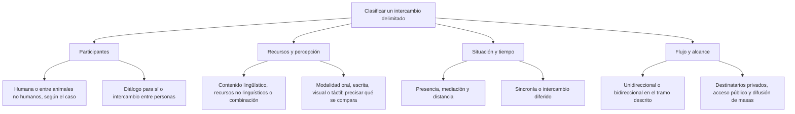

# Tipología de la Comunicación: Clasificación y Criterios

Una conversación puede ser interpersonal, presencial y bidireccional al mismo tiempo. Estas palabras no compiten: responden a criterios distintos. Interpersonal indica quiénes participan; presencial señala que comparten un lugar; bidireccional describe que se envían mensajes en ambos sentidos.

Antes de clasificar, **delimita el intercambio**. En un debate televisado no es lo mismo analizar a los candidatos que se responden en el estudio que la transmisión hacia quienes lo ven desde casa. El programa contiene relaciones diferentes; una etiqueta aplicada a una no se extiende automáticamente a todas las demás.

## Mapa de criterios

El mapa organiza preguntas de análisis. No describe etapas ni una jerarquía de valor entre formas de comunicación.

## 1.2.1 — Participantes, recursos lingüísticos y modalidad

### Quiénes participan

La clasificación **humana o no humana** atiende aquí a los participantes del caso. Una persona que activa una sirena para advertir su presencia utiliza un dispositivo en un intercambio humano. El aparato no convierte la señal en comunicación entre animales. En cambio, una señal que una abeja melífera proporciona a otras abejas pertenece a un caso de comunicación entre animales no humanos.

Esta distinción no dice por sí sola si hay sonidos, movimientos o señales químicas. Tampoco demuestra que toda conducta animal sea exclusivamente innata ni que carezca de aprendizaje. Son cuestiones diferentes que requieren evidencia específica. Para resolver la pregunta sobre las abejas de este nivel basta con identificar los participantes y la función informativa descrita; no se necesita afirmar que todos los animales actúan del mismo modo.

### Lingüístico y no lingüístico

La comunicación **lingüística** utiliza una lengua o representa contenido de ella. Una conversación en español y una oración escrita en español son ejemplos. En algunos materiales escolares se usa verbal como equivalente de lingüístico, pero conviene definir ese uso: no debe entenderse como una restricción a sonidos producidos por la voz.

La comunicación **no lingüística** emplea señales que, en el caso analizado, no constituyen expresiones de una lengua. Una sirena convencional sin palabras, la luz roja aislada de un semáforo o un guiño acordado para indicar un turno son ejemplos. Sonido no significa necesariamente habla, y una señal visual no es necesariamente ajena a las lenguas.

Un mismo mensaje puede combinar recursos. Un cartel con una frase, una fotografía y colores contiene texto lingüístico y recursos gráficos. Decir que el cartel es visual describe su percepción; no elimina el texto. En una conversación pueden acompañar a las palabras los gestos y la postura. La clasificación debe admitir la combinación cuando el caso la describe.

### Braille: lengua representada y lectura táctil

El **braille es un sistema de lectoescritura**, no una lengua independiente. Cuando una oración en español se transcribe a braille, sigue representando contenido lingüístico en español. El lector puede acceder a ella mediante el tacto. Por eso, en ese caso, la descripción adecuada es **comunicación lingüística escrita con lectura táctil**.

No se debe concluir que todo lo táctil es no lingüístico. Esa conclusión confunde el sentido por el que se accede a la información con el contenido representado. Un apretón de manos convenido y una oración en braille pueden percibirse mediante el tacto y, aun así, no pertenecer a la misma categoría lingüística.

También debe precisarse el contenido: el braille permite representar letras y otros signos. No hace falta clasificar cualquier inscripción braille imaginable como una oración. La pregunta de este nivel especifica que se lee una oración en español; esa condición permite justificar su carácter lingüístico.

### Lenguas de señas y gestos aislados

Las **lenguas de señas son lenguas**. No deben confundirse con una colección de gestos aislados sin organización lingüística. La modalidad visual o manual no basta para decidir si un mensaje es lingüístico. Tampoco existe una única lengua de señas universal compartida de manera automática por todas las personas sordas.

En cambio, el guiño de la práctica está delimitado: dos compañeros acuerdan que un guiño aislado significa «es tu turno» en un juego, sin palabras y sin usar una lengua de señas. En ese caso se analiza un gesto facial no lingüístico. La conclusión se refiere al gesto descrito, no a todos los movimientos de manos o rostro.

### Comparar sin mezclar criterios

| Caso delimitado | Recurso o contenido | Percepción relevante |
|---|---|---|
| Una frase pronunciada en español | Lingüístico oral | Auditiva en el caso descrito |
| Una oración en español transcrita a braille | Lingüístico escrito | Táctil en la lectura descrita |
| Una sirena convencional sin palabras | No lingüístico acústico | Auditiva |
| Luz roja aislada de un semáforo | No lingüístico cromático | Visual |
| Guiño aislado acordado en un juego | No lingüístico gestual | Visual |
| Cartel con frase e imagen | Combinación de texto y recursos gráficos | Visual |

La palabra acústico describe un recurso sonoro; gestual describe un movimiento significativo; cromático destaca el uso del color. No son todos criterios equivalentes y excluyentes. Un gesto puede ser visual, y una palabra oral puede ser acústica y lingüística a la vez. Indica el criterio que pide la pregunta en lugar de buscar una sola etiqueta absoluta.

La proxémica estudia el uso comunicativo de la distancia y del espacio interpersonal. No permite atribuir automáticamente rechazo, confianza o autoridad a una distancia concreta sin conocer el contexto. La ubicación de dos personas es un dato; la interpretación de su relación requiere más información.

## 1.2.2 — Diálogo interior, relación entre personas y situación

### Intrapersonal e interpersonal

En el modelo que incluye el **diálogo interior** como comunicación, se llama intrapersonal al mensaje que una persona formula para sí. Un estudiante se dice mentalmente «primero leeré las opciones». Se describe una formulación para sí, sin un segundo interlocutor externo. No se concluye que cualquier recuerdo, sensación o actividad mental sea necesariamente un acto comunicativo.

La comunicación **interpersonal** se produce entre personas distintas. Puede ocurrir cara a cara o a distancia. Una llamada entre familiares es interpersonal aunque no estén en la misma habitación. Leer una carta personal tampoco se convierte en intrapersonal porque el lector se encuentre solo: la carta fue escrita por otra persona y está dirigida a él.

El criterio debe aplicarse al intercambio, no al número de personas visibles en una fotografía. Alguien que habla por teléfono puede estar solo en su cuarto y participar en una conversación interpersonal. Una persona ante una audiencia puede dirigirse a ella o estar ensayando para sí; hace falta describir qué está haciendo.

### Presencia y mediación

La comunicación **presencial** ocurre entre participantes que comparten un lugar en el momento del intercambio. Una conversación cara a cara es el ejemplo de este nivel. La comunicación **mediada** utiliza un soporte o dispositivo que interviene en el intercambio, como una carta o una videollamada.

En clasificaciones escolares se llama directa a la comunicación presencial e indirecta a la realizada a distancia o mediante soportes. Los términos pueden variar según el modelo, por lo que aquí se prefiere describir los hechos: comparten el estudio, leen una carta enviada o conversan mediante una llamada. No se usa indirecta como sinónimo de comunicación deficiente o menos auténtica.

Presencia y mediación no son opuestos perfectos en todos los casos. Una conferencia puede ser presencial y utilizar micrófono y pantalla. Si el problema pregunta por copresencia, ese es el criterio; si pregunta por tecnología, analiza el recurso indicado. No debe forzarse una única categoría cuando dos descripciones pueden coexistir.

### Sincronía y asincronía

La comunicación **sincrónica** se desarrolla con participación temporalmente coincidente, como una llamada en la que las personas conversan. La **asincrónica** es diferida: el mensaje se produce y se recibe en momentos separados, como una carta que se lee tres días después. La distancia espacial y la diferencia temporal son aspectos distintos.

| Caso | Situación espacial o mediación | Tiempo de intercambio |
|---|---|---|
| Dos personas conversan en el mismo salón | Presencial | Sincrónico |
| Dos familiares conversan por videollamada | Mediado a distancia | Sincrónico |
| Una joven envía una carta que se lee días después | Mediado a distancia | Asincrónico |
| Una persona deja una nota que otra lee más tarde en el mismo escritorio | Mediado por un soporte | Asincrónico |

La nota del escritorio muestra por qué no debe reducirse la asincronía a vivir en distintas provincias. Dos personas pueden usar el mismo lugar en momentos diferentes. La videollamada muestra la relación inversa: la separación geográfica no impide participar simultáneamente.

## 1.2.3 — Dirección del flujo y alcance

### Unidireccional y bidireccional

Un flujo es **unidireccional** en el tramo analizado cuando los mensajes van de una parte a otra sin retorno descrito en ese tramo. Durante unas noticias de radio, la emisora transmite y los oyentes no intervienen. Esa emisión se clasifica como unidireccional. El término no significa que los oyentes carezcan de actividad mental: pueden interpretar, evaluar y discrepar.

El intercambio es **bidireccional** cuando hay mensajes en ambos sentidos. Dos personas que se preguntan y responden por teléfono intercambian sus papeles de emisor y receptor. También puede haber intercambio bidireccional diferido: alguien envía una carta y recibe una respuesta días después. **La demora no equivale a ausencia de retorno**.

La clasificación depende del alcance temporal que se esté analizando. La emisión original de una carta va en un sentido. Si el caso incluye la respuesta posterior, puede analizarse el intercambio completo en ambos sentidos. No se debe clasificar toda carta como unilateral para siempre ni suponer una respuesta que la consigna no menciona.

En el debate de la práctica se especifica que dos candidatos están en el mismo estudio y se responden por turnos. El intercambio entre ellos es interpersonal, presencial y bidireccional. La transmisión televisiva hacia la audiencia constituye otro tramo: quienes miran desde casa no están presentes en el estudio y el enunciado no dice que intervengan. Delimitar el caso evita respuestas incompatibles entre sí.

### Privado, público y de masas

Un mensaje **privado**, según el criterio de destinatarios empleado aquí, se dirige a una persona o grupo delimitado. Una carta personal a un abuelo es el ejemplo. Esto no garantiza confidencialidad técnica ni que otra persona nunca pueda leerla. El destinatario previsto y la protección efectiva del mensaje son asuntos diferentes.

Un mensaje **público** se ofrece a una audiencia abierta o a quienes acceden al espacio o medio donde se publica. No necesita alcanzar millones de personas para ser público. Un aviso abierto en un pequeño local puede ser público y tener pocos lectores. Una **difusión de masas** se dirige a una audiencia amplia mediante medios preparados para ese alcance; no es sinónimo obligatorio de cualquier mensaje público.

Tampoco el número de receptores determina por sí solo la privacidad. Una reunión cerrada con muchas personas puede tener destinatarios delimitados; un anuncio abierto a cualquier visitante puede ser público aunque en ese momento lo lea una sola persona. La consigna debe indicar condiciones de acceso y destinatarios, en lugar de pedir que se adivinen.

### El cartel como caso combinado

Una empresa coloca un cartel con texto e imagen junto a una carretera para quienes pasan. En la emisión del cartel hacia sus lectores, sin otro medio de retorno descrito, el flujo es unidireccional. Es público porque está dirigido abiertamente a quienes lo consultan y está mediado por un soporte. No es intrapersonal porque cada lector lo mire individualmente.

Si alguien llama después al anunciante, aparece una respuesta mediante otro medio. El análisis puede ampliarse, pero esa posibilidad no debe inventarse al resolver el caso inicial. Del mismo modo, si un anuncio incluye un código para responder y el caso describe su uso, habrá que tomarlo en cuenta en vez de repetir una clasificación memorizada.

## Importante

**Separa participantes, contenido, percepción, situación, tiempo, flujo y destinatarios.** Un texto en braille no pierde su carácter lingüístico por leerse con el tacto. Una conversación a distancia puede ser sincrónica y bidireccional. Un mensaje público no tiene que ser masivo. Clasifica el intercambio que realmente se describe, sin añadir respuestas, intenciones o participantes que faltan en la consigna.

## Procedimiento con un ejemplo

Una joven escribe a su abuelo, que vive en otra provincia; él lee la carta tres días después y responde a la semana.

1. **Participantes:** son personas distintas; el intercambio es interpersonal.
2. **Contenido y vía:** si escribe una carta en español, hay contenido lingüístico escrito. No se vuelve no lingüístico por usar papel.
3. **Situación:** existe mediación mediante el soporte y separación espacial.
4. **Tiempo:** la lectura y la respuesta son diferidas; el intercambio es asincrónico.
5. **Flujo:** la primera emisión va en un sentido; el intercambio completo descrito incluye mensajes en ambos sentidos.
6. **Destinatario:** la carta personal se dirige al abuelo; no es pública por viajar a otra provincia.

Para cambiar la clasificación hay que cambiar un dato pertinente. Si el abuelo no responde en el caso, no afirmes que hubo retorno. Si conversan por teléfono, cambia la situación temporal. Si la joven publica abiertamente el mismo texto en un mural, cambia el acceso al mensaje. Tener un contenido parecido no hace idénticos los intercambios.

## Comprobación final

- Un sonido convencional puede ser no lingüístico: no todo sonido es habla.
- Un texto puede leerse mediante el tacto: no toda lectura es visual.
- Una lengua de señas es una lengua: no todo movimiento visible es un gesto no lingüístico.
- Estar solo en una habitación no convierte una llamada en diálogo interior.
- La distancia no implica necesariamente demora, y la demora no implica ausencia de respuesta.
- Recibir una emisión unidireccional no vuelve mentalmente pasivo al receptor.
- Lo público se distingue por acceso y destinatarios; no por una cifra mínima universal de lectores.

La clasificación debe permitir explicar el caso con precisión. Si los datos no permiten decidir una dimensión, reconoce lo que falta en lugar de asignar una etiqueta por costumbre.
