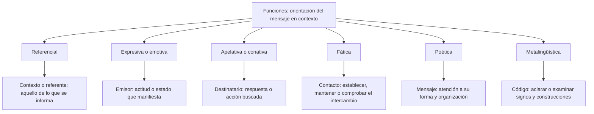

# Planos del Lenguaje y las Seis Funciones del Lenguaje (Bühler y Jakobson)

Una misma frase puede informar, expresar una actitud y pedir una respuesta. Para estudiar las funciones del lenguaje hay que atender a la situación y a la orientación que se destaca. Una pregunta no es siempre apelativa, una exclamación no es siempre expresiva y una metáfora no convierte automáticamente todo el mensaje en predominantemente poético.

Este nivel distingue primero lenguaje, lengua y habla. Después compara el modelo de tres funciones de Bühler con el de seis funciones de Jakobson. Son herramientas de análisis: **identificar una función no prueba que el mensaje sea verdadero, que se haya comprendido o que produzca el efecto buscado**.

## Mapa de las seis funciones

Las ramas relacionan cada función con su orientación en el modelo de Jakobson. No representan etapas ni funciones que se excluyan mutuamente.

## 1.3.1 — Lenguaje, lengua y habla

### Una facultad, un sistema y una realización

En la distinción que se estudia aquí, **lenguaje** nombra la facultad humana relacionada con las lenguas y su uso. **Lengua** designa un sistema social de signos compartido por una comunidad. **Habla** se refiere a la realización individual concreta en la distinción saussureana. No son tres objetos separados que funcionen sin relación: una emisión particular utiliza recursos del sistema y depende de capacidades del hablante.

| Concepto | Perspectiva de análisis | Ejemplo propio |
|---|---|---|
| Lenguaje | Facultad relacionada con la adquisición y el uso de lenguas | La capacidad que permite adquirir y utilizar una lengua |
| Lengua | Sistema social de signos y relaciones | El español como sistema compartido, con sus variedades |
| Habla | Realización individual concreta | Una persona dice una frase determinada en una conversación |

Social no significa idéntico en todos los miembros de una comunidad. Hay variación entre hablantes y situaciones, y las lenguas cambian históricamente. Llamar sistema a la lengua no obliga a describirla como casi fija o a establecer una velocidad universal de cambio. Tampoco un acto de habla es un movimiento corporal sin organización o una actividad ajena a las reglas compartidas.

La distinción es analítica: un texto puede estudiar el sistema aunque nadie pronuncie una frase en ese momento, y una conversación permite observar usos particulares. Decir que el habla es concreta no significa que una grabación de ella no pueda conservarse. El acto ocurre en un momento; su registro puede permanecer y reproducirse después.

El lenguaje humano no se reduce a producir voz. Las lenguas de señas también son lenguas. No debe usarse la descripción clásica de una realización oral para concluir que las personas que se comunican por una lengua de señas carecen de lengua o de lenguaje. En los ejemplos fonológicos de este nivel se trabaja específicamente con el español oral.

## 1.3.2 — Bühler y las orientaciones representativa, expresiva y apelativa

El modelo de **Karl Bühler** distingue representación, expresión y apelación. En las denominaciones escolares se habla de función representativa, expresiva y apelativa. El modelo de **Roman Jakobson** reúne seis funciones, relacionadas con seis factores de la comunicación. No se debe presentar a Jakobson como autor de un modelo compuesto únicamente por las otras tres.

La correspondencia entre modelos ayuda a estudiar sus orientaciones, pero no exige tratarlos como una única teoría sin diferencias. Para resolver las preguntas de esta lección se usa el cuadro de seis funciones de Jakobson y se reconoce la distinción histórica con Bühler.

### Referencial o representativa

La función referencial orienta el mensaje hacia aquello de lo que se habla. En un informe ficticio se escribe «La biblioteca abre a las nueve» para comunicar un horario. Si el propósito descrito es informar de ese horario, se destaca la función referencial. No hay que inventar una emoción, una orden o una intención estética que el caso no menciona.

**Orientación informativa no equivale a verdad comprobada.** Un dato incorrecto puede estar formulado con intención de informar. Determinar si el horario es real requiere otra verificación. La función tampoco garantiza neutralidad: el mensaje puede seleccionar información o incorporar valoraciones. En casos complejos puede coexistir con una orientación persuasiva o expresiva.

Una cifra o una fórmula no bastan para clasificar de manera automática. Si una persona cita un horario para quejarse de él, hay que analizar la situación completa. La presencia de un dato no borra otras orientaciones. La pregunta debe aportar suficiente contexto cuando solicita una función predominante.

### Expresiva o emotiva

La función expresiva se orienta hacia la actitud o el estado que manifiesta el emisor. Una persona recibe una buena noticia y dice «¡Qué alegría siento!». Si el caso destaca esa manifestación, predomina la función expresiva. No necesita ser una emoción extrema ni carecer de elaboración verbal.

Las exclamaciones pueden ser una pista, pero no son una prueba suficiente. «¡Cierra la puerta!» puede ser un pedido enfático dirigido al destinatario. «Me alegra que hayas venido», sin signos de exclamación, también puede manifestar alegría. Se identifica la orientación del mensaje en contexto, no una marca tipográfica aislada.

El lenguaje puede manifestar una actitud sin permitir medir con certeza el estado interior real de quien habla. Una frase irónica o una actuación no se interpretan igual que una manifestación espontánea descrita en el caso. El análisis debe distinguir la expresión que se presenta de una afirmación psicológica no comprobada.

### Apelativa o conativa

La función apelativa se orienta al destinatario y a una respuesta o acción esperada. «Por favor, cierra la ventana» solicita una acción. Un ruego, una invitación o una petición cortés también pueden tener esa orientación: no se limita a órdenes autoritarias ni exige un imperativo.

«¿Puedes cerrar la ventana?» puede funcionar como petición en una situación donde la otra persona puede realizar esa acción. Su forma interrogativa no elimina la orientación apelativa. Sin embargo, una pregunta citada como ejemplo gramatical se analiza de otro modo. La forma por sí sola no sustituye el contexto.

**Buscar una acción no demuestra lograrla.** La encargada puede pedir que se guarden mochilas y los destinatarios pueden desobedecer. La clasificación describe el pedido, no su resultado. Del mismo modo, un mensaje puede intentar persuadir sin que se pruebe un cambio de opinión.

## 1.3.3 — Contacto, forma del mensaje y código

### Fática o de contacto

La función fática se orienta a establecer, mantener, comprobar o cerrar el contacto. Al iniciar una llamada, Ana pregunta «¿Aló? ¿Me escuchas?» para comprobar si puede continuar. En esa situación se destaca la función fática, aunque la pregunta solicite también una respuesta.

El contacto no se reduce al estado físico de un cable o aparato. Puede incluir mantener la atención del interlocutor o sostener socialmente un intercambio. Expresiones como un saludo pueden cumplir esa función según la situación. No todos los saludos ni todos los usos de «sí» o «ajá» tienen automáticamente la misma orientación dominante.

Distingue **contacto y comprensión**. Que la persona responda que escucha no demuestra que entienda un término técnico del mensaje. En una conversación, «¿sigues ahí?» puede comprobar la continuidad del contacto, mientras «¿qué significa esa palabra?» se orienta a aclarar el código. Ambas preguntas pueden contribuir al intercambio, pero enfocan aspectos distintos.

### Poética: atención a la forma

La función poética orienta la atención hacia la organización del mensaje: selección y combinación de palabras, repeticiones, ritmo, paralelismos u otros recursos. No significa necesariamente belleza agradable ni se limita a poesía escrita. Puede intervenir en un juego verbal o en un eslogan, junto con otras funciones.

En un ejercicio propio se compone «La luna lava la loma». La consigna pide destacar la repetición de sonidos y la organización de las palabras por encima de informar un hecho. Con ese propósito se pone en primer plano la función poética. El ejemplo no se atribuye a un escritor ni se presenta como una descripción real de la luna.

La presencia de una metáfora no resuelve por sí sola el predominio. Un mensaje puede usar una comparación figurada para pedir ayuda, expresar tristeza o convencer. Hay que explicar por qué en ese caso la atención a la forma se destaca sobre las demás orientaciones. Tampoco un texto deja de expresar emoción porque tenga ritmo o figuras.

Un poema puede combinar funciones. Cuando un ejercicio pide analizar su forma, debe dar pistas suficientes; cuando pide identificar un propósito concreto en un contexto, no basta con contestar «poética porque es un verso». Se retira ese atajo para no confundir género del texto con clasificación obligatoria de cada fragmento.

### Metalingüística: hablar del código

La función metalingüística se orienta al código: permite explicar significados, analizar construcciones o aclarar cómo se utiliza una palabra. En clase se dice «En Ana leyó el cuento, el grupo el cuento funciona como complemento directo». Lo que se está explicando es una construcción lingüística, de modo que se destaca esa función.

El contenido explicado debe ser correcto. No es apropiado enseñar una regla falsa solo porque sirve de ejemplo de una función. La afirmación «todos los verbos transitivos exigen siempre un objeto directo expreso» es demasiado absoluta. Hay usos sin ese complemento escrito o pronunciado, como «Ana ya comió», donde no se especifica qué comió. Esto no elimina la distinción entre usos y construcciones transitivas e intransitivas.

También se puede analizar la escritura de una palabra: «Árbol es una palabra llana y lleva tilde por terminar en l». La sílaba tónica es la penúltima, ár; la palabra termina en una consonante distinta de n o s, por lo que sigue la regla general de tildación de llanas en ese caso. El ejemplo explica una palabra y su escritura; no informa de las características de un árbol real.

No toda definición es metalingüística por el simple hecho de ser una definición. Hay que observar si se está explicando el significado o uso de un signo o si se describen objetos, procesos o conceptos con otro propósito. «¿Qué quieres decir con reserva?» pide aclarar el uso de una palabra; «la reserva abre a las nueve» puede informar de un lugar. El término aislado no decide la función.

### Cuadro de contraste

| Función | Orientación destacada | Caso delimitado |
|---|---|---|
| Referencial | Contexto o referente | Un informe comunica el horario de una biblioteca ficticia |
| Expresiva | Emisor | Una persona manifiesta su alegría al recibir una noticia |
| Apelativa | Destinatario | Se le pide que cierre una ventana |
| Fática | Contacto | Se comprueba si la otra persona sigue en línea |
| Poética | Forma del mensaje | Un ejercicio destaca repetición sonora y organización verbal |
| Metalingüística | Código | Se analiza la acentuación o la construcción de una oración |

El cuadro orienta el análisis, no establece exclusividad. Las funciones pueden coexistir. El predominio se justifica con la información disponible; si un fragmento aislado admite varias lecturas, no se inventa una intención para forzar una respuesta única.

## 1.3.4 — Martinet y Chomsky: aportes que no deben mezclarse

### Doble articulación

La **doble articulación**, asociada con André Martinet, distingue unidades significativas en un nivel y unidades distintivas sin significado propio en otro. En su terminología, la primera articulación utiliza monemas; la segunda, fonemas. La idea se refiere a organización lingüística, no a mover la boca dos veces ni a leer dos idiomas.

Un ejemplo oral sencillo ayuda: «pan» es una unidad con significado y puede analizarse fonológicamente en /p/, /a/ y /n/. Esos fonemas no aportan cada uno una parte del significado de pan, pero participan en diferencias entre palabras. No deben confundirse con letras: las letras pertenecen a la representación escrita y la relación entre escritura y pronunciación no es siempre una a una.

Separar una palabra en sílabas tampoco equivale a explicar la doble articulación. Las sílabas organizan secuencias sonoras; la oposición que se estudia aquí es entre unidades significativas y unidades distintivas. No todas las palabras son necesariamente una sola unidad significativa: existen formas con más de un componente morfológico. El ejemplo pan sirve por su sencillez, no como regla para cualquier palabra.

### Una propuesta innatista

Noam Chomsky se asocia con la propuesta generativista de una base innata para la facultad del lenguaje. Aquí se presenta como **una posición teórica**, no como una afirmación de que todas las cuestiones sobre adquisición estén resueltas o de que exista consenso sobre cada aspecto de esa propuesta.

Innatismo no significa nacer hablando un idioma particular. Tampoco elimina la experiencia lingüística, la interacción o las condiciones de adquisición. No es correcto afirmar que vivir en una ciudad determina por sí solo una única lengua que la persona conocerá: puede haber entornos bilingües, lenguas familiares y trayectorias diferentes.

Evita añadir que toda la facultad es inmutable o que una teoría permite localizar un idioma completo inscrito genéticamente. Para responder la pregunta de autoría de este nivel basta con relacionar a Chomsky con la propuesta innatista generativista, sin convertir esa relación en una prueba biológica de afirmaciones más amplias.

| Autor | Aporte identificado en este nivel | Precaución |
|---|---|---|
| Saussure | Distinción entre sistema de lengua y realización de habla | Social no equivale a inmutable |
| Bühler | Representación, expresión y apelación | Su modelo distingue tres funciones |
| Jakobson | Modelo de seis funciones | No se reduce a las otras tres funciones del cuadro |
| Martinet | Doble articulación | No confundir fonemas con letras o sílabas |
| Chomsky | Propuesta innatista del enfoque generativista | No implica un idioma completo al nacer |

## Importante

**Las marcas formales son pistas, no respuestas automáticas.** Una exclamación puede pedir una acción, una interrogación puede comprobar el contacto y una metáfora puede acompañar una intención persuasiva. Determina qué se destaca en el caso y distingue esa orientación del resultado obtenido. Informar no certifica verdad; pedir no garantiza obediencia; comprobar contacto no demuestra comprensión.

## Procedimiento de análisis

1. **Delimita el caso:** quién habla, a quién y en qué situación. Comprueba si la oración se está usando o citando para analizarla.
2. **Reconoce lo que el caso destaca:** informar, manifestar actitud, pedir una acción, establecer contacto, atender a la forma o explicar el código.
3. **Relaciona orientación y factor:** referente, emisor, destinatario, contacto, mensaje o código según el modelo de seis funciones.
4. **Comprueba las otras posibilidades:** explica por qué no predominan en el caso, sin afirmar que desaparecen.
5. **Separa función y verificación:** no deduzcas verdad, comprensión, estado psicológico exacto o efecto logrado solo por la etiqueta.

Una profesora dice primero «¿Me escuchan?» para comprobar contacto y después «Guarden sus mochilas» para pedir una acción. En el primer tramo destaca la función fática y en el segundo la apelativa. Si luego pregunta qué significa una palabra, aparece una orientación metalingüística. El intercambio completo puede cambiar de orientación sin que el idioma o el lugar cambien.

Para comparar otro caso, considera «cierra» como pedido frente a «cierra es una forma del verbo cerrar» como explicación. La presencia de la misma palabra no obliga a dar la misma respuesta. Lo decisivo es si se pide una acción o si se analiza la forma lingüística. Así se justifica una clasificación sin recurrir a listas de palabras que prometen acertar en cualquier contexto.
