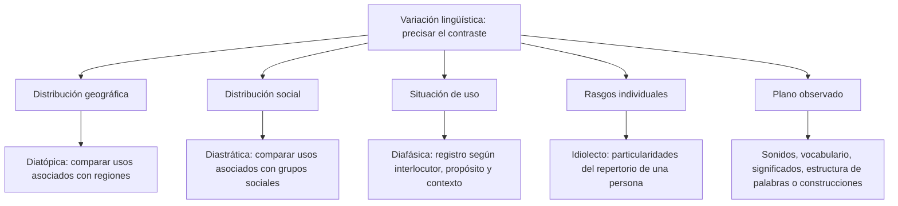

# Las Variaciones de la Lengua: Dialecto, Sociolecto e Idiolecto

Las personas no utilizan todos los recursos de una lengua de la misma manera. Hay diferencias asociadas con las regiones, los grupos sociales, las situaciones y las trayectorias individuales. Para estudiarlas conviene distinguir **qué factor organiza la comparación** y **qué aspecto de la lengua se está comparando**.

No es lo mismo preguntar si dos formas se distribuyen en regiones distintas que preguntar si cambian sonidos, significados o construcciones. El primer análisis atiende al factor geográfico; el segundo identifica un plano lingüístico. Ambos pueden aplicarse al mismo caso sin convertirse en la misma pregunta.

## Mapa de dimensiones

Las ramas organizan perspectivas que pueden combinarse. No son niveles de superioridad ni compartimentos que clasifiquen de manera definitiva a cada persona.

## 2.1.1 — Variación geográfica y planos de análisis

La variación **diatópica** se relaciona con la distribución geográfica de rasgos de una lengua. Un estudio puede comparar vocabulario o pronunciación entre regiones. Llamar dialectal a una variedad no significa considerarla un error ni una forma incompleta. El español, como otras lenguas, tiene diversidad interna.

Un estudio ficticio compara palabras para nombrar un mismo objeto en dos regiones, manteniendo semejantes las situaciones de uso. El factor que se destaca es geográfico y el plano observado es léxico. El caso no demuestra que todos los habitantes de cada región usen siempre una palabra ni que las diferencias sean exclusivas de esas zonas.

**Mencionar un lugar no convierte cualquier diferencia en geográfica.** Si Ana está en Arequipa y cambia su explicación según el interlocutor, puede estar variando el registro, no el dialecto. Para atribuir una diferencia a distribución regional se requieren datos pertinentes, no solo un topónimo en el enunciado.

### Cinco planos para comparar rasgos

| Plano | Qué se compara | Ejemplo delimitado |
|---|---|---|
| Fonético | Realización de sonidos | Dos maneras de pronunciar un sonido en datos de habla |
| Léxico | Elección de vocabulario | Palabras distintas para nombrar un mismo objeto |
| Semántico | Interpretación o significado | Una forma usada con sentidos diferentes |
| Morfológico | Estructura de las palabras | Elección de un sufijo diminutivo |
| Sintáctico | Organización y relación de unidades | Formas de construir una expresión de posesión |

Los planos se separan para estudiar un contraste concreto; no siempre existen fronteras absolutas entre fenómenos. Una diferencia de vocabulario puede implicar también una diferencia de significado. La pregunta debe aclarar qué se está observando si las opciones se refieren a planos distintos.

### Significados de guagua

En los usos especificados por el ejercicio, guagua se refiere a un bebé en un contexto andino y a un autobús en un contexto canario. Al comparar **qué significa esa forma**, se destaca el plano semántico. El uso canario relacionado con transporte colectivo está registrado en la Academia Canaria de la Lengua.

No se concluye que todo el territorio andino o canario use siempre esa forma con un único sentido. Tampoco la coincidencia escrita permite deducir una sola etimología. La historia de una palabra y su significado en un caso concreto son preguntas diferentes. Para esta práctica basta con explicar la diferencia de interpretación descrita.

### Morfología y sintaxis

En **momentito y momentico** se puede comparar la elección de -ito e -ico para formar diminutivos. Ese contraste atiende al plano morfológico. No se necesita atribuir cada forma a un país ni afirmar que una región utiliza exclusivamente una de ellas. El ejercicio deliberadamente no exige una distribución regional no documentada.

En **la chacra de Pedro** y **de Pedro su chacra**, el análisis propuesto se centra en cómo se organizan las unidades del grupo nominal y se expresa la posesión. Corresponde al plano sintáctico. El ejemplo de construcción no documenta por sí mismo su frecuencia o ubicación: no se usa para presentar a toda una región como un conjunto de hablantes idénticos.

Del mismo modo, una pronunciación escrita de manera aproximada no demuestra cómo habla una población entera. Conviene evitar caricaturas ortográficas para representar acentos si no se dispone de una transcripción y un propósito claros. Describir un fenómeno requiere identificar el rasgo concreto que se compara.

## 2.1.2 — Variación social, norma y adecuación

La variación **diastrática** se relaciona con usos asociados con grupos sociales de una comunidad. Una investigación puede estudiar diferencias vinculadas con redes sociales, generaciones, trayectorias educativas u otros factores. Las asociaciones se establecen con datos; no autorizan a deducir con certeza el grupo de una persona por una palabra aislada.

La edad puede estudiarse como un factor social o generacional, pero no es equivalente a idiolecto. La profesión puede estar relacionada con el acceso a vocabulario especializado, pero una palabra técnica no demuestra que quien la utiliza ejerza esa profesión. Una persona puede aprenderla, citarla o usarla en un contexto particular.

### Norma de referencia y valoración de las personas

Una **norma de referencia** orienta elecciones en determinados ámbitos, por ejemplo la escritura formal. Se puede corregir una forma para ajustarla a esa norma sin convertir la corrección en un juicio sobre inteligencia, valor personal o identidad cultural. No hay que confundir «se prefiere esta forma en el texto formal» con «quien usa otra forma es inferior».

En la revisión del ejercicio se cambia «Espero que haiga tiempo» por «Espero que haya tiempo». El caso usa el subjuntivo de haber y la escritura formal elige **haya**. Esa decisión no permite conocer los años de escolaridad del autor, su inteligencia ni el origen regional. La misma secuencia haiga puede aparecer además como palabra citada o con otros usos léxicos; por eso la oración concreta es necesaria para identificar qué se está corrigiendo.

El registro coloquial tampoco equivale a incorrección. Las conversaciones cotidianas pueden emplear vocabulario informal y respetar las construcciones habituales de la lengua. Un texto formal puede estar mal organizado o contener errores. Formalidad, corrección normativa y claridad son dimensiones relacionadas, pero no idénticas.

### Etiquetas tradicionales de nivel

Algunos esquemas escolares utilizan superestándar, estándar y subestándar para agrupar usos según prestigio o cercanía a una norma. Es necesario reconocer que se trata de **una clasificación tradicional con criterios valorativos**, no de una escala universal de calidad de las variedades o de las personas.

No se enseña que toda investigación filosófica o toda literatura pertenezca a una forma superior del idioma. Una obra puede incluir registros coloquiales, voces regionales y recursos diversos. Tampoco se deduce que una palabra coloquial sea necesariamente carcelaria ni que cualquier forma no estándar pruebe falta de instrucción.

| Distinción | Qué permite analizar | Qué no permite concluir por sí sola |
|---|---|---|
| Norma de escritura | Elección esperada en un ámbito definido | Inteligencia o biografía del autor |
| Registro formal o informal | Adecuación a la situación | Superioridad de una persona |
| Léxico de un grupo | Usos documentados y asociaciones de contexto | Pertenencia inequívoca por una palabra |
| Variedad regional | Distribución de rasgos | Capacidad de aprender o razonar |

### Jerga, argot y palabras coloquiales

Jerga y argot pueden designar usos de grupos o ámbitos; las delimitaciones dependen del contexto y de la tradición terminológica. No se debe equiparar cualquier jerga con delincuencia. Un grupo profesional, juvenil o de otra clase puede compartir vocabulario que no sea exclusivo de él.

En el ejercicio se menciona un uso coloquial de **luca**. La conclusión prudente es que esa palabra aislada no prueba profesión, estudios ni pertenencia delictiva. Para conocer el sentido preciso y la distribución de un término se consulta un diccionario y el contexto. Una marca de uso del diccionario describe usos; no funciona como un diagnóstico de identidad.

La extensión de palabras entre grupos también cambia con el tiempo. Un término que tuvo un uso restringido puede circular después en otros ámbitos. Por eso no se debe afirmar que una lista de tres palabras permite identificar de modo seguro el origen social de cualquier persona.

## 2.1.3 — Registro, tecnolecto e idiolecto

### Registro o variación diafásica

La variación **diafásica** se relaciona con la situación de uso. El registro puede variar según interlocutores, propósito, tema y medio del intercambio. Ana explica un resultado con términos especializados ante personas que conocen el tema y lo reformula para alguien que no lo conoce. El contraste se centra en la adaptación situacional.

No se concluye que Ana haya cambiado de lengua, región o identidad. Está utilizando recursos de su repertorio según las necesidades del intercambio. La adecuación se evalúa por cómo ayuda a comunicar lo que se necesita en esa situación, no por cuántas palabras difíciles aparezcan.

Formal e informal no son dos únicas cajas sin gradaciones. Un mensaje puede combinar una estructura cuidada con un saludo cercano. Un correo dirigido a una institución puede ser escrito y formal, pero la escritura no obliga por sí sola a la formalidad. Una conversación oral también puede ser formal. Hay que considerar datos concretos del caso.

### Léxico especializado o tecnolecto

El **léxico especializado**, llamado tecnolecto en ciertos materiales, se vincula con una disciplina o ámbito. En geometría, bisectriz y mediatriz se usan con sentidos definidos. El nivel utiliza esos términos únicamente para identificar especialización, no para enseñar aquí sus propiedades matemáticas.

Un especialista puede adaptar su explicación a interlocutores distintos. Usar un término especializado no convierte el mensaje en idiolecto ni demuestra que solo los profesionales puedan entenderlo. Un estudiante puede aprenderlo y una persona puede citarlo. La especialización del vocabulario y el conocimiento real del hablante deben distinguirse.

### Idiolecto: particularidades de un individuo

El **idiolecto** reúne rasgos propios de la forma de expresarse de una persona. No es sinónimo de registro diafásico. En un análisis individual pueden observarse preferencias de vocabulario, giros recurrentes o maneras habituales de organizar lo que se dice; su descripción necesita más evidencia que una emisión aislada.

Una persona posee un repertorio que cambia según situaciones. Por eso idiolecto y registro pueden relacionarse sin ser lo mismo. La comparación entre dos situaciones de Ana destaca variación diafásica; estudiar patrones particulares de Ana frente a otros hablantes pone el foco en rasgos individuales. La pregunta determina qué comparación se pretende hacer.

Tampoco edad, profesión o género equivalen automáticamente a idiolecto. Son factores que pueden estudiarse en distribuciones sociales o situaciones de uso, y las personas de una misma categoría no hablan todas igual. No se utilizan estereotipos como sustitutos de una descripción lingüística.

## 2.1.4 — Combinar perspectivas sin forzar etiquetas

Un mismo uso puede reflejar región, redes sociales, situación y trayectoria individual. No es necesario decidir que uno de esos factores manda siempre sobre los otros. Si una consigna pretende una respuesta única, debe indicar el contraste: entre regiones, entre grupos, entre situaciones del mismo hablante o entre rasgos individuales.

| Factor destacado | Pregunta de análisis | Término empleado |
|---|---|---|
| Distribución territorial | ¿Se comparan usos entre regiones? | Diatópico |
| Distribución social | ¿Se comparan usos asociados con grupos? | Diastrático |
| Situación comunicativa | ¿Cambia el uso según propósito o interlocutor? | Diafásico o de registro |
| Rasgos particulares | ¿Se estudian patrones propios de un individuo? | Idiolectal |

Un ejemplo ficticio muestra el procedimiento. Ana conversa con una amiga y después presenta una exposición. En la segunda intervención explica los términos y organiza la información de otra manera. Si se comparan esas dos situaciones, el foco está en registro. Si otra investigación compara datos de varias regiones, su foco puede ser geográfico. Estar estudiando a la misma persona no hace idénticos ambos análisis.

Los planos también se combinan con estos factores. Una investigación regional puede comparar sonidos y otra puede comparar vocabulario. Una adaptación de registro puede cambiar términos y construcciones. Identificar el factor no sustituye el análisis de qué unidades cambian.

## Importante

**Una palabra aislada no permite deducir identidad, inteligencia, escolaridad o pertenencia delictiva.** Idiolecto y registro no son equivalentes. Una norma puede orientar una corrección formal sin convertir las variedades en una escala de valor personal. Describe el rasgo y justifica el factor con datos del caso.

## Cómo resolver los contrastes

1. Identifica qué compara la consigna: personas, grupos, regiones o situaciones.
2. Separa el factor de distribución del plano lingüístico observado.
3. Comprueba si el ejemplo proporciona contexto suficiente para decidir el sentido de una forma.
4. Evita atribuir distribuciones regionales que el caso no documenta.
5. No conviertas una asociación de uso en una certeza sobre la biografía del hablante.

En momentito y momentico se pide comparar sufijos: el foco es morfológico. En guagua se comparan los sentidos especificados: el foco es semántico. En la explicación que Ana adapta al interlocutor se compara registro. En el estudio de patrones particulares de una persona se describe idiolecto. Cada respuesta explica el contraste planteado; ninguna autoriza conclusiones sobre el valor de quienes hablan.

## Variedad situacional y origen latino del español

La variedad situacional o registro cambia según propósito, relación entre participantes, canal y contexto. Una misma persona puede usar un registro formal en una exposición e informal con amistades; esto no implica que hable dos idiomas diferentes. Dialecto se relaciona con variación territorial, sociolecto con grupos sociales e idiolecto con rasgos personales.

El español procede principalmente del latín hablado, transformado históricamente en la península ibérica. El contacto con otras lenguas aportó vocabulario y usos. Su origen latino no significa que el español actual tenga la misma gramática ni que todas sus palabras provengan del latín. Adecuar un registro consiste en elegir recursos apropiados al intercambio, sin considerar inferior una variedad por la identidad de sus hablantes.
