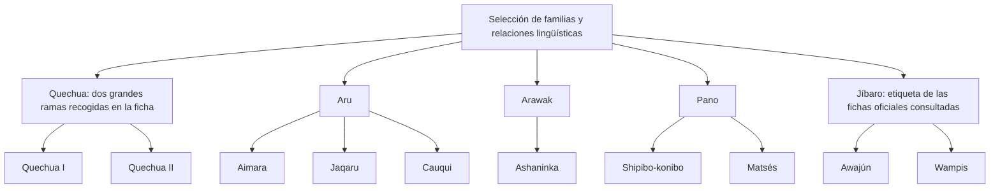

# Realidad Lingüística del Perú: Multilingüismo, Lenguas Amerindias y Castellano

El Perú es multilingüe: en él se utilizan el castellano, lenguas indígenas u originarias y otras lenguas. Para describir esa realidad hay que separar **lengua, familia, variedad, territorio y población**. Una lista de lenguas no cuenta hablantes, y una referencia territorial no encierra a sus hablantes dentro de un departamento.

Este nivel utiliza las fichas y la lista de la Base de Datos de Pueblos Indígenas u Originarios del Ministerio de Cultura consultadas para la revisión. Los datos administrativos pueden actualizarse; los censos y estudios tienen una fecha y una población de referencia. No deben combinarse cifras de fuentes diferentes como si fueran una fotografía exacta del presente.

## 2.2.1 — Lenguas, familias y variedades quechuas

### Qué se está clasificando

Una **familia lingüística** agrupa lenguas o variedades por parentesco histórico, no por superioridad ni por compartir obligatoriamente un departamento. La cercanía geográfica puede relacionarse con contacto, pero no demuestra por sí sola parentesco. Tampoco pertenecer a una familia garantiza que todos sus hablantes se comprendan sin aprendizaje.

La palabra quechua puede emplearse como denominación general en registros y censos. La ficha oficial explica, a la vez, su diversidad como familia de variedades. Por eso una cifra bajo el rótulo quechua no demuestra que todas las personas contadas utilicen una variedad idéntica. El nivel distingue el uso administrativo del nombre y la diversidad lingüística que abarca.

### Quechua I, quechua II y agrupaciones de variedades

La ficha del quechua recoge, según la terminología de Torero, dos grandes ramas: **quechua I y quechua II**. Sitúa la primera en la zona central del país y la segunda en zonas del norte y del sur. Es una clasificación general de variedades, no una división entre formas mejores y peores.

También presenta agrupaciones geográficas como quechua amazónico, norteño, central y sureño en la información del Ministerio de Educación. Esas agrupaciones sirven para organizar variedades y no deben mezclarse sin explicación con el nivel de clasificación de dos ramas. Una misma tabla puede emplear un criterio de organización diferente de otra.

En la tabla de variedades se sitúan **Chanka y Collao en quechua sureño**. Entre las referencias territoriales de Chanka se mencionan Ayacucho, Huancavelica y determinadas zonas de Apurímac; para Collao se mencionan, entre otras, Cusco y Puno. No se deduce que cada departamento corresponda de manera exclusiva a una sola variedad ni que las fronteras administrativas coincidan con fronteras lingüísticas exactas.

| Denominación del caso | Qué permite identificar | Límite de la conclusión |
|---|---|---|
| Quechua I y II | Dos grandes ramas en la clasificación recogida | No demuestra una jerarquía de calidad |
| Quechua central | Agrupación geográfica de variedades | No equivale a todos los habitantes de la zona central |
| Quechua sureño | Agrupación donde se sitúan Chanka y Collao | No hace idénticas todas las variedades incluidas |
| Quechua en un registro de población | Una categoría utilizada por esa fuente | No prueba homogeneidad ni dominio de todas las variedades |

No se presenta un único punto de origen del protoquechua como hecho definitivamente demostrado por una clasificación. Reconstruir una historia lingüística y clasificar variedades son tareas relacionadas, pero distintas. Para las preguntas de este nivel basta reconocer qué clasificación utiliza la fuente y cuál es la relación que documenta.

Tampoco se usa arcaico como sinónimo de inferior, inmóvil o incapaz de expresar realidades actuales. Las lenguas y variedades cambian; la conservación de un rasgo en una variedad no permite afirmar que toda ella permanezca detenida en el tiempo.

## 2.2.2 — Familias y referencias territoriales

### Árbol de relaciones verificadas

El esquema siguiente es **clasificatorio, no geográfico**. Las ramas indican las relaciones seleccionadas para este nivel. No muestran distancias, rutas de migración, cantidad de hablantes ni una posición de prestigio. Tampoco incluyen todas las lenguas del país.

### Aru y jaqaru

La ficha del **jaqaru** lo sitúa en la familia Aru, junto con aimara y cauqui. Algunos materiales utilizan la grafía jacaru; aquí se prioriza la denominación de la ficha consultada. La referencia territorial del ejercicio es la provincia de **Yauyos, departamento de Lima**, con localidades de los distritos de Tupe y Catahuasi.

El dato se refiere a localidades documentadas y no permite afirmar que todos los hablantes vivan únicamente allí. Tampoco es correcto ubicar automáticamente cualquier lengua de Aru en Puno: familia y departamento responden a preguntas distintas. Un parentesco histórico no sustituye conocer la distribución territorial de una lengua concreta.

### Arawak, Pano y Jíbaro

La ficha del **ashaninka** lo ubica en Arawak. Las de **shipibo-konibo y matsés** los ubican en Pano. Las de **awajún y wampis** emplean la etiqueta familiar Jíbaro. Se conserva esa etiqueta cuando se pregunta por la clasificación de la fuente, sin reemplazar con ella los nombres propios de los pueblos y de sus lenguas.

Pertenecer a una misma familia no implica tener idéntica distribución ni la misma situación de uso. Las referencias de shipibo-konibo y matsés no son intercambiables por compartir Pano. Del mismo modo, un nombre familiar no permite deducir de forma automática población, vitalidad o grado de comprensión mutua.

En esta lección no se fija el orden «ashaninka, shipibo-konibo, awajún» como una regla demográfica. Las fichas consultadas no respaldan ese orden para sus datos de lengua materna. Si se compara población, hay que indicar fuente, fecha y qué se cuenta. Un recurso para memorizar no puede sustituir esa comprobación.

### La lista de lenguas y la Amazonía

La lista del Ministerio de Cultura consultada registra **48 lenguas originarias**, con cuatro de referencia andina y 44 amazónicas. En ese inventario hay más lenguas de referencia amazónica. La conclusión es sobre lenguas de una lista, no sobre cuántas familias existen ni cuántas personas viven en cada región.

Una lengua de referencia amazónica también puede utilizarse en una ciudad de la costa o en otro departamento por migración y otros procesos. La etiqueta no significa que sus hablantes estén ausentes de ámbitos urbanos. Tampoco las cuatro referencias andinas implican que solo cuatro comunidades hablen lenguas originarias en los Andes.

Los recuentos dependen de criterios de identificación y de actualización. Esta lección no convierte los nombres del inventario en una taxonomía inmutable. Para una pregunta concreta se utiliza la lista indicada; si una fuente futura modifica el inventario, habrá que revisar los datos relacionados en vez de memorizar una cifra sin procedencia.

## 2.2.3 — Variedades del castellano y contacto de lenguas

El castellano del Perú presenta diversidad regional, social, situacional e individual. En ciertos estudios se distinguen conjuntos costeños o ribereños, andinos y amazónicos. Son denominaciones de análisis, no tres modos uniformes de hablar que clasifiquen de manera rígida a toda persona.

No se describe un acento como neutro para todos ni se considera una variedad inherentemente más correcta que las demás. Una norma puede orientar una elección en escritura formal; eso no convierte una pronunciación regional en prueba de capacidad intelectual o de valor personal. La claridad de un mensaje debe evaluarse en su contexto.

### Sonidos y escritura

El plano **fonético** observa realizaciones de sonidos. Si una investigadora compara dos realizaciones sonoras en registros de habla, ese es el plano que está estudiando. Hace falta evidencia de pronunciación para describir la diferencia; una mayúscula en la escritura no proporciona esa evidencia.

«San Juan» y «san juan» muestran una diferencia de mayúsculas. No prueban por sí solos que una consonante se haya pronunciado de otro modo. Tampoco una grafía aproximada como jue por fue permite atribuir un rasgo a todos los habitantes de una región. Si se investiga un cambio articulatorio, se necesita una descripción o un registro apropiado.

El contacto entre lenguas puede relacionarse con rasgos de pronunciación, vocabulario o construcción. No es adecuado presentar una explicación causal única para todo el castellano de una región ni afirmar que una forma aparece necesariamente en cada persona bilingüe. Las trayectorias de aprendizaje y los usos son diversos.

### Inventarios vocálicos y aprendizaje

La práctica plantea un caso delimitado: una persona parte de una variedad con tres fonemas vocálicos y aprende otra lengua con cinco. La diferencia entre sistemas puede ser relevante para estudiar una posible influencia, pero **no determina cómo pronunciarán todos los aprendices** ni basta para explicar cualquier realización concreta.

Fonema no equivale a letra. Contar letras de un alfabeto y contar unidades distintivas de un sistema fonológico son tareas diferentes. También es necesario precisar la variedad y el análisis, en vez de convertir la denominación quechua en una afirmación uniforme sobre cualquier sistema o hablante que lleve ese nombre.

El término motoseo se ha utilizado para referirse a ciertos rasgos del castellano en contacto con lenguas andinas y puede tener carga estigmatizadora. No se utiliza aquí como diagnóstico de identidad ni como sinónimo de incapacidad. Su sola mención no demuestra que una persona confunda siempre dos vocales, ni que una realización particular tenga una causa exclusiva.

Las preguntas del nivel evitan etiquetar la pronunciación de toda una población. Evalúan una distinción observable —sonidos frente a escritura— y la prudencia al inferir causas de un caso de aprendizaje. Una descripción lingüística debe separar los datos, la hipótesis que los explica y lo que aún no se ha comprobado.

## 2.2.4 — Bilingüismo, diglosia y educación

### Dos conceptos que pueden coexistir

El **bilingüismo** se refiere, según el enfoque, al uso o conocimiento de dos lenguas por una persona o a su presencia en una comunidad. No exige que la persona utilice ambas con idéntico dominio en cualquier actividad. Tampoco implica por sí solo igualdad social o ausencia de discriminación.

La **diglosia** describe una distribución social de variedades o lenguas por ámbitos y funciones. La tradición del término distingue un sentido más estricto, referido a variedades de una lengua, y usos ampliados que incluyen lenguas diferentes. En esta práctica se explicita el sentido amplio para un caso con funciones y valoración social desiguales.

Bilingüismo y diglosia **pueden coexistir**. Que alguien use dos lenguas no permite saber, sin más información, cómo se distribuyen prestigio o acceso a servicios en su comunidad. Y una descripción social de distribución de usos no significa que cada individuo tenga exactamente el mismo repertorio.

En el caso ficticio del ejercicio, una lengua se reserva habitualmente para trámites de prestigio y otra para la vida familiar, con valoración desigual. Dentro del sentido anunciado, se analiza una situación diglósica. El ejemplo no afirma que cualquier uso familiar de una lengua pruebe discriminación ni que todos los ámbitos del país reproduzcan un mismo patrón.

### Educación Intercultural Bilingüe

La **Educación Intercultural Bilingüe (EIB)** es un servicio educativo con atención a la diversidad cultural y lingüística de poblaciones originarias. El modelo consultado distingue formas de **fortalecimiento**, **revitalización cultural y lingüística** y atención en **ámbitos urbanos**. Por eso no se reduce a una única situación donde todo estudiante tiene necesariamente una lengua originaria como primera lengua.

En el fortalecimiento se atiende un escenario en que la lengua originaria tiene un uso predominante. La revitalización considera escenarios de uso más reducido de esa lengua. Los ámbitos urbanos pueden presentar repertorios y contactos diversos. Estas distinciones ayudan a entender por qué la caracterización de una institución y de sus estudiantes es relevante.

Nombrar una política o un servicio no prueba que su implementación esté completa. La disponibilidad de docentes, materiales y atención efectiva requiere verificación en cada ámbito. No se promete que la EIB elimine de inmediato cualquier desigualdad ni que su nombre garantice que toda escuela concreta ya brinde una atención adecuada.

| Concepto | Qué se observa | Qué no se deduce automáticamente |
|---|---|---|
| Bilingüismo | Repertorios o usos de dos lenguas | Igual dominio en cualquier tarea o igualdad de prestigio |
| Diglosia en el caso amplio | Distribución social por funciones y valoración | Idéntica trayectoria de cada persona |
| EIB | Modelo y formas de atención educativa | Cobertura completa o resultados garantizados |

Este nivel no convierte una síntesis del marco educativo en asesoramiento jurídico ni añade afirmaciones de oficialidad sin revisar su norma y ámbito. Distinguir reconocimiento, derechos, diseño de un servicio y acceso efectivo evita confundir cuestiones diferentes.

## Cómo interpretar fuentes y cifras

| Si una fuente presenta… | Comprueba… | Evita concluir… |
|---|---|---|
| Una lista de lenguas | Criterio y fecha de actualización | Que son familias o cifras de hablantes |
| Una población por lengua materna | Fecha, edad y pregunta utilizadas | Que representa a toda persona que conoce esa lengua |
| Una ubicación territorial | Tipo de localidad y alcance del dato | Que nadie utiliza la lengua fuera de esa zona |
| Una agrupación de variedades | El nivel de la clasificación | Que todas las variedades son idénticas |
| Un servicio educativo | Forma de atención y escenario lingüístico | Que ya se implementa plenamente en cualquier escuela |

Por ejemplo, aprender a hablar en una lengua durante la niñez y conocerla como segunda lengua no son la misma variable. Una tabla que cuenta la primera no debe presentarse como censo completo de todas las personas capaces de usarla. Tampoco una cifra antigua debe anunciarse como conteo exacto actual sin actualización.

## Importante

**Familia, lengua, variedad, territorio y población responden a preguntas distintas.** La clasificación no establece superioridad. La ubicación no limita dónde pueden vivir los hablantes. Una diferencia de sonidos no prueba identidad ni capacidad. Para comparar números o explicar un fenómeno, identifica primero la fuente y el alcance de la evidencia.

## Procedimiento para los ejercicios

1. Determina si se pregunta por una familia, variedad, localización, cantidad o situación de uso.
2. Usa la relación documentada: jaqaru–Aru, ashaninka–Arawak, shipibo-konibo y matsés–Pano, awajún y wampis–Jíbaro.
3. Separa la clasificación de dos ramas quechuas de la tabla de agrupaciones geográficas y variedades concretas.
4. Si hay un dato numérico, comprueba qué cuenta; no sustituyas lenguas por familias o lengua materna por cualquier conocimiento lingüístico.
5. Si hay una explicación de pronunciación o de uso social, distingue el dato de una hipótesis y evita generalizar a toda una población.

El objetivo es reconocer relaciones claras sin convertirlas en etiquetas para las personas. Los mapas y tablas de esta lección sirven para comparar esas relaciones; no sustituyen una cartografía de distribución ni una investigación sobre cada comunidad.
