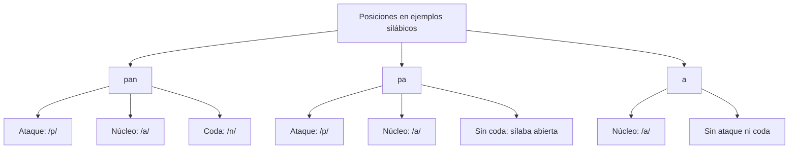

# Fonología, Fonética, Sistema Fonológico y Estructura Silábica

Para estudiar una palabra conviene separar lo que se escribe, lo que se pronuncia y las unidades que permiten distinguir palabras en una lengua. En queso hay cinco letras, pero qu funciona como dígrafo: no debe contarse cada letra como si representara necesariamente un fonema distinto.

Este nivel analiza relaciones entre unidades fónicas y escritura, la clasificación básica de las vocales y la estructura de la sílaba. Los ejemplos se delimitan para no confundir una descripción de una variedad con una regla universal para todas las pronunciaciones del español.

## 3.1.1 — Fonología, fonética y función distintiva

### Fonema y realización

La **fonología** estudia la organización y los contrastes del sistema fónico. Un **fonema** es una unidad segmental abstracta con función distintiva. En pala y bala, el contraste entre /p/ y /b/ permite diferenciar dos palabras. No significa que /p/ o /b/ tengan por sí mismos el significado de esas palabras.

La **fonética** estudia las realizaciones sonoras desde perspectivas como la producción articulatoria, las propiedades acústicas y la percepción. No se reduce a clasificar alófonos: también describe cómo se producen y perciben los sonidos. Una transcripción fonética ofrece información sobre una realización y debe precisar su grado de detalle.

Un **alófono** es una realización de un fonema que se distingue de otras realizaciones de esa misma unidad en el análisis empleado. No equivale a cualquier sonido diferente ni a una falta de pronunciación. Para identificar alofonía se necesita conocer cómo se relacionan las realizaciones con los contrastes de una variedad.

| Unidad o perspectiva | Qué se analiza | Distinción útil |
|---|---|---|
| Fonema | Contrastes en el sistema fónico | /p/ frente a /b/ en pala y bala |
| Realización fonética | Producción sonora concreta | El detalle de cómo se pronuncia un segmento |
| Alófono | Realización de un fonema en el análisis | No se identifica solo por ser diferente de otro sonido |
| Grafema o letra en estos ejemplos | Representación escrita | La c escrita de cama |
| Dígrafo | Dos letras que representan conjuntamente una unidad fónica | Qu en queso |

Se usan normalmente **barras** para representaciones fonológicas, como /p/, y **corchetes** para transcripciones fonéticas. Los símbolos requieren una convención: distintas obras pueden usar signos de transcripción diferentes. No se debe deducir una pronunciación únicamente por la apariencia de una letra fuera de su sistema de notación.

Tampoco hay que imaginar la fonología como una lista almacenada de forma literal en un lugar del cerebro o separar una mente sin cuerpo de una ejecución corporal sin organización. Se distinguen niveles de descripción; el modelo de unidades abstractas no es una demostración sobre una localización cerebral concreta.

### El par mínimo

Un **par mínimo** compara palabras que difieren por un segmento en un mismo entorno y permite mostrar un contraste. En masa y mesa cambia /a/ por /e/ en la misma posición. Las dos formas son palabras distintas y el cambio permite diferenciar sus significados. Es un ejemplo de función distintiva.

El procedimiento consiste en mantener las otras posiciones y observar el contraste. No se explica diciendo que la vocal /a/ significa masa y /e/ significa mesa. Las unidades significativas de otro nivel no se confunden con los fonemas que permiten construir y distinguir sus formas.

Dos palabras que se escriben distinto no constituyen automáticamente un par mínimo fónico. Debe comprobarse la pronunciación de la variedad que se analiza. Si dos grafías representan la misma unidad para un hablante, la diferencia escrita no demuestra por sí sola un contraste fonológico.

## 3.1.2 — Vocales y correspondencias gráficas

### Las cinco vocales del modelo básico

La descripción básica utilizada aquí distingue /a/, /e/, /i/, /o/ y /u/. Esta es una clasificación de **fonemas vocálicos**, no un total de letras ni un inventario de todas sus realizaciones posibles. Las vocales pueden describirse mediante dimensiones articulatorias como altura y posición anteroposterior.

| Altura | Anterior | Central | Posterior |
|---|---|---|---|
| Alta o cerrada | /i/ | — | /u/ |
| Media | /e/ | — | /o/ |
| Baja o abierta | — | /a/ | — |

La tabla organiza categorías del esquema básico; los espacios vacíos no significan sonidos imposibles en cualquier lengua. Alta y cerrada describen una posición relativa: no implican obstrucción total del paso del aire. /i/ y /u/ comparten altura alta, pero la primera se clasifica como anterior y la segunda como posterior.

Del mismo modo, /o/ y /u/ comparten posterioridad, pero no altura: /o/ es media y /u/ alta. Si la pregunta pide posición anteroposterior, se responde con esa dimensión. No se sustituye por apertura porque una misma vocal participe en ambas clasificaciones.

### Por qué no se fija un total universal de consonantes

El inventario consonántico debe relacionarse con la variedad y el análisis. El **seseo** y el **yeísmo** muestran que no todas las variedades conservan los mismos contrastes. Una cifra escolar de veinticuatro fonemas no debe anunciarse como número oficial único de todas las pronunciaciones del español.

En variedades seseantes no se establece el contraste que otras mantienen entre la pronunciación de s y la de z o c ante e, i. En variedades yeístas no se conserva la distinción de pronunciación entre ll e y que sí mantienen otros hablantes. La ortografía puede conservar diferencias de letras aunque esas diferencias no correspondan a contrastes para un hablante concreto.

Por ello, la práctica de este nivel pregunta por las cinco vocales del modelo y por ejemplos definidos. No exige memorizar un total consonántico sin señalar sus condiciones. Seseo y yeísmo no se presentan como incapacidades ni como motivos para considerar inferior a un hablante.

### Letras y dígrafos

El abecedario del español tiene **veintisiete letras**. Ch y ll no son letras adicionales del abecedario actual: son dígrafos. También funcionan como dígrafos qu, gu y rr en los contextos pertinentes. No toda secuencia de dos letras funciona como dígrafo en cualquier palabra.

En queso, **qu** representa /k/ ante e; la u no aporta un fonema propio en ese dígrafo. En cama se representa /k/ con c y en kilo con k. El conjunto muestra que un fonema puede tener diferentes representaciones gráficas. C y k son letras, mientras que qu contiene dos letras que actúan juntas.

El término poligrafía se utiliza en algunos materiales escolares para esa relación de un fonema con varias representaciones. La explicación del ejemplo importa más que memorizar la etiqueta: no se trata de que una sola letra esté cambiando de valor en las tres palabras, sino de representaciones distintas para /k/.

La relación inversa también existe: una misma letra puede tener valores distintos según el contexto. Por ejemplo, c en casa no tiene el mismo valor que c en cena. Para describir el segundo caso debe indicarse la pronunciación pertinente: no todas las variedades distinguen los mismos contrastes. Esta relación no es lo mismo que alomorfia ni que unir vocales en una sílaba.

| Ejemplo | Relación observada | Qué no se debe confundir |
|---|---|---|
| Cama, kilo, queso | /k/ con c, k y qu | Qu no es una letra adicional |
| Casa y cena | Valor de c según contexto y variedad | Una regla escrita no elimina diferencias de pronunciación |
| Hoja y humo | H sin fonema propio en la pronunciación habitual | No generalizar a todo préstamo o dígrafo |
| Guerra y queso | U sin realización propia en los dígrafos correspondientes | No aplicar lo mismo a cualquier u escrita |

### H y u: delimitar las palabras

La h de **hoja y humo** no representa un fonema propio en la pronunciación habitual de estos ejemplos. Eso no permite afirmar «h siempre muda» sin restricciones. La letra participa en ch y puede tener una pronunciación en ciertos préstamos y usos. Hay que distinguir una h aislada, su presencia en un dígrafo y la historia o pronunciación de una palabra concreta.

La u de guerra y queso tampoco se generaliza a toda combinación escrita. En pingüino, la diéresis indica que la u se pronuncia en esa secuencia. No es correcto decir que la u endurece una c en queso: allí el dígrafo es qu y no aparece ninguna c.

Los desajustes entre sonidos y letras explican por qué contar letras no basta para contar fonemas. Tampoco todas las letras representan exactamente una sílaba. Son relaciones distintas que se deben estudiar con las palabras y convenciones del ejemplo.

## 3.1.3 — Ataque, núcleo y coda

### Analizar posiciones

En el modelo silábico básico del español se distinguen **ataque**, **núcleo** y **coda**. El núcleo es el centro de la sílaba. El ataque ocupa una posición anterior y la coda una posterior. En pan, /p/ es ataque, /a/ es núcleo y /n/ es coda.

Una sílaba no necesita poseer las tres partes. En pa hay ataque y núcleo, sin coda; en a, considerada como sílaba por sí misma, aparece el núcleo sin ataque ni coda. Por eso pa no se describe como si contuviera solo una vocal: su /p/ es un ataque consonántico.

En algunas terminologías se habla de cima para la zona vocálica. Conviene definir esa palabra antes de usarla como equivalente de todo el núcleo o de una secuencia más amplia. Para los análisis de esta práctica se nombran directamente ataque, núcleo y coda, evitando que dos términos sin definir generen respuestas ambiguas.

### Esquema de tres ejemplos

El árbol siguiente clasifica partes de los ejemplos. No representa un aparato fonador ni una animación del habla. Cada palabra o sílaba queda vinculada solo con las posiciones que se analizan.

### Abierta y cerrada

Una sílaba **abierta o libre** carece de coda. Una sílaba **cerrada o trabada** tiene coda. En pa, el final vocálico corresponde al primer tipo. En pan, /n/ ocupa la coda y corresponde al segundo. El ataque no determina esa clasificación.

En el análisis trans-por-te, la primera sílaba se considera cerrada porque hay consonantes después del núcleo. El ejercicio se refiere a ese análisis; no afirma que todos los hablantes realicen cada consonante de manera idéntica. Tampoco llama monofonemática a trans ni deduce su estructura únicamente por el número de letras.

La presencia de una vocal no basta para identificar si hay una o varias sílabas en una palabra con secuencias vocálicas. Hay que analizar cómo se organizan en la pronunciación y qué convención ortográfica se usa para el ejercicio. La sílaba tampoco se define como una unidad física que siempre pueda contarse por un supuesto golpe acústico idéntico.

## 3.1.4 — Secuencias vocálicas y acento: panorama

Un **diptongo** reúne vocales en una misma sílaba y un **hiato** las sitúa en sílabas diferentes. Un **triptongo** reúne tres vocales en la misma sílaba. En el estudio ortográfico se aplican convenciones para decidir la tildación; estas no deben confundirse sin explicación con todas las posibles realizaciones individuales.

Como ejemplos de estudio, tierra se divide tie-rra y país se divide pa-ís. En tierra, la primera sílaba contiene la secuencia del diptongo. En país, la i tónica y la a quedan en sílabas distintas y se escribe tilde en la i. La tilde no significa que cualquier vocal vecina forme automáticamente el mismo tipo de secuencia.

La h intercalada **no determina por sí sola** que haya diptongo o hiato. En el análisis habitual de ahijado puede mantenerse la unión vocálica; en búho se analiza hiato. No se debe afirmar que la mera presencia de h rompa cualquier secuencia. Tampoco es apropiado concluir lo contrario: que toda secuencia separada por h se pronuncie siempre unida.

En los casos de una vocal cerrada tónica junto a una abierta, como país o baúl, la escritura de la tilde sigue la regla de ese hiato. Expresiones escolares como vocal fuerte, débil o tilde robúrica requieren aclaración y no describen una fuerza física que rompa una sílaba por sí misma. Se prefiere nombrar vocal abierta o cerrada y posición del acento.

Las reglas de agudas, llanas, esdrújulas y otras categorías se desarrollan en los niveles correspondientes. Aquí no se sustituye su estudio por una fórmula abreviada que omita excepciones ortográficas. El objetivo del panorama es mantener separados pronunciación, estructura silábica y escritura de tildes.

## Importante

**No hay correspondencia obligatoria de una letra, un fonema y una sílaba.** Qu es un dígrafo en queso; la h de hoja no aporta un fonema propio; pa tiene ataque y núcleo; pan añade coda. Precisa el ejemplo y la variedad antes de convertir una observación en una regla general.

## Procedimiento de análisis

1. Determina si se pregunta por escritura, contraste fonológico, realización sonora o sílaba.
2. Si hay símbolos, identifica la convención: barras, corchetes o letras ordinarias.
3. Comprueba el contraste en el ejemplo; no conviertas una diferencia gráfica en un par mínimo sin revisar pronunciación.
4. Para la estructura silábica, localiza primero el núcleo y después los márgenes que realmente aparecen.
5. Decide abierta o cerrada por la presencia de coda y no por el tamaño del ataque o el número de letras.

En masa y mesa, el análisis solicitado es fonológico: contrasta /a/ y /e/. En cama, kilo y queso, se comparan representaciones gráficas de /k/. En pan, se identifican posiciones de la sílaba. Son ejercicios distintos, aunque todos utilicen palabras del español. Separar la pregunta evita responder un conteo de letras cuando se pide una relación entre fonemas.

## Propiedades del lenguaje y silabeo

El lenguaje humano permite crear mensajes nuevos mediante combinaciones de unidades. La arbitrariedad relaciona signos y significados por convención, no por semejanza necesaria; la doble articulación combina unidades significativas y unidades sonoras distintivas. Estas propiedades no deben confundirse con funciones como informar o expresar emociones.

Una sílaba organiza sonidos alrededor de un núcleo, normalmente vocálico. El silabeo requiere reconocer diptongos, triptongos e hiatos y atender a la realización fonológica, no solamente contar letras. En país hay hiato y dos sílabas; en tierra, el diptongo participa en la sílaba inicial. La tilde señala una regla ortográfica y no convierte cualquier secuencia de vocales en el mismo fenómeno.
