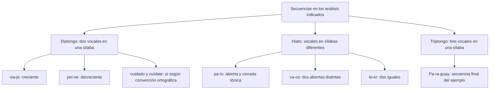

# Secuencias Vocálicas: Diptongo, Triptongo y Hiato (Acentual y Simple)

Una secuencia de letras vocálicas no permite decidir por sí sola cuántas sílabas pronuncia cualquier hablante. En este nivel se distingue el análisis silábico indicado en cada ejemplo de las convenciones usadas para la acentuación gráfica. Esa separación evita convertir la escritura de una tilde en una explicación física de la pronunciación.

Las preguntas especifican cuándo se utiliza una división escolar, cuándo se aplica una convención ortográfica y si el conteo se hace dentro de cada palabra. No se suman encuentros entre palabras ni licencias poéticas si la consigna no los incluye.

## 3.2.1 — Diptongos y tipos de secuencias

Un **diptongo** reúne dos vocales en una misma sílaba en el análisis indicado. Un **hiato** las sitúa en sílabas diferentes. Un **triptongo** reúne tres vocales en una sílaba. La definición atiende a organización silábica; no se decide contando cuántas letras tiene toda la palabra.

En la terminología ortográfica, **abiertas** son a, e y o; **cerradas**, i y u. En la clasificación articulatoria más detallada se distingue también la altura media de e y o. Aquí abierta y cerrada permiten nombrar las combinaciones relevantes para las reglas de acentuación, sin confundirlas con dos grados absolutos de fuerza.

### Creciente, decreciente y dos cerradas distintas

En la clasificación escolar se llama **creciente** al diptongo de cerrada átona seguida de abierta, como ia en via-je. Se llama **decreciente** al de abierta seguida de cerrada átona, como ei en pei-ne. El nombre describe el orden del ejemplo, no una garantía de que toda combinación escrita se realice igual en cualquier situación.

La secuencia de **dos cerradas distintas**, ui o iu, se llama a veces diptongo homogéneo en materiales escolares. A efectos de acentuación gráfica se trata como diptongo. Esta convención no significa que ninguna de sus vocales pueda recibir acento ni tilde. Hay que aplicar la regla de la palabra completa.

| Análisis o convención | Secuencia observada | Clasificación empleada |
|---|---|---|
| Via-je | I átona seguida de a en una sílaba | Diptongo creciente |
| Pei-ne | E seguida de i átona en una sílaba | Diptongo decreciente |
| Ciu-dad | I y u distintas | Diptongo de dos cerradas para acentuación gráfica |
| Cui-da-do | U e i distintas | Diptongo de dos cerradas para acentuación gráfica |

No se enseña que dos vocales se unen porque sean demasiado débiles para separarse. Esa imagen no sustituye una descripción silábica ni explica todas las variaciones de pronunciación. Tampoco se debe llamar hiato a cualquier secuencia con una letra tildada: hay diptongos que llevan tilde.

### Por qué ui puede llevar tilde

Cuidado no lleva tilde según su clasificación y terminación, mientras que **cuídate** la lleva por ser esdrújula en el análisis cuí-da-te. En un diptongo de dos cerradas distintas, la tilde correspondiente se coloca sobre la segunda vocal. No se puede concluir «ui e iu nunca se tildan».

Otro ejemplo de escritura es **construido**, sin tilde, frente a formas que sí la requieren por sus reglas. Para decidir no basta con localizar ui: hay que reconocer el acento y la clasificación ortográfica de la palabra. El hecho de que un diptongo pueda tener tilde impide usar «hay tilde» como prueba universal de hiato.

La clasificación ortográfica mantiene un criterio común para escribir aunque existan realizaciones individuales diferentes. Si una pregunta investiga la pronunciación de una persona concreta, debe aportar ese dato. Si pregunta cómo se escribe una palabra según la norma, se aplica la convención correspondiente.

## Esquema de ejemplos

Este mapa compara clases en ejemplos delimitados. Las ramas no son etapas ni instrucciones para cambiar la pronunciación. No representan todas las variantes posibles de cada secuencia.

## 3.2.2 — Triptongo y y final

El **triptongo** contiene tres vocales en una misma sílaba en el análisis indicado. Para acentuación gráfica se considera el patrón de vocal abierta entre dos cerradas, siempre que ninguna de estas últimas sea tónica. Que la abierta sea tónica en un ejemplo no significa que todo triptongo ocupe necesariamente una sílaba tónica.

En **Pa-ra-guay**, la secuencia final reúne u, a e i; la última vocal está representada por y. Las cerradas son átonas y la a es tónica en ese ejemplo. La letra y puede tener valor vocálico en determinadas posiciones; no debe analizarse siempre como una consonante por el solo hecho de estar escrita con esa letra.

No toda sucesión de tres letras relacionadas con vocales forma triptongo. Debe comprobarse su organización. Tampoco una y situada en otra posición tiene necesariamente el mismo valor. La pregunta de Paraguay delimita la secuencia final y no permite extender su análisis a toda palabra con y.

Las palabras con triptongo se someten a las reglas de acentuación gráfica pertinentes. Si corresponde tilde en la secuencia, se coloca en la vocal abierta. Un caso con y final exige además atender a su tratamiento ortográfico en la terminación; no se decide una tilde solo porque la y tenga valor vocálico en la pronunciación.

Si una de las cerradas es tónica, no se conserva ese patrón de triptongo ortográfico. Sin embargo, no basta con decir que cualquier grupo restante se convierte en una cadena de hiatos: hay que analizar cada par y la palabra completa. Por eso se retiran silabeos difíciles no justificados y se enseñan los casos concretos de la práctica.

## 3.2.3 — Clases de hiato y tildación

### Dos abiertas distintas o dos iguales

El análisis **ca-os** separa a y o, dos vocales abiertas distintas. **Le-er** separa dos e iguales. En la clasificación ortográfica, esas combinaciones se consideran hiatos. Los hiatos de dos vocales iguales no se limitan a ii o uu: también pueden aparecer con vocales abiertas iguales.

Estos casos siguen las reglas generales de acentuación. **Leer no lleva tilde** por el simple hecho de contener un hiato. No se debe enseñar que hiato y tilde sean equivalentes. Poeta puede escribirse sin tilde, mientras una palabra con otra posición acentual o terminación puede requerirla.

En el habla pueden producirse ajustes y uniones vocálicas según el contexto o la variedad. Una convención para escribir no es una predicción infalible de cada emisión. Las divisiones que se muestran en este nivel son las del análisis anunciado; si se pide describir otra pronunciación, hace falta indicarla.

### Cerrada tónica junto a abierta

En **pa-ís**, **ba-úl** y **tí-o** hay una vocal cerrada tónica junto a una abierta. La regla ortográfica exige tilde en la cerrada tónica, aunque la palabra no la llevara por la regla general de su terminación. No significa que se incumpla la ortografía: es una regla específica dentro del mismo sistema.

Algunos materiales llaman a esa tilde robúrica o disolvente. Esas denominaciones no deben convertirse en la idea de que el signo gráfico produce físicamente la separación. La pronunciación, la posición del acento y la convención ortográfica se analizan de forma relacionada; una marca escrita no funciona como una fuerza que rompe un sonido.

Se precisa siempre el tipo de vocales. La regla de cerrada tónica junto a abierta no debe aplicarse sin más a ui o iu, que son dos cerradas distintas. **Cuídate** muestra que una cerrada puede llevar tilde dentro de un diptongo ortográfico. Escribir una tilde sobre i no prueba, por sí solo, un hiato.

### La h intercalada

La h intercalada **no determina por sí sola** si una secuencia forma hiato o diptongo. En **bú-ho**, la ú es cerrada tónica y se escribe tilde junto a o abierta; la h no causa esa separación. Tampoco hace cerrada la sílaba bú, porque no ocupa una coda pronunciada en ese ejemplo.

En **ahi-ja-do**, el análisis indicado reúne a e i átona en la primera sílaba y se denomina diptongo decreciente. La presencia de h no obliga a crear una sílaba distinta. El contraste entre ambos ejemplos permite ver que h no significa automáticamente separar ni automáticamente unir.

Una regla sobre la h muda intercalada en estos ejemplos no equivale a afirmar que toda h de cualquier palabra carezca siempre de pronunciación. Esa cuestión se delimita en el nivel anterior. Aquí se evalúa su relación con las secuencias concretas que la práctica muestra.

| Ejemplo analizado | Secuencia relevante | Motivo ortográfico o silábico |
|---|---|---|
| País: pa-ís | A e í en sílabas distintas | Tilde en cerrada tónica junto a abierta |
| Búho: bú-ho | Ú y o en sílabas distintas | La h no causa el hiato ni impide la tilde |
| Caos: ca-os | A y o | Hiato de abiertas distintas |
| Leer: le-er | E y e | Hiato de iguales; no obliga por sí solo a tildar |
| Ahijado: ahi-ja-do | A e i átona | Diptongo en el análisis indicado, pese a h |
| Cuídate: cuí-da-te | U e í | Diptongo ortográfico con tilde por la regla general |

## 3.2.4 — Conteo con un ámbito explícito

Para contar secuencias hay que fijar la unidad. Puede pedirse analizar el interior de cada palabra, una pronunciación concreta o un verso con fenómenos entre palabras. Son tareas diferentes. La práctica de este nivel cuenta **solo el interior de cada palabra**, sin sinalefas ni uniones a través de espacios.

Considera «Raúl tenía un baúl de recuerdos en su habitación». Se piden únicamente los hiatos de cerrada tónica junto a abierta dentro de palabra. El análisis encuentra Ra-úl, te-ní-a y ba-úl. Habitación no añade uno de esa clase en el análisis escolar utilizado. La respuesta es tres.

| Palabra | Secuencia que interesa | Aporte al conteo solicitado |
|---|---|---|
| Raúl | A-ú | Un hiato de la clase pedida |
| Tenía | Í-a | Un hiato de la clase pedida |
| Baúl | A-ú | Un hiato de la clase pedida |
| Recuerdos | Ue en el análisis escolar | Ninguno de la clase pedida |
| Habitación | Ió en el análisis escolar | Ninguno de la clase pedida |

El resultado no es una afirmación sobre cuántos encuentros vocálicos de cualquier naturaleza hay al recitar toda la oración. Tampoco se cuenta cada palabra tildada como un hiato: la tilde puede responder a reglas diferentes. Primero se clasifica la secuencia; después se suma.

Otro ejemplo de análisis escolar es «El antiguo navío transportaba petróleo hacia la bahía». Dentro de palabra, antiguo y hacia aportan los diptongos señalados en uo e ia; navío y bahía presentan los hiatos í-o e í-a, y petróleo presenta e-o. Si se cuentan todas esas clases en ese análisis, se obtienen dos diptongos y tres hiatos. Se distingue ese encargo del anterior, que pedía solo una clase de hiato.

No se ofrece un conteo de tildes para un párrafo que no se muestra. Un resultado numérico debe acompañarse del texto completo y de la condición que define qué se cuenta. Tampoco se utilizan expresiones como método infalible: una clasificación puede estar mal planteada si se omite la pronunciación o se mezclan criterios.

## Importante

**La h no causa por sí sola un hiato, y una tilde no demuestra por sí sola que lo haya.** Ui e iu pueden llevar tilde cuando corresponde. Distingue análisis de pronunciación y convención ortográfica, y fija si el conteo se hace dentro de palabra o entre palabras.

## Procedimiento para resolver

1. Lee qué se cuenta: sílabas, diptongos, triptongos, hiatos de una clase o tildes.
2. Identifica la convención o pronunciación indicada en la consigna.
3. Separa las palabras si se pide análisis interno y marca solo las secuencias pertinentes.
4. Distingue abiertas, cerradas y posición del acento; no atribuyas causalidad a una h intercalada.
5. Para tildar, aplica las reglas correspondientes, incluidas las específicas de hiato.
6. Suma después de clasificar y explica cada aporte, para que el resultado pueda verificarse.

En país se justifica la tilde por la cerrada tónica junto a abierta. En cuídate se aplica la regla general de esdrújulas y la tilde cae sobre la segunda cerrada del diptongo. En leer, el hiato de iguales no obliga a una tilde. Los tres casos muestran por qué no sirve una única regla de «toda tilde separa» o «todo hiato se tilda».
