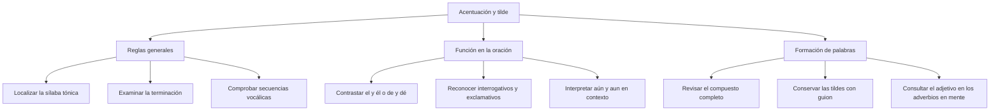

# Normativa de Acentuación General, Diacrítica y Enfática

## Introducción

El **acento prosódico** se percibe al hablar; la **tilde** pertenece a la escritura. En casa destaca la primera sílaba, pero no se escribe tilde. En café destaca la última y sí se escribe. Para decidir no basta con pronunciar más fuerte: hay que reconocer la palabra, su sílaba tónica y la regla que le corresponde.

La posición del acento permite clasificar palabras como canción, árbol, médico y dígamelo. En otros casos importa la función dentro de la oración: el artículo el y el pronombre él no se escriben igual. También hay que atender a las secuencias vocálicas y a la formación de palabras. Esta lección separa esos criterios y los aplica a ejemplos completos.

## Mapa del tema

# 3.3.1 — Acento y reglas generales

**Localizar antes de escribir**

En **ca-sa**, la sílaba tónica es ca; en **ca-fé**, es fé. La tilde no crea el acento: lo representa cuando las reglas lo requieren. Para clasificar una palabra se cuentan sus sílabas desde el final, no sus letras ni sus vocales por separado.

En el habla algunas palabras se apoyan en otras. En mi casa, el posesivo mi no tiene el mismo relieve que el pronombre mí en para mí. Por eso no conviene afirmar que todas las palabras de una oración tienen necesariamente una sílaba tónica independiente. Los adverbios en -mente, además, tienen un comportamiento propio que se explica más adelante.

| Clase | Posición de la sílaba tónica | Ejemplos |
| --- | --- | --- |
| Aguda | Última | ca-fé, can-ción, re-loj |
| Llana o grave | Penúltima | me-sa, ár-bol, e-xa-men |
| Esdrújula | Antepenúltima | mé-di-co, e-xá-me-nes |
| Sobresdrújula | Anterior a la antepenúltima | dí-ga-me-lo, en-tré-ga-se-lo |

### Relacionar la posición con la terminación

Para las reglas generales, se considera si la palabra acaba en vocal, en una sola n o s, o en otra consonante. Las agudas terminadas en vocal, n o s llevan tilde si esa n o s no va precedida de otra consonante. Las llanas siguen el patrón complementario. Las esdrújulas y sobresdrújulas se tildan sin depender de la letra final.

**Canción** lleva tilde por ser aguda terminada en n; **reloj**, también aguda, acaba en j y no la lleva. **Árbol** es llana terminada en l; **mesa** es llana terminada en vocal. La presencia de tilde no basta, por sí sola, para identificar una clase: canción y árbol tienen tilde, pero sus sílabas tónicas ocupan posiciones diferentes.

En **bíceps**, el final es el grupo consonántico ps. No corresponde tratarla como una llana terminada únicamente en s. Lo mismo explica fórceps y cómics. En sentido contrario, una aguda como robots termina en dos consonantes y no se tilda. La y final se trata como consonante para estas reglas: convoy se escribe sin tilde.

### El plural puede cambiar la clasificación

Compara **e-xa-men** con **e-xá-me-nes**. En ambas formas se conserva la sílaba pronunciada con mayor relieve, pero el plural añade una sílaba después. En el singular, xa es penúltima; en el plural, xá es antepenúltima. De ahí que examen sea llana sin tilde y exámenes sea esdrújula con tilde.

Este razonamiento no significa que todos los plurales ganen tilde. Árbol pasa a árboles y conserva la tilde; casa pasa a casas y sigue sin ella. Hay que analizar cada forma completa. Tampoco se debe confundir una división silábica con una segmentación de raíz y terminaciones: aquí interesa contar sílabas.

# 3.3.2 — Contrastes diacríticos y casos relacionados

**La función se determina dentro de la oración**

La **tilde diacrítica** distingue ciertos usos que coinciden en su forma escrita. No se coloca automáticamente a todos los pronombres, verbos o palabras importantes. Estos pares sirven para practicar el análisis de función:

| Con tilde | Uso y ejemplo | Sin tilde: contraste |
| --- | --- | --- |
| él | Pronombre: Él respondió. | Artículo: el ejercicio. |
| tú | Pronombre: Tú eliges. | Posesivo: tu cuaderno. |
| mí | Pronombre: Lo guardó para mí. | Posesivo: mi mochila; nota musical: mi. |
| sí | Afirmación: Sí, iré; pronombre: volvió en sí; consentimiento: dio el sí. | Conjunción: si llueve; nota musical: si. |
| té | Infusión: Preparó té. | Pronombre: te escucho. |
| dé | Verbo dar: Espero que dé resultado. | Preposición: una hoja de papel. |
| sé | Verbo saber: lo sé; verbo ser: sé prudente. | Pronombre: se levantó. |
| más | Cantidad: Necesito más tiempo. | Conjunción equivalente a pero: lo intentó, mas no pudo. |

Los ejemplos no se resuelven por la posición de la palabra. En el libro aparece sin tilde porque es artículo; al empezar una oración, El libro sigue sin tilde. Las mayúsculas no eximen de las reglas: Él respondió conserva su tilde.

### Tres contrastes desarrollados

**El sí de consentimiento.** En La delegada dio el sí, el artículo el introduce un sustantivo: sí nombra la aceptación. No es una condición ni una nota musical. Por eso se escribe con tilde. En Si la delegada acepta, comenzaremos, si introduce la condición y se escribe sin ella.

**Dé y de.** En Espero que me dé la ficha, dé es una forma del verbo dar. Puede compararse con Espero que me entregue la ficha. En La ficha de la actividad, de introduce un complemento y no es un verbo. La prueba consiste en identificar la construcción, no en añadir una tilde por la cercanía de otra palabra tónica.

**Mas y más.** En Practicó, mas no terminó, mas permite expresar oposición y puede sustituirse por pero. En Necesita más práctica, más expresa cantidad. Decir que mas no se tilda porque es una palabra breve no explica el contraste: ambas formas son monosílabas.

### Palabras sin tilde diacrítica

El pronombre **ti** se escribe sin tilde: Esta explicación es para ti. Ser pronombre no basta para justificar una tilde. En para mí sí aparece porque mí forma parte de un contraste diacrítico reconocido; no se extiende esa solución por analogía a ti.

**Fe, fue, fui, dio, vio y vi** se escriben sin tilde en sus usos ordinarios. Son monosílabos y no pertenecen a los pares diacríticos anteriores. En El grupo vio la demostración, vio no se convierte en una palabra de dos sílabas por formar parte de un pasado verbal. Tampoco se escribe una tilde para destacar emocionalmente esa acción.

### Aún y aun

En **Aún no llegó el docente**, aún equivale a todavía. En **Aun los primeros ejercicios requieren atención**, aun equivale a incluso. El significado permite elegir la forma pertinente; la tilde de aún se explica por la secuencia vocálica con u tónica en hiato. No conviene llamarla simplemente un noveno monosílabo: aún tiene dos sílabas en ese uso.

El contexto resulta indispensable. No basta con memorizar la cadena de letras aun y colocarle tilde en todas las oraciones. Tampoco se clasifica el aun monosilábico como palabra llana, porque la oposición aguda/llana requiere comparar posiciones silábicas en palabras de más de una sílaba.

# 3.3.3 — Interrogación y exclamación

**La interrogativa indirecta también lleva tilde**

En **¿Quién organiza el grupo?**, quién es interrogativo y pregunta por una persona. En **Dime quién organiza el grupo**, la pregunta aparece subordinada a dime: es una interrogativa indirecta. No se necesitan signos de interrogación para mantener el valor interrogativo.

Las formas qué, cuál, quién, cómo, cuánto, cuándo, dónde y adónde, y sus variantes pertinentes, se tildan en sus usos interrogativos o exclamativos. La denominación escolar **tilde enfática** suele referirse a estos usos. No es correcto ofrecerla como una respuesta incompatible con tilde diacrítica: esta última es la denominación normativa del contraste.

| Construcción | Ejemplo | Qué se reconoce |
| --- | --- | --- |
| Interrogación directa | ¿Dónde guardaste el material? | Una pregunta independiente. |
| Interrogación indirecta | No sé dónde guardaste el material. | Una información de lugar que se desconoce. |
| Exclamación | ¡Qué clara quedó la explicación! | Una valoración exclamativa. |
| Relativo átono | Volvimos al lugar donde estudiamos. | Se identifica un lugar ya mencionado. |
| Conjunción | Creo que terminamos. | Se introduce el contenido de lo que se cree. |

En **Dime con quién andas**, con quién pregunta por la identidad de una persona. En **Habla con quien conoce el tema**, quien puede parafrasearse como la persona que conoce el tema y funciona como relativo. El análisis debe atender a lo que se expresa, no a la simple presencia de un verbo delante.

Los signos tampoco deciden por sí solos. En **¡Que descanses!**, que introduce un deseo y no pregunta qué cosa ocurre; por eso va sin tilde. Para practicar conviene usar construcciones claras como las de la tabla. Algunos contextos admiten más de un análisis y no deben presentarse como preguntas de respuesta única sin explicar la interpretación.

# 3.3.4 — Palabras formadas y aplicación de las reglas

**Unión en una palabra, guion y adverbios en -mente**

Al unir elementos sin guion, se analiza el resultado completo. No se conservan mecánicamente todas las tildes que tenían las formas separadas. En **decimoséptimo**, el resultado es esdrújulo; en **balompié**, el resultado es agudo terminado en vocal.

Si los componentes se unen mediante guion, cada uno mantiene la acentuación gráfica que le corresponde. En físico-químico, ambos componentes llevan tilde. El guion de esa palabra no debe confundirse con los guiones que usamos aquí para mostrar divisiones silábicas.

| Formación | Procedimiento | Ejemplo |
| --- | --- | --- |
| Unión sin guion | Aplicar las reglas al resultado. | décimo + séptimo: decimoséptimo. |
| Unión con guion | Mantener la acentuación de cada componente. | físico-químico. |
| Adverbio en -mente | Conservar la tilde del adjetivo base, si la tiene. | fácil: fácilmente; suave: suavemente. |

**Fácilmente** conserva la tilde de fácil. **Velozmente** no lleva tilde porque veloz no la lleva. No se explica esa escritura reduciendo todos estos adverbios al patrón de una sola sílaba tónica: tienen el acento del adjetivo y el de -mente. Esto permite comprender por qué compararlos mecánicamente con una esdrújula corriente conduce a errores.

### Secuencias vocálicas y letra h

En **Raúl**, la u tónica forma hiato con a y lleva tilde. En **búho**, la h intercalada no impide el hiato. La letra h no añade por sí sola una regla de tildación distinta: hay que reconocer las vocales y la secuencia correspondiente.

En **construido**, **fluido** y **circuito**, la secuencia de dos vocales cerradas distintas cuenta como diptongo a efectos de acentuación gráfica. Son formas que se escriben sin tilde. Esto no significa que toda palabra con ui o iu carezca de ella: **cuídate** sí la lleva. Para estos casos se aplica también lo estudiado en las secuencias vocálicas del nivel anterior.

### Solo y demostrativos

La escritura general es **solo**, **este**, **ese** y **aquel**, sin tilde. En usos adverbiales de solo o pronominales de esos demostrativos, la norma actual permite la tilde si quien escribe aprecia ambigüedad. No debe enseñarse como una prohibición absoluta en cualquier contexto. Esto no autoriza tildar el adjetivo solo ni los demostrativos que acompañan a un sustantivo.

## Importante

La tilde se justifica con la **regla y el uso concreto**. No se añade por considerar importante una palabra, por ser un verbo o por estar dentro de una pregunta. La denominación enfática no convierte la tilde de quién interrogativo en algo ajeno a la diacrítica.

Antes de responder, identifica la forma que se está analizando. En palabras derivadas y plurales hay que revisar el resultado; en un contraste como dé/de o sí/si hay que leer la oración completa.

## Ejemplos resueltos

### El consentimiento

En **Dio el sí definitivo**, sí nombra la aceptación. Es el sustantivo introducido por el artículo el. Se escribe con tilde. En cambio, en **Preguntó si podía pasar**, si introduce una interrogativa indirecta total y se escribe sin ella. La función cambia aunque las letras coincidan.

### Un verbo, una conjunción y un pronombre

En **Sé prudente y espera que te dé más tiempo**, sé pertenece al verbo ser, dé al verbo dar y más expresa cantidad. Te es un pronombre átono sin tilde. En **Se quedó, mas tenía prisa**, se es pronombre y mas equivale a pero. Una misma frase puede reunir varias reglas: se comprueba cada palabra por separado.

### El plural de examen

Primero se divide: **e-xa-men** y **e-xá-me-nes**. Después se localiza el acento: xa/xá. Por último se cuenta desde el final. En el singular ocupa el penúltimo lugar; en el plural, el antepenúltimo. La explicación es el cambio de llana a esdrújula, no una supuesta tilde exclusiva del número plural.

### Una forma con interrogación indirecta

En **No recuerdo cuándo comienza la actividad**, se desconoce el momento de inicio. Cuándo introduce esa información interrogativa y lleva tilde. En **Te avisaré cuando comience la actividad**, cuando enlaza temporalmente dos situaciones y se escribe sin tilde. La ausencia de signos de interrogación en la primera oración no elimina su estructura interrogativa.

### Una base sin tilde

Para escribir **velozmente**, se parte de veloz. Es aguda terminada en z y no lleva tilde. El adverbio conserva esa ausencia. Para **fácilmente**, se parte de fácil, llana terminada en l, que sí lleva tilde. Aplicar la regla específica del adjetivo base evita tratar las dos formas como si tuvieran una acentuación ordinaria idéntica.

### Cómo revisar un escrito

Lee primero la oración para reconocer su sentido. Localiza después las palabras cuya escritura dudas y separa los problemas: posición del acento, secuencia de vocales, contraste gramatical o formación. Comprueba la regla correspondiente y vuelve a leer el resultado. Una lista de tildes contadas sin el texto original no permite justificar una respuesta: hace falta conocer cuáles son las palabras y qué función cumplen.
