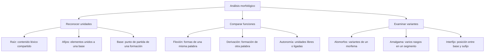

# Morfología: Concepto, Morfema, Alomorfos y Clasificación

## Introducción

Comparar **alumno**, **alumna** y **alumnas** permite reconocer una parte compartida y unas terminaciones que cambian. Comparar **leal** con **desleal** muestra otro proceso: se forma una palabra con un significado diferente. La morfología estudia esa estructura interna y las relaciones entre las formas.

El análisis no consiste en cortar una palabra cada cierto número de letras. Cada segmento necesita una justificación: puede aportar contenido léxico, expresar información gramatical o participar en una formación. También hay variantes de una misma unidad. El contexto y la comparación con otras palabras ayudan a reconocerlas.

## Mapa del tema

# 4.1.1 — Qué analiza la morfología

**Palabras, morfemas y sonidos**

La **morfología** estudia cómo se constituyen las palabras y cómo varían sus formas. En un análisis escolar, un **morfema** es una unidad mínima a la que se atribuye contenido léxico o información gramatical. La definición orienta el análisis, pero no exige que a cada fragmento visible le corresponda siempre un significado aislable.

En **alumn-a-s**, la raíz alumn- se relaciona con el contenido léxico, -a marca el femenino en este paradigma y -s marca el plural. Si quitamos -s, obtenemos alumna; si contrastamos alumna con alumno, observamos la oposición de género. La comparación respalda los cortes y sus funciones.

Un **fonema**, en cambio, es una unidad sonora distintiva sin ese significado propio. En pan y tan, sustituir /p/ por /t/ distingue las palabras; no significa que el fonema /p/ aporte por sí mismo la idea de alimento. Una letra representa escritura y una sílaba organiza pronunciación: ninguno de esos criterios basta para contar morfemas.

| Pregunta de análisis | Unidad que interesa | Ejemplo de observación |
| --- | --- | --- |
| ¿Qué sonidos permiten distinguir palabras? | Fonema | /p/ y /t/ en pan y tan. |
| ¿Cómo se organiza la pronunciación? | Sílaba | a-lum-nas tiene tres sílabas. |
| ¿Qué unidades expresan contenido o rasgos gramaticales? | Morfema | alumn-a-s permite reconocer raíz, género y número. |
| ¿Cómo se relacionan las palabras en un enunciado? | Construcción sintáctica | Las alumnas leen: el grupo nominal concuerda en plural. |

### Raíz y base no son siempre lo mismo

La **raíz** concentra el contenido léxico compartido por una familia. En pan, panadero y panadería se reconoce pan-. La **base** es la unidad sobre la que opera un proceso de formación y puede ser mayor que una raíz. Por eso una pregunta que pide la raíz no debe confundirse con otra que pide el paso inmediato de una derivación.

Reconocer pan- en panaderías no obliga a resolver de una sola manera todos los segmentos restantes. El análisis de procesos sucesivos exige más información. Aquí se pide identificar el contenido compartido con la palabra pan, no asegurar que todo lo que queda tras la raíz sea un único sufijo.

### Cómo justificar una segmentación

Primero se identifica la palabra en una oración y se compara con formas relacionadas. Después se proponen segmentos y se indica qué contraste explica cada uno. Finalmente se comprueba si la misma función reaparece en otros ejemplos. Este procedimiento permite distinguir un corte morfológico de una separación por letras o sílabas.

En **mares**, la comparación con mar permite reconocer mar-es. No conviene separar ma-r-es: ni ma- ni -r aportan aquí las funciones que esa propuesta tendría que demostrar. En **desleal**, la comparación con leal permite reconocer des- como prefijo, sin exigir que el número de sílabas coincida con el de unidades morfológicas.

# 4.1.2 — Variantes de un mismo morfema

**Qué es un alomorfo**

Los **alomorfos** son realizaciones distintas de un mismo morfema. La función o el contenido se relacionan, aunque cambie la forma. No toda semejanza escrita prueba alomorfía ni toda diferencia demuestra que haya un morfema nuevo: se necesita comparar usos y contextos.

Un ejemplo de número es el contraste entre **casa/casas** y **árbol/árboles**. El plural aparece mediante -s en el primer caso y -es en el segundo. El ejemplo no establece que todas las palabras acabadas en vocal o consonante sigan únicamente esos dos modelos; se trata de observar dos realizaciones concretas del plural.

| Serie | Forma observada | Función compartida |
| --- | --- | --- |
| casa/casas | -s | Número plural. |
| árbol/árboles | -es | Número plural. |
| una crisis/varias crisis | Sin cambio segmental en crisis | La forma sirve para singular y plural; el entorno los distingue. |
| inútil/imposible/ilegal/irreal | in-, im-, i- | Negación en estas formaciones. |

La forma **crisis** no recibe una s adicional para formar el plural. En varios análisis se representa esa ausencia de cambio mediante un **morfo cero**, escrito Ø. El signo es una herramienta del análisis; no es una letra pronunciada ni significa que el sustantivo carezca de número. En otras descripciones se habla de forma invariable y se destaca el papel del contexto.

### El prefijo negativo

En **inútil**, **imposible**, **ilegal** e **irreal** se reconoce el mismo prefijo negativo con variación formal. Im- es la variante gráfica ante p o b; i- aparece ante l o r. En irreal, la doble r responde además a la escritura del sonido entre vocales. No se deben contar dos prefijos negativos por ver dos letras r.

La distribución no equivale a una elección libre del hablante para cualquier palabra. Escribimos imposible, no una forma inventada con in- delante de posible. Tampoco todo comienzo in-, im- o i- permite aislar automáticamente un prefijo negativo: primero debe reconocerse una base y una relación de significado pertinente.

### Alomorfo y alófono

Un alomorfo corresponde al análisis morfológico: se mantiene una función o un contenido. Un alófono corresponde a la realización de un fonema en la pronunciación. Los términos no se intercambian por el hecho de que ambos describan variantes. En esta lección, -s y -es se comparan por el plural; el análisis de realizaciones sonoras requiere otro nivel de descripción.

La forma puede variar por el entorno fónico, pero también por factores morfológicos. Por eso no se define la alomorfía como un proceso que dependa exclusivamente de facilitar la pronunciación. Comparar varias palabras resulta más fiable que decidir a partir de una sola secuencia escrita.

# 4.1.3 — Función de raíces y afijos

**Flexión y derivación**

La **flexión** produce formas de una misma palabra léxica. En alumno, alumna y alumnas cambia información gramatical del paradigma. La **derivación** permite formar otra palabra: de leal se obtiene desleal; de leal también se forma lealtad. En el primer caso se mantiene la categoría adjetiva; en el segundo se obtiene un sustantivo.

No es necesario que un derivado cambie de categoría para considerarlo derivado. Tampoco basta con buscar una entrada separada en un diccionario: la cobertura de un diccionario no decide por sí sola la estructura de la lengua. Se compara el procedimiento de formación y el significado de las unidades.

| Elemento o proceso | Qué permite reconocer | Ejemplo |
| --- | --- | --- |
| Raíz | Contenido léxico básico compartido. | pan- en panadero y panadería. |
| Afijo flexivo | Rasgos de las formas de un paradigma. | -s en alumnas. |
| Prefijo derivativo | Formación mediante un elemento anterior a la base. | des- en desleal. |
| Sufijo derivativo | Formación mediante un elemento posterior a la base. | -ero en librero. |

En **alumnas**, -a y -s permiten reconocer femenino y plural en el análisis mostrado. Esto no autoriza a afirmar que toda palabra acabada en a sea femenina o que toda o final sea un morfema masculino. La letra final se interpreta dentro del paradigma: las funciones gramaticales no se leen mediante una correspondencia automática entre letra y género.

### Más de un rasgo en un segmento

Se habla de **amalgama** cuando un segmento reúne varias informaciones gramaticales. En **escribí**, la terminación -í permite reconocer una forma de primera persona singular del pretérito perfecto simple de indicativo. No se puede asignar una letra diferente a cada uno de esos valores.

No toda terminación verbal constituye un bloque que exprese obligatoriamente todos los rasgos a la vez. En **cant-á-ba-mos**, un análisis distingue raíz, vocal temática, -ba- y -mos. El segmento -ba- reúne tiempo, aspecto y modo; -mos reúne persona y número. La amalgama consiste en acumular información, no en exigir siempre cinco valores ni en declarar indivisible cualquier final verbal.

Este contraste también impide confundir la conjugación con la creación de una palabra léxica. Cantaba y cantábamos son formas del mismo verbo; cantante pertenece a un proceso de formación. Reconocer una terminación no basta: hay que indicar qué rasgos expresa y en qué unidad se está trabajando.

### Prefijo, sufijo e interfijo

En **rehacer**, re- precede a la base; en **librero**, -ero aparece después de la raíz. Esa posición ayuda a distinguir prefijos y sufijos, aunque no sustituye el análisis de su función.

Un **interfijo** se sitúa entre una base y un sufijo. En el análisis **cancion-c-ita**, -c- ocupa esa posición. No debe llamarse automáticamente infijo: este se inserta dentro de una base, como -it- en Carl-it-os. La segmentación de ciertos derivados puede variar entre modelos; no se presenta como una partición universal ni se explica todo interfijo únicamente como un adorno para pronunciar mejor.

### Interpretar des-

En **desarmar**, des- expresa reversión o privación respecto de armar. En **desleal**, aporta negación a leal. Es un prefijo derivativo en estos ejemplos. No conviene concluir que todos los prefijos signifiquen oposición: re- en rehacer expresa repetición y sub- en subdirector expresa una relación de subordinación.

Si se analiza el infinitivo con mayor detalle, **des-arm-a-r** permite separar el prefijo, la raíz, la vocal temática -a- y la marca -r de infinitivo. Por tanto, llamar vocal temática a todo el segmento -ar sería una segmentación imprecisa. El grado de detalle debe declararse antes de contar los segmentos.

# 4.1.4 — Autonomía y análisis de casos

**Unidades libres y ligadas**

Un morfema **libre** puede constituir una palabra; uno **ligado** necesita unirse a otro elemento para aparecer con la función analizada. Sol es una palabra simple que permite observar la primera situación. El prefijo des- no puede funcionar aisladamente como palabra con el valor de negación que tiene en desleal.

Esta clasificación no sustituye a la de función. Un sufijo derivativo y una terminación flexiva pueden ser ligados, aunque no aporten la misma clase de información. En librero, -ero participa en la derivación; en mares, -es expresa plural. Decir que ambos son ligados no significa que ambos formen palabras nuevas.

| Palabra | Segmentación o comparación utilizada | Qué se puede concluir |
| --- | --- | --- |
| sol | sol | Palabra simple y unidad libre en este análisis. |
| mares | mar-es frente a mar | -es marca plural. |
| alumnas | alumn-a-s frente a alumna/alumno | -a y -s expresan género y número en este paradigma. |
| desleal | des-leal frente a leal | des- es un prefijo derivativo. |
| escribí | escrib-í frente a otras formas de escribir | La terminación acumula información de la conjugación. |
| panaderías | pan- compartido con pan y panadero | Se reconoce la raíz; identificarla no equivale a segmentar todo el resto. |

### Casos desarrollados

**Identificar una unidad mínima.** En una pregunta que contrapone morfema, fonema, grafema y sintagma, hay que reconocer el nivel solicitado. Si se pide la unidad del análisis de la estructura interna con contenido o función gramatical, corresponde morfema. No se elige fonema solo por ser una unidad pequeña.

**Reconocer variantes.** En inútil e imposible cambia la realización del prefijo negativo. La relación no convierte cada forma en un significado de negación diferente. Para justificar alomorfía se indican las formas comparadas, su contenido y el contexto, sin afirmar que cualquier parecido visual es suficiente.

**Distinguir forma y palabra derivada.** Al pasar de mar a mares se expresa plural; al pasar de leal a desleal se forma otro adjetivo. La derivación puede mantener la categoría, mientras la flexión organiza las formas de una misma unidad léxica. El contraste debe explicarse con ejemplos completos.

**Reconocer una raíz.** Pan- se relaciona con el contenido compartido por pan, panadero y panadería. No se elige -s, que marca plural, ni se confunde la raíz con una base de derivación más extensa. La pregunta debe precisar qué unidad solicita.

**Analizar una terminación verbal.** En escribí, -í no es un prefijo ni un morfema que indique únicamente plural. La forma expresa primera persona singular y pasado, entre otros rasgos. El nombre flexivo amalgama describe la acumulación; no enseña que toda conjugación se segmente igual.

## Importante

Una segmentación necesita **comparación y función**. Las letras que coinciden, el número de sílabas o la posibilidad de pronunciar una parte no demuestran por sí solos que haya un morfema. Hay que indicar el modelo y el detalle del análisis, especialmente en los derivados y las formas verbales.

No se extiende una conclusión local a todas las palabras: -a expresa femenino en alumnas, pero esa observación no clasifica automáticamente cualquier palabra terminada en a. De igual manera, un prefijo puede cambiar significado sin cambiar categoría.

## Flexión y formación de palabras

La flexión expresa información gramatical sin crear necesariamente una nueva palabra léxica: niño/niños cambia número; canto/cantábamos cambia rasgos verbales. La derivación puede formar una nueva unidad mediante afijos, como pan/panadero. La composición combina bases, como sacapuntas.

Un morfema es una unidad mínima de significado o función gramatical, no una sílaba. Un mismo segmento sonoro puede cumplir funciones distintas según la palabra; por eso el análisis debe relacionar forma y función. Identificar raíz y morfemas evita confundir número de letras, sílabas y unidades morfológicas.
