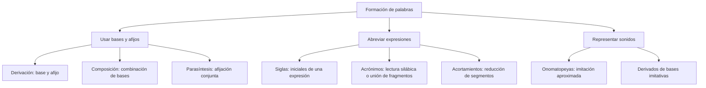

# Procesos Formativos de Palabras en el Español

## Introducción

En **cocinero** se reconoce una raíz relacionada con cocina y un sufijo. En **bocacalle** se combinan dos bases. En **foto**, usada por fotografía, se acorta una palabra. Estas diferencias permiten estudiar cómo se forman las unidades del vocabulario sin confundir cualquier palabra larga con una compuesta ni cualquier palabra breve con una sigla.

Para analizar una formación hay que reconocer sus componentes, explicar cómo se relacionan y comprobar el significado del resultado. No basta con quitar una letra, encontrar una secuencia parecida en otra palabra o contar cuántos afijos parecen visibles. Algunas clasificaciones dependen del modelo; cuando eso ocurre se declara el criterio y se evita construir una pregunta ambigua.

## Mapa del tema

# 4.2.1 — Derivación: formar otra palabra mediante afijos

**Prefijación y sufijación**

La **derivación** relaciona una base con una nueva palabra mediante afijos. En **desleal**, el prefijo des- se une a leal; en **lealtad**, un sufijo forma un sustantivo relacionado con ese adjetivo. Los dos procesos modifican el contenido de la base, pero solo el segundo cambia la categoría gramatical.

En **cocinero**, el segmento -ero participa en la formación de una palabra relacionada con cocina. En **rehacer**, re- aporta repetición a hacer. La derivación no debe definirse como cualquier adición de letras: una terminación de plural, como -s en casas, pertenece a la flexión de una palabra, no a la creación de otra unidad léxica.

| Comparación | Proceso observado | Justificación |
| --- | --- | --- |
| leal/desleal | Prefijación | des- precede a la base y modifica su significado. |
| leal/lealtad | Sufijación | Se forma un sustantivo a partir del adjetivo. |
| cocina/cocinero | Sufijación | -ero participa en la formación de una palabra relacionada. |
| hacer/rehacer | Prefijación | re- aporta repetición en este ejemplo. |
| casa/casas | Flexión, no derivación | Cambia el número de la misma palabra léxica. |

### Procesos sucesivos

Una formación puede contener más de un afijo sin que todos se hayan añadido a la vez. En **deslealtad**, se reconoce la relación con lealtad, que a su vez se relaciona con leal. En **inalcanzable**, alcanzable sirve como base para la negación. La presencia gráfica de un prefijo y un sufijo no demuestra por sí sola parasíntesis.

La explicación tiene que vincular la base con el sentido de la palabra. No basta con encontrar otra secuencia que también exista, si no participa en esa formación. Del mismo modo, que un estudiante desconozca una base no demuestra que sea inexistente en español. Un diccionario ayuda a comprobar usos, pero la búsqueda debe acompañarse de análisis.

### Categoría y significado

**Desleal** sigue siendo adjetivo, mientras **lealtad** es sustantivo. Ambos son derivados. Por tanto, cambiar de categoría es una posibilidad de la derivación y no un requisito universal. Tampoco todos los afijos tienen un único significado aplicable a cualquier base: el valor se interpreta en el ejemplo analizado.

Comparar palabras de una familia permite explicar la formación con más precisión que inventar una historia para cada fragmento escrito. Una segmentación debe sostenerse en una relación reconocible y no en que el segmento se parezca casualmente a una palabra independiente.

# 4.2.2 — Composición: combinar bases

**Componentes y resultado**

La **composición** combina bases en una unidad léxica. En **bocacalle** se reconocen boca y calle. En **sacapuntas**, una forma verbal se combina con un sustantivo. En **blanquirrojo**, se relacionan blanco y rojo. Los componentes no tienen que pertenecer a la misma categoría ni conservar siempre idéntica apariencia gráfica.

En **ciempiés** se reconocen cien y pies, con la adaptación m ante p y la tilde del resultado. La composición se identifica por las bases que se combinan; no nace simplemente de cambiar n por m. En **sacapuntas** no hay esa adaptación y sigue existiendo composición.

| Compuesto | Bases reconocidas | Relación que se observa |
| --- | --- | --- |
| bocacalle | boca + calle | Combinación de dos bases nominales. |
| sacapuntas | saca + puntas | Forma verbal y sustantivo. |
| blanquirrojo | blanco + rojo | Dos bases adjetivas con adaptación de la primera. |
| ciempiés | cien + pies | Numeral y sustantivo con adaptación de la escritura. |

### No convertir una etiqueta en una regla universal

Algunos materiales escolares llaman yuxtaposición a ciertos compuestos cuyos componentes se mantienen reconocibles y reservan otras etiquetas para los que presentan cambios. Esa terminología no debe elevarse a una oposición universal basada en una sola letra. En otras clasificaciones, composición propia alude a la integración gráfica en una palabra, no exclusivamente a una modificación sonora.

Aquí se pregunta primero si hay **combinación de bases**, y después se describe cómo se han integrado. Así se explica sacapuntas sin contraponerle como categoría incompatible una etiqueta que otro manual podría usar con distinto alcance. Si se pide una subclasificación, el enunciado debe indicar el criterio.

### Composición frente a grupo libre de palabras

Una unidad léxica compuesta no se identifica solamente contando espacios. Hay formaciones escritas juntas y otras que conservan separación. La relación fija entre componentes y el significado ayudan a distinguirlas de una combinación ocasional. Para empezar conviene trabajar con los casos claros de la tabla.

Tampoco una raíz y un sufijo se convierten en dos bases independientes por ser dos segmentos. En cocinero, -ero no funciona como una palabra autónoma equivalente a boca o calle. Ese contraste explica por qué cocinero se analiza por sufijación y bocacalle por composición.

# 4.2.3 — Parasíntesis y análisis por etapas

**Afijación conjunta**

La **parasíntesis** puede formar una palabra mediante prefijación y sufijación conjuntas. En **ensombrecer**, la base sombra se integra en la formación en-…-ecer. No se interpreta simplemente como un prefijo añadido a un verbo sombrecer usado como etapa intermedia.

El criterio es la **relación de formación**, no borrar de manera mecánica los extremos escritos. En **anochecer**, la presencia de la palabra anoche no demuestra que sea su base: el verbo significa hacerse de noche y se relaciona con noche. Una secuencia existente puede no intervenir en el proceso analizado.

El término también se ha aplicado a formaciones como quinceañero que combinan composición y derivación. Existen análisis distintos para ese grupo. No se utiliza su clasificación discutida como única respuesta posible sin indicar el modelo, ni se afirma que ninguna secuencia parcial exista jamás en otra acepción.

### Comparar decisiones justificadas

| Caso | Análisis utilizado | Qué evita el error |
| --- | --- | --- |
| ensombrecer | Afijación conjunta sobre sombra. | No inventar un proceso sucesivo sin base pertinente. |
| anochecer | Formación relacionada con noche. | La palabra anoche existe, pero eso no decide la base. |
| deslealtad | Derivación que puede relacionarse con lealtad. | No considerar simultáneos todos los afijos visibles. |
| inalcanzable | Prefijación sobre alcanzable. | Reconocer una base pertinente antes de clasificar. |

Cuando una prueba de supresión deja una secuencia, hay que examinar su función y su significado. Tampoco el hecho de que no quede una palabra reconocida por el lector constituye una demostración completa. El análisis debe mostrar la base y explicar la relación con el resultado.

El contraste con deslealtad es especialmente útil: lealtad ofrece una etapa coherente para la formación por negación. El procedimiento es distinto del que se propone para ensombrecer. Las dos palabras tienen varios componentes, pero contar componentes no basta para igualar sus procesos.

# 4.2.4 — Siglas, acrónimos, acortamientos y onomatopeyas

**Siglas: origen y pronunciación**

Una **sigla** se forma a partir de iniciales de una expresión. DNI se relaciona con Documento Nacional de Identidad. ONU se relaciona con Organización de las Naciones Unidas. Las dos son siglas, aunque no se pronuncien de la misma manera.

DNI suele leerse por deletreo; ONU se lee silábicamente como una palabra y es también un **acrónimo**. Por tanto, sigla y acrónimo no son categorías siempre excluyentes. Preguntar si ONU es únicamente una u otra, sin precisar qué propiedad se analiza, produciría una pregunta defectuosa.

La escritura en mayúsculas tampoco exige deletreo. Se separa el procedimiento que originó la forma de su modo de lectura. Algunas siglas se lexicalizan como palabras y adoptan las reglas de escritura de esa condición; no se extiende automáticamente ese proceso a cualquier denominación institucional.

### Acrónimos por fragmentos

Acrónimo también designa una palabra creada con fragmentos de otras. **Ofimática** combina segmentos relacionados con oficina e informática. Este mecanismo no consiste en tomar solamente las letras iniciales ni en acortar una única palabra.

El ejemplo muestra por qué hay que leer la definición concreta del ejercicio. Una pregunta sobre la unión de fragmentos puede resolverse con acronimia, mientras otra sobre las iniciales de una expresión se resuelve reconociendo siglación. No se utiliza la oposición leído de corrido/deletreado como una explicación universal del origen.

### Acortamientos

**Foto**, por fotografía, y **bici**, por bicicleta, son acortamientos. En esos usos se reducen segmentos de una unidad y se mantiene la referencia principal. No se combinan las iniciales de varias palabras. El registro o las connotaciones pueden cambiar, y algunos acortamientos son habituales en la lengua general.

No basta con que una palabra sea breve. Mar no se clasifica como un acortamiento de mares, porque esa relación es de número; tampoco el sufijo de cocinero es un recorte. Para identificar el proceso se necesita una unidad de partida y una reducción que explique el uso resultante.

### Representación de sonidos

**Tictac**, **miau** y **quiquiriquí** son ejemplos de onomatopeyas: aproximan sonidos mediante formas lingüísticas. No reproducen exactamente una grabación ni tienen que ser idénticas en todas las lenguas. Se estudian como representaciones convencionales de una experiencia sonora.

Una palabra que nombra un sonido no es automáticamente una onomatopeya simple. **Chasquido** se relaciona con chascar mediante derivación. Confundir el tema del que habla una palabra con su procedimiento de formación impediría distinguir significado y estructura.

| Procedimiento | Punto de partida | Ejemplo explicado |
| --- | --- | --- |
| Siglación | Iniciales de una expresión. | DNI: Documento Nacional de Identidad. |
| Acrónimo de origen siglar | Sigla que puede leerse silábicamente. | ONU es sigla y también acrónimo. |
| Acronimia por fragmentos | Segmentos de varias palabras. | ofimática: oficina e informática. |
| Acortamiento | Reducción de una unidad. | foto por fotografía. |
| Onomatopeya | Representación aproximada de un sonido. | tictac. |

## Importante

Identifica **la base y el procedimiento** antes de elegir una etiqueta. No se demuestra composición por cambiar una letra, ni parasíntesis por borrar un extremo. Las siglas pueden leerse de forma silábica: ONU no deja de ser sigla por pronunciarse como una palabra.

Si una clasificación depende de un modelo escolar, ese criterio debe aparecer explicado. No se sustituyen las relaciones entre las palabras por una lista de reglas supuestamente infalibles.

## Ejemplos resueltos

### Blanquirrojo y sacapuntas

En blanquirrojo se combinan blanco y rojo y se adapta la forma del primer elemento. En sacapuntas se combinan saca y puntas. Ambos presentan composición. La adaptación se describe como una propiedad del ejemplo, sin volverla una prueba universal para separar dos clases incompatibles.

### Ensombrecer y deslealtad

Para ensombrecer se propone afijación conjunta sobre sombra. Para deslealtad puede reconocerse lealtad como base pertinente. La conclusión se obtiene explicando las relaciones, no por el número de letras que se retiran. Si se quisiera usar otra clasificación teórica, habría que indicar sus criterios.

### Ofimática frente a foto

Ofimática combina fragmentos procedentes de dos palabras; foto reduce fotografía. En el primer caso hay acronimia por fragmentos. En el segundo hay acortamiento. Pronunciar ambas con normalidad no hace que compartan el mismo proceso.

### Cocinero frente a bocacalle

Cocinero se relaciona con cocina mediante el sufijo -ero. Bocacalle reúne boca y calle. La comparación distingue un afijo de una base léxica y permite explicar derivación frente a composición sin depender de la longitud del resultado.

### DNI y ONU

DNI y ONU se originan en iniciales. DNI se lee habitualmente por deletreo y ONU por lectura silábica. En ese último uso ONU es también acrónimo. Una respuesta que diga que todas las siglas se deletrean contradice el ejemplo y debe corregirse.

### El sonido nombrado y el origen de la palabra

Tictac representa un sonido mediante imitación aproximada. Chasquido nombra otro sonido, pero su estructura se relaciona con chascar. No se asigna el mismo procedimiento a las dos formas solamente porque ambas se refieran a fenómenos sonoros. El análisis combina significado, forma y relación con otras unidades.
