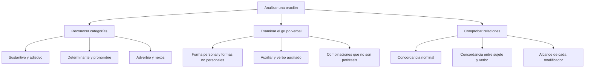

# La Sintaxis y las Categorías Gramaticales: Variables e Invariables

## Introducción

En **La estudiante explicó el ejercicio**, estudiante es un sustantivo y el grupo la estudiante funciona como sujeto. En **Escuché a la estudiante**, ese sustantivo conserva su categoría, pero forma parte del complemento directo. La sintaxis estudia cómo se relacionan las unidades en una oración; la categoría de una palabra no decide por sí sola su función.

Para analizar una expresión se necesita contexto. Temprano no desempeña el mismo papel en llegaron temprano que en un regreso temprano. Tampoco basta con ver dos verbos juntos para identificar una perífrasis. Esta lección combina formas, relaciones y ejemplos completos para justificar cada clasificación.

## Mapa del tema

# 5.1.1 — Sintaxis, categoría y función

La **sintaxis** estudia las relaciones y la organización de las palabras en grupos y oraciones. Una categoría gramatical reúne palabras con propiedades compartidas: sustantivos, adjetivos, verbos, entre otras. Una función expresa el papel de una unidad en una construcción: sujeto, complemento directo o modificador, por ejemplo.

En **La investigadora revisó las muestras**, investigadora y muestras son sustantivos. El grupo la investigadora es sujeto; las muestras es complemento directo. Por eso no se dice que todo sustantivo sea sujeto ni que una palabra cambie de categoría cada vez que cambia de función.

La posición tampoco resuelve todo el análisis. En **Las muestras las revisó la investigadora**, el grupo inicial no pasa a ser sujeto por aparecer primero. La relación con el verbo y con los demás componentes sigue siendo necesaria. Las preguntas deben permitir reconocer la construcción, no limitarse a contar palabras delante o detrás de un verbo.

### Categorías que admiten flexión

En una clasificación escolar se llaman **variables** las categorías cuyos miembros pueden presentar flexión. Esto no significa que cada palabra de esas categorías disponga de todas las variaciones posibles. Mesa tiene género femenino, pero no forma un masculino mediante el simple cambio a -o. Crisis puede conservar la misma forma para singular y plural.

| Categoría | Propiedad que se observa | Ejemplo delimitado |
| --- | --- | --- |
| Sustantivo | Contenido nominal y rasgos de género y número. | alumna/alumnas; el libro/los libros. |
| Adjetivo | Puede concordar con un elemento nominal. | libro nuevo/libros nuevos. |
| Determinante | Participa en la identificación o cuantificación nominal. | esa actividad/esas actividades. |
| Pronombre | Puede constituir una expresión pronominal con rasgos propios. | ella/ellas; yo/nosotros. |
| Verbo | Sus formas personales expresan rasgos de la conjugación. | estudio/estudiamos; estudió/estudiará. |

Un adjetivo como **amable** no cambia de forma entre alumno amable y alumna amable, pero sí en alumnos amables. La falta de una terminación diferente de género en ese ejemplo no convierte amable en adverbio. Para clasificar se examina el conjunto de propiedades, no una sola letra final.

### Del nombre al grupo nominal

Un sustantivo puede encabezar un grupo con determinantes y complementos: **los apuntes de Física**. El núcleo apuntes se relaciona con los y de Física. El grupo completo puede desempeñar distintas funciones: en Los apuntes de Física están aquí es sujeto; en Ordené los apuntes de Física es complemento directo.

No todos los grupos de una oración tienen núcleo nominal. En muy cerca se reconoce una organización adverbial; en bastante claro, una adjetival. Identificar el núcleo permite explicar de qué depende cada palabra sin llamar frase nominal a cualquier secuencia que tenga un significado reconocible.

# 5.1.2 — Adjetivos, determinantes y pronombres

Un **adjetivo** aporta una propiedad o una relación dentro de una construcción. En **una explicación clara**, clara modifica explicación y concuerda en femenino singular. En **la explicación es clara**, conserva su categoría adjetiva, pero desempeña la función de atributo. Categoría y función siguen siendo planos diferentes.

Un **determinante**, como el artículo o un demostrativo en su uso adnominal, participa en la referencia del grupo nominal. En **esos jóvenes**, esos acompaña al sustantivo jóvenes. En **ellos esperan**, ellos es un pronombre personal y puede constituir el grupo sujeto sin un sustantivo que lo acompañe.

| Expresión | Palabra analizada | Clasificación en este uso |
| --- | --- | --- |
| esos jóvenes | esos | Determinante demostrativo. |
| ellos esperan | ellos | Pronombre personal. |
| una explicación clara | clara | Adjetivo modificador del sustantivo. |
| la explicación es clara | clara | Adjetivo en función de atributo. |

### Lo que no demuestra la sustitución

A veces se explica el pronombre diciendo que sustituye al nombre. Esa fórmula puede ayudar en ciertos ejemplos, pero no es una definición suficiente. **Yo** o **tú** pueden referirse a participantes del intercambio sin reemplazar un sustantivo dicho antes. La identificación depende de la referencia y de la construcción.

En los demostrativos usados sin nombre expreso hay diferencias de análisis entre modelos gramaticales. No se fuerza una pregunta de respuesta única basada solamente en la fórmula acompaña/sustituye. Para distinguir categorías de forma clara, esta lección contrapone esos en esos jóvenes con el pronombre personal ellos.

Los numerales, cuantificadores y posesivos también admiten clasificaciones más detalladas. Aquí se reconoce su uso en ejemplos explícitos y no se ofrece una lista de palabras que conserven obligatoriamente una misma etiqueta en cualquier oración. La categoría se justifica con propiedades de la unidad y del contexto.

### Concordancia no significa identidad de terminaciones

En **las jóvenes responsables**, el artículo y el sustantivo tienen rasgos compatibles; responsables concuerda en plural sin mostrar una forma femenina distinta. No hay que exigir que todos terminen con las mismas letras para reconocer la relación gramatical.

El sustantivo **estudiante**, por ejemplo, permite el estudiante y la estudiante sin cambiar su terminación. Esa observación no elimina el género gramatical de los grupos. Una forma invariable en alguno de sus rasgos no debe confundirse con una categoría que carece de flexión nominal.

# 5.1.3 — Formas verbales y perífrasis

Las **formas personales** del verbo expresan rasgos de la conjugación: estudio y estudiamos permiten reconocer una diferencia de persona y número. **Infinitivo, gerundio y participio** son formas no personales; también reciben el nombre escolar de verboides. No expresan persona gramatical como una forma conjugada.

La denominación no personal no implica que carezcan de cualquier propiedad gramatical. Estudiar es infinitivo; estudiando, gerundio; estudiado, participio. Hay formas compuestas como haber estudiado y habiendo estudiado, y los usos participiales requieren distinguir construcciones.

| Construcción | Qué forma se observa | Contraste pertinente |
| --- | --- | --- |
| quiere estudiar | estudiar, infinitivo | El infinitivo no identifica por sí solo la persona de quien estudia. |
| está estudiando | estudiando, gerundio | La forma conjugada está aporta rasgos personales. |
| ha estudiado las lecciones | estudiado, participio con haber | No concuerda con lecciones. |
| las lecciones estudiadas | estudiadas, participio concordado | Presenta femenino plural en esta construcción. |

**Estudiadas** muestra por qué sería incorrecto afirmar que todo participio es invariable. Con el auxiliar haber, en los tiempos compuestos, se dice ha estudiado las lecciones. En las lecciones estudiadas, la forma concuerda con el sustantivo. Ninguno de esos participios expresa persona verbal como estudió o estudiaron.

### Reconocer una perífrasis con un caso claro

En **Tiene que entregar el informe**, tener que expresa obligación y entregar aporta el contenido de la acción. La combinación se analiza como **perífrasis verbal**. En **Suele repasar sus apuntes**, soler aporta habitualidad y repasar identifica la actividad. En ambos casos hay relación entre auxiliar y verbo auxiliado.

Puede aparecer un enlace, como que en tener que, pero no es obligatorio en todas las perífrasis: suele repasar carece de él. Tampoco todo auxiliar tiene que aparecer conjugado en cualquier contexto: en una construcción más amplia puede encontrarse en infinitivo. No se convierte un esquema útil en una definición rígida para cualquier secuencia.

### Límites de las pruebas de sustitución

En **Prometió entregar el informe**, prometió conserva el significado de comprometerse a algo y admite prometió eso. Esa comparación ayuda a reconocer una construcción diferente de tener que entregar. Sin embargo, sustituir por eso no constituye una prueba automática ni debe aplicarse ignorando las preposiciones o el sentido.

**Tiene eso** es una expresión posible, pero tener expresa posesión en ella; no conserva la obligación de tiene que entregar. Una prueba que cambia el significado no demuestra que las dos construcciones sean equivalentes. Del mismo modo, la imposibilidad de una sustitución mal construida no prueba por sí sola que haya perífrasis.

El análisis combina el significado del auxiliar, la relación con la forma no personal y la construcción completa. Algunos casos admiten discusión entre modelos. Los ejercicios de respuesta única deben elegir ejemplos claros y no presentar toda combinación de dos verbos como auxiliar más verbo principal.

# 5.1.4 — Adverbios, nexos y concordancia

Los **adverbios**, las **preposiciones** y las **conjunciones** se estudian como categorías invariables. No presentan concordancia de género o número como la del adjetivo de estos ejemplos. La clasificación no significa que cualquier palabra que no cambie en una oración pertenezca necesariamente a una de esas tres categorías. Existen también otras, como las interjecciones.

Un adverbio puede modificar un verbo, un adjetivo u otro adverbio. En **respondió correctamente**, correctamente aporta información sobre la respuesta. En **muy clara**, muy intensifica al adjetivo clara. En **muy temprano**, muy modifica al adverbio temprano. Esos usos son frecuentes, pero no agotan todos los alcances del adverbio: probablemente puede afectar a una oración completa.

### Contar preposiciones en una oración

En **Bajo la sombra del árbol conversó con sus amigos sobre el examen hasta el anochecer**, se identifican **bajo, de, con, sobre y hasta**. La preposición de está incluida en la contracción del, formada por de y el. La consigna debe aclarar que se cuentan preposiciones, no espacios ni palabras gráficas.

| Segmento observado | Análisis | Aporte al conteo |
| --- | --- | --- |
| Bajo la sombra | bajo es preposición. | Una. |
| del árbol | del reúne de + el. | Una preposición, de. |
| con sus amigos | con es preposición. | Una. |
| sobre el examen | sobre es preposición. | Una. |
| hasta el anochecer | hasta es preposición en este uso. | Una. |

Las letras de la oración no se clasifican sin contexto. Bajo también puede ser una forma verbal en yo bajo, y sobre puede aparecer en otras construcciones. El conteo del ejemplo se apoya en su uso preposicional dentro de la oración dada.

### Coordinación y contraste

En **Estudió con empeño, pero no terminó**, pero introduce una relación adversativa entre los miembros coordinados. Se reconoce oposición o restricción entre lo expresado, sin que uno de los dos segmentos se transforme por ello en una subordinada causal. La etiqueta es **conjunción coordinante adversativa**.

No se llama preposición a cualquier palabra breve que conecte elementos. Una preposición introduce un término; una conjunción coordina o subordina construcciones. La función concreta se justifica en la oración, no contando las letras del enlace.

### Concordancia nominal y verbal

En **extraordinaria rapidez y valor**, el adjetivo antepuesto concuerda con rapidez, el sustantivo más próximo. Es un patrón normal en esa construcción, no una regla absoluta para toda coordinación imaginable. En otros casos importan la interpretación, la posición y los referentes de los sustantivos.

En **La jauría huyó despavorida**, jauría es el núcleo singular del sujeto; huyó y despavorida concuerdan con él. Que la jauría esté formada por varios animales no convierte su forma gramatical en plural. Esta explicación se limita a la construcción dada y no se extiende sin análisis a expresiones cuantificativas como la mayoría de los estudiantes.

## Importante

Distingue **categoría, forma y función**. Una misma palabra puede aparecer en construcciones diferentes, y una categoría variable puede contener formas que no muestran una terminación distinta para cada rasgo. El participio concordado no debe confundirse con el participio de un tiempo compuesto con haber.

Para reconocer perífrasis y concordancia se conserva el sentido de la oración y se comparan sus relaciones. Una sustitución aislada o una palabra cercana no reemplazan ese análisis.

## Ejemplos resueltos

### Dos usos de muy

En **La explicación es muy clara**, muy intensifica al adjetivo clara. En **Llegaron muy temprano**, modifica al adverbio temprano. El alcance cambia, pero muy sigue siendo adverbio. No es un adjetivo porque no califica directamente a un sustantivo ni concuerda con él en esas construcciones.

### Esos y ellos

En **Esos jóvenes ingresaron y ellos ya recibieron sus resultados**, esos acompaña a jóvenes y se reconoce como determinante demostrativo. Ellos constituye una expresión pronominal personal. La comparación distingue las unidades sin exigir un nombre expreso anterior para cada pronombre del idioma.

### Una obligación y una promesa

**Tiene que entregar el informe** expresa obligación mediante la perífrasis tener que + infinitivo. **Prometió entregar el informe** presenta una promesa cuyo contenido es entregar el informe. La semejanza de contener dos formas verbales no basta para igualar su estructura. La explicación debe indicar qué aporta el primer verbo y cómo se integra el segundo.

### Persona verbal y participio concordado

**Estudiaron** expresa tercera persona plural. **Estudiadas**, en las lecciones estudiadas, concuerda en femenino plural, pero no expresa una persona verbal. Por eso no se debe confundir no personal con incapaz de mostrar cualquier flexión en todos los usos.

### Un sujeto colectivo

En **La jauría huyó**, se localiza el núcleo singular jauría y se comprueba la forma huyó. La respuesta no depende de adivinar cuántos perros forman el conjunto. El análisis identifica el número gramatical que aparece en esa oración y evita una generalización basada solamente en el significado colectivo.
