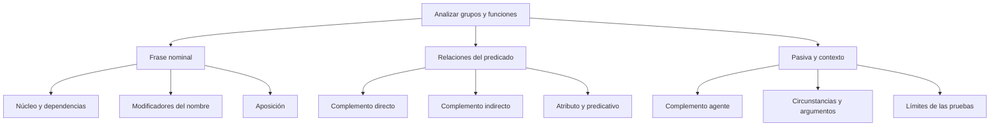

# Estructura de la Frase Nominal (FN), Frase Verbal (FV) y sus Complementos

## Introducción

En **Los estudiantes revisaron el informe**, los estudiantes es un grupo nominal que funciona como sujeto, y el informe es otro grupo nominal que funciona como complemento directo. Tener la misma clase de grupo no implica desempeñar la misma función. El análisis debe indicar de qué unidad se habla y con qué elementos se relaciona.

Esta lección utiliza las denominaciones **frase** y **sintagma** como equivalentes en los ejemplos. Para los componentes de la frase nominal se conserva la nomenclatura escolar de núcleo, modificador directo, modificador indirecto y aposición, explicando su alcance. Para los complementos del verbo se usan objeto/complemento directo e indirecto, atributo, predicativo, agente y circunstancial.

## Mapa del tema

# 5.2.1 — Frase nominal y dependencias internas

La **frase nominal** se organiza en torno a un núcleo nominal. Puede incluir determinantes, adjetivos y complementos, pero no exige que todos aparezcan ni que sigan una fórmula única. En **libros**, el sustantivo puede constituir por sí solo un grupo; en **los libros nuevos de la biblioteca**, aparecen varias dependencias.

En el análisis escolar empleado aquí, los determinantes y adjetivos unidos al nombre sin preposición se estudian como **modificadores directos**. Un complemento preposicional del nombre, como de la biblioteca, se denomina **modificador indirecto**. Estas etiquetas describen dependencias internas: no son objeto directo u objeto indirecto del verbo.

| Expresión | Segmento analizado | Análisis escolar utilizado |
| --- | --- | --- |
| el reloj | el | Determinante: modificador directo de reloj. |
| el reloj antiguo | antiguo | Adjetivo: modificador directo de reloj. |
| el reloj de oro | de oro | Modificador indirecto preposicional de reloj. |
| el río Chili | río | Sustantivo que se toma como núcleo en este análisis. |
| el río Chili | Chili | Aposición especificativa del nombre río. |

### Explicar la relación, no solo la preposición

En **el reloj de oro de mi abuelo**, el análisis depende de cómo se entiendan los complementos. Si se indica que el reloj está hecho de oro y que pertenece al abuelo, ambos grupos modifican reloj. Sin esa interpretación, una secuencia puede admitir otras agrupaciones internas. Por eso la consigna debe aclarar la relación que se evalúa.

No se deduce una función verbal por ver de, a o por. En **entregó el reloj de oro**, de oro sigue dentro del grupo nominal y modifica reloj; el grupo el reloj de oro completo desempeña la función de complemento directo de entregó. Un mismo análisis puede contener niveles de dependencia distintos.

### Aposición explicativa y especificativa

En **Elena, la coordinadora del equipo, entregó el informe**, la coordinadora del equipo añade una identificación explicativa de Elena. Las comas delimitan esa unidad nominal. En **el río Chili**, Chili especifica qué río se menciona sin quedar separado por comas.

Para reconocer una aposición se considera la relación entre expresiones nominales, no solamente la presencia de comas. Un inciso adverbial también puede ir entre comas y no por ello es aposición. Del mismo modo, no toda expresión explicativa puede sustituirse por otra palabra sin modificar el sentido o la organización de la oración.

En este nivel se emplean casos claros de aposición nominal. Otras construcciones y algunos nombres propios admiten análisis más detallados; la nomenclatura escolar se declara para que el ejercicio no dependa de adivinar qué modelo está usando quien pregunta.

# 5.2.2 — Complemento directo e indirecto

El **complemento directo**, también llamado **objeto directo**, mantiene una relación argumental con un verbo transitivo. No se define simplemente como quien recibe una acción: en **La estudiante siente alegría**, alegría es complemento directo, aunque no se describa un objeto golpeado o transformado físicamente.

En **La investigadora redactó el informe**, el informe puede sustituirse por lo: La investigadora lo redactó. En la pasiva correspondiente aparece como sujeto: El informe fue redactado por la investigadora. Las dos observaciones apoyan el análisis de este ejemplo, pero no se convierten en requisitos automáticos para cualquier complemento directo.

### Alcance de las pruebas

Las formas **lo, la, los y las** ayudan a reconocer complementos directos en los ejemplos del nivel. Hay que conservar el significado y la estructura de la oración. Lo también puede sustituir un atributo y existen fenómenos de variación en el uso de los pronombres; verlo escrito no resuelve por sí solo toda función.

La transformación pasiva es útil cuando la construcción la permite de forma natural. **No todo verbo transitivo admite con igual facilidad una pasiva equivalente**. La ausencia de una pasiva natural no demuestra por sí sola que falte complemento directo. En **Tengo dos hermanos**, se reconoce el complemento de tener sin forzar una pasiva artificial para cumplir una supuesta regla infalible.

La preposición a tampoco separa automáticamente directo e indirecto. **El jurado premió a la investigadora** permite El jurado la premió: a la investigadora es complemento directo. Es un caso de complemento directo de persona, no una prueba de que cualquier grupo con a sea indirecto.

### El complemento indirecto

En **El arqueólogo entregó las piezas al director del museo**, las piezas es complemento directo y al director del museo es **complemento indirecto**. El segundo grupo identifica al destinatario de la entrega y se relaciona con le: El arqueólogo le entregó las piezas.

| Construcción | Segmento analizado | Función justificada |
| --- | --- | --- |
| El jurado la premió. | la | Complemento directo referido a la investigadora. |
| Entregó las piezas al director. | las piezas | Complemento directo. |
| Le entregó las piezas. | le | Complemento indirecto. |
| Les otorgó diplomas a los estudiantes. | les / a los estudiantes | Dos expresiones correferentes en una duplicación del indirecto. |
| Es muy clara: lo es. | lo | Sustituto del atributo, no objeto directo. |

El indirecto no se limita en cualquier oración a un destinatario de entrega. También puede relacionarse con un experimentante: en **A Marta le gusta la música**, a Marta y le se refieren a quien experimenta el gusto; la música es el sujeto que concuerda con gusta. La función se determina con la construcción completa.

### Duplicación, no coordinación

En **Les otorgó diplomas a los mejores ingresantes**, les y a los mejores ingresantes se refieren al mismo grupo. Se trata de **duplicación pronominal** del complemento indirecto, no de coordinación entre dos destinatarios. No aparece una conjunción que sume dos participantes diferentes.

Si se sustituyen simultáneamente ambos complementos en le entregó las piezas, se obtiene **se las entregó**. En esta combinación, se corresponde al indirecto y las al directo. No se deduce que todo se de cualquier oración tenga esa función: hay que identificar la construcción de partida.

### No todo para introduce un indirecto

Un grupo con para puede expresar destino o beneficio sin ser complemento indirecto en el análisis actual. En **Entregó a Ana un paquete para Luis**, a Ana identifica a la receptora de la entrega y para Luis al destinatario final del paquete. No conviene fusionar las dos relaciones en una única regla basada en la idea general de beneficiario.

Cambiar para por a o añadir le puede modificar la estructura. Esa modificación no equivale a una sustitución que demuestre la función original. Para clasificar se examinan las relaciones sintácticas y el sentido que realmente tiene la oración.

# 5.2.3 — Atributo y complemento predicativo

El **atributo** expresa una predicación en construcciones como **Los médicos son competentes**. El grupo sumamente competentes de **Aquellos médicos son sumamente competentes** atribuye una propiedad al sujeto mediante son y puede sustituirse por lo: Aquellos médicos lo son.

La presencia de lo aquí no señala complemento directo. La construcción es copulativa y el sustituto es neutro: se dice lo son con médicos y lo es con médica. La forma no copia el género y el número de las personas, aunque el adjetivo competentes sí concuerde en número con el sujeto.

### No reducir el atributo a una lista cerrada de adjetivos

En **La alumna es investigadora**, el atributo es nominal. En otros ejemplos puede ser un grupo preposicional o adverbial. Por tanto, no se identifica automáticamente atributo con adjetivo ni se exige que todo atributo muestre una terminación de género y número idéntica a la del sujeto.

Ser, estar y parecer ofrecen los ejemplos copulativos básicos del nivel. Hay otras construcciones semicopulativas que requieren análisis propio. No se presenta yacer o permanecer como una lista intercambiable sin explicar su uso, ni se exige que la prueba con lo funcione del mismo modo en todas esas construcciones.

### Predicativo referido al sujeto

En **Los niños caminaban contentos**, contentos expresa un estado de los niños durante la acción de caminar. El adjetivo concuerda con niños, pero el verbo conserva su contenido de movimiento. En este ejemplo se identifica un **complemento predicativo del sujeto**, llamado subjetivo en la nomenclatura escolar.

Comparar **Las niñas caminaban contentas** muestra la concordancia del predicativo. Comparar **Las niñas caminaban despacio** muestra una expresión adverbial de modo que no cambia a despacias. La pregunta cómo caminaban puede resultar útil para conversar sobre el significado, pero no distingue por sí sola las dos estructuras.

### Predicativo referido al directo

En **El jurado declaró ganadora a la delegación**, a la delegación es complemento directo y ganadora se predica de él. Se comprueba la referencia con **El jurado la declaró ganadora**: la sustituye al directo y ganadora permanece. Se identifica así un **predicativo del complemento directo**, llamado objetivo en el análisis escolar.

No debe confundirse la sustitución del objeto con la del predicativo. En la declaró ganadora, la no reemplaza ganadora. El análisis necesita indicar qué segmento se sustituye y cuál permanece; de lo contrario una prueba aparentemente correcta conduce a una conclusión equivocada.

| Ejemplo | Expresión estudiada | Relación que se reconoce |
| --- | --- | --- |
| Los médicos son competentes. | competentes | Atributo referido al sujeto. |
| Los niños caminaban contentos. | contentos | Predicativo referido al sujeto. |
| El jurado la declaró ganadora. | ganadora | Predicativo referido al complemento directo. |
| Los niños caminaban despacio. | despacio | Adverbio en función circunstancial de modo en este ejemplo. |

No todos los predicativos tienen que ser adjetivos de la misma forma que contentos. Los ejemplos de concordancia sirven para justificar esos casos, no para establecer que toda expresión invariable sea necesariamente circunstancial. La categoría de un grupo y su función se analizan de forma relacionada, pero no se confunden.

# 5.2.4 — Agente, circunstancias y análisis por niveles

En **El tratado fue suscrito por los cancilleres**, por los cancilleres identifica al agente de la pasiva. La activa correspondiente es **Los cancilleres suscribieron el tratado**. El segmento que en la pasiva aparece introducido por por se relaciona aquí con el sujeto de la activa.

El **complemento agente puede omitirse**: El tratado fue suscrito sigue siendo una oración pasiva. La omisión deja sin expresar quién lo suscribió; no destruye necesariamente la estructura. Tampoco todo grupo con por es agente: por el retraso puede expresar causa en una construcción apropiada.

### Circunstancias y selección del verbo

En **Revisaron el informe ayer**, ayer sitúa temporalmente la revisión. En **Revisaron el informe en el aula**, en el aula añade una localización. Son complementos circunstanciales en esos ejemplos; no dependen de que quien escucha los considere poco importantes.

Su identificación no permite afirmar que todo lugar o toda expresión de modo sea prescindible con cualquier verbo. Hay complementos de lugar seleccionados por determinados predicados y otros complementos argumentales introducidos por preposición. Se estudia la relación con el verbo, no únicamente el significado de lugar, causa o modo.

| Construcción | Qué aporta el segmento señalado | Precaución de análisis |
| --- | --- | --- |
| El tratado fue suscrito por los cancilleres. | por los cancilleres identifica al agente. | La pasiva también puede omitirlo. |
| Revisaron el informe ayer. | ayer localiza temporalmente. | Ser importante para el relato no lo convierte en objeto. |
| Revisaron el informe en el aula. | en el aula localiza la revisión. | No generalizar a cualquier complemento de lugar. |
| Entregó el reloj de oro. | de oro modifica reloj. | Es dependencia nominal, no objeto indirecto del verbo. |

### Un análisis completo

En **La coordinadora les entregó los materiales a los estudiantes ayer**, el grupo la coordinadora funciona como sujeto. El verbo es entregó. Los materiales es complemento directo; a los estudiantes es complemento indirecto, duplicado por les. Ayer funciona como circunstancial de tiempo.

Si se amplía el directo a **los materiales de Biología**, de Biología depende de materiales dentro del grupo nominal. El grupo completo sigue siendo complemento directo. Añadir una dependencia interna no convierte de Biología en complemento indirecto de entregó.

Para justificar cada respuesta se conserva la oración, se identifica el segmento y se indica la relación con el verbo o con otro núcleo. Las abreviaturas OD, OI, MD y MI se usan después de explicar esas funciones, evitando confundir una dependencia nominal con un complemento verbal.

## Importante

Las pruebas de sustitución, concordancia y cambio de voz **se interpretan dentro de una construcción concreta**. No son reglas infalibles que permitan ignorar el verbo, el significado o la estructura. Lo puede sustituir un atributo, y a puede introducir un complemento directo de persona.

Un análisis claro precisa qué grupo se estudia, de qué depende y qué función desempeña. Las categorías de las palabras y los nombres escolares de las funciones no reemplazan esa explicación.

## Ejemplos resueltos

### Dos expresiones con a

En **El jurado premió a la delegación**, a la delegación se relaciona con la en la premió y funciona como directo. En **El jurado entregó el premio a la delegación**, el premio es directo y a la delegación es indirecto, relacionado con le. La preposición compartida no iguala las funciones.

### Un atributo y un directo

En **La explicación es clara**, clara es atributo: La explicación lo es. En **La alumna comprendió la explicación**, la explicación es directo: La alumna la comprendió. Las sustituciones se justifican por construcciones diferentes; no se concluye que cualquier pronombre átono señale una misma función.

### Un estado durante una acción

En **Las alumnas regresaron cansadas**, cansadas expresa el estado de las alumnas al regresar. La concordancia en femenino plural y la referencia al sujeto apoyan el análisis de predicativo. La oración no se resuelve mediante la pregunta cómo regresaron sin explicar qué relación mantiene ese adjetivo con alumnas.

### Una pasiva sin agente expreso

**El informe fue revisado** presenta una pasiva sin indicar quién efectuó la revisión. Si se añade **por la coordinadora**, aparece un complemento agente. La diferencia muestra una información que puede quedar sin expresar; no un requisito de nombrar siempre al agente para que exista pasiva.

## Frases: clase, núcleo y función

Una frase o sintagma se organiza alrededor de un núcleo: nominal, verbal, adjetival, adverbial o preposicional según el análisis adoptado. Su clase no determina por sí sola su función en una oración. Una frase nominal puede ser sujeto o complemento: en La estudiante lee un libro, La estudiante funciona como sujeto y un libro como complemento directo.

Para identificar función, examina la relación con otros elementos. La posición inicial no garantiza que una expresión sea sujeto. En A María le gusta la música, la música concuerda con gusta y funciona como sujeto; A María expresa a quién afecta la experiencia. Las pruebas de concordancia y sustitución son más confiables que una pregunta mecánica aislada.
