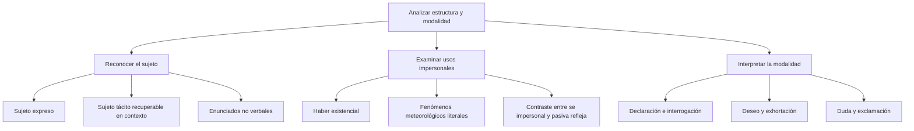

# La Oración Gramatical: Bimembre vs. Unimembre y Actitud del Hablante

## Introducción

En **La delegada entregó el informe**, se reconoce un sujeto expreso y un predicado. En **Hubo varias reuniones**, el grupo varias reuniones no funciona como sujeto del haber existencial. En **¡Auxilio!**, el contexto permite interpretar una petición completa sin que aparezca un verbo. Los tres casos comunican, pero no tienen la misma organización sintáctica.

Para distinguirlos se separan dos preguntas: **cómo se estructura la expresión** y **qué modalidad o valor comunicativo presenta**. Una pregunta puede contener sujeto y predicado, y un deseo puede escribirse entre signos de exclamación. Los criterios no se excluyen ni se resuelven localizando una palabra aislada.

## Mapa del tema

# 6.1.1 — Oración, enunciado y sujeto

Un **enunciado** es una unidad comunicativa que puede interpretarse en su contexto. Puede contener una oración, varias o una expresión menor. **Buenos días**, usado como saludo, constituye un enunciado sin necesitar un verbo conjugado. La noción comunicativa de enunciado no se identifica sin más con la estructura gramatical de una oración.

Una **oración** presenta una organización sintáctica que permite analizar una predicación. Puede ser independiente o estar incluida en otra construcción: en **La delegada dijo que volvería**, que volvería está subordinada y conserva estructura oracional. Por eso la independencia comunicativa no es una condición que deba cumplir por sí sola cualquier oración subordinada.

### Bimembre y unimembre en la nomenclatura escolar

La clasificación escolar llama **bimembre** a la estructura que distingue sujeto y predicado. Incluye ejemplos con sujeto escrito y otros donde se recupera un sujeto tácito. Utiliza **unimembre** para expresiones que no presentan esa división, entre ellas las impersonales y ciertos enunciados no verbales. Esta terminología se declara para no mezclar criterios de modelos distintos.

| Ejemplo en su contexto | Organización observada | Denominación escolar empleada |
| --- | --- | --- |
| Los delegados caminaron. | Sujeto expreso: los delegados. | Bimembre con sujeto expreso. |
| Hablamos de los delegados: caminaron tres horas. | Se recupera el sujeto de caminaron a partir del contexto. | Bimembre con sujeto tácito. |
| Hubo varias reuniones. | Haber existencial sin sujeto léxico. | Unimembre verbal impersonal. |
| ¡Auxilio!, como petición independiente. | Enunciado sin verbo. | Unimembre no verbal en esta nomenclatura. |

En **Mañana llegarán los delegados**, el sujeto aparece después del verbo. El orden inicial no identifica automáticamente el sujeto. En **A la delegada la felicitaron sus compañeros**, a la delegada no pasa a ser sujeto por estar al comienzo: sus compañeros concuerda con felicitaron y funciona como sujeto.

### Sujeto tácito y referencia indeterminada

En un relato sobre **los excursionistas**, la oración **Caminaron durante tres horas** permite recuperar ese grupo como sujeto tácito. La terminación verbal aporta persona y número, mientras el contexto ayuda a identificar a quienes se refiere. No se obtiene toda la referencia solamente de las letras finales del verbo.

Una tercera persona plural no siempre identifica a un grupo conocido. En **Llaman a la puerta**, puede quedar indeterminado quién llama, e incluso puede tratarse de una sola persona. Esa interpretación suele incluirse entre los usos de impersonalidad inespecífica. No se aplica la regla automática de que toda tercera persona plural equivale necesariamente a ellos conocidos.

También hay distintas descripciones teóricas de las oraciones impersonales. El análisis escolar de este nivel distingue un sujeto tácito referencial de la ausencia de un sujeto léxico en haber existencial y en los ejemplos meteorológicos. La pregunta debe proporcionar el contexto necesario para no confundir ambos casos.

# 6.1.2 — Impersonalidad y construcciones que conviene contrastar

En **Hubo muchos postulantes**, haber expresa existencia. Según la norma general del español, se mantiene en singular: **hay, había, hubo, habrá**. Muchos postulantes no determina una concordancia verbal plural como la que aparece con un sujeto plural en Los postulantes llegaron.

En el análisis escolar utilizado, el grupo nominal del haber existencial se estudia como **complemento directo**. En **Hubo muchas dificultades**, la sustitución **Las hubo** ayuda a observar esa relación. Se interpreta junto con la construcción existencial; no se convierte cualquier sustitución por las en una prueba de impersonalidad de toda una oración.

| Uso de haber | Ejemplo | Qué se distingue |
| --- | --- | --- |
| Existencial en pasado | Hubo varias reuniones. | Haber impersonal en singular. |
| Existencial en tiempo compuesto | Ha habido varias reuniones. | El auxiliar se mantiene en singular. |
| Auxiliar de otro verbo | Los delegados habían terminado. | Haber forma parte de un tiempo compuesto y concuerda con el sujeto. |
| Contraste de verbos | Existían varias soluciones. | Existir tiene otra construcción: varias soluciones es sujeto plural. |

### No juzgar una forma fuera de su uso

En **Hubieron varios accidentes**, con valor de existencia, la norma general recomienda **Hubo varios accidentes**. La corrección se refiere a esa construcción. **Hubieron** también existe como forma auxiliar del pretérito anterior, de uso poco frecuente, como en **Cuando hubieron terminado, salieron**. Por tanto, no se enseña que la secuencia hubieron sea incorrecta en cualquier oración imaginable.

Corregir un uso conforme al registro formal no requiere descalificar a quien habla. Se explica la construcción, la concordancia que corresponde y la alternativa recomendada. La variación lingüística no se utiliza para inferir capacidad o valor personal.

### Fenómenos meteorológicos y sentidos figurados

En **Nevó intensamente sobre la cordillera**, nevar se emplea con sentido meteorológico literal y no se expresa un sujeto que produzca la nevada. En **La nieve cubrió el camino**, en cambio, la nieve es sujeto del verbo cubrir. Hablar de un fenómeno natural no convierte automáticamente una oración en impersonal.

Los verbos meteorológicos admiten además usos figurados. En **Llovieron mensajes de apoyo**, mensajes de apoyo concuerda con llovieron en esa construcción figurada. La forma léxica del verbo no permite trasladar sin análisis la impersonalidad del ejemplo literal.

| Construcción | Relación que se reconoce | Precaución |
| --- | --- | --- |
| Nevó sobre la cordillera. | Uso meteorológico impersonal. | Se especifica la interpretación literal. |
| La lluvia caía sobre el tejado. | La lluvia es sujeto de caía. | El significado meteorológico del nombre no elimina el sujeto. |
| Hace frío. | Uso impersonal de hacer. | No equivale a Los estudiantes hacen maquetas. |
| Se vive bien aquí. | Se impersonal. | No se identifica todo se con impersonalidad. |
| Se venden libros. | Pasiva refleja con libros como sujeto. | La concordancia plural la distingue del ejemplo anterior. |

### Interpretar se en la construcción completa

**Se vive bien aquí** presenta un uso impersonal: se habla de una manera general de vivir sin identificar un sujeto léxico. **Se venden libros** permite reconocer libros como sujeto paciente plural en una pasiva refleja. En **Se atiende a los visitantes**, la a personal y el singular verbal orientan al análisis impersonal del ejemplo.

No basta con localizar se y contar cuántas palabras siguen. También existen usos reflexivos y pronominales que requieren otros análisis. Se compara la concordancia, el tipo de complemento y el significado de la construcción.

### Enunciados no verbales

**¡Auxilio!**, entendido como petición de ayuda, comunica por sí solo en una situación adecuada. En la nomenclatura escolar del nivel se clasifica como unimembre no verbal. Esto no significa que toda expresión sin verbo carezca de estructura ni que toda frase tenga que estar incompleta comunicativamente.

**A las cuatro**, como respuesta a ¿A qué hora comienza?, es un enunciado interpretable gracias al contexto. La misma secuencia, aislada y sin situación, puede no bastar para reconstruir lo que se comunica. Se distinguen así la estructura de una expresión y su uso en un intercambio concreto.

# 6.1.3 — Modalidad y actitud del hablante

La clasificación por **modalidad** y por actitud del hablante atiende a cómo se presenta un contenido: como afirmación, pregunta, deseo, posibilidad u orden, entre otros valores. La clasificación escolar siguiente sirve para organizar ejemplos claros; no exige que todos esos rasgos sean incompatibles en cualquier uso real.

| Valor estudiado | Ejemplo | Lectura que se justifica |
| --- | --- | --- |
| Declarativo o enunciativo | La reunión comienza a las cuatro. | Se presenta una información. |
| Interrogativo | ¿A qué hora comienza la reunión? | Se introduce una incógnita temporal. |
| Exclamativo | ¡Qué clara quedó la explicación! | Se expresa una valoración exclamativa. |
| Exhortativo | Mantengan el orden. | Se solicita una conducta mediante una orden. |
| Desiderativo u optativo | Ojalá termine a tiempo. | Se expresa un deseo. |
| Dubitativo | Tal vez viajemos mañana. | Se presenta una posibilidad no asegurada. |

Que una oración sea declarativa no demuestra que su contenido sea verdadero. Puede expresar una afirmación errónea o pertenecer a un relato ficticio. Del mismo modo, unos signos de exclamación no eliminan el valor desiderativo de **¡Ojalá salga bien!**. La consigna debe indicar qué aspecto se está clasificando.

### Directa e indirecta no clasifican lo mismo que total y parcial

En **¿Llegaron los delegados?**, la interrogación es directa y total. En **¿Quién llegó?**, es directa y parcial: se deja abierta la identidad de una persona. En **No sé si llegaron los delegados**, si llegaron los delegados es una interrogativa indirecta total incluida en una oración mayor.

En **No sé quién fue el autor de ese informe**, la subordinada **quién fue el autor de ese informe** es interrogativa indirecta parcial. La oración completa presenta declarativamente un desconocimiento. No se atribuye sin más la modalidad de la subordinada al conjunto de la oración.

| Segmento que se clasifica | Dependencia | Estructura interrogativa |
| --- | --- | --- |
| ¿Llegaron los delegados? | Directa. | Total en este ejemplo. |
| ¿Quién llegó? | Directa. | Parcial. |
| si llegaron los delegados, en No sé si llegaron | Indirecta. | Total. |
| quién llegó, en No sé quién llegó | Indirecta. | Parcial. |

La ausencia de signos no basta para identificar una interrogativa indirecta. **Sé que llegaron** tampoco lleva signos y contiene una subordinada declarativa. El análisis busca una incógnita y la estructura correspondiente, no simplemente un verbo de saber seguido de cualquier grupo de palabras.

Las interrogativas totales se practican aquí con ejemplos que permiten respuestas como sí o no. Hay también interrogativas que ofrecen alternativas: **¿Vendrán hoy o mañana?**. No se reduce todo el grupo a una obligación de contestar siempre mediante una sola de esas dos palabras.

### Deseo, duda y exhortación en los ejercicios

En **Ojalá obtengas el primer puesto**, el contenido se presenta como deseado. El subjuntivo obtengas contribuye a esa construcción, pero un subjuntivo no señala por sí solo deseo en cualquier oración. En **Tal vez viajemos**, el hablante expresa posibilidad o incertidumbre, aunque además pueda tener ganas de viajar.

En **Señores postulantes, mantengan el orden y no abran el cuadernillo**, aparecen una orden y una prohibición dirigidas a los destinatarios. La clasificación pedida es exhortativa. El vocativo señores postulantes no se convierte por ello en el sujeto gramatical expreso de los verbos.

En la comunicación también puede utilizarse una pregunta para pedir algo: **¿Puedes cerrar la ventana?** tiene forma interrogativa y puede funcionar como petición. Ese uso muestra por qué conviene precisar si se estudia la estructura, la modalidad o el acto comunicativo, en lugar de hacerlos equivalentes.

## Importante

Antes de clasificar, indica **qué segmento y qué criterio** analizas. Un sujeto tácito necesita un contexto de referencia; una interrogativa subordinada no fija automáticamente la modalidad de toda la oración. En haber existencial, la norma singular se explica por el uso, no por una prohibición de cualquier forma plural de haber.

No se evalúa la competencia de una persona por una forma lingüística aislada. Las correcciones del registro formal se justifican con la construcción y con ejemplos comparables.

## Ejemplos resueltos

### Haber y existir

**Hubo varias dificultades** mantiene haber en singular. El grupo varias dificultades se analiza aquí como complemento directo y permite Las hubo. En **Existieron varias dificultades**, el verbo existir concuerda con el sujeto plural. Las dos oraciones pueden comunicar contenidos semejantes sin compartir exactamente el mismo análisis sintáctico.

### Un sujeto que el relato permite recuperar

El texto presenta a **los excursionistas** y continúa: **Caminaron durante tres horas**. En esa lectura, el sujeto tácito de caminaron se refiere al grupo mencionado. No se afirma que toda tercera persona plural identifique necesariamente a varias personas conocidas: hace falta atender al contexto.

### Un fenómeno natural con y sin sujeto

**Nevó durante la noche** presenta un uso meteorológico impersonal. En **La lluvia dañó el camino**, la lluvia es sujeto expreso de dañó. La presencia de vocabulario del clima no sustituye el análisis de la estructura verbal.

### El segmento interrogativo

En **No sé quién escribió el informe**, se delimita quién escribió el informe. Ese segmento presenta una incógnita sobre la persona y depende de sé: es interrogativa indirecta parcial. No se confunde con la oración mayor, que afirma un desconocimiento.

### El alcance de una corrección

En **Hubieron varias reuniones**, usado para expresar existencia, se corrige a **Hubo varias reuniones**. En **Cuando hubieron terminado, salieron**, haber funciona como auxiliar de terminado. Los usos son distintos, y la corrección formal debe explicar cuál de ellos está evaluando.
