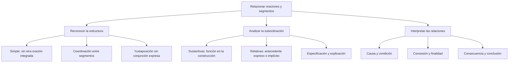

# Oraciones Compuestas: Coordinadas y Subordinadas

## Introducción

**La delegada revisó el informe** presenta una predicación. **La delegada revisó el informe y el equipo corrigió los datos** relaciona dos oraciones mediante coordinación. En **La delegada afirmó que el informe estaba listo**, una oración se integra en otra como contenido de lo afirmado. Esas relaciones, y no el número de palabras escritas, orientan el análisis.

La terminología escolar utiliza oración compuesta y proposición para estudiar estas construcciones. Aquí se declara el segmento que se clasifica y se distingue su estructura de su función. Una oración de relativo puede desempeñar una función nominal sin convertirse por ello en una subordinada sustantiva del mismo tipo que que el informe estaba listo.

## Mapa del tema

# 6.2.1 — Oración simple, coordinación y yuxtaposición

Una **oración simple** no contiene otra oración integrada. Puede incluir un tiempo compuesto o una perífrasis: **El equipo ha terminado** y **El equipo tiene que terminar** no se vuelven compuestas por contener varias formas verbales escritas. Se analiza la organización del predicado y no se cuentan automáticamente los verbos como unidades independientes.

En **El equipo afirmó que terminaría**, que terminaría es una oración subordinada incluida en una construcción mayor. En **El equipo terminó y la delegada presentó el informe**, se coordinan dos oraciones. La oposición simple/compuesta requiere reconocer esas relaciones.

| Construcción | Qué organización se observa | Conclusión del ejemplo |
| --- | --- | --- |
| El equipo terminó. | Un predicado sin otra oración integrada. | Oración simple. |
| El equipo ha terminado. | Tiempo compuesto con haber. | No hay dos oraciones por escribir ha terminado. |
| El equipo tiene que terminar. | Perífrasis de obligación. | No hay dos oraciones por contar tiene y terminar. |
| El equipo afirmó que terminaría. | Una subordinada integrada. | Construcción compuesta por subordinación. |
| El equipo terminó y la delegada presentó el informe. | Dos oraciones coordinadas. | Construcción compuesta por coordinación. |

### Qué puede coordinar una conjunción

La **coordinación** puede relacionar oraciones, pero también palabras y grupos. En **Trajo libros y cuadernos**, y une dos elementos nominales dentro de un complemento; no demuestra que haya dos oraciones. En **Estudió y luego descansó**, se coordinan dos predicados con formas verbales personales, y luego aporta una referencia temporal dentro del segundo segmento.

El mismo cuidado se necesita con pero. **El examen era riguroso, pero no imposible** puede analizarse como coordinación de adjetivos dentro de una predicación. Para preguntar por dos oraciones adversativas sin depender de una reconstrucción elíptica, resulta más claro **El examen era riguroso, pero los postulantes mantuvieron la calma**.

### Yuxtaponer no significa colocar cualquier coma

En **El expositor presentó su investigación; el auditorio escuchó en silencio**, se enlazan dos oraciones sin conjunción expresa: hay **yuxtaposición**. La puntuación representa la organización escrita, pero el punto y coma no sustituye el análisis de las unidades que relaciona.

Una coma también puede delimitar una aposición o separar elementos de una enumeración. Por tanto, ver coma, dos puntos o punto y coma no basta para concluir que existen dos oraciones coordinadas. Además, los segmentos yuxtapuestos pueden sugerir distintas relaciones de significado: sucesión, explicación, causa o consecuencia, según el contexto.

# 6.2.2 — Valores de coordinación y conexión del discurso

En los ejercicios escolares se distinguen valores de adición, alternativa, oposición y distribución. También se estudian explicaciones y conclusiones entre segmentos. **La relación de significado no determina por sí sola una categoría gramatical única del enlace**: una conjunción y un conector discursivo pueden contribuir a una relación semejante mediante construcciones distintas.

| Relación estudiada | Ejemplo | Qué se reconoce |
| --- | --- | --- |
| Adición | Lee el texto y toma notas. | y coordina dos predicados con valor copulativo. |
| Alternativa | Puedes escribir o llamar. | o presenta alternativas; el contexto determina su alcance. |
| Oposición | Quería continuar, pero estaba cansada. | pero establece una relación adversativa. |
| Distribución en la nomenclatura tradicional | Bien estudian en la biblioteca, bien practican en casa. | bien… bien… organiza alternativas o actividades distribuidas. |
| Reformulación | El plazo es breve, es decir, dos días. | es decir aclara un segmento, sin exigir dos oraciones completas. |
| Conclusión | Ya cerró la biblioteca, así que volveremos mañana. | así que introduce una conclusión o consecuencia. |

### Alternativas y distribución

La conjunción o no obliga en todos sus usos a elegir una opción y excluir la otra. **Puedes escribir o llamar** ofrece alternativas que el contexto puede permitir combinar. Una consigna que evalúe exclusión debe aportar la interpretación correspondiente en lugar de atribuírsela automáticamente a cualquier o.

**Bien… bien…** se estudia tradicionalmente bajo la etiqueta distributiva. Otras descripciones la relacionan con la coordinación disyuntiva correlativa. Para una pregunta de respuesta única se indica la nomenclatura utilizada. Lo central es reconocer cómo se presentan las alternativas, no memorizar que nunca puedan excluirse entre sí.

### Conjunción y conector discursivo

**Pero** es una conjunción en los ejemplos anteriores. **Sin embargo** y **por lo tanto** pueden actuar como conectores del discurso; no se convierten automáticamente en conjunciones coordinantes por expresar contraste o consecuencia. En **Estudió y, sin embargo, no terminó**, pueden coexistir y y sin embargo con funciones distintas.

También es necesario interpretar **luego**. En **Pienso, luego existo**, introduce una conclusión en la formulación dada. En **Almorzamos y luego salimos**, equivale a después dentro del segundo miembro. La coincidencia escrita no vuelve idénticas las dos relaciones.

La denominación **ilativa** se utiliza para conexiones de conclusión o consecuencia en determinadas clasificaciones. No significa que el enlace garantice la verdad de lo dicho ni que cualquier secuencia que lo contenga constituya una demostración lógica válida. Se describe la relación expresada por el hablante.

# 6.2.3 — Sustantivas, relativas y funciones

Una **subordinada sustantiva** puede desempeñar funciones características de un grupo nominal en una construcción mayor. En **El decano afirmó que publicarían los resultados**, que publicarían los resultados expresa el contenido de la afirmación y funciona como complemento directo: El decano lo afirmó.

En **Me preocupa que llegues tarde**, que llegues tarde funciona como sujeto de preocupa. Me señala a la persona que experimenta la preocupación. La presencia de una subordinada tras un verbo no demuestra que necesariamente sea su complemento directo: hay que reconocer la relación concreta.

### La sustitución ayuda si conserva la construcción

Comparar **Afirmó que vendría** con **Afirmó eso** resulta útil. En **Confía en que revisarán el informe**, la preposición en debe conservarse al comparar con Confía en eso. No se elimina una preposición exigida por el verbo para aplicar una fórmula mecánica.

La sustitución por eso no decide por sí sola todas las clasificaciones ni identifica una única función. El sujeto, el complemento directo y el término de una preposición pueden permitir sustituciones nominales en ejemplos apropiados. Primero se delimita la unidad y después se explica la función que desempeña.

### Relativas con antecedente expreso

En **Los postulantes que se inscribieron a tiempo rindieron el examen**, que se inscribieron a tiempo restringe la referencia de postulantes. Se reconoce una **oración de relativo especificativa**, llamada tradicionalmente adjetiva especificativa, y no se separa como inciso mediante comas.

En **Los postulantes, que se inscribieron a tiempo, rindieron el examen**, el inciso añade una información sobre el grupo ya identificado. Se trata de una **relativa explicativa**. La diferencia no es un adorno de puntuación: cambia cómo se presenta el grupo del que se habla.

**La casa donde crecí queda en Yanahuara** contiene una relativa que modifica casa. Donde conserva su naturaleza relativa aunque aporte una referencia de lugar. No se clasifica toda oración con donde como circunstancial del verbo principal: aquí donde crecí se relaciona con el antecedente nominal casa.

### Relativas sin antecedente expreso

En **Quienes alcancen el puntaje requerido obtendrán la vacante**, quienes alcancen el puntaje requerido es una **relativa libre**, sin antecedente nominal expreso. El conjunto desempeña la función de sujeto de obtendrán. Su estructura relativa y su función nominal son dos datos compatibles.

No debe confundirse esta relativa con una sustantiva introducida por una conjunción que. Que una unidad desempeñe función de sujeto o pueda relacionarse con ellos no demuestra que todas las subordinadas de sujeto tengan la misma estructura interna.

| Segmento dentro de su construcción | Estructura reconocida | Función o relación exterior |
| --- | --- | --- |
| que publicarán los resultados, en El decano afirmó… | Sustantiva declarativa. | Complemento directo de afirmó. |
| que llegues tarde, en Me preocupa… | Sustantiva declarativa. | Sujeto de preocupa. |
| quienes alcancen el puntaje…, en …obtendrán la vacante | Relativa libre. | El conjunto funciona como sujeto de obtendrán. |
| que se inscribieron a tiempo, tras postulantes | Relativa con antecedente expreso. | Restringe la referencia del nombre. |
| donde crecí, tras la casa | Relativa con antecedente expreso. | Modifica casa, no directamente queda. |

Las copulativas con grupos nominales definidos pueden admitir análisis diferentes según su organización. Por eso no se utiliza **Mi meta es alcanzar una vacante** como una prueba automática de atributo mediante Mi meta lo es. Los ejemplos del nivel permiten reconocer funciones sin exigir que una sustitución forzada decida una construcción discutible.

# 6.2.4 — Causa, condición, concesión y otras relaciones

En la clasificación escolar se agrupan muchas construcciones bajo el nombre de **subordinadas adverbiales**. Algunas expresan localización, tiempo o manera; otras establecen relaciones como causa, condición, concesión o finalidad. No todas se comportan como un adverbio intercambiable por una sola palabra, y conviene justificar los casos por su estructura y significado.

En **Iré a la biblioteca aunque llueva**, aunque llueva presenta una dificultad que no cancela la intención expresada por iré. Se reconoce una **concesiva**. No se afirma con ello que el hablante vaya a cumplir necesariamente lo anunciado: se describe cómo relaciona la lluvia con su decisión.

| Relación | Ejemplo | Interpretación del segmento |
| --- | --- | --- |
| Causa | No salió porque estaba enferma. | Se presenta un motivo de no salir. |
| Condición | Si llueve, nos quedaremos. | Se formula una condición para lo anunciado. |
| Concesión | Iré aunque llueva. | Se presenta un obstáculo que no cancela la decisión expresada. |
| Finalidad | Te prestó el libro para que repases. | Se expresa el propósito del préstamo. |
| Consecuencia con cuantificación | Habló tan bajo que nadie lo oyó. | tan… que relaciona el grado con una consecuencia. |

### No identificar una construcción por una palabra aislada

**No sé si llueve** contiene una interrogativa indirecta total, no una condición para otra acción. La misma forma si aparece con un uso distinto en **Si llueve, nos quedaremos**. El análisis debe conservar el resto de la oración para distinguir las relaciones.

De igual manera, una palabra que puede introducir una concesión en un contexto necesita analizarse en el uso concreto. Los ejercicios de esta lección aportan la oración completa para justificar el valor evaluado. No se enseña un detector de palabras que sustituya la lectura.

### Consecuencia, conclusión y comparación

En **Habló tan bajo que nadie lo oyó**, el esquema tan… que organiza una construcción consecutiva relacionada con el grado. En **Ya es tarde, así que nos iremos**, se presenta una conclusión o consecuencia mediante otro esquema. No se afirma que toda expresión de consecuencia necesite obligatoriamente tan, tanto o tal.

La comparación también tiene sus propios esquemas: **Estudia más que antes** compara con un término expresado por antes. No toda comparación exige que se escriban dos verbos personales. Del mismo modo, no se identifica toda palabra que como relativo: su función depende de la construcción que introduce.

### Relaciones temporales, de lugar y de manera

En **Salió cuando terminó la reunión**, cuando terminó la reunión sitúa temporalmente la salida. En **Acamparemos donde nace el río**, la construcción aporta el lugar donde se acampará. Estas relaciones no deben confundirse con **la casa donde crecí**, donde la relativa está integrada como modificador del nombre casa.

No se deduce la función del grupo mayor por la categoría de una palabra dentro de él. Donde puede ser un relativo adverbial y encabezar una relativa que modifica un sustantivo. Esa distinción entre categoría y función continúa lo estudiado en las lecciones anteriores.

## Importante

Delimita **qué oración o segmento se analiza**, identifica su relación con el resto y después aplica la etiqueta correspondiente. No basta contar verbos, localizar una coma o buscar un enlace aislado. Tampoco la función de sujeto convierte todas las subordinadas que la desempeñan en una única clase estructural.

Cuando una denominación pertenece a una clasificación escolar concreta, se declara el criterio. Los ejemplos deben permitir una respuesta justificada y no obligar a escoger entre etiquetas compatibles o entre análisis que la propia gramática distingue.

## Ejemplos resueltos

### Una yuxtaposición

En **El expositor presentó su investigación; el auditorio escuchó en silencio**, se reconocen dos oraciones y no aparece una conjunción entre ellas. La relación formal es de yuxtaposición. Una coma dentro de la expresión el expositor, responsable del proyecto, no demostraría por sí sola la presencia de otra oración.

### Una adversativa con dos miembros claros

**El examen era riguroso, pero los postulantes mantuvieron la calma** relaciona dos oraciones con pero y expresa oposición o restricción. Se distingue de **riguroso, pero no imposible**, donde pueden coordinarse dos adjetivos dentro de una sola predicación. La extensión del segmento importa.

### Dos sujetos de estructura distinta

En **Quienes llegaron temprano encontraron sitio**, el sujeto es una relativa libre. En **Me preocupa que lleguen tarde**, el sujeto es una subordinada sustantiva declarativa. Reconocer la misma función externa no obliga a dar a los dos segmentos la misma clasificación interna.

### Una relativa de lugar

En **La casa donde crecí queda cerca**, donde crecí modifica casa. La información de lugar que contiene no la convierte en un circunstancial directo de queda. Primero se identifica el antecedente y la dependencia nominal; después se explica la función del relativo dentro de su oración.

### Una conclusión y una secuencia temporal

En **Pienso, luego existo**, luego introduce una conclusión según la formulación del enunciado. En **Almorzamos y luego salimos**, luego sitúa temporalmente la salida y la conjunción y relaciona los predicados. No se llama simple a la segunda construcción solamente por interpretar luego como adverbio.
