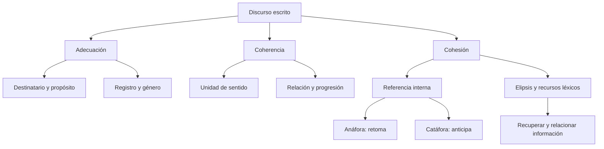

# El Discurso Escrito: Adecuación, Coherencia y Mecanismos de Cohesión

## Introducción
Un texto se interpreta como una unidad de comunicación en una situación concreta. Puede ocupar una palabra, un aviso o varios párrafos. Su calidad no depende de acumular conectores: importa qué comunica, a quién se dirige y cómo relaciona sus ideas. Para revisar un escrito conviene distinguir **adecuación**, **coherencia** y **cohesión**, aunque en la lectura actúen juntas.

Compara estas situaciones: un informe correcto que el destinatario no entiende por sus tecnicismos; un párrafo lleno de enlaces que afirma ideas incompatibles; y una explicación breve que se entiende sin repetir su tema en cada oración. Cada caso obliga a mirar un aspecto diferente del discurso. Las categorías ayudan a justificar un análisis; no sustituyen la lectura del fragmento completo.

## 7.1.1 · Adecuación, coherencia y cohesión
La **adecuación** es la relación del texto con su propósito, destinatario, género y circunstancias. Una explicación médica para un paciente puede ser precisa y comprensible sin reproducir todas las abreviaturas de una comunicación entre especialistas. Adecuar no significa tratar al lector con condescendencia ni suponer que todo intercambio cotidiano requiere expresiones informales.

La **coherencia** permite construir un sentido global. Intervienen las ideas expresadas, sus relaciones y el conocimiento pertinente de la situación. No es una propiedad que se mida contando pronombres. Un texto puede usar conectores correctos y, sin embargo, sostener afirmaciones incompatibles acerca del mismo hecho, momento y punto de vista.

La **cohesión** reúne procedimientos lingüísticos que conectan partes del texto: referencias, repeticiones pertinentes, relaciones léxicas, omisiones recuperables y conectores, entre otros. No todas las conexiones deben estar señaladas por una palabra específica. El lector también infiere relaciones; esa inferencia debe apoyarse en el contexto, no en información inventada.

| Aspecto | Pregunta de revisión | Problema reconocible |
| --- | --- | --- |
| Adecuación | ¿La manera de comunicar corresponde al propósito y al destinatario? | Un aviso práctico usa terminología que su público no puede interpretar. |
| Coherencia | ¿Puede construirse un sentido global compatible con lo dicho? | Se afirma que una sala está vacía y que contiene asistentes en el mismo momento, sin explicación. |
| Cohesión | ¿Cómo se enlazan las expresiones y sus referentes? | Un pronombre puede remitir a dos personas y el texto no permite decidir a cuál. |

**Ejemplo de revisión.** «La biblioteca cerró a las seis. A las siete, el público seguía entrando por su puerta principal». No basta con declarar que hay contradicción: puede existir una apertura extraordinaria, otra fecha o un uso distinto de cerrar. Si el fragmento establece que se trata del mismo día, del cierre al público y de ninguna excepción, entonces sí corresponde señalar la incompatibilidad. Un juicio sobre coherencia necesita esas condiciones.

## 7.1.2 · Anáfora, catáfora y referencia al contexto
Un elemento tiene valor **anafórico** cuando se interpreta mediante una expresión anterior. En «Visité Arequipa. Allí recorrí el centro», *allí* retoma el lugar mencionado. No significa que la palabra *allí* sea anafórica en todos sus usos: al señalar un sitio durante una conversación, también puede depender de la situación.

La **catáfora** dirige la interpretación hacia una expresión posterior. En «Preparó esto: una carpeta y dos cuadernos», *esto* se concreta después de los dos puntos. El signo ayuda a organizar la información, pero no basta por sí solo para diagnosticar catáfora. Antes de una cita o de una consecuencia también puede haber dos puntos sin que exista el pronombre anticipador de este ejemplo.

Cuando la referencia se resuelve dentro del texto se habla de **endófora**. Si depende de la situación del intercambio, se habla de referencia **exofórica**. En «Déjalo aquí», *aquí* puede señalar el escritorio de quien habla sin que el escritorio se haya nombrado. Hay que reconstruir el uso concreto antes de elegir una categoría.

| Fragmento | Elemento analizado | Cómo se interpreta |
| --- | --- | --- |
| Ana llegó temprano. Ella abrió la sala. | Ella | Retoma a Ana: anáfora. |
| Solo pidió esto: unos minutos de silencio. | Esto | Anticipa la petición que se precisa después: catáfora. |
| Viajé a Arequipa. Allí encontré a mis amigos. | Allí | Recupera el lugar nombrado: anáfora locativa. |
| Una persona señala una mesa y dice «déjalo aquí». | Aquí | Se interpreta por la situación: referencia exofórica. |

Los posesivos necesitan la misma atención. «Luis habló con Pablo sobre su proyecto» puede resultar ambiguo: *su* no identifica automáticamente al dueño. Repetir el nombre pertinente puede mejorar el texto más que introducir otro pronombre. La economía de palabras deja de ser útil cuando vuelve incierta la referencia.

Un ejemplo claro de referencia a una obra sería «Leí una novela. Esa obra me sorprendió». Si se escribe «Mario publicó una novela y este obtuvo reconocimiento», el masculino *este* no debe presentarse indistintamente como sustituto del autor y de una obra femenina. El género, la concordancia y el contexto participan en la interpretación.

## 7.1.3 · Elipsis y relaciones léxicas
La **elipsis** consiste en no expresar un elemento recuperable. En «Marta eligió Historia; Pedro, Geografía», el verbo de la segunda parte se recupera como *eligió*. La coma señala esa omisión en la escritura. No faltan al azar palabras necesarias: la estructura y el contexto permiten reconstruirlas.

El español también admite **sujeto tácito**: «Los estudiantes llegaron y ocuparon sus asientos». La segunda forma verbal mantiene el referente del sujeto sin repetirlo. En el análisis escolar de cohesión puede describirse como elipsis del sujeto; gramaticalmente se relaciona con la posibilidad de dejarlo implícito. No debe confundirse con un pronombre visible ni afirmarse que todo sujeto ausente tiene un antecedente inequívoco.

Los recursos **léxicos** incluyen repetir una palabra cuando conviene y emplear otra expresión que conserve una relación pertinente. Un hiperónimo permite pasar de una denominación específica a una más general: «Apareció un perro. El animal estaba herido». Esa relación depende del sentido zoológico de *perro* usado aquí.

Una expresión descriptiva puede recuperar a una persona ya identificada: «César Vallejo nació en Santiago de Chuco. El poeta peruano escribió *Los heraldos negros*». *El poeta peruano* es una denominación contextual del mismo referente; no es un sinónimo de diccionario del nombre propio ni permite identificar a Vallejo fuera de cualquier contexto.

| Recurso | Ejemplo | Qué se conserva o recupera |
| --- | --- | --- |
| Elipsis verbal | Marta eligió Historia; Pedro, Geografía. | Se recupera eligió en la segunda parte. |
| Sujeto tácito en continuidad | Los estudiantes llegaron y ocuparon sus asientos. | Se mantiene el referente de los estudiantes. |
| Hiperónimo | Apareció un perro. El animal estaba herido. | Animal incluye al perro mencionado. |
| Expresión descriptiva | Se mencionó a Vallejo. El poeta peruano… | El contexto identifica al referente. |

La repetición no es siempre un defecto. En una demostración, una norma o una explicación técnica puede ser preferible conservar el mismo término para evitar cambios de significado. Cambiar *célula* por una palabra imprecisa solo para no repetirla perjudica la claridad. El propósito de la cohesión es mantener las relaciones del discurso, no exhibir variedad léxica a cualquier precio.

## 7.1.4 · Progresión temática y revisión del sentido
El **tema** puede entenderse como aquello de lo que se habla y el **rema** como lo que se dice de ello. Con frecuencia el tema se relaciona con información conocida y el rema con información nueva, pero no son equivalencias automáticas. Un texto puede introducir por primera vez a su protagonista como tema; el receptor no necesita conocerlo antes.

Hay distintas maneras de avanzar. En la progresión con tema constante, varias oraciones añaden datos sobre el mismo asunto. En la progresión lineal, una parte de la información nueva pasa a servir de punto de partida de la oración siguiente. Son modelos de organización, no moldes obligatorios para cada oración de cualquier texto.

| Organización | Secuencia breve | Cómo avanza |
| --- | --- | --- |
| Tema constante | La biblioteca tiene dos salas. La biblioteca abre temprano. | Añade información sobre el mismo lugar. |
| Progresión lineal | La biblioteca recibió una colección. La colección contiene mapas. | El aporte de la primera oración se retoma como tema de la segunda. |
| Tema general y aspectos | El informe describe el centro: primero las salas, después el archivo. | Desarrolla aspectos relacionados con un tema general. |

**Revisión guiada.** En «El grupo necesita un lugar tranquilo. La biblioteca ofrece una sala de estudio. Esa sala abre por la mañana», las oraciones se conectan por el problema inicial, la propuesta de un lugar y una referencia posterior. No es necesario insertar *por tanto* en cada enlace. Sí sería necesario aclarar quién puede entrar si el texto pretende orientar a un público concreto.

Para revisar un fragmento, identifica primero su asunto y finalidad. Después comprueba los referentes de pronombres y omisiones. Finalmente examina si cada idea añade algo pertinente y si las relaciones se sostienen en las condiciones descritas. Cambiar la puntuación puede aclarar un vínculo, pero no convierte una afirmación falsa o incompatible en una explicación correcta.

## Importante
La clasificación depende del uso. Un pronombre no es siempre anafórico; los dos puntos no garantizan catáfora; una repetición no es siempre defectuosa. Una expresión descriptiva puede recuperar a alguien sin ser su sinónimo léxico. Tampoco toda diferencia entre dos frases es contradicción: hay que comprobar tiempo, referente y perspectiva. Justifica cada respuesta con el fragmento, evitando reglas basadas en una sola palabra.

## Síntesis
La adecuación relaciona el texto con su situación; la coherencia permite interpretarlo globalmente; la cohesión aporta enlaces lingüísticos. Anáfora y catáfora se distinguen por la dirección de la referencia. La elipsis deja implícito lo recuperable y los recursos léxicos mantienen o precisan referentes. La progresión temática organiza lo que se presenta como punto de partida y lo que se añade sobre ello. Estas herramientas sirven para explicar y mejorar un texto, no para asignarle etiquetas sin leerlo.
