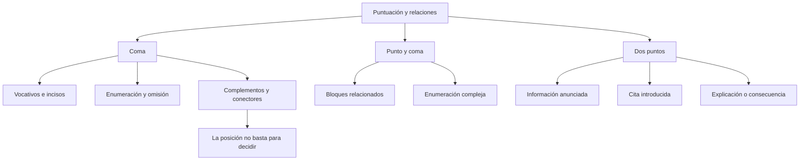

# Normativa de Signos de Puntuación: La Coma, el Punto y Coma y los Dos Puntos

## Introducción
La puntuación organiza las relaciones del escrito. No consiste en insertar una coma cada vez que falta aire al leer. Una pausa puede depender de la voz del lector y no justificar ningún signo; por el contrario, una coma puede ser necesaria para distinguir un vocativo aunque apenas se perciba una pausa.

En este tema se revisan tres signos: la **coma**, el **punto y coma** y los **dos puntos**. Para elegirlos conviene reconocer la estructura de la oración y la relación que se quiere expresar. Algunas decisiones son obligatorias; otras admiten alternativas según la extensión, la complejidad y el efecto de organización buscado. La explicación debe distinguir ambas situaciones.

## 7.2.1 · Vocativos, omisión y complementos iniciales
El **vocativo** es una expresión con la que se llama al interlocutor o se dirige uno a él. Se delimita con coma: «Lucía, revisa el informe»; «Revisa, Lucía, el informe»; «Revisa el informe, Lucía». El nombre no es el sujeto expreso del imperativo: se está apelando a la persona.

Compara «Lucía revisa el informe» y «Lucía, revisa el informe». En la primera se informa de lo que hace Lucía; en la segunda se le pide que lo haga. No basta con preguntar quién realiza la acción, pues la misma persona puede ser agente de la acción y destinataria de la orden. Hay que analizar cómo está construida la expresión.

La llamada **coma elíptica** señala la omisión de un verbo recuperable. «Marta eligió Historia; Pedro, Geografía» permite recuperar *eligió* en la segunda parte. No es una coma arbitraria entre sujeto y predicado: su función se entiende porque el verbo no está escrito y se recupera del primer miembro.

Un **complemento circunstancial antepuesto** puede delimitarse con coma. Su extensión, su posición y la manera de presentar la información importan: «Durante las primeras horas de la mañana, el equipo revisó los registros». En un complemento breve integrado, como «Hoy revisamos los registros», no se impone una coma por el solo hecho de aparecer al principio.

| Fragmento | Función de la coma o ausencia de ella | Razón |
| --- | --- | --- |
| Lucía, revisa el informe. | Vocativa | Se llama a la interlocutora. |
| Marta eligió Historia; Pedro, Geografía. | Elíptica | Se recupera eligió en el segundo miembro. |
| Durante las primeras horas de la mañana, revisamos los registros. | Delimita un complemento inicial | El segmento extenso se presenta separado del resto. |
| Hoy revisamos los registros. | No requiere coma tras hoy | El complemento breve está integrado. |

En la terminología escolar, la coma que acompaña un complemento adelantado se llama a menudo **hiperbática**. Esa etiqueta no significa que todo orden distinto de sujeto, verbo y complementos sea anormal ni que todo complemento inicial necesite el signo. El español admite variaciones de orden con diferentes efectos informativos.

## 7.2.2 · Enumeraciones, incisos y uniones que no deben romperse
En una **enumeración simple**, la coma separa miembros equivalentes: «Trajo papel, lápices y reglas». La conjunción final suele sustituir a la última coma. No debe trasladarse esa pauta mecánicamente a cualquier aparición de *y*: su posición y la relación entre los miembros pueden justificar otros usos.

Un **inciso** aporta una aclaración o comentario que se delimita respecto del enunciado principal. «César, el profesor de física, explicó el problema» contiene una aposición explicativa entre dos comas. Las dos delimitan el mismo segmento: no corresponde retirar una de ellas y dejar un inciso abierto.

Compáralo con «El profesor de física explicó el problema». El grupo *de física* restringe o identifica al profesor y no tiene por ello que encerrarse entre comas. La posibilidad de borrar palabras sin perder una oración gramatical no determina por sí sola que sean un inciso; también debe considerarse la función que cumplen.

No se coloca una coma que separe **sujeto y predicado** únicamente porque el sujeto sea largo. «Los estudiantes del grupo de la mañana entregaron sus trabajos» no lleva coma antes de *entregaron*. Tampoco se separan con una coma un verbo y su complemento integrado en «Entregaron los trabajos».

| Construcción | Escritura | Qué explica la puntuación |
| --- | --- | --- |
| Sujeto seguido de verbo | Los estudiantes entregaron sus trabajos. | La longitud del sujeto no exige coma. |
| Inciso intercalado | Los estudiantes, según indicó la tutora, entregaron sus trabajos. | Las comas delimitan el comentario. |
| Sujeto acabado en etcétera | Libros, cuadernos, lápices, etc., estaban sobre la mesa. | La coma tras etc. pertenece al cierre de esa enumeración. |
| Complemento integrado | Revisamos los resultados. | No se inserta una coma entre verbo y directo. |

La norma sobre sujeto y predicado no prohíbe que entre ambos aparezca un inciso delimitado ni elimina la coma que corresponde tras *etcétera*. Por eso es inexacto afirmar que jamás puede encontrarse gráficamente una coma antes del verbo. Lo incorrecto es introducir una separación sin función que la justifique.

Los conectores como *sin embargo* y *por tanto* suelen delimitarse del resto: «El informe, sin embargo, está incompleto». No equivalen a la conjunción *pero* en su comportamiento sintáctico. Reconocer el significado adversativo no autoriza a puntuar todos esos recursos de la misma manera.

## 7.2.3 · Punto y coma: organización de miembros complejos
El **punto y coma** separa unidades relacionadas que conviene distinguir más que con una coma. Puede resultar útil cuando esas unidades ya contienen comas, como en «Marta revisó los mapas, las tablas y los anexos; Pedro verificó las fuentes y las fechas». La puntuación hace visible la organización de los dos bloques.

No existe una regla que obligue a elegir punto y coma en cualquier pareja de oraciones que contengan una coma interior. En muchos contextos es posible usar punto y seguido. Se modifica entonces la manera de presentar la continuidad del discurso, sin que necesariamente se produzca un error gramatical.

También puede emplearse delante de un conector entre miembros de cierta extensión: «El grupo revisó cada apartado del informe; sin embargo, quedaron datos por comprobar». El punto y coma va antes de *sin embargo* y la coma posterior delimita el conector. «El grupo revisó cada apartado del informe. Sin embargo, quedaron datos por comprobar» es otra organización posible.

| Organización | Ejemplo propio | Efecto |
| --- | --- | --- |
| Dos miembros relacionados | Marta revisó los anexos; Pedro comprobó las fechas. | Mantiene ambos dentro del mismo enunciado. |
| Conector entre miembros | Se revisaron los anexos; sin embargo, faltaban las fechas. | Separa los bloques y delimita el conector. |
| Punto y seguido | Se revisaron los anexos. Sin embargo, faltaban las fechas. | Da mayor independencia gráfica al segundo bloque. |
| Enumeración compleja | Participaron Ana, de primero; Luis, de segundo; y Marta, de tercero. | Distingue miembros que ya contienen comas. |

El nombre de un conector no decide automáticamente el signo anterior. Es necesario saber qué unidades conecta, cómo están construidas y si se desea mantenerlas en el mismo enunciado. La extensión orienta la elección, pero no se traduce en un número fijo de palabras que obligue a usar un signo.

Una subordinada final no se desprende de la principal mediante un punto y coma por ser larga: «Visitamos el archivo para comprobar las fechas». El grupo con *para* expresa aquí la finalidad de la visita y se integra en su estructura. La elección de un signo fuerte no puede sustituir ese análisis.

## 7.2.4 · Dos puntos: anuncio, cita y explicación
Los **dos puntos** relacionan lo anterior con información que se presenta a continuación como desarrollo, precisión, ejemplificación o consecuencia. Un uso habitual introduce una enumeración explicativa anunciada: «Compré tres materiales: papel, tinta y cartón». El grupo *tres materiales* anticipa lo que se detalla.

En una oración seguida, «Compré: papel, tinta y cartón» rompe sin justificación la relación entre verbo y complemento. En cambio, una enumeración dispuesta como lista vertical puede seguir a una fórmula introductoria aunque no reproduzca la misma estructura de una oración corrida. No debe afirmarse que toda lista necesita obligatoriamente un sustantivo anticipador en cualquier formato.

Para introducir **palabras textuales** después de una expresión de habla, puede escribirse «La tutora indicó: “Revisen las fechas”». Es un ejemplo construido para analizar el signo, no una cita atribuida a una persona histórica. Los dos puntos no aparecen obligatoriamente delante de cualquier texto entrecomillado: «La palabra “archivo” figura en el título» no introduce un parlamento.

| Uso | Ejemplo | Relación que se presenta |
| --- | --- | --- |
| Enumeración anunciada | Necesito dos documentos: el informe y el acta. | Se concreta el anuncio. |
| Cita tras una expresión introductoria | La tutora indicó: “Revisen las fechas”. | Se reproducen sus palabras en estilo directo. |
| Explicación | El archivo está cerrado: hoy no atiende al público. | Se explica la situación anunciada. |
| Consecuencia | No presentó el documento requerido: tendrá que completar la solicitud. | Se enuncia una consecuencia del primer hecho. |

La relación entre dos oraciones puede permitir más de una puntuación. En determinados contextos también sería posible un punto y coma o un punto, con diferencias de organización. Por tanto, causa y efecto no convierten los dos puntos en un signo obligatorio en cualquier redacción.

El uso de los dos puntos no se limita a estos ejemplos: también aparecen en encabezamientos de cartas y en títulos que anuncian un desarrollo. No se escriben solo porque una expresión parezca importante. La primera parte debe preparar una relación comprensible con lo que viene después.

## Importante
No puntúes por respiración ni por una palabra aislada. Comprueba qué se delimita: vocativo, inciso, omisión, complemento o bloque completo. No toda coma antes de un verbo es incorrecta; no todo complemento inicial exige coma; no toda cita requiere dos puntos. Distingue la puntuación necesaria de una elección válida entre varias posibilidades. Los ejemplos incorrectos de esta lección sirven para compararlos con una corrección explícita, no para aprenderlos como modelos de escritura.

## Síntesis
La coma delimita ciertos segmentos y organiza enumeraciones sin romper relaciones integradas. El punto y coma permite distinguir bloques próximos o miembros complejos. Los dos puntos anuncian un desarrollo relacionado con lo anterior. Para explicar una respuesta, identifica la construcción, señala qué función cumple el signo y muestra cómo se conserva o modifica la relación entre las partes.
