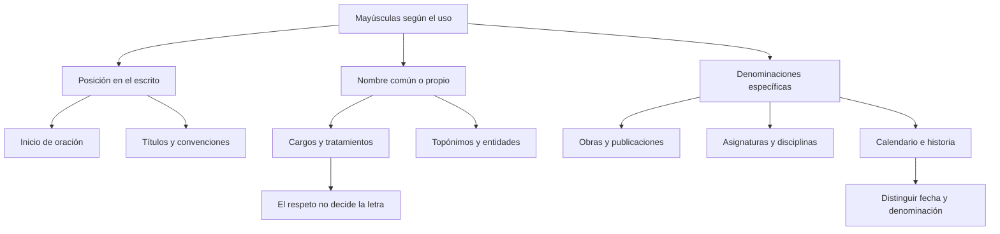

# Normativa del Uso de Mayúsculas y Minúsculas (Ortografía RAE)

## Introducción
Las mayúsculas cumplen funciones ortográficas, no indican por sí solas respeto, prestigio o importancia. Para decidir su uso hay que distinguir el nombre propio del nombre común y atender a la posición de la palabra. *Presidenta* lleva mayúscula al comenzar una oración por esa posición, no porque el cargo exija una mayúscula de dignidad.

También importa qué se está nombrando. Una disciplina mencionada de forma general no se escribe necesariamente igual que el nombre de una asignatura. Una fecha corriente no se convierte automáticamente en el nombre de una festividad por aludir a un acontecimiento importante. Esta lección compara usos concretos y evita clasificar una palabra aislada sin contexto.

## 7.3.1 · Cargos, dignidades y tratamientos
Los nombres de cargos y dignidades se escriben con **minúscula** en su uso común: *presidente*, *ministra*, *alcaldesa*, *rey*, *papa*, *obispo* o *decano*. La presencia o ausencia del nombre de la persona no transforma esos sustantivos en nombres propios. «La alcaldesa presentó el proyecto» y «La alcaldesa Rosa presentó el proyecto» siguen la misma regla para el cargo.

No corresponde escribir una mayúscula solo como muestra de respeto. Esto no elimina otras reglas: una palabra que comienza una oración debe llevar la mayúscula posicional que corresponda, y un nombre propio o una denominación oficial se analiza con sus propias convenciones.

Distingue **persona, cargo y entidad**. En «La ministra de Salud recibió el informe», *ministra* nombra el cargo; *Salud* remite al área de una denominación institucional. En «El Ministerio de Salud recibió el informe», se nombra la entidad. No es la misma estructura ni se justifica la mayúscula por la importancia de quien ocupa el puesto.

| Qué se nombra | Ejemplo | Criterio |
| --- | --- | --- |
| Cargo | La alcaldesa respondió. | Nombre común de una función. |
| Dignidad religiosa | El papa participó en la ceremonia. | Nombre común de una dignidad. |
| Persona | Ana presentó el proyecto. | Nombre propio de persona. |
| Entidad con nombre oficial | El Ministerio de Salud recibió el documento. | Denominación institucional. |

Los tratamientos desarrollados, como *señor*, *señora* o *doctor*, se escriben normalmente con minúscula; sus abreviaturas siguen convenciones específicas, como *Sr.* o *Dra.*. No conviene convertir esa pauta en la afirmación de que cualquier tratamiento, en todo uso protocolario y sin atender al contexto, tiene idéntico comportamiento.

Un caso de revisión permite separar los problemas: «La Presidenta llegó el Lunes». Si se trata de una oración corriente, debe escribirse «La presidenta llegó el lunes». El cargo y el día son nombres comunes en ese contexto. La mayúscula de *La* corresponde al comienzo de oración, no a una categoría de dignidad.

## 7.3.2 · Calendario, gentilicios, lenguas y orientación
Los nombres de **días, meses y estaciones** se escriben con minúscula en sus usos ordinarios: «Nos reunimos el martes», «La visita será en agosto», «El curso empieza en primavera». La importancia de una reunión no cambia esa escritura. Tampoco lo hace el hecho de aparecer en un documento formal.

Cuando una de esas palabras pertenece a una **denominación propia**, debe analizarse el conjunto. *Mayo* puede formar parte de un nombre como *plaza del Dos de Mayo*. La existencia de una fecha histórica no autoriza a poner mayúscula a todos los meses que aparecen en cualquier relato del acontecimiento.

Los **gentilicios y nombres de lenguas** se escriben normalmente con minúscula: *peruano*, *arequipeña*, *español* o *inglés*. Si un término integra un título o un nombre propio, se atiende además a esa función. No se deduce su grafía únicamente de una lista de palabras memorizadas.

Los **puntos cardinales** llevan minúscula cuando indican orientación o posición: *el norte de la provincia*, *hacia el sur*. En *América del Norte* y *Corea del Sur* forman parte de denominaciones propias. No basta con que una dirección aparezca en un mapa para convertirla automáticamente en nombre propio.

| Uso corriente | Uso dentro de una denominación | Diferencia |
| --- | --- | --- |
| La reunión será en mayo. | Visitamos la plaza del Dos de Mayo. | Mes corriente frente a componente de un nombre propio. |
| Viajó hacia el norte. | Viajó a América del Norte. | Orientación frente a denominación geográfica. |
| Estudia inglés por su cuenta. | Se matriculó en Inglés Básico. | Lengua en general frente al nombre de una asignatura. |
| La primavera fue lluviosa. | El texto analiza la Primavera de Praga. | Estación frente a denominación histórica. |

La posición al comienzo de oración sigue siendo una regla independiente: «Mayo fue lluvioso» lleva mayúscula inicial por abrir el enunciado. En una pregunta sobre excepciones, conviene precisar si se está preguntando por posición gráfica o por pertenencia a un nombre propio.

## 7.3.3 · Obras, publicaciones y materias de estudio
En los **títulos de obras** en español se escribe con mayúscula la primera palabra y los nombres propios que la requieren. *La ciudad y los perros* no debe convertirse en *La Ciudad Y Los Perros*. La cursiva, cuando el soporte la admite, distingue el título del texto que lo rodea; no obliga a poner en mayúscula todas sus palabras.

El artículo inicial también puede ser la primera palabra del título: en *La ciudad y los perros*, la mayúscula corresponde a *La*. Cuando dentro de un título aparece un nombre propio, este conserva su grafía. No sería correcto bajar una mayúscula necesaria únicamente por no estar al comienzo del título.

Los nombres de **publicaciones periódicas**, como *El Comercio*, siguen la convención de mayúsculas en sus palabras significativas. Es necesario distinguir la cabecera del nombre de un artículo publicado en ella. La regla de la publicación no se traslada sin más al título de cada noticia.

Las **disciplinas** se escriben con minúscula cuando se mencionan como campos del conocimiento: «Le interesan la física y la historia». En cambio, las denominaciones de **asignaturas** y titulaciones en contextos curriculares pueden llevar las mayúsculas propias de esos nombres: «Se matriculó en Física General». El contexto debe dejar claro qué se nombra.

| Expresión | Qué designa | Escritura que se explica |
| --- | --- | --- |
| Leí La ciudad y los perros. | Título de una obra | Primera palabra y nombres propios, si los hubiera. |
| Consulté El Comercio. | Cabecera de una publicación | Mayúsculas de su denominación. |
| Me interesa la física. | Disciplina en general | Nombre común en minúscula. |
| Me matriculé en Física General. | Nombre de una asignatura | Denominación curricular con mayúsculas. |

«Estudia derecho» no aporta por sí solo toda la información de «Está matriculado en la asignatura Derecho Constitucional». Para que un ejercicio tenga una única respuesta defendible, debe indicar cuándo se trata de un nombre curricular. Una clave no puede basarse en una interpretación del contexto que el enunciado no proporciona.

## 7.3.4 · Nombres geográficos e históricos
En **río Chili**, **lago Titicaca** o **volcán Misti**, el término genérico clasifica el accidente y el nombre propio lo individualiza. En esos ejemplos se usa minúscula en *río*, *lago* o *volcán*. No debe ampliarse esa regla a todo topónimo que contenga una palabra con apariencia de nombre común: algunas denominaciones incorporan ese término como parte del propio nombre.

La misma precaución se aplica a *república*. En un uso genérico, como «una república parlamentaria», es un nombre común. Dentro del nombre oficial de un país, como *República Argentina*, interviene otra convención. No conviene resolver una pregunta ambigua con la afirmación de que *república* siempre lleva la misma letra.

Las denominaciones de **periodos históricos**, como *Edad Media* o *Renacimiento*, no autorizan a escribir con mayúscula cualquier palabra que trate de historia. En los nombres de guerras, la pauta general mantiene el genérico en minúscula: **guerra del Pacífico**. Si *guerra* abre una oración, su mayúscula inicial se explica por la posición, no por una regla que exija mayúscula en todos los conflictos.

Compara también *Revolución francesa*: la denominación del acontecimiento y el adjetivo gentilicio no tienen idéntica escritura. Es un error enseñar que todos los sustantivos y adjetivos de cualquier hecho histórico llevan mayúscula sin excepciones ni distinciones.

| Construcción | Ejemplo en su contexto | Motivo |
| --- | --- | --- |
| Genérico geográfico más nombre propio | El río Chili atraviesa la ciudad. | Río clasifica; Chili individualiza. |
| Periodo histórico | El capítulo trata sobre la Edad Media. | Denominación de un periodo. |
| Conflicto bélico | El grupo estudia la guerra del Pacífico. | Genérico en minúscula y parte específica con mayúscula. |
| Revolución y gentilicio | El capítulo analiza la Revolución francesa. | El adjetivo de nacionalidad conserva la minúscula. |

Las descripciones ocasionales y las designaciones fijadas tampoco son automáticamente iguales. Decir que una ciudad tiene edificios blancos es describirla, no darle necesariamente un segundo nombre. Si un ejercicio exige analizar una denominación antonomástica, debe indicar ese uso y ofrecer un contexto suficiente.

## Importante
No uses la importancia del referente como criterio de mayúscula. Separa posición de la palabra, nombre común, nombre propio y denominación específica. Un cargo no gana mayúscula por respeto; un mes no la gana por mencionar una fecha importante; una disciplina no equivale siempre a una asignatura. En historia, no generalices la pauta de Edad Media a guerra del Pacífico. Las palabras en un ejemplo incorrecto deben compararse con su corrección, no memorizarse como formas válidas.

## Revisión de un caso
En «La Alcaldesa visitará el Río Chili el próximo Martes», el escrito corriente requiere «La alcaldesa visitará el río Chili el próximo martes». Se corrigen el cargo, el genérico geográfico y el día. *Chili* conserva la mayúscula porque es el nombre propio. La primera palabra de la oración continúa con mayúscula por su posición.

## Síntesis
Las reglas se aplican a usos concretos. Primero identifica qué se nombra y dónde aparece la expresión; después distingue el nombre común de la denominación propia. Contrasta títulos de obras con cabeceras de publicaciones, disciplinas con asignaturas y fechas ordinarias con nombres establecidos. La explicación de una respuesta debe señalar ese criterio, sin recurrir a supuestas mayúsculas de prestigio ni a reglas absolutas que el propio contexto contradice.
