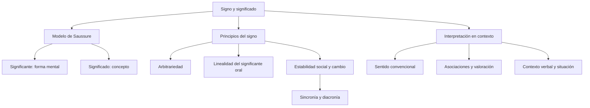

# El Signo Lingüístico y la Distinción Denotación vs. Connotación

## Introducción
Una palabra permite comunicar porque relaciona una forma reconocible con un significado compartido. No es el objeto al que puede referirse ni una copia física de ese objeto. Al decir *árbol* no introducimos un árbol en la conversación: usamos un signo que el interlocutor puede interpretar gracias a la lengua y al contexto.

Esta lección presenta el modelo de **signo lingüístico de Saussure**, sus principios básicos y la distinción escolar entre denotación y connotación. Se trata de herramientas para explicar el funcionamiento de las expresiones. No convierten todas las palabras en etiquetas sin historia ni reducen el sentido de una oración a su primera acepción de diccionario.

## 8.1.1 · Significante, significado y referente
En el modelo saussureano, el **significante** es la imagen acústica o forma mental asociada al signo y el **significado** es su contenido conceptual. No se identifica el primero con una fotografía del objeto ni el segundo con un ejemplar material de aquello que se nombra.

La expresión *imagen acústica* se refiere a la representación mental del sonido, no al ruido físico aislado. Es posible pensar una palabra sin pronunciarla. Cuando efectivamente se habla, se produce una realización sonora; cuando se escribe, se emplean signos gráficos para representarla conforme a las convenciones de escritura.

El **referente** es la entidad a la que se alude en un uso concreto. Si alguien dice «Ese árbol perdió sus hojas», puede señalar un árbol determinado. El referente no constituye una de las dos caras del signo en la formulación saussureana que aquí se estudia. Tampoco toda expresión exige un objeto visible: la lengua permite hablar de ideas y de seres imaginarios.

| Elemento | Qué se distingue | Ejemplo de análisis |
| --- | --- | --- |
| Significante | Forma mental reconocible del signo | La imagen acústica asociada a árbol. |
| Significado | Contenido conceptual | El concepto que el hablante asocia a esa forma. |
| Referente | Entidad aludida en una situación | El árbol del patio del que se está hablando. |
| Realización escrita | Representación gráfica convencional | Las letras con las que se escribe árbol. |

El significado no es necesariamente una imagen visual idéntica en todas las personas. Un hablante puede conocer una palabra abstracta sin poder dibujar su referente. El modelo distingue planos de análisis; no afirma que comprender consista siempre en visualizar una figura.

## 8.1.2 · Arbitrariedad y linealidad
La **arbitrariedad** significa que la asociación entre forma y contenido no está impuesta por una relación natural necesaria. Las denominaciones de conceptos comparables pueden diferir entre lenguas: *perro* en español y *dog* en inglés. No hace falta convertir las letras de esas palabras en una falsa transcripción fonética para mostrar el contraste.

Arbitrario no significa que cada persona pueda elegir libremente las palabras del idioma cada vez que habla. La convención es social. Si una persona decide llamar *ventana* a cualquier cuaderno sin explicarlo, sus interlocutores no tienen por qué interpretar esa nueva equivalencia.

Tampoco implica que no exista ninguna motivación reconocible en parte del léxico. Las palabras derivadas y compuestas pueden permitir relaciones entre sus elementos. Las onomatopeyas también se ajustan a convenciones de cada lengua, aunque mantengan una relación imitativa con sonidos. Estos casos no convierten el vocabulario completo en una reproducción natural del mundo.

La **linealidad del significante oral** se refiere a su desarrollo en el tiempo. Una secuencia tiene un orden: no equivale pronunciar *pata* y *tapa*. El ejemplo muestra que el orden de los segmentos participa en la identificación de las formas; no niega la coarticulación, es decir, el solapamiento de gestos del habla.

| Principio | Pregunta a la que responde | Caso que lo ilustra |
| --- | --- | --- |
| Arbitrariedad | ¿La relación entre esta forma y este contenido es natural y obligatoria? | Perro y dog muestran denominaciones convencionales diferentes. |
| Linealidad | ¿Cómo se desarrolla la forma oral? | Pata y tapa tienen segmentos ordenados de manera distinta. |
| Convención social | ¿Por qué el interlocutor reconoce la forma? | Comparte usos de la lengua con quien habla. |

La linealidad no debe enseñarse como una descripción universal de toda modalidad del lenguaje humano. La simultaneidad desempeña un papel relevante en las lenguas de signos. Aquí se explica el principio clásico sobre el significante acústico. Precisar ese ámbito evita trasladarlo indebidamente a sistemas diferentes.

## 8.1.3 · Estabilidad, cambio y doble articulación
La **inmutabilidad**, en esta explicación del signo, destaca que un individuo no cambia por su sola voluntad la convención compartida por toda la comunidad. No es una prohibición de inventar palabras, hacer juegos de lenguaje o proponer nuevos usos. Una creación individual puede difundirse; lo que no obtiene automáticamente es aceptación colectiva.

La **mutabilidad** considera que las formas y los significados cambian a lo largo de la historia. El paso del latín *aurum* al español *oro* ilustra un cambio histórico de la forma. No debe describirse como una sustitución decidida de una vez por una persona ni convertir el ejemplo en una regla universal que prediga cualquier evolución.

**Sincronía** y **diacronía** son perspectivas de estudio. Una descripción sincrónica atiende a un estado o periodo de la lengua; una descripción diacrónica examina cambios a través del tiempo. Sincronía no significa que en una comunidad no haya ninguna variación ni que todas sus personas hablen de modo idéntico.

La **doble articulación** distingue unidades significativas y unidades distintivas. En la terminología de Martinet, las unidades de la primera articulación se llaman **monemas**. En muchas exposiciones escolares se emplea *morfemas* en un sentido amplio para las unidades mínimas con significado. Conviene indicar la terminología utilizada, en vez de presentarla como una coincidencia de nombres sin matices.

| Nivel o perspectiva | Qué se analiza | Ejemplo |
| --- | --- | --- |
| Primera articulación | Unidades con significado léxico o gramatical | En casas se distinguen una base léxica y una marca de plural. |
| Segunda articulación | Unidades que permiten distinguir formas | El contraste inicial de pata y bata distingue palabras. |
| Sincronía | Relaciones en un estado de lengua | La oposición entre dos formas usadas en español actual. |
| Diacronía | Evolución histórica | El paso de aurum a oro. |

Un **fonema** no tiene por sí mismo el significado léxico de una palabra: cumple una función distintiva en un sistema. Un **grafema** pertenece a la escritura y no debe equipararse automáticamente con un fonema. La doble letra de *perro*, por ejemplo, no autoriza a contar dos unidades sonoras independientes solo porque se escriban dos erres.

No todas las palabras se segmentan de la misma manera ni toda terminación visible equivale a una marca independiente con un solo significado. La segmentación exige atender a la lengua y a la construcción concreta. En esta lección interesa distinguir los dos niveles, no resolver toda la morfología mediante el conteo de letras.

## 8.1.4 · Denotación, connotación y sentido figurado
En la distinción escolar utilizada aquí, la **denotación** atiende al significado convencional con el que una expresión nombra o caracteriza algo; la **connotación** atiende a asociaciones culturales, afectivas o valorativas vinculadas a su uso. Estas nociones ayudan a interpretar, pero no equivalen simplemente a verdadero frente a falso o científico frente a literario.

En «El león es un mamífero», el nombre se emplea en su sentido zoológico. En «Defendió a su equipo como un león», aparece una comparación que puede asociar al animal con valentía o fuerza. La interpretación se apoya en el contexto y no requiere afirmar que la persona se haya convertido literalmente en un felino.

Un uso figurado puede estar **convencionalizado** y recogido en un diccionario. Por eso consultar el diccionario no establece automáticamente que un uso sea literal ni que carezca de asociaciones. Expresiones como *echar una mano* se entienden como ayuda, no como el lanzamiento de una parte del cuerpo.

| Expresión contextualizada | Lectura que se solicita | Justificación |
| --- | --- | --- |
| El león es un mamífero. | Sentido zoológico literal | Se nombra al animal. |
| Tiene un corazón de oro. | Valoración figurada | Se elogia la bondad, no la composición material de un órgano. |
| Le echó una mano con el informe. | Uso figurado convencional | Se expresa ayuda. |
| El hielo se derritió con el calor. | Descripción literal en este ejemplo | Se describe un cambio físico, sin atribuir una emoción al hielo. |

Las asociaciones no son siempre invenciones privadas ni necesariamente arbitrarias para quien escucha. Pueden compartirse culturalmente. A la vez, una palabra usada literalmente puede suscitar valoraciones: decir *hogar* en un contexto puede evocar afecto sin dejar de referirse al lugar de vivienda. El análisis debe indicar qué aspecto se está examinando.

No corresponde afirmar que una oración entera es exclusivamente objetiva en todos los sentidos posibles. En un ejercicio puede pedirse reconocer cuál de varias expresiones tiene un uso figurado manifiesto o cuál describe literalmente el hecho presentado. Esa delimitación es más clara que confundir denotación con neutralidad absoluta.

## Importante
No confundas significante con referente ni letras con fonemas. La arbitrariedad es compatible con convenciones compartidas y no equivale a libertad individual sin límites. La estabilidad social no excluye innovación ni variación. Un sentido figurado puede estar en el diccionario; lo que decide el análisis es su uso en el fragmento. Identifica siempre el modelo y el ámbito de la afirmación antes de generalizarla.

## Síntesis
El modelo de Saussure distingue significante y significado. Arbitrariedad y linealidad explican aspectos de su asociación y de la secuencia oral. Estabilidad y cambio se estudian desde perspectivas sincrónicas y diacrónicas; la doble articulación distingue unidades significativas y distintivas. La interpretación de un enunciado exige considerar el sentido convencional, las asociaciones y la situación en que se emplea.

## Clases de signo, significado y contexto

Un indicio mantiene una relación de conexión con lo que señala, como humo respecto de combustión; un icono se basa en semejanza; un símbolo funciona por convención. Son criterios para analizar la relación entre signo y objeto, no sinónimos del signo lingüístico. En este último se distinguen significante y significado.

El contexto verbal son los enunciados que rodean una expresión; la situación comprende participantes, lugar, momento y condiciones del intercambio. Aquí, mañana o yo cambian de referencia según quién habla y cuándo. La polisemia exige seleccionar un sentido entre los de una palabra: banco se interpreta de manera distinta junto a préstamo que junto a sentarse.

Denotación apunta a un significado convencional; connotación incorpora asociaciones y valoraciones. Un texto puede usar ambas. Comprender el significado exige reconocer la expresión y sus relaciones, sin asignarle un sentido aislado incompatible con el intercambio.
