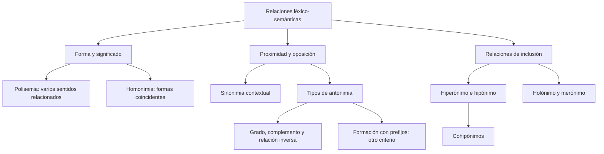

# Relaciones Léxico-Semánticas: Polisemia, Homonimia, Antonimia e Inclusión

## Introducción
Las palabras pueden relacionarse por su forma, por sus significados o por la estructura de la clasificación que construimos con ellas. No es lo mismo que dos expresiones suenen igual, que tengan sentidos próximos o que una nombre una parte de aquello que la otra designa. Para reconocer una relación es necesario fijar primero el sentido empleado en el ejemplo.

En esta lección se comparan **polisemia y homonimia**, **sinonimia y paronimia**, distintos tipos de **oposición** e **inclusión**. Se utilizan ejemplos delimitados. Algunas clasificaciones dependen del criterio lingüístico y del diccionario consultado; no se presentan casos discutidos como pruebas infalibles de una regla universal.

## 8.2.1 · Polisemia, homonimia y pronunciación
La **polisemia** es la pluralidad de sentidos de una expresión. En su explicación léxica habitual, una misma palabra puede desarrollar acepciones relacionadas: *cabeza* puede nombrar una parte del cuerpo y, por extensión, a quien dirige un grupo. Que el sentido cambie con el contexto no significa necesariamente que exista otra palabra de origen independiente.

La **homonimia** describe la coincidencia formal entre unidades distintas. En la presentación escolar se diferencia la **homografía**, cuando coinciden en escritura, y la **homofonía**, cuando coinciden en pronunciación aunque pueda variar la escritura. *Tubo* y *tuvo* permiten observar homofonía con grafías distintas.

Para un ejemplo claro de homografía se pueden comparar *lima*, la herramienta, y *lima*, la fruta. Sus historias léxicas son diferentes y el diccionario las distingue. No es necesario añadir el nombre propio *Lima* y afirmar que su escritura es exactamente idéntica: ese nombre requiere mayúscula en el uso ordinario.

| Comparación | Qué se observa | Análisis en el ámbito indicado |
| --- | --- | --- |
| Cabeza del cuerpo / cabeza de un grupo | Sentidos vinculados de una palabra | Polisemia por extensión de significado. |
| Lima, herramienta / lima, fruta | Escritura coincidente de unidades distintas | Homonimia homógrafa. |
| Tubo / tuvo | Pronunciación coincidente y escritura diferente | Homofonía. |
| Aptitud / actitud | Formas próximas que no se usan con el mismo significado | Paronimia en la clasificación escolar. |

La etimología puede ayudar a distinguir polisemia y homonimia, pero no debe inventarse a partir de un parecido. Los hablantes pueden percibir relaciones diferentes de las históricas y los diccionarios toman decisiones de organización. La existencia de una o varias entradas es una ayuda para consultar, no una explicación autónoma de todos los casos.

Por esa razón, no conviene declarar que *banco*, como asiento y como entidad financiera, es sin discusión un caso de orígenes completamente separados. La relación histórica y la clasificación lexicográfica requieren consulta. Para un ejercicio inicial se prefieren casos de interpretación más delimitada y se explica el criterio utilizado.

La homofonía también depende de la variedad de pronunciación. *Tubo* y *tuvo* constituyen un ejemplo adecuado en español; *cima* y *sima* coinciden en las variedades seseantes, pero no en aquellas que distinguen los sonidos iniciales correspondientes. Es incorrecto ignorar esa diferencia y presentar idéntica pronunciación para todos los hablantes.

## 8.2.2 · Sinonimia y paronimia
La **sinonimia** relaciona expresiones con significados próximos o equivalentes en un uso. La sustitución debe comprobarse en una frase y con una interpretación determinada. «Adquirió una casa» puede reformularse con «Compró una casa» si el contexto trata de esa adquisición mediante compra. «Adquirió experiencia» no admite la misma sustitución sin un cambio de interpretación.

La llamada **sinonimia absoluta** exigiría equivalencia en todos los contextos, sentidos y matices pertinentes. Es una exigencia muy fuerte; no debe probarse con dos palabras que solo se aproximan en una frase. *Dentista* y *odontólogo* pueden nombrar al mismo profesional en un contexto, pero eso no demuestra intercambiabilidad universal en cualquier combinación.

*Tubérculo* y *patata* tampoco deben enseñarse como sinónimos absolutos: el primero tiene un alcance más general y se emplea para estructuras que no se limitan a la patata. Para analizar un ejercicio importa el sentido concreto, no una equivalencia memorizada fuera del contexto.

La **paronimia** se refiere a semejanza entre formas que puede provocar confusión. *Aptitud* expresa capacidad o disposición para una actividad; *actitud* puede referirse a una disposición o postura. Las dos palabras no son intercambiables por sonar de manera parecida. Tampoco debe restringirse toda aptitud a una capacidad exclusivamente intelectual.

| Fragmento | Sustitución o contraste | Resultado |
| --- | --- | --- |
| Compró una casa. | Adquirió una casa. | Equivalencia posible en el contexto de una compra. |
| Adquirió experiencia. | Compró experiencia. | Cambia o fuerza el sentido; no hay sustitución general. |
| Tiene aptitud para resolver problemas. | Tiene actitud para resolver problemas. | Se modifica lo que se afirma. |
| Hay que adaptar el texto. | Hay que adoptar el texto. | Las formas próximas no tienen aquí la misma función semántica. |

En ejercicios escolares, distinguir igualdad de sonido y semejanza ayuda a comparar homofonía y paronimia. No basta, sin embargo, con afirmar que dos palabras difieren en una letra: hay que precisar cómo se pronuncian y qué significan. El número de letras no determina por sí solo la relación semántica.

## 8.2.3 · Tipos de oposición y criterios que pueden cruzarse
La **antonimia gradual** presenta polos dentro de una escala, como *frío* y *caliente*. Puede haber valores intermedios y la interpretación depende del contexto: una temperatura considerada caliente para un uso puede no serlo para otro. Negar un polo no impone siempre el extremo contrario; algo no caliente puede ser templado.

La **oposición complementaria** presenta alternativas excluyentes dentro de un dominio delimitado. *Par* e *impar* lo ilustran cuando se clasifica un número entero. No se extiende ese binarismo a cualquier entidad: un decimal no tiene por qué recibir una de esas etiquetas. *Vivo* y *muerto* se utilizan como ejemplo de oposición complementaria en su contraste léxico básico, sin confundir ese ejercicio con el diagnóstico de un caso médico.

Los **términos recíprocos o inversos** describen una misma relación desde sus participantes. Si Ana compra un libro a Luis, Luis se lo vende a Ana. No significa que una persona que alguna vez fue compradora necesite que cualquier otra sea su vendedor en todas las situaciones. Se conserva la relación concreta y se invierten sus papeles.

| Relación | Ejemplo delimitado | Qué debe comprobarse |
| --- | --- | --- |
| Gradual | Frío / caliente | Una escala y posibles valores intermedios. |
| Complementaria | Par / impar, para números enteros | Exclusión y cobertura dentro de ese dominio. |
| Recíproca | Comprar a / vender a | La misma transacción descrita desde participantes distintos. |
| Formación morfológica | Leal / desleal | Oposición construida mediante prefijación. |

La **antonimia gramatical o morfológica**, en la clasificación escolar, atiende a cómo se forma la oposición: *leal/desleal*, *posible/imposible*. Ese criterio no está en el mismo plano que gradualidad, complementariedad o reciprocidad. Una pareja puede formarse con un prefijo y, además, recibir un análisis de grado o de oposición según su uso.

Por ello, una pregunta sobre el prefijo de *desleal* debe indicar que analiza la **formación** de la palabra, no pedir una casilla supuestamente incompatible con todo otro análisis. Del mismo modo, *soltero/casado* no debe imponerse como clasificación exhaustiva de todas las situaciones civiles: existen otras categorías y usos. El dominio de aplicación forma parte del razonamiento.

## 8.2.4 · Hiperonimia y meronimia: dos jerarquías diferentes
La **hiperonimia** relaciona una denominación más general con otras de extensión más específica. En el sentido correspondiente, *animal* es hiperónimo de *perro* y *perro* es hipónimo de *animal*. La orientación importa: no son etiquetas intercambiables para ambas palabras.

Los **cohipónimos** comparten un hiperónimo en una clasificación. *Perro* y *gato* pueden ser cohipónimos bajo *animal*. No hace falta que sean contrarios ni que agoten todos los animales existentes. Una categoría puede incluir muchos más miembros que los usados en un ejemplo.

La **meronimia** relaciona una parte con un todo, y la **holonimia** presenta esa relación desde el todo. En el sentido material del ejemplo, *cuerda* es merónimo de *guitarra* y *guitarra* es holónimo de *cuerda*. Esto no implica que una cuerda sea una clase de guitarra.

| Relación | Orientación | Comprobación contextual |
| --- | --- | --- |
| Hiperónimo / hipónimo | Animal / perro | Un perro es un animal. |
| Cohiponimia | Perro / gato bajo animal | Ambos se subordinan al mismo término general. |
| Holónimo / merónimo | Guitarra / cuerda | La cuerda es una parte del instrumento del ejemplo. |
| Holónimo / merónimo | Árbol / raíz | La raíz es una parte, no una especie de árbol. |

Las pruebas «es un» y «forma parte de» orientan el análisis, pero deben aplicarse con el sentido y la construcción pertinentes. «La biblioteca forma parte del barrio» puede expresar una inclusión espacial distinta de la relación estructural entre raíz y árbol. No toda frase posible con *parte* demuestra el mismo tipo de meronimia.

Tampoco toda relación de pertenencia es una relación de parte material. Un integrante de un equipo y una pieza de un instrumento ilustran relaciones distintas que conviene precisar si el ejercicio exige mayor detalle. En este nivel basta con no confundir una clase específica con un componente del objeto.

## Importante
Fija el sentido y el dominio antes de clasificar. La etimología no se deduce por intuición; la pronunciación puede variar entre dialectos; la sinonimia se comprueba en contexto. La oposición formada con prefijos no excluye otros análisis semánticos. Para la inclusión, distingue «es un tipo de» de «es una parte de». Evita forzar la respuesta cuando el enunciado no aporta el criterio necesario.

## Revisión guiada
Compara «El perro es un animal» con «La raíz es parte del árbol». En la primera se clasifica una entidad como miembro de una clase más general; en la segunda se identifica un componente. Si ambas se redujeran a la idea vaga de que una cosa está dentro de otra, se perdería la diferencia que se quiere aprender. Escribir la relación completa y en la dirección correcta permite justificar hiperónimo, hipónimo, holónimo y merónimo.

## Síntesis
La polisemia considera sentidos de una expresión y la homonimia, coincidencias entre unidades distintas. Sinonimia y paronimia no se confunden con identidad de escritura o de pronunciación. Las oposiciones se analizan por su relación semántica y, cuando corresponde, por su formación. Hiperonimia y meronimia describen jerarquías diferentes. Cada etiqueta se sostiene con el contexto, no con una coincidencia superficial.
