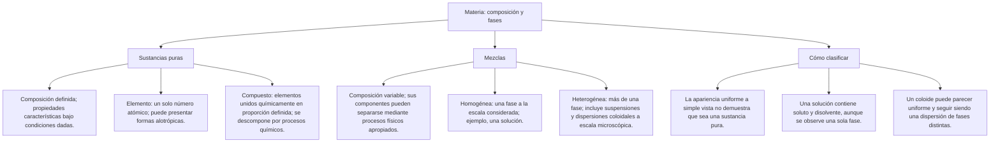

## 1. MARCO CONCEPTUAL Y ONTOLOGÍA
## 1. FICHA TÉCNICA DEL TEMA
* **Eje Temático:** 04 - Ciencia y Tecnología
* **Área Disciplinar:** Química General e Inorgánica
* **Ponderación Oficial UNSA (Resolución N.° 0028-2026):**
  * *Área 1 (Ingenierías):* 1.425411425 pts/pregunta (Examen: 6 preguntas)
  * *Área 2 (Biomédicas):* 1.684740000 pts/pregunta (Examen: 6 preguntas) — **MÁXIMA PRIORIDAD**
  * *Área 3 (Sociales):* 1.109300781 pts/pregunta (Examen: 3 preguntas)
* **Nivel de Dificultad Teórica:** Medio
* **Nivel de Recurrencia en Exámenes (UNSA / CEPRUNSA / UNMSM / UNI):** 9.2 / 10

---

## 2. MAPA CONCEPTUAL Y ÁRBOL DE CONTENIDOS

---

## 2. DESARROLLO TEÓRICO FORMAL - PARTE I
### 3. MARCO TEÓRICO RIGUROSO Y FORMALIZACIÓN

### 3.1. Definición y Objeto de Estudio de la Química
La Química es la ciencia central empírico-racional que estudia la materia, su composición íntima, estructura atómica y molecular, propiedades físicas y químicas, así como las transformaciones energéticas asociadas a los cambios que experimenta.

### 3.2. Clasificación Sistemática de la Materia

#### A. Sustancia Pura
Forma de materia homogénea de composición química definida e invariable, cuyas propiedades termodinámicas e intensivas son constantes a condiciones fijas de presión y temperatura.
1. **Sustancia Simple o Elemento:** Constituida por átomos con el mismo número atómico (Z). No se puede descomponer en sustancias más simples por métodos químicos ordinarios.
   * *Monoatómicos:* Gases nobles (He, Ne, Ar, Kr, Xe, Rn).
   * *Poliatómicos:* O_2, O_3, P_4, S_8, N_2, H_2, Cl_2.
   * *Fenómeno de Alotropía:* Existencia en un mismo estado físico de dos o más formas moleculares o cristalinas de un mismo elemento, con propiedades físicas marcadamente distintas (ej. Carbono: diamante sp^3, grafito sp^2, grafeno, fullerenos; Oxígeno: dioxígeno O_2, ozono O_3; Fósforo: blanco P_4, rojo amorfo).
2. **Sustancia Compuesta o Compuesto:** Unión química de dos o más elementos diferentes en proporciones de masa constantes y definidas (Ley de Proust). Se descomponen por métodos químicos (pirólisis, electrólisis, fotólisis).
   * Ejemplos: Agua pura (H_2O), dióxido de carbono (CO_2), glucosa (C_6H_{12}O_6), cloruro de sodio (NaCl), ácido sulfúrico (H_2SO_4).

#### B. Mezclas
Asociación física de dos o más sustancias puras en proporciones variables, donde cada componente conserva su identidad química intrínseca. No poseen fórmula química.
1. **Mezcla Homogénea (Solución):** Presenta una sola fase continua macroscópica y microscópicamente. El tamaño de partícula del soluto es inferior a 1\text{ nm} (10\text{ Å}). Sus componentes no sedimentan y no se separan por filtración simple.
   * *Gaseosas:* Aire seco y filtrado (N_2, O_2, Ar, CO_2).
   * *Líquidas:* Agua potable, salmuera, vinagre (ácido acético al 5% en agua), alcohol medicinal (70° o 96°).
   * *Sólidas (Aleaciones):* Bronce (Cu + Sn), Latón (Cu + Zn), Acero (Fe + C), Amalgama (Hg + \text{metal}).
2. **Mezcla Heterogénea:** Presenta dos o más fases distinguibles a simple vista o con microscopio óptico. Distribución no uniforme.
   * *Suspensiones:* Tamaño de partícula > 1000\text{ nm}. Sedimentan por gravedad (ej. jugo de papaya con pulpa, jarabes medicinales, leche de magnesia).
   * *Coloides (Sistemas Coloidales):* Tamaño de partícula entre 1\text{ nm} y 1000\text{ nm}. Presentan Efecto Tyndall (dispersión de luz) y Movimiento Browniano (ej. leche, mayonesa, gelatina, niebla, humo, sangre).
