## 1. MARCO CONCEPTUAL Y ONTOLOGÍA
## 1. FICHA TÉCNICA DEL TEMA
* **Eje Temático:** 04 - Ciencia y Tecnología
* **Área Disciplinar:** Físico-Química Fundamental y Termodinámica Clásica
* **Ponderación Oficial UNSA (Resolución N.° 0028-2026):**
  * *Área 1 (Ingenierías):* 1.425411425 pts/pregunta (Examen: 6 preguntas)
  * *Área 2 (Biomédicas):* 1.684740000 pts/pregunta (Examen: 6 preguntas)
  * *Área 3 (Sociales):* 1.109300781 pts/pregunta (Examen: 3 preguntas)
* **Nivel de Dificultad Teórica:** Medio - Alto (Cálculos de calorimetría y equivalencia masa-energía)
* **Nivel de Recurrencia en Exámenes (UNSA / CEPRUNSA / UNMSM / UNI):** 9.0 / 10

---

## 2. MAPA CONCEPTUAL Y ÁRBOL DE CONTENIDOS

```mermaid
graph TD
 ROOT["Estados de la materia y energía"]
 B1["Estados de agregación"]
 B1N1["Sólido: forma y volumen definidos en condiciones habituales."]
 B1N2["Líquido: volumen definido y forma del recipiente."]
 B1N3["Gas: se expande para ocupar el recipiente."]
 B1N4["Plasma: estado ionizado con electrones libres e iones; no es simplemente un gas caliente cualquiera."]
 B2["Cambios que absorben calor"]
 B2N1["Fusión: sólido a líquido."]
 B2N2["Vaporización: líquido a gas."]
 B2N3["Sublimación directa: sólido a gas sin pasar por líquido."]
 B3["Cambios que liberan calor"]
 B3N1["Solidificación: líquido a sólido."]
 B3N2["Condensación o licuación: gas a líquido."]
 B3N3["Deposición o sublimación inversa: gas a sólido."]
 B4["Relación masa-energía"]
 B4N1["Energía en reposo: $E_0=mc^2$, con m como masa invariante."]
 B4N2["Variación de energía en reposo: $\Delta E_0=\Delta m c^2$; conservar una convención de signos."]
 B4N3["Energía total de una partícula libre: $E=\gamma mc^2$, $\gamma=1/\sqrt{1-v^2/c^2}$."]
 B4N4["Masa relativista es una denominación histórica; no confundirla con la masa invariante."]
 ROOT --> B1
 B1 --> B1N1
 B1 --> B1N2
 B1 --> B1N3
 B1 --> B1N4
 ROOT --> B2
 B2 --> B2N1
 B2 --> B2N2
 B2 --> B2N3
 ROOT --> B3
 B3 --> B3N1
 B3 --> B3N2
 B3 --> B3N3
 ROOT --> B4
 B4 --> B4N1
 B4 --> B4N2
 B4 --> B4N3
 B4 --> B4N4
```

---

## 2. DESARROLLO TEÓRICO FORMAL - PARTE I
### 3. MARCO TEÓRICO RIGUROSO Y FORMALIZACIÓN

### 3.1. Los Estados de Agregación de la Materia
El estado físico depende del balance dinámico entre las fuerzas de atracción intermolecular (fuerzas de cohesión, F_c) y las fuerzas de repulsión cinética molecular (F_r):
1. **Estado Sólido:** F_c \gg F_r. Forma y volumen propios y definidos. Incompresibles. Movimiento molecular restringido a vibraciones en posiciones reticulares fijas. Densidad generalmente alta (anomalía del agua: el hielo es menos denso que el agua líquida a 4^\circ\text{C}).
2. **Estado Líquido:** F_c \approx F_r. Volumen constante pero forma variable (adopta la forma del recipiente). Prácticamente incompresibles. Presentan fluidez, viscosidad y tensión superficial.
3. **Estado Gaseoso:** F_r \gg F_c. Forma y volumen variables (ocupan todo el volumen disponible). Alta compresibilidad y expansibilidad. Movimiento caótico translacional a altas velocidades (entropía elevada).
4. **Estado Plasmático (Cuarto Estado):** Gas altamente ionizado compuesto por cationes, electrones libres y fotones a temperaturas extraordinariamente altas (> 10\,000\text{ K}). Excelente conductor de la electricidad. Es el estado más abundante en el Universo observable (sol, estrellas, nebulosas, reactores Tokamak, auroras boreales).
5. **Condensado de Bose-Einstein (Quinto Estado):** Materia a temperaturas extremadamente cercanas al cero absoluto (0\text{ K} = -273.15^\circ\text{C}). Los átomos caen al nivel cuántico más bajo, comportándose como una sola "superonda" o superátomo.

### 3.2. Cambios de Fase (Cambios Físicos de Estado)
Son transformaciones físicas reversibles gobernadas por la adición o remoción de energía térmica (entalpía de cambio de fase) a presión constante:
* **Procesos Endotérmicos (Ganan calor, \Delta H > 0):**
  * *Fusión:* Sólido \to Líquido.
  * *Vaporización (Evaporación / Ebullición):* Líquido \to Gas/Vapor.
  * *Sublimación Directa o Volatilización:* Sólido \to Gas (ej. naftalina, hielo seco CO_{2(s)}, yodo sólido I_{2(s)}).
* **Procesos Exotérmicos (Liberan calor, \Delta H < 0):**
  * *Solidificación:* Líquido \to Sólido.
  * *Condensación:* Gas/Vapor \to Líquido (se llama *licuación* cuando un gas real se somete a aumento de presión y enfriamiento simultáneo).
  * *Sublimación Inversa, Deposición o Compensación:* Gas \to Sólido (ej. formación de escarcha, nieve).

### 3.3. Calorimetría Aplicada a Cambios Físicos
1. **Calor Sensible (Q_s):** Energía térmica absorbida o cedida que produce variación de temperatura sin cambio de estado:
   Q_s = m \cdot c_e \cdot \Delta T = m \cdot c_e \cdot (T_f - T_i)
   Donde:
   * m: masa en gramos (g).
   * c_e: calor específico en \text{cal}/(\text{g}\cdot^\circ\text{C}) o \text{J}/(\text{kg}\cdot\text{K}).
   * Para el agua: c_e(\text{hielo}) = 0.5\text{ cal/g}^\circ\text{C}, c_e(\text{líquida}) = 1.0\text{ cal/g}^\circ\text{C}, c_e(\text{vapor}) = 0.5\text{ cal/g}^\circ\text{C}.
2. **Calor Latente de Cambio de Fase (Q_L):** Energía necesaria para que una unidad de masa cambie de estado isotérmicamente (a temperatura constante):
   Q_L = m \cdot L
