## 1. MARCO CONCEPTUAL Y ONTOLOGÍA
## 1. FICHA TÉCNICA DEL TEMA
* **Eje Temático:** 04 - Ciencia y Tecnología
* **Área Disciplinar:** Química General / Estructura de la Materia
* **Ponderación Oficial UNSA (Resolución N.° 0028-2026):**
  * *Área 1 (Ingenierías):* 1.425411425 pts/pregunta (Examen: 6 preguntas)
  * *Área 2 (Biomédicas):* 1.684740000 pts/pregunta (Examen: 6 preguntas) — **MÁXIMA PRIORIDAD**
  * *Área 3 (Sociales):* 1.109300781 pts/pregunta (Examen: 3 preguntas)
* **Nivel de Dificultad Teórica:** Medio
* **Nivel de Recurrencia en Exámenes (UNSA / CEPRUNSA / UNMSM / UNI):** 9.6 / 10 (Tema clásico indispensable)

---

## 2. MAPA CONCEPTUAL Y ÁRBOL DE CONTENIDOS

```mermaid
graph TD
 ROOT["Estructura atómica y especies"]
 B1["Núcleo"]
 B1N1["Protones: carga positiva; su cantidad define el elemento."]
 B1N2["Neutrones: sin carga eléctrica neta."]
 B1N3["Concentra casi toda la masa del átomo; la proporción exacta depende de la especie."]
 B2["Región electrónica"]
 B2N1["Electrones: carga negativa; se describen mediante estados cuánticos."]
 B2N2["Un orbital expresa una distribución de probabilidad; no es una órbita planetaria."]
 B2N3["La nube electrónica determina la mayor parte del tamaño del átomo."]
 B3["Notación y conteo"]
 B3N1["Notación: ${}^{A}_{Z}X^{q}$. Número atómico: $Z=p$."]
 B3N2["Número de masa: $A=p+n$; por tanto, $n=A-Z$."]
 B3N3["Número de carga: $q=p-e$; la carga física es $q e_0$."]
 B3N4["En un átomo neutro, la cantidad de electrones coincide con Z."]
 B4["Comparación entre especies"]
 B4N1["Isótopos: mismo Z y diferente número de neutrones."]
 B4N2["Isóbaros: igual A y distinto Z."]
 B4N3["Isótonos: igual número de neutrones y distinto Z."]
 B4N4["Especies atómicas isoelectrónicas: igual número de electrones; esta comparación no es una propiedad del núcleo."]
 ROOT --> B1
 B1 --> B1N1
 B1 --> B1N2
 B1 --> B1N3
 ROOT --> B2
 B2 --> B2N1
 B2 --> B2N2
 B2 --> B2N3
 ROOT --> B3
 B3 --> B3N1
 B3 --> B3N2
 B3 --> B3N3
 B3 --> B3N4
 ROOT --> B4
 B4 --> B4N1
 B4 --> B4N2
 B4 --> B4N3
 B4 --> B4N4
```

---

## 2. DESARROLLO TEÓRICO FORMAL - PARTE I
### 3. MARCO TEÓRICO RIGUROSO Y FORMALIZACIÓN

### 3.1. Evolución Histórica de los Modelos Atómicos
1. **Modelo Atómico de John Dalton (1808) — "Esfera Rígida":**
   * El átomo es indivisible, indestructible, macizo e impenetrable.
   * Los átomos de un mismo elemento son idénticos en masa y propiedades. Explica las leyes ponderales de la química.
2. **Modelo de Joseph J. Thomson (1897 / 1904) — "Budín de Pasas":**
   * Descubrió el electrón mediante experimentos con tubos de rayos catódicos (determinó la relación carga/masa e/m).
   * El átomo es una esfera de masa uniforme cargada positivamente con electrones incrustados como pasas. Es eléctricamente neutro y divisible.
3. **Modelo Nuclear de Ernest Rutherford (1911) — "Sistema Planetario en Miniatura":**
   * Experimento con la lámina de oro bombardeada con partículas alfa (\alpha).
   * Demostró la existencia de un **núcleo central** diminuto, denso y positivo que concentra casi toda la masa, rodeado por electrones girando en órbitas concéntricas vacías (zona extranuclear).
   * *Limitación física clásica:* Según la electrodinámica de Maxwell, una carga acelerada emite radiación y colapsaría en espiral hacia el núcleo.
4. **Modelo de Niels Bohr (1913) — "Órbitas Cuantizadas Estacionarias":**
   * Aplica la teoría cuántica de Planck al átomo de hidrógeno (átomos monoelectrónicos: H, He^+, Li^{2+}).
   * **Postulados de Bohr:**
     1. El electrón gira solo en ciertas órbitas circulares estacionarias permitidas sin radiar energía.
     2. Momento angular cuantizado: L = m \cdot v \cdot r = n \frac{h}{2\pi} (n = 1, 2, 3\dots).
     3. Salto cuántico: El electrón emite o absorbe un fotón de energía \Delta E = h\nu = \frac{hc}{\lambda} solo al transitar entre órbitas (E_{\text{fotón}} = E_{\text{final}} - E_{\text{inicial}}).
5. **Modelo de Arnold Sommerfeld (1916):** Introduce órbitas elípticas y subniveles de energía (número cuántico secundario o azimutal l).

### 3.2. Estructura y Partículas Subatómicas Fundamentales
| Partícula | Símbolo | Masa absoluta (kg) | Masa (u.m.a.) | Carga absoluta (C) | Carga relativa | Descubridor |
| :--- | :---: | :---: | :---: | :---: | :---: | :--- |
| **Neutrón** | n^0 | 1.6749 \times 10^{-27} | 1.008665 | 0 | 0 | James Chadwick (1932) |
| **Protón** | p^+ | 1.6726 \times 10^{-27} | 1.007276 | +1.602 \times 10^{-19} | +1 | Ernest Rutherford (1919) |
| **Electrón** | e^- | 9.1094 \times 10^{-31} | 0.000548 | -1.602 \times 10^{-19} | -1 | J.J. Thomson (1897) |

* **Relación de masas:**
  m(n^0) > m(p^+) \gg m(e^-)
  \frac{m(p^+)}{m(e^-)} \approx 1836 \quad ; \quad \frac{m(n^0)}{m(e^-)} \approx 1839

## 3. FORMULARIO FUNDAMENTAL Y LEYES BASE
### 4. SISTEMA DE RADIACTIVIDAD NATURAL
* **Emisión Alfa (\alpha):** Núcleos de Helio (^4_2 He^{2+}). Bajo poder de penetración (una hoja de papel la detiene), alto poder ionizante.
  _Z^A X \to \, _{Z-2}^{A-4} Y + \, _2^4\alpha (Ley de Soddy-Fajans).
* **Emisión Beta (\beta^-):** Electrones nucleares de alta velocidad (^0_{-1}\beta o ^0_{-1}e). Poder de penetración medio (lámina de aluminio de 2-3\text{ mm}).
