## 1. MARCO CONCEPTUAL Y ONTOLOGÍA
## 1. FICHA TÉCNICA DEL TEMA
* **Eje Temático:** 04 - Ciencia y Tecnología
* **Área Disciplinar:** Química Inorgánica Sistemática
* **Ponderación Oficial UNSA (Resolución N.° 0028-2026):**
  * *Área 1 (Ingenierías):* 1.425411425 pts/pregunta (Examen: 6 preguntas)
  * *Área 2 (Biomédicas):* 1.684740000 pts/pregunta (Examen: 6 preguntas) — **MÁXIMA PRIORIDAD**
  * *Área 3 (Sociales):* 1.109300781 pts/pregunta (Examen: 3 preguntas)
* **Nivel de Dificultad Teórica:** Medio - Alto (Gran volumen de reglas IUPAC, Stock y Tradicional)
* **Nivel de Recurrencia en Exámenes (UNSA / CEPRUNSA / UNMSM / UNI):** 9.9 / 10 (Fijo en todas las áreas de examen)

---

## 2. MAPA CONCEPTUAL Y ÁRBOL DE CONTENIDOS

```mermaid
graph TD
 ROOT["Funciones químicas inorgánicas"]
 B1["Óxidos"]
 B1N1["Compuestos binarios de oxígeno con otro elemento; distinguir peróxidos y otras especies especiales."]
 B1N2["Óxidos básicos: reaccionan con ácidos; muchos son óxidos metálicos."]
 B1N3["Óxidos ácidos: reaccionan con bases; muchos son óxidos no metálicos."]
 B1N4["También existen óxidos anfóteros y neutros; metal o no metal no basta como regla universal."]
 B2["Hidróxidos y ácidos"]
 B2N1["Hidróxidos: contienen el grupo $\mathrm{OH^-}$; un álcali es una base soluble en agua."]
 B2N2["Oxoácidos: contienen hidrógeno, oxígeno y un elemento central."]
 B2N3["Hidrácidos: ácidos sin oxígeno en disolución acuosa; distinguir la especie gaseosa de su disolución ácida."]
 B2N4["No todo óxido reacciona con agua para formar automáticamente un ácido o un hidróxido."]
 B3["Hidruros"]
 B3N1["Compuestos binarios de hidrógeno con otro elemento."]
 B3N2["En hidruros salinos de metales electropositivos, el hidrógeno tiene estado de oxidación -1."]
 B3N3["Hidruros covalentes: ejemplos $\mathrm{NH_3}$, $\mathrm{PH_3}$ y $\mathrm{CH_4}$; no todos son ácidos."]
 B4["Sales y neutralización"]
 B4N1["Oxisales: contienen un oxoanión; distinguir catión y anión para formular."]
 B4N2["Sales binarias: contienen aniones sin oxígeno en la clasificación introductoria."]
 B4N3["En la reacción usual ácido-hidróxido se forman sal y agua; otras reacciones ácido-base no producen necesariamente agua."]
 B4N4["Stock indica el estado de oxidación cuando corresponde; la fórmula debe conservar la neutralidad eléctrica."]
 ROOT --> B1
 B1 --> B1N1
 B1 --> B1N2
 B1 --> B1N3
 B1 --> B1N4
 ROOT --> B2
 B2 --> B2N1
 B2 --> B2N2
 B2 --> B2N3
 B2 --> B2N4
 ROOT --> B3
 B3 --> B3N1
 B3 --> B3N2
 B3 --> B3N3
 ROOT --> B4
 B4 --> B4N1
 B4 --> B4N2
 B4 --> B4N3
 B4 --> B4N4
```

---

## 2. DESARROLLO TEÓRICO FORMAL - PARTE I
### 3. MARCO TEÓRICO RIGUROSO Y FORMALIZACIÓN

### 3.1. Conceptos Fundamentales: Valencia y Estado de Oxidación (E.O.)
1. **Valencia:** Capacidad de combinación de un átomo. Es un número entero **sin signo** que indica cuántos enlaces simples puede formar (o electrones que comparte/transfiere).
2. **Estado de Oxidación (E.O.) o Número de Oxidación:** Carga eléctrica real o aparente que adquiere un átomo cuando se rompen hipotéticamente todos sus enlaces considerando que los electrones compartidos se transfieren por completo al átomo más electronegativo. Es un número entero o fraccionario con **signo (+ o -)**.

### 3.2. Reglas Prácticas de Asignación de Estados de Oxidación
1. Todo elemento en estado libre o no combinado tiene \text{E.O.} = 0 (ej. Na, Fe, O_2, P_4, S_8).
2. El **Hidrógeno** actúa con +1 en la mayoría de sus compuestos; actúa con -1 únicamente en hidruros metálicos (NaH, CaH_2).
3. El **Oxígeno** actúa casi siempre con -2.
   * *Excepciones:*
     * En peróxidos (O_2^{2-}): actúa con -1 (ej. H_2O_2, Na_2O_2, BaO_2).
     * En superóxidos (O_2^-): actúa con -1/2 (ej. KO_2).
     * Unido al Flúor (OF_2): actúa con +2 (el Flúor es el único elemento más electronegativo que el oxígeno).
4. Los metales alcalinos (Grupo IA: Li, Na, K, Rb, Cs) y la plata (Ag) siempre actúan con +1.
5. Los metales alcalinotérreos (Grupo IIA: Be, Mg, Ca, Sr, Ba) y el zinc (Zn) y cadmio (Cd) siempre actúan con +2. El aluminio (Al) siempre actúa con +3.
6. El **Flúor** en todos sus compuestos tiene invariablemente \text{E.O.} = -1.
7. En una molécula neutra, la sumatoria algebraica de los E.O. de todos sus átomos es estrictamente igual a cero:
   \sum \text{E.O.} = 0
8. En un ión poliatómico, la sumatoria es igual a la carga neta del ión:
   \sum \text{E.O.} = q

### 3.3. Estados de Oxidación de Elementos Más Frecuentes en Admisión
* **Metales con 1 solo E.O.:** IA (+1), IIA (+2), Al (+3), Ag (+1), Zn (+2), Cd (+2).
* **Metales con varios E.O.:**
  * Cu, Hg: +1, +2
  * Au: +1, +3
  * Fe, Co, Ni: +2, +3
  * Sn, Pb, Pt: +2, +4
* **No Metales:**
  * Boro (B): +3
  * Carbono (C): +2, +4 (además -4)
  * Silicio (Si): +4
  * Nitrógeno (N): +1, +2, +3, +4, +5 (forma ácidos con +3, +5; óxidos neutros con +1, +2, +4)
  * Fósforo (P), Arsénico (As): +1, +3, +5 (anfóteros/polihidratados)
  * Azufre (S), Selenio (Se), Teluro (Te): -2 (hidruros/sales); +2, +4, +6 (óxidos/ácidos)
  * Cloro (Cl), Bromo (Br), Yodo (I): -1 (haloideos); +1, +3, +5, +7 (oxácidos)
* **Elementos de Comportamiento Anfótero (Metales que actúan como no metales):**
  * Manganeso (Mn):
    * Como metal (óxidos básicos / sales): +2, +3 (MnO, Mn_2O_3).
    * Como no metal (anhídridos / oxácidos): +4, +6, +7 (MnO_2, H_2MnO_4, HMnO_4).
  * Cromo (Cr):
    * Como metal: +2, +3 (CrO, Cr_2O_3).
    * Como no metal: +6 (CrO_3 \to H_2CrO_4 [ácido crómico], H_2Cr_2O_7 [ácido dicrómico]).
  * Vanadio (V): Como metal +2, +3; como no metal +4, +5.

### 3.4. Sistemas de Nomenclatura Química
1. **Nomenclatura Tradicional o Clásica:** Emplea prefijos y sufijos según la cantidad de E.O.:
   * 1 solo E.O.: Sufijo **-ico** (o nombre del elemento).
   * 2 E.O.: Menor \to **-oso** ; Mayor \to **-ico**.
   * 3 E.O.: Mínimo \to **hipo- ... -oso** ; Intermedio \to **-oso** ; Máximo \to **-ico**.
   * 4 E.O.:
     - Mínimo (+1): **hipo- ... -oso**

## 3. FORMULARIO FUNDAMENTAL Y LEYES BASE
### 4. RADICALES INORGÁNICOS MÁS IMPORTANTES
* Cl^-: Cloruro
* ClO^-: Hipoclorito
* ClO_2^-: Clorito
* ClO_3^-: Clorato
* ClO_4^-: Perclorato
* S^{2-}: Sulfuro
* SO_3^{2-}: Sulfito
* SO_4^{2-}: Sulfato

### Comparar la fórmula antes de nombrar

| Fórmula | Familia | Nombre |
|---|---|---|
| $\mathrm{CaO}$ | Óxido | Óxido de calcio |
| $\mathrm{Ca(OH)_2}$ | Hidróxido | Hidróxido de calcio |
| $\mathrm{HCl(aq)}$ | Hidrácido | Ácido clorhídrico |
| $\mathrm{HNO_3}$ | Oxoácido | Ácido nítrico |
| $\mathrm{NaCl}$ | Sal binaria | Cloruro de sodio |
| $\mathrm{Na_2SO_4}$ | Oxisal | Sulfato de sodio |

> **Importante:** la clasificación por familia no demuestra que una sustancia se obtenga simplemente añadiendo agua a cualquier óxido. La reacción concreta debe comprobarse.
