## 1. MARCO CONCEPTUAL Y ONTOLOGÍA
## 1. FICHA TÉCNICA DEL TEMA
* **Eje Temático:** 04 - Ciencia y Tecnología
* **Área Disciplinar:** Físico-Química y Procesos de Transformación
* **Ponderación Oficial UNSA (Resolución N.° 0028-2026):**
  * *Área 1 (Ingenierías):* 1.425411425 pts/pregunta (Examen: 6 preguntas)
  * *Área 2 (Biomédicas):* 1.684740000 pts/pregunta (Examen: 6 preguntas) — **MÁXIMA PRIORIDAD**
  * *Área 3 (Sociales):* 1.109300781 pts/pregunta (Examen: 3 preguntas)
* **Nivel de Dificultad Teórica:** Medio - Alto (Balance redox por ión-electrón en medio ácido/básico)
* **Nivel de Recurrencia en Exámenes (UNSA / CEPRUNSA / UNMSM / UNI):** 9.7 / 10

---

## 2. MAPA CONCEPTUAL Y ÁRBOL DE CONTENIDOS

```mermaid
graph TD
 ROOT["Reacciones químicas y balanceo"]
 B1["Patrones de reacción"]
 B1N1["Síntesis: varios reactivos forman un producto principal."]
 B1N2["Descomposición: un reactivo origina varios productos."]
 B1N3["Desplazamiento simple: una especie sustituye a otra; comprobar si la reacción es posible."]
 B1N4["Doble desplazamiento: intercambio de especies; revisar precipitado, gas o formación de un electrolito débil."]
 B2["Energía y reversibilidad"]
 B2N1["Exotérmica: $\Delta H<0$; endotérmica: $\Delta H>0$, para la reacción y condiciones indicadas."]
 B2N2["Reversible: puede avanzar en ambos sentidos según las condiciones; no significa velocidades iguales en todo momento."]
 B2N3["La clasificación por patrón no sustituye la comprobación del cambio de estado de oxidación."]
 B3["Oxidación y reducción"]
 B3N1["Oxidación: pérdida formal de electrones y aumento del estado de oxidación."]
 B3N2["Reducción: ganancia formal de electrones y disminución del estado de oxidación."]
 B3N3["El agente reductor se oxida; el agente oxidante se reduce."]
 B3N4["En una desproporción, una misma especie se oxida y se reduce."]
 B4["Conservar átomos y carga"]
 B4N1["Tanteo y método algebraico: ajustar coeficientes; nunca modificar subíndices para balancear."]
 B4N2["Método del estado de oxidación: igualar los cambios electrónicos totales."]
 B4N3["Ión-electrón en medio ácido: balancear O con $\mathrm{H_2O}$ y H con $\mathrm{H^+}$; ajustar carga con electrones."]
 B4N4["Medio básico: eliminar $\mathrm{H^+}$ añadiendo $\mathrm{OH^-}$ a ambos lados, simplificar agua y verificar carga."]
 ROOT --> B1
 B1 --> B1N1
 B1 --> B1N2
 B1 --> B1N3
 B1 --> B1N4
 ROOT --> B2
 B2 --> B2N1
 B2 --> B2N2
 B2 --> B2N3
 ROOT --> B3
 B3 --> B3N1
 B3 --> B3N2
 B3 --> B3N3
 B3 --> B3N4
 ROOT --> B4
 B4 --> B4N1
 B4 --> B4N2
 B4 --> B4N3
 B4 --> B4N4
```

---

## 2. DESARROLLO TEÓRICO FORMAL - PARTE I
### 3. MARCO TEÓRICO RIGUROSO Y FORMALIZACIÓN

### 3.1. Definición y Evidencias de una Reacción Química
Una reacción química es un proceso termodinámico en el cual una o más sustancias (reactivos o reactantes) rompen sus enlaces intramoleculares y reorganizan sus átomos mediante colisiones efectivas para constituir nuevas sustancias (productos) con propiedades físicas y químicas totalmente distintas.
* **Evidencias Experimentales Macroscópicas:**
  1. Desprendimiento de gas (burbujeo persistente).
  2. Liberación o absorción espontánea de energía térmica (cambio de temperatura).
  3. Formación de un precipitado insoluble en solución acuosa.
  4. Cambio perceptible e irreversible de color, olor o sabor.
  5. Emisión de luz o energía electromagnética (quimioluminiscencia / combustión).

### 3.2. Clasificación Sistemática de las Reacciones Químicas

#### A. Por la Forma de Reagrupamiento Atómico
1. **Reacción de Síntesis, Combinación o Adición:** Dos o más reactantes forman un único producto:
   A + B \to AB \quad \text{Ejemplo: } N_{2(g)} + 3H_{2(g)} \to 2NH_{3(g)} \text{ (Proceso Haber-Bosch)}
2. **Reacción de Descomposición:** Un único reactante se fragmenta en dos o más sustancias más simples mediante el suministro de energía externa (calor, electricidad o luz):
   * *Pirólisis (por calor, \Delta):* 2KClO_{3(s)} \xrightarrow{\Delta, MnO_2} 2KCl_{(s)} + 3O_{2(g)}
   * *Electrólisis (por corriente eléctrica):* 2H_2O_{(l)} \xrightarrow{\text{electricidad}} 2H_{2(g)} + O_{2(g)}
   * *Fotólisis (por luz, h\nu):* 2H_2O_2 \xrightarrow{h\nu} 2H_2O + O_2
3. **Reacción de Desplazamiento Simple o Sustitución:** Un elemento químico libre más activo desplaza a otro menos activo en un compuesto, liberándolo:
   A + BC \to AC + B \quad \text{Ejemplo: } Zn_{(s)} + 2HCl_{(ac)} \to ZnCl_{2(ac)} + H_{2(g)}\uparrow
   * Se rige por la **Serie Electroquímica de Actividad Metálica**:
     Li > K > Ba > Ca > Na > Mg > Al > Zn > Fe > Ni > Sn > Pb > \mathbf{H} > Cu > Hg > Ag > Pt > Au
     *(Los metales a la izquierda del H desplazan al hidrógeno de los ácidos diluidos; los metales nobles a la derecha no reaccionan con ácidos hidrácidos ordinarios)*.
4. **Reacción de Doble Desplazamiento o Metátesis:** Dos compuestos en solución acuosa intercambian iones sin alterar sus estados de oxidación:
   AB + CD \to AD + CB
   * *Precipitación:* AgNO_{3(ac)} + NaCl_{(ac)} \to AgCl_{(s)}\downarrow (\text{blanco}) + NaNO_{3(ac)}
   * *Neutralización Ácido-Base:* HCl_{(ac)} + NaOH_{(ac)} \to NaCl_{(ac)} + H_2O_{(l)}

#### B. Por la Variación de Entalpía (\Delta H)
1. **Reacción Exotérmica (\Delta H < 0):** Libera calor al entorno. La entalpía de los productos es menor que la de los reactantes (H_{\text{productos}} < H_{\text{reactantes}}):
   A + B \to C + D + \text{Calor} \quad (\Delta H = -)
   * Todas las reacciones de combustión, neutralización y respiración celular son exotérmicas.
2. **Reacción Endotérmica (\Delta H > 0):** Absorbe calor del entorno. La entalpía de los productos es mayor que la de los reactantes (H_{\text{productos}} > H_{\text{reactantes}}):
   A + B + \text{Calor} \to C + D \quad (\Delta H = +)
   * Fotosíntesis, descomposición térmica de carbonatos (CaCO_3 \xrightarrow{\Delta} CaO + CO_2).

#### C. Reacciones de Combustión
Reacción redox exotérmica violenta entre un hidrocarburo (combustible) y el oxígeno gaseoso (comburente):
1. **Combustión Completa (Exceso de O_2):** Llama azulada pálida no luminosa y caliente. Produce únicamente dióxido de carbono y vapor de agua:

## 3. FORMULARIO FUNDAMENTAL Y LEYES BASE
### 4. AGENTES REDOX TÍPICOS DE ADMISIÓN
* **Agentes Oxidantes Fuertes:** Permanganato de potasio (KMnO_4), Dicromato de potasio (K_2Cr_2O_7), Ácido nítrico concentrado (HNO_3), Peróxido de hidrógeno (H_2O_2), Halógenos libres (Cl_2, Br_2).
* **Agentes Reductores Típicos:** Metales activos (Zn, Fe, Na), Ácido sulfhídrico (H_2S), Monóxido de carbono (CO), Ión yoduro (I^-), Dióxido de azufre (SO_2).

### Seguir los electrones sin confundir los agentes

Para $\mathrm{Zn+Cu^{2+}\rightarrow Zn^{2+}+Cu}$:

| Especie inicial | Cambio de estado de oxidación | Proceso | Función |
|---|---|---|---|
| $\mathrm{Zn}$ | $0\rightarrow +2$ | Pierde dos electrones: oxidación | Agente reductor |
| $\mathrm{Cu^{2+}}$ | $+2\rightarrow 0$ | Gana dos electrones: reducción | Agente oxidante |

**Comprobación:** hay un átomo de cada elemento a ambos lados y la carga total es $+2$ en cada miembro. Los electrones perdidos y ganados coinciden; no se cambia la fórmula de las especies para ajustar la ecuación.
