## 1. MARCO CONCEPTUAL Y ONTOLOGÍA
## 1. FICHA TÉCNICA DEL TEMA
* **Eje Temático:** 04 - Ciencia y Tecnología
* **Área Disciplinar:** Química Cuantitativa y Leyes Ponderales
* **Ponderación Oficial UNSA (Resolución N.° 0028-2026):**
  * *Área 1 (Ingenierías):* 1.425411425 pts/pregunta (Examen: 6 preguntas) — **MÁXIMA PRIORIDAD**
  * *Área 2 (Biomédicas):* 1.684740000 pts/pregunta (Examen: 6 preguntas) — **MÁXIMA PRIORIDAD**
  * *Área 3 (Sociales):* 1.109300781 pts/pregunta (Examen: 3 preguntas)
* **Nivel de Dificultad Teórica:** Alto (Cálculos de pureza, reactivo limitante y rendimiento de reacción)
* **Nivel de Recurrencia en Exámenes (UNSA / CEPRUNSA / UNMSM / UNI):** 10.0 / 10 (El tema de cálculo numérico por excelencia en admisión)

---

## 2. MAPA CONCEPTUAL Y ÁRBOL DE CONTENIDOS

```mermaid
graph TD
 ROOT["Cantidades químicas y estequiometría"]
 B1["Masa y cantidad de sustancia"]
 B1N1["Masa atómica promedio: promedio ponderado según abundancias isotópicas; no es el número de masa A."]
 B1N2["Masa molar M: masa por mol; $n=m/M$ con unidades compatibles."]
 B1N3["Número de entidades: $N=nN_A$; indicar si se cuentan átomos, moléculas, iones u otras entidades."]
 B1N4["Átomo-gramo y molécula-gramo son denominaciones históricas; expresar la cantidad de sustancia en mol."]
 B2["Composición y fórmulas"]
 B2N1["Porcentaje en masa: $100m_{\mathrm{componente}}/m_{\mathrm{total}}$."]
 B2N2["Fórmula empírica: proporción entera más simple de átomos."]
 B2N3["Fórmula molecular: múltiplo entero de la empírica; requiere información adicional como la masa molar."]
 B3["Relaciones estequiométricas"]
 B3N1["Conservar átomos por elemento y carga eléctrica al balancear una reacción química."]
 B3N2["Proporciones definidas: composición fija de un compuesto; proporciones múltiples: distintos compuestos de los mismos elementos."]
 B3N3["Proporciones recíprocas: comparar las masas que se combinan con una masa fija de un tercer elemento."]
 B3N4["Los coeficientes relacionan moles de las especies; no son directamente una razón de masas en gramos."]
 B3N5["La relación entre volúmenes gaseosos requiere la misma temperatura y presión y un modelo adecuado."]
 B4["Reacciones con datos reales"]
 B4N1["Reactivo limitante: comparar cantidad disponible dividida por su coeficiente; el menor cociente determina el avance máximo."]
 B4N2["Pureza: usar solo la masa reactiva de la muestra."]
 B4N3["Rendimiento: $100m_{\mathrm{real}}/m_{\mathrm{teorica}}$, para el mismo producto y unidad."]
 B4N4["Gas ideal: $V_m=RT/P$; $22{,}4\ \mathrm{L/mol}$ es aproximado a $273{,}15\ \mathrm{K}$ y $1\ \mathrm{atm}$, no para cualquier condición."]
 ROOT --> B1
 B1 --> B1N1
 B1 --> B1N2
 B1 --> B1N3
 B1 --> B1N4
 ROOT --> B2
 B2 --> B2N1
 B2 --> B2N2
 B2 --> B2N3
 ROOT --> B3
 B3 --> B3N1
 B3 --> B3N2
 B3 --> B3N3
 B3 --> B3N4
 B3 --> B3N5
 ROOT --> B4
 B4 --> B4N1
 B4 --> B4N2
 B4 --> B4N3
 B4 --> B4N4
```

---

## 2. DESARROLLO TEÓRICO FORMAL - PARTE I
### 3. MARCO TEÓRICO RIGUROSO Y FORMALIZACIÓN

### 3.1. Unidades Químicas de Masa (UQM)
1. **Unidad de Masa Atómica (u.m.a. o u o Dalton Da):**
   Patrón internacional de masa definido exactamente como la doceava (1/12) parte de la masa de un átomo neutro del isótopo de carbono-12 (^{12}_6C):
   1\text{ u.m.a.} = \frac{m(^{12}_6C)}{12} \approx 1.6605 \times 10^{-24}\text{ g} = 1.6605 \times 10^{-27}\text{ kg}
2. **Concepto de Mol:**
   Unidad fundamental del SI para la cantidad de sustancia. Contiene exactamente tantas entidades elementales (átomos, moléculas, iones, electrones) como átomos hay en 0.012\text{ kg} de carbono-12. Dicha constante es el **Número de Avogadro (N_A)**:
   N_A = 6.02214 \times 10^{23}\text{ entidades/mol} \approx 6.02 \times 10^{23}\text{ mol}^{-1}
3. **Masa Molar (M o \overline{M}):**
   Masa en gramos de un mol de sustancia. Numéricamente es idéntica a la masa molecular o atómica en u.m.a., pero expresada en \text{g/mol}.
   * *Relación fundamental del Mol:*
     n = \frac{m}{\overline{M}} = \frac{N^\circ \text{ partículas}}{N_A} = \frac{V_{(CN)}}{22.4\text{ L}}
4. **Átomo-gramo (at\text{-}g):** Es la masa de un mol de átomos de un elemento químico:
   1\text{ at-g}(X) = \overline{P.A.}(X)\text{ gramos} = 6.022 \times 10^{23}\text{ átomos de } X
5. **Molécula-gramo (mol\text{-}g o mol):** Es la masa de un mol de moléculas de un compuesto:
   1\text{ mol}(H_2O) = 18\text{ g} = 6.022 \times 10^{23}\text{ moléculas de } H_2O

### 3.2. Composición Centesimal, Fórmula Empírica y Molecular
1. **Composición Centesimal (\%m_i):** Porcentaje en masa que representa cada elemento dentro del compuesto:
   \%m_i = \frac{N^\circ \text{ átomos}_i \cdot \overline{P.A.}_i}{\overline{M}_{\text{compuesto}}} \times 100\%
2. **Fórmula Empírica (FE) o Mínima:** Expresa la relación de números enteros más simple entre los átomos de una sustancia:
   * *Algoritmo:* Dividir el porcentaje o masa de cada elemento entre su \overline{P.A.}; luego dividir cada cociente entre el menor valor obtenido. Si quedan decimales sencillos (\approx 0.5, 0.33), multiplicar por un factor entero mínimo (2 o 3).
3. **Fórmula Molecular (FM) o Verdadera:** Indica el número real de átomos de cada elemento en una molécula:
   \text{FM} = k \cdot (\text{FE}) \quad \text{donde} \quad k = \frac{\overline{M}_{\text{molecular}}}{\overline{M}_{\text{empírica}}} \quad (k \in \mathbb{Z}^+)

### 3.3. Leyes Ponderales de la Química
1. **Ley de Conservación de la Masa (Antoine Lavoisier, 1789):**
   "En toda reacción química ordinaria, la masa total de los reactantes es estrictamente igual a la masa total de los productos obtenidos":
   \sum m_{\text{reactantes}} = \sum m_{\text{productos}}
2. **Ley de las Proporciones Definidas o Constantes (Joseph Louis Proust, 1799):**
   "Cuando dos o más elementos se combinan químicamente para formar un compuesto determinado, lo hacen siempre en una relación de masas fija, definida e invariable".

## 3. FORMULARIO FUNDAMENTAL Y LEYES BASE
### 4. MASAS ATÓMICAS FUNDAMENTALES DE ADMISIÓN
* Hidrógeno (H): 1\text{ u.m.a.}
* Carbono (C): 12\text{ u.m.a.}
* Nitrógeno (N): 14\text{ u.m.a.}
* Oxígeno (O): 16\text{ u.m.a.}
* Sodio (Na): 23\text{ u.m.a.}
* Magnesio (Mg): 24\text{ u.m.a.}
* Aluminio (Al): 27\text{ u.m.a.}
* Fósforo (P): 31\text{ u.m.a.}
* Azufre (S): 32\text{ u.m.a.}

### Resolver con una tabla de cantidades

Se dispone de $6\ \mathrm{mol}$ de $\mathrm{H_2}$ y $2\ \mathrm{mol}$ de $\mathrm{O_2}$. Para la reacción completa idealizada:

$$\mathrm{2H_2+O_2\rightarrow 2H_2O}$$

| Especie | Cantidad inicial | Coeficiente | Inicial dividida por coeficiente |
|---|---|---|---|
| $\mathrm{H_2}$ | $6\ \mathrm{mol}$ | 2 | $3\ \mathrm{mol}$ |
| $\mathrm{O_2}$ | $2\ \mathrm{mol}$ | 1 | $2\ \mathrm{mol}$ |

**Primero, comparar:** el menor cociente es 2; el oxígeno es el limitante.

**Después, aplicar la proporción:** se consumen $4\ \mathrm{mol}$ de hidrógeno y $2\ \mathrm{mol}$ de oxígeno para formar $4\ \mathrm{mol}$ de agua.

**Por último, comprobar:** sobran $2\ \mathrm{mol}$ de hidrógeno. Se conservan los átomos: ocho moles de átomos de H y cuatro de O pasan al producto. Este resultado es teórico; un rendimiento menor modificaría la cantidad recuperada.
