## 1. MARCO CONCEPTUAL Y ONTOLOGÍA
## 1. FICHA TÉCNICA DEL TEMA
* **Eje Temático:** 04 - Ciencia y Tecnología
* **Área Disciplinar:** Físico-Química del Estado Gaseoso
* **Ponderación Oficial UNSA (Resolución N.° 0028-2026):**
  * *Área 1 (Ingenierías):* 1.425411425 pts/pregunta (Examen: 6 preguntas) — **MÁXIMA PRIORIDAD**
  * *Área 2 (Biomédicas):* 1.684740000 pts/pregunta (Examen: 6 preguntas)
  * *Área 3 (Sociales):* 1.109300781 pts/pregunta (Examen: 3 preguntas)
* **Nivel de Dificultad Teórica:** Medio - Alto (Ecuación universal, procesos restringidos, presiones parciales y difusión de Graham)
* **Nivel de Recurrencia en Exámenes (UNSA / CEPRUNSA / UNMSM / UNI):** 9.4 / 10

---

## 2. MAPA CONCEPTUAL Y ÁRBOL DE CONTENIDOS

```mermaid
graph TD
 ROOT["Gases: modelo y condiciones"]
 B1["Modelo cinético ideal"]
 B1N1["Partículas con volumen despreciable frente al recipiente y sin interacciones salvo durante los choques."]
 B1N2["Choques elásticos; energía cinética traslacional media proporcional a la temperatura absoluta."]
 B1N3["El modelo aproxima mejor gases de baja densidad alejados de la condensación."]
 B2["Relaciones entre variables"]
 B2N1["Boyle: $P_1V_1=P_2V_2$ con temperatura y cantidad de gas constantes."]
 B2N2["Charles: $V_1/T_1=V_2/T_2$ con presión y cantidad constantes."]
 B2N3["Gay-Lussac o Amontons: $P_1/T_1=P_2/T_2$ con volumen y cantidad constantes."]
 B2N4["Ley combinada: $P_1V_1/T_1=P_2V_2/T_2$ con la misma cantidad de gas."]
 B3["Ecuación de estado"]
 B3N1["$PV=nRT$: presión absoluta, temperatura en kelvin y unidades compatibles con R."]
 B3N2["Densidad ideal: $\rho=PM/(RT)$, con masa molar M."]
 B3N3["Valores aproximados de R: $0{,}08206\ \mathrm{L\,atm/(mol\,K)}$ o $8{,}314\ \mathrm{J/(mol\,K)}$."]
 B4["Mezclas y transporte"]
 B4N1["Dalton para mezcla ideal: $P=\sum_i P_i$ y $P_i=x_iP$."]
 B4N2["Amagat: volúmenes parciales ideales a la misma presión y temperatura; $V_i=x_iV$."]
 B4N3["Masa molar media: $M_{\mathrm{mezcla}}=\sum_i x_iM_i$."]
 B4N4["Graham para efusión comparable: $r_1/r_2=\sqrt{M_2/M_1}$. No describe sin condiciones cualquier difusión macroscópica."]
 ROOT --> B1
 B1 --> B1N1
 B1 --> B1N2
 B1 --> B1N3
 ROOT --> B2
 B2 --> B2N1
 B2 --> B2N2
 B2 --> B2N3
 B2 --> B2N4
 ROOT --> B3
 B3 --> B3N1
 B3 --> B3N2
 B3 --> B3N3
 ROOT --> B4
 B4 --> B4N1
 B4 --> B4N2
 B4 --> B4N3
 B4 --> B4N4
```

---

## 2. DESARROLLO TEÓRICO FORMAL - PARTE I
### 3. MARCO TEÓRICO RIGUROSO Y FORMALIZACIÓN

### 3.1. Postulados de la Teoría Cinético-Molecular de los Gases Ideales (Clausius, Maxwell, Boltzmann)
Un gas real se aproxima al comportamiento de un **gas ideal** a condiciones de **baja presión (P \to 0)** y **alta temperatura (T \gg 0)**:
1. Los gases están constituidos por partículas puntiformes pequeñísimas (moléculas o átomos) separadas por distancias enormes comparadas con sus diámetros. El volumen propio de las partículas se considera matemáticamente despreciable respecto al volumen total del recipiente (V_{\text{gas}} \approx V_{\text{recipiente}}).
2. Las moléculas se encuentran en movimiento caótico, continuo y rectilíneo al azar en todas las direcciones del espacio.
3. Las fuerzas de atracción y repulsión intermolecular (cohesión y Van der Waals) son totalmente nulas (F_c = F_r = 0).
4. Los choques intermoleculares y contra las paredes del recipiente son **perfectamente elásticos**: no hay pérdida neta de energía cinética total (\Delta E_k = 0).
5. La energía cinética media de traslación de las moléculas es directamente proporcional a la **Temperatura Absoluta** (T en Kelvin):
   \overline{E}_k = \frac{1}{2} m \overline{v}^2 = \frac{3}{2} k_B T
   *(Donde k_B es la constante de Boltzmann k_B = R/N_A = 1.38 \times 10^{-23}\text{ J/K})*.

### 3.2. Variables de Estado de un Gas
* **Presión (P):** Fuerza que ejercen los choques moleculares por unidad de área de superficie:
  1\text{ atm} = 760\text{ mmHg} = 760\text{ Torr} = 101.325\text{ kPa} \approx 10^5\text{ Pa}
* **Volumen (V):** Espacio disponible que ocupa el gas (volumen del recipiente):
  1\text{ m}^3 = 1000\text{ L} = 10^6\text{ mL} = 10^6\text{ cm}^3
* **Temperatura Absoluta (T):** Medida de la agitación cinética media:
  T(\text{K}) = T(^\circ\text{C}) + 273.15 \approx T(^\circ\text{C}) + 273
  *(Jamás operar leyes de gases con grados Celsius)*.
* **Cantidad de sustancia (n):** Número de moles de gas:
  n = \frac{m}{\overline{M}}

### 3.3. Leyes Empíricas de los Gases Ideales (Procesos Restringidos)

#### A. Ley de Boyle - Mariotte (Proceso Isotérmico: T = \text{constante}, n = \text{constante})
"A temperatura y masa constantes, el volumen de una masa gaseosa es inversamente proporcional a la presión absoluta que soporta":
P \cdot V = k \implies P_1 \cdot V_1 = P_2 \cdot V_2
* Gráfica P vs V: Rama de hipérbola equilátera (Isoterma).

#### B. Ley de Charles (Proceso Isobárico: P = \text{constante}, n = \text{constante})
"A presión y masa constantes, el volumen de un gas varía en forma directamente proporcional a su temperatura absoluta":
\frac{V}{T} = k \implies \frac{V_1}{T_1} = \frac{V_2}{T_2}
* Gráfica V vs T: Línea recta que converge al cero absoluto (0\text{ K}) (Isobara).

#### C. Ley de Gay-Lussac (Proceso Isocórico o Isométrico: V = \text{constante}, n = \text{constante})
"A volumen y masa constantes, la presión absoluta de un gas es directamente proporcional a su temperatura absoluta":
\frac{P}{T} = k \implies \frac{P_1}{T_1} = \frac{P_2}{T_2}
* Gráfica P vs T: Línea recta orientada hacia el origen absoluto (Isócora).

#### D. Ecuación Combinada de los Gases
Relaciona dos estados de una misma masa fija de gas (n = \text{constante}):
\frac{P_1 \cdot V_1}{T_1} = \frac{P_2 \cdot V_2}{T_2}

### 3.4. Ecuación de Estado del Gas Ideal (Ecuación Universal)
Unifica todas las variables termodinámicas para cualquier sistema gaseoso ideal:
P \cdot V = n \cdot R \cdot T

## 3. FORMULARIO FUNDAMENTAL Y LEYES BASE
### 4. GASES REALES Y FACTOR DE COMPRESIBILIDAD (Z)
Para gases reales bajo presiones moderadas o altas, las moléculas sí ocupan volumen propio y sí existen fuerzas de atracción intermolecular. Se define el **Factor de Compresibilidad (Z)**:
Z = \frac{P \cdot V}{n \cdot R \cdot T}
* Si Z = 1: El gas se comporta como estrictamente ideal.
* Si Z > 1: Predominan las fuerzas de repulsión volumétrica (gas difícil de comprimir).
* Si Z < 1: Predominan las fuerzas de atracción intermolecular (gas fácilmente licuable).

### Elegir la ley por lo que permanece constante

| Condiciones | Relación | Antes de calcular |
|---|---|---|
| n y T constantes | $P_1V_1=P_2V_2$ | Presiones absolutas |
| n y P constantes | $V_1/T_1=V_2/T_2$ | Temperaturas en kelvin |
| n y V constantes | $P_1/T_1=P_2/T_2$ | Temperaturas en kelvin |
| n constante | $P_1V_1/T_1=P_2V_2/T_2$ | Comprobar las tres variables |

**Ejemplo:** si un gas ideal ocupa 2 L a 1 atm y se comprime a 1 L sin cambiar n ni T, su presión final es 2 atm. Se conserva $PV=2\ \mathrm{L\,atm}$; no se trata de una regla para cualquier calentamiento.
