## 1. MARCO CONCEPTUAL Y ONTOLOGÍA
## 1. FICHA TÉCNICA DEL TEMA
* **Eje Temático:** 04 - Ciencia y Tecnología
* **Área Disciplinar:** Físico-Química de Disoluciones
* **Ponderación Oficial UNSA (Resolución N.° 0028-2026):**
  * *Área 1 (Ingenierías):* 1.425411425 pts/pregunta (Examen: 6 preguntas)
  * *Área 2 (Biomédicas):* 1.684740000 pts/pregunta (Examen: 6 preguntas) — **MÁXIMA PRIORIDAD**
  * *Área 3 (Sociales):* 1.109300781 pts/pregunta (Examen: 3 preguntas)
* **Nivel de Dificultad Teórica:** Medio - Alto (Molaridad, Normalidad, Molalidad, Dilución y Mezcla de soluciones)
* **Nivel de Recurrencia en Exámenes (UNSA / CEPRUNSA / UNMSM / UNI):** 9.9 / 10 (Fijo en los exámenes de Ciencias Biomédicas e Ingenierías)

---

## 2. MAPA CONCEPTUAL Y ÁRBOL DE CONTENIDOS

```mermaid
graph TD
 ROOT["Dispersiones, concentración y dilución"]
 B1["Tipos de dispersión"]
 B1N1["Solución: mezcla homogénea a escala molecular o iónica."]
 B1N2["Coloide: partículas dispersas de tamaño intermedio; puede presentar efecto Tyndall y movimiento browniano."]
 B1N3["Suspensión: partículas mayores que pueden sedimentar; los límites de tamaño son una clasificación aproximada."]
 B2["Concentraciones físicas"]
 B2N1["Porcentaje m/m: gramos de soluto por 100 gramos de solución."]
 B2N2["Porcentaje v/v: volumen de soluto por 100 unidades del volumen final de solución."]
 B2N3["Porcentaje m/v: gramos de soluto por 100 mL de solución."]
 B2N4["ppm en masa equivale a mg/kg; mg/L solo aproxima ese valor si la densidad de la solución es cercana a 1 kg/L."]
 B3["Concentraciones químicas"]
 B3N1["Molaridad: moles de soluto por litro de solución."]
 B3N2["Molalidad: moles de soluto por kilogramo de disolvente."]
 B3N3["Fracción molar: $x_i=n_i/n_{\mathrm{total}}$."]
 B3N4["Normalidad: equivalentes por litro; el factor de equivalencia depende de la reacción especificada."]
 B4["Operaciones y conservación"]
 B4N1["Dilución sin reacción ni pérdida de soluto: $M_1V_1=M_2V_2$."]
 B4N2["Mezcla del mismo soluto sin reacción: $M_fV_f=M_1V_1+M_2V_2$; usar el volumen final real."]
 B4N3["En equivalencia ácido-base coinciden equivalentes reactivos; no necesariamente moles de ácido y base."]
 ROOT --> B1
 B1 --> B1N1
 B1 --> B1N2
 B1 --> B1N3
 ROOT --> B2
 B2 --> B2N1
 B2 --> B2N2
 B2 --> B2N3
 B2 --> B2N4
 ROOT --> B3
 B3 --> B3N1
 B3 --> B3N2
 B3 --> B3N3
 B3 --> B3N4
 ROOT --> B4
 B4 --> B4N1
 B4 --> B4N2
 B4 --> B4N3
```

---

## 2. DESARROLLO TEÓRICO FORMAL - PARTE I
### 3. MARCO TEÓRICO RIGUROSO Y FORMALIZACIÓN

### 3.1. Clasificación Comparativa de los Sistemas Dispersos
Un sistema disperso consta de una **Fase Dispersa** (análoga al soluto) distribuida en el seno de una **Fase Dispersante** (medio continuo, análogo al solvente):

| Propiedad | Suspensión | Coloide | Solución Verdadera |
| :--- | :--- | :--- | :--- |
| **Tamaño de partícula** | > 1000\text{ nm} (> 10\,000\text{ Å}) | 1\text{ nm} - 1000\text{ nm} | < 1\text{ nm} (< 10\text{ Å}) |
| **Homogeneidad** | Heterogéneo (2 fases visibles) | Heterogéneo (microscópicamente) | Homogéneo (monofásico) |
| **Sedimentación** | Sedimentan por gravedad | No sedimentan espontáneamente | No sedimentan jamás |
| **Filtrabilidad** | Retenidas por papel de filtro común | Atraviesan filtro común, retenidas por ultrafiltros | No se separan por membranas |
| **Efecto Tyndall** | No aplica (opacas o traslúcidas) | **Presente** (dispersan el haz de luz) | **Ausente** (ópticamente transparentes) |
| **Ejemplos** | Jugo de papaya, leche de magnesia | Mayonesa, gelatina, niebla, humo, sangre | Salmuera, vinagre, aire filtrado, alcohol 70° |

### 3.2. Componentes y Clasificación de las Soluciones
1. **Componentes:**
   * **Soluto (sto):** Sustancia que se disuelve y se halla generalmente en menor proporción molar. Determina el nombre y la reactividad química de la solución. Puede ser uno o más.
   * **Solvente o Disolvente (ste):** Medio dispersante que disuelve al soluto. El agua (H_2O) es el solvente universal por su elevada constante dieléctrica (\epsilon \approx 80) y momento dipolar.
   * **Masa de la solución:**
     m_{\text{solución}} = m_{\text{soluto}} + m_{\text{solvente}}
2. **Clasificación por la Capacidad de Solubilidad (S a una temperatura dada):**
   * *Solubilidad (S):* Cantidad máxima de soluto en gramos que puede disolverse en 100\text{ g} de solvente a una temperatura fija.
   * *Solución Diluida / Concentrada:* Clasificación cualitativa según la proporción relativa de soluto.
   * *Solución Insaturada:* Contiene menos soluto que la máxima cantidad permitida por la curva de solubilidad (m_{\text{sto}} < S).
   * *Solución Saturada:* Contiene exactamente la máxima cantidad disuelta en equilibrio termodinámico dinámico (m_{\text{sto}} = S).
   * *Solución Sobresaturada:* Sistema termodinámicamente inestable que contiene más soluto disuelto que el permitido por la saturación a esa temperatura. Precipita inmediatamente ante una perturbación mecánica o adición de un cristal de siembra.

### 3.3. Unidades Físicas de Concentración
1. **Porcentaje en Masa (\%m/m o \%P/P):**
   \%m/m = \frac{m_{\text{sto}}}{m_{\text{sol}}} \times 100\% = \frac{m_{\text{sto}}}{m_{\text{sto}} + m_{\text{ste}}} \times 100\%
2. **Porcentaje en Volumen (\%v/v o Grado Alcohólico ^\circ\text{GL}):**
   \%v/v = \frac{V_{\text{sto}}}{V_{\text{sol}}} \times 100\%
3. **Porcentaje Masa en Volumen (\%m/v):**
   \%m/v = \frac{m_{\text{sto}}(\text{g})}{V_{\text{sol}}(\text{mL})} \times 100\%
4. **Partes por Millón (ppm):** Usada para soluciones extremadamente diluidas (contaminación, trazas de metales pesados en agua):
   ppm = \frac{mg_{\text{sto}}}{kg_{\text{sol}}} \approx \frac{mg_{\text{sto}}}{L_{\text{solución acuosa}}}

### 3.4. Unidades Químicas de Concentración

#### A. Molaridad (M)
Número de moles de soluto disueltas por cada litro de solución:
M = \frac{n_{\text{sto}}}{V_{\text{sol}}(\text{L})} = \frac{m_{\text{sto}}(\text{g})}{\overline{M}_{\text{sto}}(\text{g/mol}) \cdot V_{\text{sol}}(\text{L})}

## 3. FORMULARIO FUNDAMENTAL Y LEYES BASE
### 4. DENSIDAD Y FACTORES DE CONVERSIÓN
\rho_{\text{solución}} = \frac{m_{\text{solución}}}{V_{\text{solución}}}
* La densidad del agua líquida se asume habitualmente como \rho_{H_2O} \approx 1.0\text{ g/mL} = 1.0\text{ g/cm}^3 = 1000\text{ kg/m}^3.

## COMPLEMENTO OFICIAL: Líquido, sólido y disolución
- **Líquido:** tensión superficial (cohesión que sostiene insectos), viscosidad (resistencia a fluir: miel > agua), presión de vapor y ebullición.
- **Sólido:** cristalinos (red ordenada: NaCl, diamante) frente a amorfos (desordenados: vidrio, plásticos).
- **Disolución:** el soluto se rodea de solvente (solvatación/hidratación); depende de temperatura, agitación y superficie de contacto. "Lo semejante disuelve lo semejante": polar con polar.
- Trampa: disolver NO es fundir ni reaccionar; la sal en agua se disocia, no se derrite.

### No confundir solución con disolvente

| Concentración | Numerador | Denominador |
|---|---|---|
| Molaridad | Moles de soluto | Litros de solución |
| Molalidad | Moles de soluto | Kilogramos de disolvente |
| % m/m | Masa de soluto multiplicada por 100 | Masa de solución |
| ppm en masa | Miligramos de soluto | Kilogramos de solución |

**Ejemplo de dilución:** se toman 25 mL de una solución 0,40 mol/L y se lleva a un volumen final de 100 mL. Sin reacción ni pérdida de soluto, $M_f=0{,}40\times25/100=0{,}10\ \mathrm{mol/L}$. Se completa hasta 100 mL; no se añaden 100 mL de agua.

> **Importante:** para sumar volúmenes o sustituir mg/kg por mg/L hace falta una justificación física. La etiqueta «solución acuosa» por sí sola no garantiza esas igualdades exactas.
