## 1. MARCO CONCEPTUAL Y ONTOLOGÍA
## 1. FICHA TÉCNICA DEL TEMA
* **Eje Temático:** 04 - Ciencia y Tecnología
* **Área Disciplinar:** Físico-Química Dinámica y Termodinámica Química
* **Ponderación Oficial UNSA (Resolución N.° 0028-2026):**
  * *Área 1 (Ingenierías):* 1.425411425 pts/pregunta (Examen: 6 preguntas) — **MÁXIMA PRIORIDAD**
  * *Área 2 (Biomédicas):* 1.684740000 pts/pregunta (Examen: 6 preguntas)
  * *Área 3 (Sociales):* 1.109300781 pts/pregunta (Examen: 3 preguntas)
* **Nivel de Dificultad Teórica:** Alto (Ley de velocidad, perfiles energéticos, cálculo de K_c y K_p, y Principio de Le Chatelier)
* **Nivel de Recurrencia en Exámenes (UNSA / CEPRUNSA / UNMSM / UNI):** 9.3 / 10

---

## 2. MAPA CONCEPTUAL Y ÁRBOL DE CONTENIDOS

```mermaid
graph TD
 ROOT["Velocidad y equilibrio químico"]
 B1["Cinética"]
 B1N1["Colisiones eficaces: energía y orientación apropiadas para el mecanismo considerado."]
 B1N2["Energía de activación y estado de transición describen la barrera de una ruta de reacción."]
 B1N3["Ley de velocidad: $v=k[A]^\alpha[B]^\beta$; los órdenes se determinan experimentalmente y no se copian en general de los coeficientes."]
 B1N4["Concentración, temperatura, superficie y catalizadores pueden modificar la rapidez según el sistema."]
 B2["Equilibrio dinámico"]
 B2N1["Las velocidades directa e inversa son iguales; las concentraciones son constantes, no necesariamente iguales."]
 B2N2["K corresponde a una ecuación, temperatura y convención dadas; omitir sólidos y líquidos puros en las expresiones habituales."]
 B2N3["Comparar Q con K permite determinar hacia qué sentido debe evolucionar el sistema para alcanzar equilibrio."]
 B2N4["Para gases ideales y las convenciones habituales: $K_p=K_c(RT)^{\Delta n_g}$; contar solo especies gaseosas."]
 B3["Perturbaciones"]
 B3N1["Cambios de concentración pueden modificar la composición de equilibrio."]
 B3N2["La respuesta a compresión depende de los moles gaseosos; un gas inerte no tiene el mismo efecto a volumen y presión constantes."]
 B3N3["Cambiar la temperatura puede cambiar K; considerar el signo de la entalpía de reacción."]
 B3N4["Un catalizador acelera ambos sentidos y la llegada al equilibrio; no cambia K ni la composición de equilibrio."]
 ROOT --> B1
 B1 --> B1N1
 B1 --> B1N2
 B1 --> B1N3
 B1 --> B1N4
 ROOT --> B2
 B2 --> B2N1
 B2 --> B2N2
 B2 --> B2N3
 B2 --> B2N4
 ROOT --> B3
 B3 --> B3N1
 B3 --> B3N2
 B3 --> B3N3
 B3 --> B3N4
```

---

## 2. DESARROLLO TEÓRICO FORMAL - PARTE I
### 3. MARCO TEÓRICO RIGUROSO Y FORMALIZACIÓN

### 3.1. Cinética Química: Velocidad de Reacción
La Cinética Química estudia la rapidez con que los reactivos se transforman en productos y los mecanismos moleculares detallados del proceso.
* **Velocidad Media de Reacción:** Variación de la concentración molar de una sustancia por unidad de tiempo:
  aA + bB \to cC + dD
  v_{\text{reacción}} = -\frac{1}{a} \frac{\Delta [A]}{\Delta t} = -\frac{1}{b} \frac{\Delta [B]}{\Delta t} = +\frac{1}{c} \frac{\Delta [C]}{\Delta t} = +\frac{1}{d} \frac{\Delta [D]}{\Delta t}
  *(El signo negativo indica consumo de reactantes y el positivo formación de productos)*.

### 3.2. Teoría de las Colisiones y Perfil de Energía Potencial
Para que una reacción química ocurra tras un choque molecular, deben cumplirse dos condiciones simultáneas:
1. **Orientación geométrica espacial adecuada.**
2. **Energía cinética mínima suficiente:** Denominada **Energía de Activación (E_a)**, requerida para vencer las repulsiones electrónicas y romper los enlaces iniciales formando el **Complejo Activado** (estado de transición inestable de máxima energía potencial).

* **Parámetros del Diagrama de Energía:**
  * **Variación de Entalpía (\Delta H):**
    \Delta H = H_{\text{productos}} - H_{\text{reactantes}}
    * Si \Delta H < 0: Proceso Exotérmico (libera calor).
    * Si \Delta H > 0: Proceso Endotérmico (absorbe calor).
  * **Energía de Activación Directa (E_{a(d)}):**
    E_{a(d)} = H_{\text{complejo activado}} - H_{\text{reactantes}}
  * **Energía de Activación Inversa (E_{a(i)}):**
    E_{a(i)} = H_{\text{complejo activado}} - H_{\text{productos}}
  * **Relación Fundamental:**
    \Delta H = E_{a(d)} - E_{a(i)}

### 3.3. Ley de Velocidad y Orden de Reacción
Para una reacción homogénea general en una sola etapa (reacción elemental):
aA + bB \to \text{Productos}
La Ley de Velocidad (Ley de Acción de Masas de Guldberg y Waage) es:
v = k [A]^a [B]^b
Para una reacción compleja en varias etapas, la velocidad está gobernada estrictamente por la **etapa más lenta (etapa determinante de la velocidad)**, y los órdenes de reacción (\alpha, \beta) se determinan **experimentalmente**:
v = k [A]^\alpha [B]^\beta
* \alpha, \beta: Órdenes parciales respecto a A y B.
* \alpha + \beta: **Orden Total de la Reacción**.
* k: Constante cinética específica de velocidad (depende exclusivamente de la temperatura según la ecuación de Svante Arrhenius: k = A e^{-E_a/RT}).

### 3.4. Factores que Modifican la Velocidad de Reacción
1. **Naturaleza de los Reactantes:** Reacciones iónicas en disolución acuosa no requieren ruptura previa de enlaces y son casi instantáneas (v \to \infty); reacciones covalentes con enlaces múltiples son lentas.
2. **Concentración de Reactivos:** A mayor concentración molar, mayor densidad de moléculas por unidad de volumen y mayor frecuencia de colisiones por segundo (v \uparrow).
3. **Superficie de Contacto (Grado de División en Sólidos):** A mayor subdivisión (polvo fino vs fragmento macizo), mayor área expuesta a colisiones y mayor velocidad.
4. **Temperatura:** Un incremento térmico eleva la energía cinética media molecular; según la regla empírica de Van 't Hoff, por cada 10^\circ\text{C} de incremento, la velocidad se duplica o triplica.
5. **Catalizadores:** Sustancias que aumentan notablemente la velocidad de reacción ofreciendo una ruta alternativa con una **menor Energía de Activación (E_a)**.
   * *Propiedades del Catalizador:*
     * No se consume en la reacción (se recupera intacto).
     * No altera la entalpía de reacción (\Delta H permanece constante).
     * No modifica la constante de equilibrio (K_c) ni desplaza el equilibrio; únicamente **acelera el tiempo para alcanzarlo**.

### 3.5. Equilibrio Químico y Ley de Acción de Masas
El equilibrio químico es un estado dinámico alcanzado por una reacción reversible en un sistema cerrado a temperatura constante, donde las **velocidades de la reacción directa e inversa se igualan**:
v_{\text{directa}} = v_{\text{inversa}}
Macroscópicamente, las concentraciones de reactantes y productos permanecen constantes en el tiempo.
