## 1. MARCO CONCEPTUAL Y ONTOLOGÍA
## 1. FICHA TÉCNICA DEL TEMA
* **Eje Temático:** 04 - Ciencia y Tecnología
* **Área Disciplinar:** Química Analítica y Equilibrio Iónico en Solución Acuosa
* **Ponderación Oficial UNSA (Resolución N.° 0028-2026):**
  * *Área 1 (Ingenierías):* 1.425411425 pts/pregunta (Examen: 6 preguntas)
  * *Área 2 (Biomédicas):* 1.684740000 pts/pregunta (Examen: 6 preguntas) — **MÁXIMA PRIORIDAD**
  * *Área 3 (Sociales):* 1.109300781 pts/pregunta (Examen: 3 preguntas)
* **Nivel de Dificultad Teórica:** Alto (Cálculo logarítmico de pH/pOH, ácidos/bases fuertes y débiles, hidrólisis de sales y soluciones buffer)
* **Nivel de Recurrencia en Exámenes (UNSA / CEPRUNSA / UNMSM / UNI):** 10.0 / 10 (Tema estrella indispensable en el examen de Biomédicas)

---

## 2. MAPA CONCEPTUAL Y ÁRBOL DE CONTENIDOS

```mermaid
graph TD
 ROOT["Ácidos, bases y equilibrio acuoso"]
 B1["Modelos ácido-base"]
 B1N1["Arrhenius: aumento de hidronio o hidróxido en disolución acuosa."]
 B1N2["Brønsted-Lowry: ácido dona un protón y base lo acepta; identificar los pares conjugados."]
 B1N3["Lewis: ácido acepta un par electrónico y base lo dona."]
 B2["Agua y escala de pH"]
 B2N1["Autoionización: $2\mathrm{H_2O}\rightleftharpoons\mathrm{H_3O^+}+\mathrm{OH^-}$."]
 B2N2["En disoluciones diluidas, $K_w\approx[\mathrm{H_3O^+}][\mathrm{OH^-}]$; depende de la temperatura."]
 B2N3["$\mathrm{pH}\approx-\log_{10}[\mathrm{H_3O^+}]$ en el tratamiento diluido; rigurosamente se usa actividad."]
 B2N4["$\mathrm{pH+pOH}=pK_w$, aproximadamente 14 a $25\,^{\circ}\mathrm C$; neutral significa igual actividad de ambos iones."]
 B3["Fuerza y cálculo"]
 B3N1["Fuerte o débil describe ionización; concentrado o diluido describe cantidad relativa. No son sinónimos."]
 B3N2["La concentración de iones de una base fuerte depende también de lo que realmente se disuelve."]
 B3N3["Para ácidos polipróticos, resolver las etapas; no multiplicar automáticamente la concentración por todos los hidrógenos."]
 B3N4["Ácido débil monoprótico: $[\mathrm{H_3O^+}]\approx\sqrt{K_aC_0}$ solo si la ionización y la contribución del agua son despreciables frente a las cantidades pertinentes."]
 B4["Amortiguadores y titulación"]
 B4N1["Buffer: ácido débil y base conjugada en cantidades apreciables; $\mathrm{pH}\approx pK_a+\log([A^-]/[HA])$ dentro de sus supuestos."]
 B4N2["Hidrólisis de sales: analizar los iones y sus equilibrios; no clasificar solo por el nombre de la sal."]
 B4N3["Equivalencia estequiométrica y punto final del indicador son conceptos distintos; el pH de equivalencia no siempre es 7."]
 ROOT --> B1
 B1 --> B1N1
 B1 --> B1N2
 B1 --> B1N3
 ROOT --> B2
 B2 --> B2N1
 B2 --> B2N2
 B2 --> B2N3
 B2 --> B2N4
 ROOT --> B3
 B3 --> B3N1
 B3 --> B3N2
 B3 --> B3N3
 B3 --> B3N4
 ROOT --> B4
 B4 --> B4N1
 B4 --> B4N2
 B4 --> B4N3
```

---

## 2. DESARROLLO TEÓRICO FORMAL - PARTE I
### 3. MARCO TEÓRICO RIGUROSO Y FORMALIZACIÓN

### 3.1. Teorías Modernas Ácido-Base

#### A. Teoría Clásica de Svante Arrhenius (1884)
* **Ácido:** Sustancia hidrogenada neutra que, al disolverse exclusivamente en agua, se disocia produciendo iones hidrógeno o protones (H^+ o H_3O^+):
  HA_{(ac)} \xrightarrow{H_2O} H^+_{(ac)} + A^-_{(ac)}
* **Base:** Sustancia que, al disolverse en agua, se disocia liberando iones hidróxido u oxhidrilo (OH^-):
  B(OH)_{n(ac)} \xrightarrow{H_2O} B^{n+}_{(ac)} + n OH^-_{(ac)}
* *Limitaciones de Arrhenius:* Solo es aplicable a disoluciones acuosas; no explica el carácter fuertemente básico de sustancias como el gas amoníaco (NH_3), que carecen del grupo OH en su fórmula molecular.

#### B. Teoría Protónica de Johannes Brønsted y Thomas Lowry (1923)
* **Ácido:** Toda especie química (molecular o iónica) capaz de **donar o ceder uno o más protones (H^+)** a otra especie.
* **Base:** Toda especie química capaz de **aceptar o recibir uno o más protones (H^+)**.
* **Pares Conjugados Ácido-Base:** Pareja de especies químicas que difieren exactamente en un único protón (H^+):
  \text{Ácido}_1 + \text{Base}_2 \rightleftharpoons \text{Base Conjugada}_1 + \text{Ácido Conjugado}_2
  * *Ejemplo:*
    CH_3COOH + H_2O \rightleftharpoons CH_3COO^- + H_3O^+
    - Par 1: CH_3COOH (ácido) / CH_3COO^- (base conjugada).
    - Par 2: H_2O (base) / H_3O^+ (ácido conjugado).
* **Sustancia Anfótera o Anfolito:** Sustancia que puede actuar como ácido o como base según el reactivo con el que interactúe (el agua H_2O, el ión bicarbonato HCO_3^-, el ión bisulfato HSO_4^-).
  * Regla de Fuerza: "A un ácido más fuerte le corresponde una base conjugada más débil, y viceversa".

#### C. Teoría Electrónica de Gilbert N. Lewis (1923)
* **Ácido de Lewis:** Especie química que posee un orbital atómico vacío y es capaz de **aceptar un par de electrones** formando un enlace covalente coordinado (electrófilo) (ej. cationes metálicos: H^+, Fe^{3+}, Cu^{2+}; compuestos con octeto incompleto: BF_3, AlCl_3, SO_3).
* **Base de Lewis:** Especie química que posee al menos un **par de electrones solitario libre** que puede **donar** para formar un enlace covalente dativo (nucleófilo) (ej. NH_3, H_2O, OH^-, CN^-, Cl^-).
* *Reacción General de Lewis:*
  BF_3 + :NH_3 \to F_3B \leftarrow NH_3 \quad (\text{Aducto o complejo de coordinación})

### 3.2. Autoionización del Agua y Producto Iónico (K_w)
El agua líquida pura es un electrolito extraordinariamente débil que experimenta auto-protólisis en un equilibrio muy desplazado a la izquierda:
H_2O_{(l)} + H_2O_{(l)} \rightleftharpoons H_3O^+_{(ac)} + OH^-_{(ac)}
La constante termodinámica de autoionización del agua a 25^\circ\text{C} (298\text{ K}) es:
K_w = [H^+][OH^-] = 1.0 \times 10^{-14}
* En agua neutra pura a 25^\circ\text{C}:
  [H^+] = [OH^-] = \sqrt{10^{-14}} = 1.0 \times 10^{-7}\text{ M}
* **Influencia de la Temperatura en K_w:** La autoionización del agua es un proceso endotérmico (\Delta H > 0). Si T > 25^\circ\text{C}, K_w > 10^{-14} (a 60^\circ\text{C}, K_w \approx 10^{-13}, por lo que el agua neutra tiene pH \approx 6.5).

### 3.3. Escala Logarítmica de pH y pOH (Søren Peter Lauritz Sørensen, 1909)
Para evitar el uso de exponentes negativos microscópicos se define el operador matemático potencial "p" (pX = -\log_{10} X):
pH = -\log_{10}[H^+] = -\log_{10}[H_3O^+] \iff [H^+] = 10^{-pH}
pOH = -\log_{10}[OH^-] \iff [OH^-] = 10^{-pOH}
Aplicando -\log a la expresión de K_w:
-\log(K_w) = -\log([H^+][OH^-]) = -\log[H^+] + (-\log[OH^-])
pK_w = pH + pOH
* A la temperatura estándar de 25^\circ\text{C}:
  pH + pOH = 14

## 3. FORMULARIO FUNDAMENTAL Y LEYES BASE
### 4. INDICADORES ÁCIDO-BASE Y RANGO DE VIRAJE
| Indicador | Color Ácido | Rango de pH de Viraje | Color Básico |
| :--- | :---: | :---: | :---: |
| **Fenolftaleína** | Incoloro | 8.2 - 10.0 | Rojo grosella / Fucsia |
| **Tornasol** | Rojo | 5.0 - 8.0 | Azul |

### Elegir el modelo antes de usar la fórmula

| Situación | Comprobación necesaria |
|---|---|
| Ácido fuerte monoprótico | Concentración y contribución del agua; no confundir fuerza con concentración |
| Ácido débil monoprótico | Verificar si la ionización es pequeña antes de usar la raíz aproximada |
| Ácido con varios protones | Examinar cada etapa de ionización |
| Neutralidad | Igual actividad de hidronio e hidróxido a la temperatura dada |
| Titulación | Separar equivalencia química de cambio de color del indicador |

**Ejemplo:** para HCl 0,0010 mol/L a 25 °C, en la aproximación de solución ideal diluida y contribución despreciable del agua, $[\mathrm{H_3O^+}]\approx10^{-3}\ \mathrm{mol/L}$ y pH aproximadamente 3. No se usa este atajo para una solución extremadamente diluida sin revisar el agua.
