## 1. MARCO CONCEPTUAL Y ONTOLOGÍA
## 1. FICHA TÉCNICA DEL TEMA
* **Eje Temático:** 04 - Ciencia y Tecnología
* **Área Disciplinar:** Físico-Química / Conversión de Energía Química y Eléctrica
* **Ponderación Oficial UNSA (Resolución N.° 0028-2026):**
  * *Área 1 (Ingenierías):* 1.425411425 pts/pregunta (Examen: 6 preguntas) — **MÁXIMA PRIORIDAD**
  * *Área 2 (Biomédicas):* 1.684740000 pts/pregunta (Examen: 6 preguntas)
  * *Área 3 (Sociales):* 1.109300781 pts/pregunta (Examen: 3 preguntas)
* **Nivel de Dificultad Teórica:** Alto (Leyes cuantitativas de Faraday, Celdas Galvánicas, Potenciales Estándar y Espontaneidad)
* **Nivel de Recurrencia en Exámenes (UNSA / CEPRUNSA / UNMSM / UNI):** 9.3 / 10

---

## 2. MAPA CONCEPTUAL Y ÁRBOL DE CONTENIDOS

```mermaid
graph TD
 ROOT["Electroquímica: electrodos y carga"]
 B1["Lo que siempre se conserva"]
 B1N1["Ánodo: oxidación. Cátodo: reducción, tanto en pilas como en electrólisis."]
 B1N2["Los electrones recorren el circuito externo; los iones transportan carga por el electrolito."]
 B1N3["El puente salino permite compensar la carga sin convertirse en un cable de electrones."]
 B2["Celda galvánica"]
 B2N1["La reacción espontánea en las condiciones dadas puede suministrar trabajo eléctrico."]
 B2N2["En una pila en descarga, el ánodo es negativo y el cátodo positivo."]
 B2N3["Con potenciales tabulados de reducción: $E^\circ_{\mathrm{celda}}=E^\circ_{\mathrm{catodo}}-E^\circ_{\mathrm{anodo}}$; no multiplicar potenciales por coeficientes."]
 B2N4["$\Delta G^\circ=-nFE^\circ$ relaciona espontaneidad estándar y potencial estándar."]
 B3["Celda electrolítica"]
 B3N1["Una fuente externa impulsa una reacción no espontánea en esas condiciones."]
 B3N2["En la celda electrolítica usual, ánodo positivo y cátodo negativo."]
 B3N3["En disolución acuosa pueden competir varias semirreacciones; no suponer los productos de una sal fundida."]
 B4["Leyes de Faraday"]
 B4N1["Carga transferida: $Q=It$ para corriente constante; I en amperios y t en segundos."]
 B4N2["Masa ideal depositada: $m=MIt/(zF)$, con z electrones por entidad y eficiencia de corriente del 100 %. "]
 B4N3["$F\approx96485\ \mathrm{C/mol}$ de electrones; si se indica otro redondeo, usarlo consistentemente."]
 B4N4["Comparar masas por equivalente exige la misma carga transferida y controlar las eficiencias."]
 ROOT --> B1
 B1 --> B1N1
 B1 --> B1N2
 B1 --> B1N3
 ROOT --> B2
 B2 --> B2N1
 B2 --> B2N2
 B2 --> B2N3
 B2 --> B2N4
 ROOT --> B3
 B3 --> B3N1
 B3 --> B3N2
 B3 --> B3N3
 ROOT --> B4
 B4 --> B4N1
 B4 --> B4N2
 B4 --> B4N3
 B4 --> B4N4
```

---

## 2. DESARROLLO TEÓRICO FORMAL - PARTE I
### 3. MARCO TEÓRICO RIGUROSO Y FORMALIZACIÓN

### 3.1. Definición y Clasificación de Celdas Electroquímicas
La Electroquímica estudia la interconversión entre la energía química de las reacciones redox y la energía eléctrica de una corriente de electrones:
1. **Celda Electrolítica:** Sistema no espontáneo (\Delta G > 0) donde una corriente eléctrica continua externa (suministrada por una fuente o batería) induce una reacción química forzada de óxido-reducción.
2. **Celda Galvánica o Voltaica:** Dispositivo espontáneo (\Delta G < 0) que genera corriente eléctrica continua útil a partir de una reacción redox que ocurre de manera natural.

### 3.2. Celdas Electrolíticas y Electrólisis
Consta de una cuba o celda, un electrolito (sales o hidróxidos fundidos o en disolución acuosa) y dos electrodos sumergidos conectados a los polos de una fuente de corriente continua:
* **Ánodo (Polo Positivo, +):** Conectado al polo positivo de la fuente. Atrae a los aniones (A^-). En su superficie ocurre la **OXIDACIÓN** (pérdida de electrones).
* **Cátodo (Polo Negativo, -):** Conectado al polo negativo de la fuente. Atrae a los cationes (C^+). En su superficie ocurre la **REDUCCIÓN** (ganancia de electrones).
* *Regla Mnemotécnica Universal:* **"AN-OX y CAT-RED"**
  - **Án**odo \to **Ox**idación.
  - **Cát**odo \to **Red**ucción.
  *(Válido absolutamente para celdas electrolíticas y para celdas galvánicas)*.

#### A. Electrólisis de Sales Fundidas
Ejemplo clásico: Electrólisis del Cloruro de Sodio fundido (NaCl_{(l)} seco a 801^\circ\text{C}):
* Disociación: NaCl_{(l)} \to Na^+ + Cl^-
* Ánodo (+): 2Cl^- \to Cl_{2(g)}\uparrow + 2e^- (Oxidación, se desprende gas cloro).
* Cátodo (-): 2Na^+ + 2e^- \to 2Na_{(l)} (Reducción, se deposita sodio metálico líquido).
* Ecuación global: 2NaCl_{(l)} \xrightarrow{\text{electrólisis}} 2Na_{(l)} + Cl_{2(g)}\uparrow

#### B. Electrólisis de Soluciones Acuosas (Competencia con el Agua)
En disolución acuosa, las moléculas de agua compiten con los iones del soluto en las semirreacciones:
* **En el Cátodo (Competencia de Reducción):**
  * Si el catión es de metales muy reactivos (Grupos IA, IIA y Al^{3+}), estos iones **NO se reducen** en agua; en su lugar, el agua se reduce liberando **gas hidrógeno (H_2)**:
    2H_2O_{(l)} + 2e^- \to H_{2(g)}\uparrow + 2OH^-_{(ac)}
  * Los cationes de metales menos activos (Cu^{2+}, Ag^+, Au^{3+}, Ni^{2+}, Sn^{2+}, Pb^{2+}) sí se reducen y se depositan como metal puro sobre el cátodo.
* **En el Ánodo (Competencia de Oxidación):**
  * Los aniones oxigenados estables (SO_4^{2-}, NO_3^-, CO_3^{2-}, ClO_4^-) y el fluoruro (F^-) **NO se oxidan**; en su lugar, el agua se oxida liberando **gas oxígeno (O_2)**:
    2H_2O_{(l)} \to O_{2(g)}\uparrow + 4H^+_{(ac)} + 4e^-
  * Los aniones no oxigenados (Cl^-, Br^-, I^-) se oxidan preferentemente frente al agua produciendo Cl_2, Br_2, I_2.

### 3.3. Leyes Cuantitativas de Michael Faraday (1833)

#### A. Primera Ley de Faraday
"La masa de una sustancia que se deposita o libera en un electrodo durante la electrólisis es directamente proporcional a la cantidad total de carga eléctrica (Q) que atraviesa la celda":
m \propto Q \implies m = \frac{PE}{F} \cdot Q = \frac{PE \cdot I \cdot t}{96\,500}
Donde:
* m: Masa depositada o desprendida en gramos (g).
* Q: Carga eléctrica en Culombios (C). Se cumple: Q = I \cdot t.
* I: Intensidad de corriente eléctrica en Amperios (A).

## 3. FORMULARIO FUNDAMENTAL Y LEYES BASE
### 4. SIGNOS DE LOS ELECTRODOS SEGÚN EL TIPO DE CELDA
| Tipo de Celda | Ánodo (Proceso) | Cátodo (Proceso) | Flujo de Electrones |
| :--- | :---: | :---: | :---: |
| **Celda Electrolítica** | **Positivo (+)** (Oxidación) | **Negativo (-)** (Reducción) | Del Ánodo al Cátodo (por la fuente) |
