## 1. MARCO CONCEPTUAL Y ONTOLOGÍA
## 1. FICHA TÉCNICA DEL TEMA
* **Eje Temático:** 04 - Ciencia y Tecnología
* **Área Disciplinar:** Química Orgánica Fundamental
* **Ponderación Oficial UNSA (Resolución N.° 0028-2026):**
  * *Área 1 (Ingenierías):* 1.425411425 pts/pregunta (Examen: 6 preguntas)
  * *Área 2 (Biomédicas):* 1.684740000 pts/pregunta (Examen: 6 preguntas) — **MÁXIMA PRIORIDAD**
  * *Área 3 (Sociales):* 1.109300781 pts/pregunta (Examen: 3 preguntas)
* **Nivel de Dificultad Teórica:** Medio - Alto (Hibridación sp^3, sp^2, sp, tipos de carbono, isomería, nomenclatura IUPAC de alcanos, alquenos, alquinos y cicloalcanos, y aromaticidad del benceno)
* **Nivel de Recurrencia en Exámenes (UNSA / CEPRUNSA / UNMSM / UNI):** 10.0 / 10

---

## 2. MAPA CONCEPTUAL Y ÁRBOL DE CONTENIDOS

```mermaid
graph TD
 ROOT["Carbono e hidrocarburos"]
 B1["Estructura del carbono"]
 B1N1["Tetravalencia y catenación explican muchas estructuras del carbono en el modelo introductorio."]
 B1N2["Hibridaciones $sp^3$, $sp^2$ y sp: distinguir geometría y enlaces sigma y pi."]
 B1N3["Carbono primario, secundario, terciario o cuaternario: contar carbonos directamente enlazados, no hidrógenos."]
 B2["Hidrocarburos alifáticos"]
 B2N1["Alcanos acíclicos saturados: $C_nH_{2n+2}$."]
 B2N2["Alquenos acíclicos con un solo doble enlace: $C_nH_{2n}$."]
 B2N3["Alquinos acíclicos con un solo triple enlace: $C_nH_{2n-2}$."]
 B2N4["Cicloalcanos monocíclicos saturados: $C_nH_{2n}$; esa fórmula por sí sola no demuestra un doble enlace."]
 B3["Aromaticidad e isomería"]
 B3N1["Benceno: electrones pi deslocalizados; las formas de resonancia no son moléculas que alternan físicamente."]
 B3N2["Regla de Hückel: aplicar a sistemas cíclicos, planos y completamente conjugados que cumplan sus condiciones."]
 B3N3["Isomería de cadena, posición o función: misma fórmula molecular y diferente conectividad."]
 B3N4["Isomería geométrica: requiere restricción de giro y sustituyentes adecuados; no todo alqueno tiene cis/trans."]
 B4["Nomenclatura"]
 B4N1["Elegir la estructura principal según las reglas de la familia, no solo la cadena dibujada más horizontal."]
 B4N2["Numerar, localizar insaturaciones y sustituyentes, y comprobar la estructura del nombre obtenido."]
 ROOT --> B1
 B1 --> B1N1
 B1 --> B1N2
 B1 --> B1N3
 ROOT --> B2
 B2 --> B2N1
 B2 --> B2N2
 B2 --> B2N3
 B2 --> B2N4
 ROOT --> B3
 B3 --> B3N1
 B3 --> B3N2
 B3 --> B3N3
 B3 --> B3N4
 ROOT --> B4
 B4 --> B4N1
 B4 --> B4N2
```

---

## 2. DESARROLLO TEÓRICO FORMAL - PARTE I
### 3. MARCO TEÓRICO RIGUROSO Y FORMALIZACIÓN

### 3.1. Generalidades de la Química Orgánica
La Química Orgánica es la rama de la química que estudia los compuestos del carbono y sus derivados (con excepción de formas inorgánicas simples como CO, CO_2, H_2CO_3, sales de carbonato CO_3^{2-}, cianuros CN^-, carburos CaC_2).
* **Hito Histórico (Friedrich Wöhler, 1828):** Derrumbe de la Teoría de la Fuerza Vital (Vitalismo) al sintetizar urea (H_2N-CO-NH_2, compuesto orgánico) a partir de una sustancia mineral inorgánica (cianato de amonio, NH_4OCN) mediante calentamiento:
  NH_4OCN \xrightarrow{\Delta} (NH_2)_2CO \text{ (Urea)}

### 3.2. Propiedades Singulares del Átomo de Carbono
El carbono (Z = 6, configuración basal: 1s^2 2s^2 2p^2) posee propiedades electrónicas únicas que explican la existencia de millones de compuestos orgánicos:
1. **Tetravalencia:** Capacidad del carbono para formar **cuatro enlaces covalentes**, completando su octeto electrónico en todos sus compuestos estables (postulado de Kekulé).
2. **Autosaturación (Catenación):** Capacidad intrínseca del carbono de unirse a otros átomos de carbono mediante enlaces simples, dobles o triples para formar cadenas moleculares lineales, ramificadas, cíclicas y redes infinitas de gran estabilidad termodinámica.
3. **Covalencia:** El carbono comparte electrones con otros no metales (H, O, N, S, P, X) mediante enlaces covalentes con baja diferencia de electronegatividad.
4. **Hibridación de Orbitales Atómicos (Linus Pauling):** Reordenamiento y mezcla cuántica de los orbitales atómicos puros (2s y 2p) para generar nuevos orbitales híbridos equivalentes:

| Tipo de Hibridación | Enlaces Formados | Geometría Molecular | Ángulo de Enlace | Tipo de Enlace | Ejemplo Característico |
| :---: | :---: | :---: | :---: | :---: | :---: |
| **sp^3** | 4 enlaces simples | **Tetraédrica** | 109.5^\circ (109^\circ 28') | 4\sigma | Metano (CH_4), Alcanos |
| **sp^2** | 1 doble y 2 simples | **Trigonal Plana** | 120^\circ | 3\sigma + 1\pi | Eteno (C_2H_4), Alquenos |
| **sp** | 1 triple y 1 simple (o 2 dobles acumulados) | **Lineal** | 180^\circ | 2\sigma + 2\pi | Etino (C_2H_2), Alquinos, Alenos |

### 3.3. Tipos de Átomos de Carbono en Cadenas Saturadas
Se clasifican de acuerdo al número de otros átomos de carbono a los que se encuentran enlazados directamente mediante enlaces simples:
1. **Carbono Primario (1^\circ):** Unido a **1 solo átomo de carbono**. En los extremos de cadenas lineales porta generalmente 3 hidrógenos (-CH_3, grupo metilo).
2. **Carbono Secundario (2^\circ):** Unido a **2 átomos de carbono**. En cadenas lineales porta 2 hidrógenos (-CH_2-, grupo metileno).
3. **Carbono Terciario (3^\circ):** Unido a **3 átomos de carbono**. Porta 1 hidrógeno (\diagup\hspace{-1mm}\text{CH}-, grupo metino).
4. **Carbono Cuaternario (4^\circ):** Unido a **4 átomos de carbono**. No porta hidrógenos (\backslash\hspace{-1.5mm}\text{C}\hspace{-1.5mm}\diagup).

### 3.4. Isomería en Química Orgánica
Fenómeno por el cual dos o más compuestos tienen la **misma fórmula molecular global**, pero difieren en su estructura, conectividad o disposición tridimensional en el espacio, presentando propiedades distintas:
1. **Isomería Estructural o Plana:**
   * *De Cadena:* Difiere la ramificación del esqueleto carbonado (ej. pentano lineal y 2-metilbutano, ambos C_5H_{12}).
   * *De Posición:* Difiere la ubicación del grupo funcional o del enlace múltiple en la misma cadena (ej. 1-butanol y 2-butanol; 1-buteno y 2-buteno).
   * *De Función:* Compuestos con distinta función química pero misma fórmula molecular (ej. etanol CH_3CH_2OH y éter dimetílico CH_3OCH_3, ambos C_2H_6O).
2. **Estereoisomería (Isomería Espacial):**
   * *Isomería Geométrica (Cis-Trans o E/Z):* Se presenta en alquenos con enlace doble rígido que impide la libre rotación:
     - **Cis:** Los sustituyentes de mayor prioridad se hallan en el mismo lado del plano del doble enlace.
     - **Trans:** Los sustituyentes se encuentran en lados opuestos del plano (más estable termodinámicamente).
   * *Isomería Óptica (Enantiómeros):* Moléculas con átomos de carbono asimétricos o quirales (carbono con 4 sustituyentes diferentes) que rotan el plano de la luz polarizada (dextrógiras y levógiras).

### 3.5. Hidrocarburos Alifáticos: Nomenclatura y Propiedades

#### A. Alcanos o Parafinas (Hidrocarburos Saturados)
* **Fórmula General Acíclica:**

## 3. FORMULARIO FUNDAMENTAL Y LEYES BASE
### 4. RESUMEN DE PROPIEDADES FÍSICAS DE HIDROCARBUROS
* Son compuestos **apolares** o de polaridad casi nula; por tanto, son insolubles en agua e hidrófobos, pero solubles en solventes orgánicos apolares (éter, benceno, cloroformo).
* Sus moléculas se mantienen unidas exclusivamente por **fuerzas de dispersión de London**.
* Al aumentar el número de carbonos (masa molar), los puntos de ebullición y fusión **aumentan progresivamente**.

### Una fórmula molecular puede admitir familias distintas

| Familia y condición | Fórmula general | Ejemplo |
|---|---|---|
| Alcano acíclico saturado | $C_nH_{2n+2}$ | Etano: $C_2H_6$ |
| Alqueno acíclico con un doble enlace | $C_nH_{2n}$ | Propeno: $C_3H_6$ |
| Alquino acíclico con un triple enlace | $C_nH_{2n-2}$ | Propino: $C_3H_4$ |
| Cicloalcano con un anillo saturado | $C_nH_{2n}$ | Ciclopropano: $C_3H_6$ |

**Comprobación:** propeno y ciclopropano comparten fórmula molecular, pero tienen conectividad y enlaces diferentes. La fórmula sola no permite elegir entre ambos.
