## 1. MARCO CONCEPTUAL Y ONTOLOGÍA
## 1. FICHA TÉCNICA DEL TEMA
* **Eje Temático:** 04 - Ciencia y Tecnología
* **Área Disciplinar:** Química Orgánica Funcional y Biomoléculas
* **Ponderación Oficial UNSA (Resolución N.° 0028-2026):**
  * *Área 1 (Ingenierías):* 1.425411425 pts/pregunta (Examen: 6 preguntas)
  * *Área 2 (Biomédicas):* 1.684740000 pts/pregunta (Examen: 6 preguntas) — **MÁXIMA PRIORIDAD**
  * *Área 3 (Sociales):* 1.109300781 pts/pregunta (Examen: 3 preguntas)
* **Nivel de Dificultad Teórica:** Alto (Jerarquía de grupos funcionales IUPAC, reacciones de oxidación/reducción, esterificación, saponificación y biomoléculas)
* **Nivel de Recurrencia en Exámenes (UNSA / CEPRUNSA / UNMSM / UNI):** 10.0 / 10 (Fijo en los exámenes de Biomédicas e Ingenierías)

---

## 2. MAPA CONCEPTUAL Y ÁRBOL DE CONTENIDOS

```mermaid
graph TD
 ROOT["Funciones orgánicas y transformaciones"]
 B1["Grupos con oxígeno"]
 B1N1["Alcohol: grupo OH unido a carbono saturado; distinguirlo del fenol."]
 B1N2["Éter: oxígeno enlazado a dos grupos carbonados."]
 B1N3["Aldehído: carbonilo unido al menos a un hidrógeno; cetona: carbonilo unido a dos carbonos."]
 B1N4["Ácido carboxílico y éster: reconocer todo el grupo, no solo el carbonilo."]
 B2["Grupos con nitrógeno"]
 B2N1["Amina: derivado orgánico del amoníaco; su basicidad depende de estructura y medio."]
 B2N2["Amida: nitrógeno unido al carbono de un carbonilo; no confundir con una amina."]
 B2N3["Nitrilo: grupo carbono-nitrógeno con triple enlace. Nitroderivado: grupo nitro."]
 B3["Reacciones y condiciones"]
 B3N1["Alcohol primario: puede oxidarse a aldehído y después a ácido, según reactivo y condiciones."]
 B3N2["Alcohol secundario: oxidación usual a cetona."]
 B3N3["Alcohol terciario: resiste oxidantes suaves habituales; no afirmar que nunca reacciona con ningún oxidante."]
 B3N4["Esterificación de Fischer: ácido carboxílico y alcohol en equilibrio con éster y agua, bajo catálisis ácida."]
 B4["Biomoléculas y polímeros"]
 B4N1["Glúcidos: incluyen monosacáridos como glucosa."]
 B4N2["Lípidos: los triglicéridos contienen enlaces éster susceptibles de saponificación."]
 B4N3["Proteínas: aminoácidos unidos por enlaces peptídicos, de tipo amida."]
 B4N4["Polímeros: distinguir mecanismos de adición y condensación; no todo polímero procede de la misma reacción."]
 ROOT --> B1
 B1 --> B1N1
 B1 --> B1N2
 B1 --> B1N3
 B1 --> B1N4
 ROOT --> B2
 B2 --> B2N1
 B2 --> B2N2
 B2 --> B2N3
 ROOT --> B3
 B3 --> B3N1
 B3 --> B3N2
 B3 --> B3N3
 B3 --> B3N4
 ROOT --> B4
 B4 --> B4N1
 B4 --> B4N2
 B4 --> B4N3
 B4 --> B4N4
```

---

## 2. DESARROLLO TEÓRICO FORMAL - PARTE I
### 3. MARCO TEÓRICO RIGUROSO Y FORMALIZACIÓN

### 3.1. Jerarquía Oficial IUPAC de Grupos Funcionales
Cuando en una misma molécula polifuncional coinciden dos o más grupos funcionales distintos, el grupo de mayor jerarquía define la función principal y la terminación del nombre (sufijo principal). Los grupos restantes pasan a nombrarse como simples sustituyentes o prefijos:

\begin{array}{|c|c|c|c|c|}
\hline
\textbf{Prioridad} & \textbf{Función Química} & \textbf{Grupo Funcional} & \textbf{Sufijo (Principal)} & \textbf{Prefijo (Sustituyente)} \\
\hline
1 & \text{Ácido Carboxílico} & -COOH & \text{ácido ...-oico} & \text{carboxi-} \\
2 & \text{Éster} & -COOR & \text{-oato de ...-ilo} & \text{alcoxicarbonil-} \\
3 & \text{Amida} & -CONH_2 & \text{-amida} & \text{carbamoil-} \\
4 & \text{Nitrilo} & -C \equiv N & \text{-nitrilo} & \text{ciano-} \\
5 & \text{Aldehído} & -CHO & \text{-al} & \text{formil- / oxo-} \\
6 & \text{Cetona} & -CO- & \text{-ona} & \text{oxo-} \\
7 & \text{Alcohol / Fenol} & -OH & \text{-ol} & \text{hidroxi-} \\
8 & \text{Amina} & -NH_2 & \text{-amina} & \text{amino-} \\
9 & \text{Éter} & -O- & \text{éter / -oxi} & \text{alcoxi-} \\
10 & \text{Alqueno / Alquino} & = / \equiv & \text{-eno / -ino} & \text{enil- / inil-} \\
11 & \text{Halógeno / Nitro} & -X / -NO_2 & \text{-} & \text{halo- / nitro-} \\
\hline
\end{array}

### 3.2. Funciones Químicas Oxigenadas

#### A. Alcoholes (-OH, Grupo Hidroxilo)
* Compuestos derivados de hidrocarburos al sustituir uno o más átomos de hidrógeno por el grupo hidroxilo (-OH).
* **Clasificación por el tipo de carbono que porta el -OH:**
  1. *Primario (1^\circ):* R-CH_2-OH (ej. etanol CH_3CH_2OH).
  2. *Secundario (2^\circ):* R-CH(OH)-R' (ej. 2-propanol o alcohol isopropílico).
  3. *Terciario (3^\circ):* R-C(OH)(R')-R'' (ej. 2-metilpropan-2-ol o alcohol ter-butílico).
* **Propiedades Físicas:** Forman intensos **enlaces puente de hidrógeno intermoleculares**, confiriéndoles puntos de ebullición sustancialmente más elevados que los éteres o hidrocarburos de masa molar similar. Los alcoholes de 1 a 3 carbonos son totalmente miscibles en agua en cualquier proporción.
* **Fenoles:** Compuestos donde el grupo -OH está enlazado directamente a un anillo aromático (C_6H_5OH, fenol o ácido fénico). Poseen carácter ligeramente más ácido que los alcoholes alifáticos.

#### B. Éteres (-O-, Grupo Oxi)
* Compuestos de fórmula general R-O-R', donde dos radicales alquilo o arilo se enlazan a un átomo de oxígeno central.
* Geometría angular (\approx 110^\circ). Carecen de hidrógenos unidos directamente a oxígeno, por lo que **NO pueden formar puentes de hidrógeno entre sí** (puntos de ebullición bajos, muy volátiles e inflamables).
* Nomenclatura: IUPAC usa prefijo alcoxi (ej. metoxietano: CH_3-O-C_2H_5) o nomenclatura radicofuncional (éter etilmetílico).

#### C. Aldehídos y Cetonas (Grupo Carbonilo, >C=O)
El enlace doble C=O es fuertemente polarizado (C^{\delta+} = O^{\delta-}), con hibridación sp^2 en el carbono.
1. **Aldehídos (R-CHO):** El grupo carbonilo se ubica en un **extremo de la cadena** (carbono primario terminal). Sufijo: **-al**.
   * Metanal (Formaldehído / Formol al 40%): conservante biológico.
   * Etanal (Acetaldehído): metabolito intermedio de la degradación del alcohol.
   * *Reactivos de diferenciación:* Dan positivo en el **Reactivo de Tollens** (espejo de plata: Ag^+ \to Ag^0) y en el **Reactivo de Fehling** (precipitado rojo ladrillo de Cu_2O), debido a su facilidad para oxidarse a ácidos carboxílicos.
2. **Cetonas (R-CO-R'):** El grupo carbonilo se ubica en una **posición intermedia** (carbono secundario). Sufijo: **-ona**.
   * Propanona (Acetona, CH_3-CO-CH_3): disolvente industrial y quitaesmalte.
   * Son resistentes a la oxidación suave (dan prueba negativa con Tollens y Fehling).

#### D. Ácidos Carboxílicos (R-COOH, Grupo Carboxilo)
* Resultan de la unión de un grupo carbonilo y un hidroxilo en el mismo átomo de carbono. Es la función oxigenada de mayor jerarquía.
* Sufijo: **ácido ...-oico**.
  * Ácido metanoico (Ácido fórmico, HCOOH): veneno de hormigas y abejas.
  * Ácido etanoico (Ácido acético, CH_3COOH): componente del vinagre al 5%.

## 3. FORMULARIO FUNDAMENTAL Y LEYES BASE
### 4. ENSAYOS Y REACTIVOS ANALÍTICOS ESPECÍFICOS
* **Reactivo de Tollens ([Ag(NH_3)_2]^+ en medio básico):** Oxida aldehídos produciendo un espejo de plata brillante en las paredes del tubo de ensayo. Las cetonas no reaccionan.
* **Reactivo de Fehling (Cu^{2+} complejado con tartrato):** Reduce el cobre formando un precipitado rojo ladrillo de óxido cuproso (Cu_2O) con aldehídos y azúcares reductores.

### Reconocer el grupo completo

| Familia | Grupo representativo | Ejemplo |
|---|---|---|
| Alcohol | $\mathrm{R{-}OH}$ | Etanol: $\mathrm{CH_3CH_2OH}$ |
| Aldehído | $\mathrm{R{-}CHO}$ | Etanal: $\mathrm{CH_3CHO}$ |
| Cetona | $\mathrm{R{-}CO{-}R'}$ | Propanona: $\mathrm{CH_3COCH_3}$ |
| Ácido carboxílico | $\mathrm{R{-}COOH}$ | Ácido etanoico: $\mathrm{CH_3COOH}$ |
| Éster | $\mathrm{R{-}COO{-}R'}$ | Etanoato de metilo: $\mathrm{CH_3COOCH_3}$ |
| Amida | $\mathrm{R{-}CONH_2}$ | Etanamida: $\mathrm{CH_3CONH_2}$ |

R y R' representan grupos orgánicos en estos ejemplos; para clasificar se revisa la estructura completa. El grupo OH de un ácido carboxílico no convierte ese grupo en un alcohol.
