## 1. MARCO CONCEPTUAL Y ONTOLOGÍA
## 1. 🎯 FICHA TÉCNICA Y MATRIZ DE COMPETENCIAS

| Universidad | Tipo de Enfoque Evaluado | Nivel de Complejidad | Frecuencia Histórica |
| :--- | :--- | :---: | :---: |
| **UNSA** (Ordinario / CEPREUNSA) | Clasificación de enunciados (proposición, enunciado abierto, no proposicional), distinción de proposiciones simples y compuestas, valores de verdad en contextos fácticos. | Intermedio | ⭐⭐⭐⭐⭐ (En todos los exámenes) |
| **UNMSM** (San Marcos) | Enfoque DECO: análisis de discursos argumentativos, declaraciones científicas e históricas, detección de enunciados con sentido o sin sentido. | Intermedio-Alto | ⭐⭐⭐⭐⭐ |
| **UNI** (Ciencias / Ingeniería) | Formalización estricta en lenguaje formal (\mathcal{L}), cuantificadores universales/existenciales implícitos, paradojas autorreferenciales clásicas (Russell, Epiménides). | Avanzado | ⭐⭐⭐⭐☆ |

### Capacidades Oficiales Evaluadas (Prospecto UNSA 2027)
1. Identificar proposiciones lógicas distinguiéndolas con precisión de oraciones no proposicionales.
2. Determinar y discriminar valores de verdad (Verdadero V o Falso F) según el contexto fáctico o formal dado.
3. Reconocer enunciados no proposicionales: directivos, expresivos, exclamativos, interrogativos, juicios estéticos y pseudoproposiciones.
4. Analizar, clasificar y formalizar afirmaciones simples (atómicas o elementales) y compuestas (moleculares o coligativas).

---

## 2. 🗺️ MAPA TAXONÓMICO Y ONTOLOGÍA DEL TEMA

```mermaid
graph TD
 ROOT["Proposiciones y enunciados lógicos"]
 B1["Tipos de enunciados"]
 B1N1["Órdenes, preguntas y deseos: no afirman por sí solos un hecho con valor V o F."]
 B1N2["Enunciado abierto: su valor depende de una variable sin asignar o cuantificar."]
 B1N3["Enunciado sin interpretación definida: aclarar el significado antes de evaluarlo."]
 B1N4["Proposición cerrada: afirma algo evaluable como verdadero o falso."]
 B2["Proposiciones simples"]
 B2N1["Predicativa: atribuye una propiedad a un sujeto."]
 B2N2["Relacional: afirma un vínculo entre entidades."]
 B3["Proposiciones compuestas"]
 B3N1["Conjunción: $p\land q$; afirma ambas componentes."]
 B3N2["Disyunción inclusiva: $p\lor q$; admite ambas verdaderas."]
 B3N3["Disyunción exclusiva: exige exactamente una componente verdadera."]
 B3N4["Condicional: $p\to q$; solo es falso con p verdadera y q falsa."]
 B3N5["Bicondicional: $p\leftrightarrow q$; exige valores iguales."]
 B3N6["Negación: $\neg p$; invierte el valor."]
 B4["Lógica clásica bivalente"]
 B4N1["Bivalencia: cada proposición recibe uno de dos valores, V o F."]
 B4N2["Tercero excluido: $p\lor\neg p$."]
 B4N3["No contradicción: $\neg(p\land\neg p)$."]
 ROOT --> B1
 B1 --> B1N1
 B1 --> B1N2
 B1 --> B1N3
 B1 --> B1N4
 ROOT --> B2
 B2 --> B2N1
 B2 --> B2N2
 ROOT --> B3
 B3 --> B3N1
 B3 --> B3N2
 B3 --> B3N3
 B3 --> B3N4
 B3 --> B3N5
 B3 --> B3N6
 ROOT --> B4
 B4 --> B4N1
 B4 --> B4N2
 B4 --> B4N3
```

---

## 2. DESARROLLO TEÓRICO FORMAL - PARTE I
### 3. 📖 DESARROLLO TEÓRICO FORMAL

### 3.1 El Enunciado y sus Categorías Epistemológicas
* **Enunciado:** Toda frase, oración o expresión lingüística emitida mediante el lenguaje verbal o escrito.
* **Proposición Lógica:** Es un enunciado aseverativo (afirmativo o negativo) susceptible de ser calificado unívocamente como **Verdadero (V)** o **Falso (F)**, pero nunca ambos a la vez. Posee un significado objetivo e invariable.
  * *Ejemplo Verdadero:* "Arequipa es la capital del departamento homónimo". (V)
  * *Ejemplo Falso:* "2^3 + 3^2 = 25". (F, pues 8 + 9 = 17 \neq 25).

---

### 3.2 Clasificación Taxonómica de Expresiones No Proposicionales
No son proposiciones lógicas porque carecen de valor de verdad bivalente:
1. **Oraciones Interrogativas:** ¿A qué hora inicia el examen de la UNSA? (Buscan información, no afirman nada).
2. **Oraciones Imperativas / Directivas (Órdenes, mandatos, pedidos):** "¡Cierra la puerta inmediatamente!", "Prohibido fumar".
3. **Oraciones Exclamativas o Admirativas:** "¡Qué hermosa tarde arequipeña!", "¡Auxilio!".
4. **Oraciones Desiderativas (Deseos):** "Ojalá ingrese a Medicina en primera opción".
5. **Oraciones Dubitativas (Duda):** "Tal vez viaje a Mollendo este fin de semana".
6. **Juicios de Valor Estético o Subjetivo:** "La música clásica es superior al rock".
7. **Pseudoproposiciones / Disparates sin sentido:** "Los triángulos son inteligentes y cantan baladas".
8. **Paradojas Lógicas Autorreferenciales:** "Esta afirmación que estoy escribiendo es falsa" (Si es verdadera, es falsa; si es falsa, es verdadera \implies Indecidible).

---

### 3.3 Enunciado Abierto (Función Proposicional)
Es un enunciado que contiene una o más variables libres y que no puede ser calificado como V o F **hasta que la variable no sea reemplazada por una constante específica del universo**:
* *Ejemplo 1:* "x + 5 = 12" (Es un enunciado abierto).
  - Si x = 7 \implies 7 + 5 = 12 (V, se transforma en proposición).

## 3. FORMULARIO FUNDAMENTAL Y LEYES BASE
### 4. 📐 FORMULARIO MAESTRO DE OPERADORES Y VALORES DE VERDAD

| Operación Lógica | Símbolo | Conector Clave | Regla de Oro Preuniversitaria |
| :--- | :---: | :---: | :--- |
| **Negación** | \sim p | "no", "es falso que" | Invierte el valor: \sim V = F, \sim F = V. |
| **Conjunción** | p \land q | "y", "pero", "además" | **Solo es VERDADERA si AMBAS son Verdaderas (V \land V = V).** En cualquier otro caso es F. |
