## 1. MARCO CONCEPTUAL Y ONTOLOGÍA
## 1. 🎯 FICHA TÉCNICA Y MATRIZ DE COMPETENCIAS

| Universidad | Tipo de Enfoque Evaluado | Nivel de Complejidad | Frecuencia Histórica |
| :--- | :--- | :---: | :---: |
| **UNSA** (Ordinario / CEPREUNSA) | Clasificación de conectores lógicos, tablas de verdad de fórmulas moleculares, tautología / contradicción / contingencia, y conector condicional directo e inverso. | Intermedio | ⭐⭐⭐⭐⭐ (En todos los exámenes) |
| **UNMSM** (San Marcos) | Enfoque DECO: análisis de conectores lógicos en textos legales (Constitución, leyes), contratos y condicionales necesarios vs. suficientes. | Intermedio-Alto | ⭐⭐⭐⭐⭐ |
| **UNI** (Ciencias / Ingeniería) | Leyes del álgebra proposicional (De Morgan, absorción, transposición), minimización de esquemas moleculares y circuitos de conmutación. | Avanzado-Extremo | ⭐⭐⭐⭐⭐ |

### Capacidades Oficiales Evaluadas (Prospecto UNSA 2027)
1. Interpretar el sentido semántico y formal de los conectores: negación, conjunción, disyunción débil y fuerte, condicional y bicondicional.
2. Analizar el impacto determinante del conector sobre el valor de verdad global de un esquema molecular.
3. Reconocer alteraciones semánticas y cambios de sentido al modificar o negar conectores lógicos en un discurso.
4. Construir y evaluar tablas de verdad matrices clasificando el resultado en Tautológico, Contradictorio o Contingente.
5. Aplicar leyes lógicas fundamentales para simplificar expresiones proposicionales extensas.

---

## 2. 🗺️ MAPA TAXONÓMICO Y ONTOLOGÍA DEL TEMA

```mermaid
graph TD
 ROOT["Conectores y tablas de verdad"]
 B1["Número de componentes"]
 B1N1["Negación: opera sobre una proposición o bloque."]
 B1N2["Conectores binarios: combinan dos proposiciones o bloques."]
 B2["Conectores frecuentes"]
 B2N1["Conjunción: $p\land q$."]
 B2N2["Disyunción inclusiva: $p\lor q$."]
 B2N3["Disyunción exclusiva: $(p\lor q)\land\neg(p\land q)$."]
 B2N4["Condicional: $p\to q$, también escrito $q\leftarrow p$."]
 B2N5["Bicondicional: $p\leftrightarrow q$."]
 B2N6["NAND o Sheffer: $\neg(p\land q)$."]
 B2N7["NOR o Peirce: $\neg(p\lor q)$."]
 B3["Evaluación de fórmulas"]
 B3N1["Con n variables distintas: $2^n$ asignaciones."]
 B3N2["Tautología: todas las asignaciones dan V."]
 B3N3["Contradicción: todas las asignaciones dan F."]
 B3N4["Contingencia: hay al menos una asignación V y otra F."]
 B4["Equivalencias para simplificar"]
 B4N1["De Morgan: $\neg(p\land q)\equiv\neg p\lor\neg q$."]
 B4N2["Condicional: $p\to q\equiv\neg p\lor q$."]
 B4N3["Absorción: $p\land(p\lor q)\equiv p$."]
 ROOT --> B1
 B1 --> B1N1
 B1 --> B1N2
 ROOT --> B2
 B2 --> B2N1
 B2 --> B2N2
 B2 --> B2N3
 B2 --> B2N4
 B2 --> B2N5
 B2 --> B2N6
 B2 --> B2N7
 ROOT --> B3
 B3 --> B3N1
 B3 --> B3N2
 B3 --> B3N3
 B3 --> B3N4
 ROOT --> B4
 B4 --> B4N1
 B4 --> B4N2
 B4 --> B4N3
```

---

## 2. DESARROLLO TEÓRICO FORMAL - PARTE I
### 3. 📖 DESARROLLO TEÓRICO FORMAL

### 3.1 Clasificación y Semántica de los Conectores Lógicos

#### A. Conector Monádico: La Negación (\sim, \neg)
Afecta a una sola proposición o a un bloque agrupado entre signos de colección.
* **Operación:** Invierte el valor de verdad: \sim V = F, \sim F = V.
* **Traducciones verbales:** "no", "ni", "es falso que", "no es cierto que", "es inadmisible que", "carece de verdad que".

---

#### B. Conectores Diádicos (Binarios)

1. **La Conjunción (\land, \&):**
   * **Semántica:** Copulativa y simultánea. Exige que ambas condiciones se satisfagan plenamente.
   * **Regla estricta:** Es **VERDADERA** únicamente cuando **ambas componentes son verdaderas**.
   * **Traducciones verbales:** "y", "e", "pero", "sin embargo", "además", "aunque", "a la vez que", "no obstante", "tanto... como...", "también".

2. **La Disyunción Inclusiva o Débil (\lor):**
   * **Semántica:** Opción no excluyente; admite la posibilidad de que ambas proposiciones ocurran simultáneamente.
   * **Regla estricta:** Es **FALSA** únicamente cuando **ambas componentes son falsas**.
   * **Traducciones verbales:** "o", "a menos que", "salvo que", "excepto que", "o en su defecto".

3. **La Disyunción Exclusiva o Fuerte (\vartriangle, \oplus, \not\leftrightarrow):**
   * **Semántica:** Opción mutuamente excluyente; una alternativa descarta por completo a la otra.
   * **Regla estricta:** Es **VERDADERA** cuando los valores de verdad son **DIFERENTES** (V \vartriangle F = V, F \vartriangle V = V). Si son iguales, es falsa (V \vartriangle V = F, F \vartriangle F = F).
   * **Traducciones verbales:** "o bien p o bien q", "ya bien... ya bien...", "o solo p o solo q".

4. **El Condicional Directo (\to):**
   * **Semántica:** Relación veritativa entre antecedente y consecuente; no demuestra una causa física.
   * **Regla estricta:** Es **FALSA** únicamente cuando el **antecedente es Verdadero y el consecuente es Falso** (V \to F = F). En todos los demás casos es V.
   * **Traducciones verbales (Antecedente \to Consecuente):**  
     "si p, entonces q", "p por lo tanto q", "p en consecuencia q", "p luego q", "p de ahí que q", "dado que p, q".

5. **El Condicional Inverso (\leftarrow):**
   * **Semántica:** El consecuente aparece al inicio de la oración y el antecedente al final.

## 3. FORMULARIO FUNDAMENTAL Y LEYES BASE
### 4. 📐 FORMULARIO MAESTRO DE LEYES DEL ÁLGEBRA PROPOSICIONAL

| Nombre de la Ley | Expresión Lógica Equivalente |
| :--- | :--- |
| **Idempotencia** | p \land p \equiv p   p \lor p \equiv p |
| **Conmutativa** | p \land q \equiv q \land p   p \lor q \equiv q \lor p |
| **Asociativa** | (p \land q) \land r \equiv p \land (q \land r)   (p \lor q) \lor r \equiv p \lor (q \lor r) |
| **Distributiva** | p \land (q \lor r) \equiv (p \land q) \lor (p \land r)   p \lor (q \land r) \equiv (p \lor q) \land (p \lor r) |
