## 1. MARCO CONCEPTUAL Y ONTOLOGÍA
## 1. 🎯 FICHA TÉCNICA Y MATRIZ DE COMPETENCIAS

| Universidad | Tipo de Enfoque Evaluado | Nivel de Complejidad | Frecuencia Histórica |
| :--- | :--- | :---: | :---: |
| **UNSA** (Ordinario / CEPREUNSA) | Relaciones de causa-efecto, condición suficiente vs. necesaria, contradicción formal, equivalencia y compatibilidad de proposiciones. | Intermedio | ⭐⭐⭐⭐⭐ (En todos los exámenes) |
| **UNMSM** (San Marcos) | Enfoque DECO: análisis de consistencia en testimonios judiciales, hipótesis científicas contrapuestas y coherencia discursiva. | Intermedio-Alto | ⭐⭐⭐⭐⭐ |
| **UNI** (Ciencias / Ingeniería) | Relaciones metalógicas de implicación tautológica (A \models B), equivalencia lógica formal (A \equiv B) e incompatibilidad analítica. | Avanzado-Extremo | ⭐⭐⭐⭐☆ |

### Capacidades Oficiales Evaluadas (Prospecto UNSA 2027)
1. Identificar y discriminar rigurosamente relaciones lógicas de causa-efecto, condición, consecuencia, contradicción y equivalencia.
2. Reconocer la compatibilidad o incompatibilidad lógica simultánea entre dos o más afirmaciones.
3. Evaluar la coherencia lógica interna y externa de conjuntos de enunciados.
4. Diferenciar con precisión una **condición suficiente** de una **condición necesaria**.
5. Determinar equivalencias lógicas directas mediante leyes de transformación sintáctica.

---

## 2. 🗺️ MAPA TAXONÓMICO Y ONTOLOGÍA DEL TEMA

```mermaid
graph TD
 ROOT["Relaciones entre proposiciones"]
 B1["Condiciones"]
 B1N1["Suficiente: si A basta para B, $A\to B$."]
 B1N2["Necesaria: si B es necesaria para A, $A\to B$."]
 B1N3["Necesaria y suficiente: $A\leftrightarrow B$."]
 B1N4["Condicional material: no demuestra por sí solo una causa física."]
 B2["Equivalencia e implicación"]
 B2N1["Equivalencia: valores iguales en todas las asignaciones."]
 B2N2["Implicación lógica: no hay caso con premisa V y conclusión F."]
 B2N3["Subcontrariedad: no pueden ser ambas falsas; se debe precisar el marco interpretativo."]
 B3["Oposición"]
 B3N1["Contradicción entre proposiciones: valores opuestos en todas las asignaciones."]
 B3N2["Incompatibilidad: no pueden ser ambas verdaderas."]
 B3N3["Contrariedad: incompatibles que pueden ser ambas falsas."]
 B4["Consistencia conjunta"]
 B4N1["Compatibilidad: existe al menos una asignación donde todas las premisas son V."]
 B4N2["Inconsistencia: ninguna asignación hace verdaderas todas las premisas."]
 ROOT --> B1
 B1 --> B1N1
 B1 --> B1N2
 B1 --> B1N3
 B1 --> B1N4
 ROOT --> B2
 B2 --> B2N1
 B2 --> B2N2
 B2 --> B2N3
 ROOT --> B3
 B3 --> B3N1
 B3 --> B3N2
 B3 --> B3N3
 ROOT --> B4
 B4 --> B4N1
 B4 --> B4N2
```

---

## 2. DESARROLLO TEÓRICO FORMAL - PARTE I
### 3. 📖 DESARROLLO TEÓRICO FORMAL

### 3.1 Condiciones necesarias y suficientes

#### A. Condición Suficiente (p \to q)
Decimos que p es **condición suficiente** para q cuando la sola presencia o verdad de p garantiza de manera infalible la ocurrencia de q.
* *Ejemplo:* Para un entero, ser divisible por 6 (p) es suficiente para ser divisible por 3 (q). No se usa una condición legal como si fuera una ley lógica universal.
* **Fórmula:** p \to q.

#### B. Condición Necesaria (q \leftarrow p \equiv p \to q)
Decimos que q es **condición necesaria** para p cuando la ausencia o falsedad de q hace absolutamente imposible la ocurrencia de p. Es un requisito indispensable, aunque por sí solo no garantiza el resultado.
* *Ejemplo:* Ser divisible por 3 (q) es necesario para ser divisible por 6 (p). No basta: el número 3 satisface q y no p.
* **Fórmula canónica:** El término "necesario" **siempre es el CONSECUENTE**:
  p \to q \quad (q \text{ es condición necesaria para } p)

#### C. Condición Necesaria y Suficiente (p \leftrightarrow q)
Ocurre cuando la relación es bidireccional y de equivalencia estricta. Una ocurre si y solo si ocurre la otra.
* *Ejemplo:* "Un polígono tiene tres lados si y solo si es un triángulo".

---

### 3.2 Relaciones de Compatibilidad e Incompatibilidad Lógica

1. **Compatibilidad Lógica:**
   Dos proposiciones A y B son **compatibles** si y solo si existe **al menos una interpretación o combinación de valores** donde ambas proposiciones son simultáneamente **VERDADERAS**:

## 3. FORMULARIO FUNDAMENTAL Y LEYES BASE
### 4. 📐 FORMULARIO MAESTRO DE RELACIONES Y EQUIVALENCIAS

### 4.1 Diccionario Rápido de Condicionales Preuniversitarios

| Frase del Enunciado | Identificación del Consecuente | Formalización |
| :--- | :--- | :---: |
| "A es condición suficiente para B" | B es el consecuente | A \to B |

### Cómo distinguir las dos lecturas

Si sabemos $p\to q$, p es suficiente para q y q es necesaria para p. Son dos maneras de leer la misma flecha, no dos flechas opuestas. Por ejemplo, todo múltiplo entero de 6 es múltiplo de 3. En cambio, ser múltiplo de 3 no garantiza ser múltiplo de 6: el entero 9 es un contraejemplo.

Una implicación lógica debe cumplirse en todas las interpretaciones admitidas. Un condicional material puede resultar verdadero en una asignación concreta, incluso si su antecedente es falso. Tampoco demuestra una relación causal: una tabla de verdad no explica cómo un fenómeno produce otro. Para comprobar una equivalencia se comparan todas las filas, y basta una discrepancia para refutarla.
