## 1. MARCO CONCEPTUAL Y ONTOLOGÍA
## 1. 🎯 FICHA TÉCNICA Y MATRIZ DE COMPETENCIAS

| Universidad | Tipo de Enfoque Evaluado | Nivel de Complejidad | Frecuencia Histórica |
| :--- | :--- | :---: | :---: |
| **UNSA** (Ordinario / CEPREUNSA) | Deducción lógica de conclusiones a partir de premisas, identificación de inferencias válidas (Modus Ponens, Modus Tollens, Silogismo Disyuntivo) y descarte de opiniones. | Intermedio | ⭐⭐⭐⭐⭐ (En todos los exámenes) |
| **UNMSM** (San Marcos) | Enfoque DECO: análisis de validez formal en textos argumentativos, distinción entre verdad fáctica de las premisas y validez estructural de la conclusión. | Intermedio-Alto | ⭐⭐⭐⭐⭐ |
| **UNI** (Ciencias / Ingeniería) | Deducción natural formal, prueba formal de validez paso a paso citando reglas clásicas (Exportación, Dilemas constructivos/destructivos, Reducción al absurdo). | Avanzado-Extremo | ⭐⭐⭐⭐⭐ |

### Capacidades Oficiales Evaluadas (Prospecto UNSA 2027)
1. Deducir rigurosamente conclusiones válidas a partir de un conjunto de premisas dadas.
2. Reconocer y clasificar inferencias en válidas (tautológicas) e inválidas (falacias formales).
3. Identificar conclusiones que se desprenden **necesaria y forzosamente** de las premisas, descartando conclusiones meramente probables.
4. Distinguir con precisión epistemológica entre una **inferencia lógica formal** y una **opinión o juicio subjetivo**.
5. Aplicar con soltura las reglas canónicas de inferencia: Modus Ponendo Ponens, Modus Tollendo Tollens, Silogismo Hipotético y Silogismo Disyuntivo.

---

## 2. 🗺️ MAPA TAXONÓMICO Y ONTOLOGÍA DEL TEMA

```mermaid
graph TD
 ROOT["Inferencias y argumentos"]
 B1["Tipos de razonamiento"]
 B1N1["Deductivo: una inferencia válida preserva la verdad de las premisas."]
 B1N2["Inductivo: apoya una conclusión que no queda garantizada por la forma."]
 B1N3["Abductivo: propone una explicación para los datos; no demuestra su unicidad."]
 B2["Estructura de un argumento"]
 B2N1["Premisas: razones ofrecidas como fundamento."]
 B2N2["Conclusión: afirmación que se intenta justificar."]
 B2N3["Verdad: propiedad de proposiciones en una interpretación."]
 B2N4["Validez: ausencia de un caso con premisas V y conclusión F."]
 B3["Reglas deductivas"]
 B3N1["Modus ponens: $p\to q$, $p$; se concluye $q$."]
 B3N2["Modus tollens: $p\to q$, $\neg q$; se concluye $\neg p$."]
 B3N3["Silogismo hipotético: $p\to q$, $q\to r$; se concluye $p\to r$."]
 B3N4["Silogismo disyuntivo: $p\lor q$, $\neg p$; se concluye $q$."]
 B3N5["Dilemas: combinar disyunciones y condiciones justificadas; revisar sus premisas."]
 B4["Formas inválidas frecuentes"]
 B4N1["Afirmar el consecuente no autoriza afirmar el antecedente."]
 B4N2["Negar el antecedente no autoriza negar el consecuente."]
 ROOT --> B1
 B1 --> B1N1
 B1 --> B1N2
 B1 --> B1N3
 ROOT --> B2
 B2 --> B2N1
 B2 --> B2N2
 B2 --> B2N3
 B2 --> B2N4
 ROOT --> B3
 B3 --> B3N1
 B3 --> B3N2
 B3 --> B3N3
 B3 --> B3N4
 B3 --> B3N5
 ROOT --> B4
 B4 --> B4N1
 B4 --> B4N2
```

---

## 2. DESARROLLO TEÓRICO FORMAL - PARTE I
### 3. 📖 DESARROLLO TEÓRICO FORMAL

### 3.1 Estructura Epistemológica de una Inferencia
Una inferencia o razonamiento es una **estructura de proposiciones** en la cual, a partir de una o más proposiciones llamadas **premisas** (P_1, P_2, \dots, P_k), se deriva y fundamenta otra proposición llamada **conclusión** (C):
P_1, P_2, P_3, \dots, P_k \models C
* En lenguaje condicional formal:
  (P_1 \land P_2 \land \dots \land P_k) \to C

#### Criterio Fundamental de Validez:
Una inferencia es **VÁLIDA** si y solo si la forma condicional asociada es una **TAUTOLOGÍA**:
\text{Validez} \iff \text{Es absolutamente imposible que las premisas sean Verdaderas y la conclusión sea Falsa}
*(Si las premisas son verdaderas, la conclusión DEBE ser necesariamente verdadera).*

---

### 3.2 Distinción Crucial: Validez Formal vs. Verdad Fáctica
* **La Verdad:** Es una propiedad de las **proposiciones aisladas** cuando concuerdan con la realidad empírica (ej. "La nieve es blanca").
* **La Validez:** Es una propiedad exclusiva de la **estructura del razonamiento**, no de su contenido fáctico.
  * Un razonamiento puede tener premisas falsas y ser formalmente válido:
    - *Premisa 1:* Todos los peces vuelan. (F)
    - *Premisa 2:* El tiburón es un pez. (V)
    - *Conclusión:* El tiburón vuela. (F)
    👉 **Estructura 100% VÁLIDA** (Silogismo perfecto), aunque la conclusión sea fácticamente falsa.

---

### 3.3 Reglas Canónicas de Inferencia Lógica (Deducción Natural)

#### 1. Modus Ponendo Ponens (MPP - "Afirmando afirmo")
Si se tiene un condicional y se afirma su antecedente, se concluye necesariamente su consecuente:
\begin{array}{rl}
p \to q & (\text{Premisa 1}) \\
p & (\text{Premisa 2}) \\
\hline
\therefore \mathbf{q} & (\text{Conclusión})
\end{array}

#### 2. Modus Tollendo Tollens (MTT - "Negando niego")
Si se tiene un condicional y se niega su consecuente, se concluye necesariamente la negación de su antecedente:
\begin{array}{rl}
p \to q & (\text{Premisa 1}) \\
\sim q & (\text{Premisa 2}) \\
\hline
\therefore \mathbf{\sim p} & (\text{Conclusión})

## 3. FORMULARIO FUNDAMENTAL Y LEYES BASE
### 4. 📐 FORMULARIO MAESTRO DE VALIDEZ Y FALACIAS FORMALES

| Regla Válida de Inferencia | Falacia Formal Inválida (Distractor Típico) | Estructura de la Falacia |
| :--- | :--- | :---: |
