## 1. MARCO CONCEPTUAL Y ONTOLOGÍA
## 1. 🎯 FICHA TÉCNICA Y MATRIZ DE COMPETENCIAS

| Universidad | Tipo de Enfoque Evaluado | Nivel de Complejidad | Frecuencia Histórica |
| :--- | :--- | :---: | :---: |
| **UNSA** (Ordinario / CEPREUNSA) | Estructura del silogismo categórico (premisa mayor, premisa menor, conclusión), identificación de términos (Mayor, Menor, Medio) y diagramas de Venn de clases. | Intermedio | ⭐⭐⭐⭐⭐ (En todos los exámenes) |
| **UNMSM** (San Marcos) | Enfoque DECO: razonamientos en lenguaje cotidiano con cuantificadores existenciales y universales implícitos, silogismos jurídicos. | Intermedio-Alto | ⭐⭐⭐⭐⭐ |
| **UNI** (Ciencias / Ingeniería) | Modos y figuras válidas del silogismo (Bárbara, Celarent, Darii, Ferio...), leyes de distribución y falacias formales de silogismo. | Avanzado-Extremo | ⭐⭐⭐⭐☆ |

### Capacidades Oficiales Evaluadas (Prospecto UNSA 2027)
1. Analizar la estructura interna de razonamientos deductivos tipo silogismo: Premisa Mayor (P), Premisa Menor (S) y Término Medio (M).
2. Determinar la validez o invalidez formal de un silogismo simple mediante diagramas de clases (Venn) y reglas aristotélicas.
3. Identificar el Término Medio (M) reconociendo que este jamás debe figurar en la conclusión.
4. Detectar errores y falacias formales de razonamiento deductivo: término medio no distribuido, falacia de cuatro términos, premisas particulares o negativas.

---

## 2. 🗺️ MAPA TAXONÓMICO Y ONTOLOGÍA DEL TEMA

```mermaid
graph TD
 ROOT["Silogismos y lógica de clases"]
 B1["Proposiciones categóricas"]
 B1N1["Universal afirmativa: todo S es P; $S\cap P^c=\varnothing$."]
 B1N2["Universal negativa: ningún S es P; $S\cap P=\varnothing$."]
 B1N3["Particular afirmativa: algún S es P; $S\cap P\ne\varnothing$."]
 B1N4["Particular negativa: algún S no es P; $S\cap P^c\ne\varnothing$."]
 B2["Términos y premisas"]
 B2N1["Mayor P: predicado de la conclusión."]
 B2N2["Menor S: sujeto de la conclusión."]
 B2N3["Medio M: conecta las premisas y no aparece en la conclusión."]
 B2N4["Premisa mayor: contiene P; premisa menor: contiene S."]
 B3["Revisión de validez"]
 B3N1["El término medio debe estar distribuido al menos una vez en el silogismo categórico válido."]
 B3N2["Revisar las reglas de cantidad y cualidad dentro del esquema categórico."]
 B3N3["No concluir existencia de S únicamente desde una universal en la interpretación moderna."]
 B4["Métodos de comprobación"]
 B4N1["Diagramas de Venn de tres clases: S, P y M."]
 B4N2["Figuras: posición del término medio en las dos premisas."]
 B4N3["Contraejemplo: premisas verdaderas y conclusión falsa."]
 ROOT --> B1
 B1 --> B1N1
 B1 --> B1N2
 B1 --> B1N3
 B1 --> B1N4
 ROOT --> B2
 B2 --> B2N1
 B2 --> B2N2
 B2 --> B2N3
 B2 --> B2N4
 ROOT --> B3
 B3 --> B3N1
 B3 --> B3N2
 B3 --> B3N3
 ROOT --> B4
 B4 --> B4N1
 B4 --> B4N2
 B4 --> B4N3
```

---

## 2. DESARROLLO TEÓRICO FORMAL - PARTE I
### 3. 📖 DESARROLLO TEÓRICO FORMAL

### 3.1 Proposiciones Categóricas Típicas (El Cuadro de Boole)
Aristóteles clasificó los juicios categóricos en cuatro formas canónicas identificadas por las vocales latinas **A, E, I, O**:

| Tipo | Denominación Clásica | Estructura | Cuantificador | Diagrama Booleano | Representación Venn |
| :---: | :--- | :--- | :---: | :---: | :---: |
| **A** | **Universal Afirmativa** | "Todo S es P" | Universal | S \cap \bar{P} = \emptyset | Zona de S fuera de P sombreada (vacía) |
| **E** | **Universal Negativa** | "Ningún S es P" | Universal | S \cap P = \emptyset | Zona de intersección S \cap P sombreada |
| **I** | **Particular Afirmativa** | "Algún S es P" | Existencial | S \cap P \neq \emptyset | Una "\times" en la intersección S \cap P |
| **O** | **Particular Negativa** | "Algún S no es P" | Existencial | S \cap \bar{P} \neq \emptyset | Una "\times" en la zona de S fuera de P |

* *Mnemotecnia latina:* **A**ff**I**rmo (A, I: Afirmativas) y n**E**g**O** (E, O: Negativas).

---

### 3.2 Distribución de Términos
Un término está **distribuido** en una proposición cuando dicha proposición se refiere a la **totalidad absoluta** de los elementos de la clase:
* En **A** (Todo S es P): El **Sujeto (S)** está distribuido.
* En **E** (Ningún S es P): **Ambos (S y P)** están distribuidos.
* En **I** (Algún S es P): **Ningún** término está distribuido.
* En **O** (Algún S no es P): El **Predicado (P)** está distribuido.

---

### 3.3 Estructura Formal del Silogismo Categórico
Un silogismo categórico estándar está compuesto rigurosamente por **tres proposiciones categóricas** que contienen exactamente **tres términos distintos**, cada uno de los cuales aparece en exactamente dos proposiciones.

\begin{array}{rll}
\text{Premisa Mayor:} & M - P \quad (\text{contiene al Término Medio y al Mayor}) \\

## 3. FORMULARIO FUNDAMENTAL Y LEYES BASE
### 4. 📐 FORMULARIO MAESTRO DE FIGURAS Y DIAGRAMAS DE VENN

### Las 4 Figuras Clásicas del Silogismo (Posición del Término Medio M)

\begin{array}{c|c|c|c}
\text{1.ª FIGURA} & \text{2.ª FIGURA} & \text{3.ª FIGURA} & \text{4.ª FIGURA} \\
\hline
M - P & P - M & M - P & P - M \\
S - M & S - M & M - S & M - S \\
\hline

### Existencia y diagramas de clases

En la interpretación moderna, «todos los S son P» expresa inclusión, pero no asegura que exista algún S. Para obtener «algún S es P» hace falta un testigo o una premisa de existencia. En un diagrama de Venn, sombrear una región vacía no equivale a colocar una marca de existencia. Esta distinción evita trasladar reglas del cuadro tradicional sin aclarar sus supuestos.
