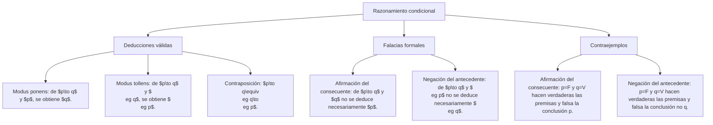

## 1. MARCO CONCEPTUAL Y ONTOLOGÍA
## 1. FICHA TÉCNICA Y MATRIZ DE COMPETENCIAS

| Parámetro | Especificación Oficial |
| :--- | :--- |
| **Eje Temático** | EJE I: Aptitud Académica |
| **Componente / Asignatura** | Razonamiento Lógico |
| **Tema Oficial N.°** | Tema VII: Razonamiento con condicionales |
| **Referencia Prospecto UNSA** | Resolución de Consejo Universitario N.° 0028-2026 (Págs. 6-7, 44-45) |
| **Ponderación por Pregunta** | **1.124150000 pts** (Áreas: Ingenierías, Biomédicas, Sociales) |
| **Preguntas por Examen** | 4 preguntas en componente Lógico (Total: 4.4966000 pts de 20.00 pts de Aptitud) |
| **Nivel de Complejidad Cognitiva** | Bloom: Análisis, Deducción Formal y Detección de Falacias |
| **Conexión Interuniversitaria** | **UNSA:** Modus Ponens, Modus Tollens, reglas de implicación. **UNMSM (DECO):** Interpretación de enunciados causales y condicionales en textos científicos. **UNI:** Tablas de verdad, circuitos lógicos con interruptores condicionales y álgebra de Boole. |

### Matriz de Indicadores de Logro Evaluados
1. **Estructura del condicional:** Descomponer enunciados en antecedente (p) y consecuente (q).
2. **Evaluación de consecuencias lógicas:** Deducir formalmente conclusiones necesarias mediante reglas de inferencia condicional.
3. **Condición suficiente vs. Condición necesaria:** Discriminar con precisión matemática cuándo un factor basta para desencadenar otro y cuándo es indispensable pero no suficiente.
4. **Detección de falacias formales:** Identificar y rechazar la Falacia de Afirmación del Consecuente (FAC) y la Falacia de Negación del Antecedente (FNA).

---

## 2. MAPA TAXONÓMICO Y ONTOLOGÍA

### Ontología de la Relación Condicional
- **Antecedente (p):** Proposición que actúa como hipótesis, causa, o condición suficiente.
- **Consecuente (q):** Proposición que actúa como tesis, efecto, consecuencia obligada o condición necesaria.
- **Condicional Directo:** p \to q ("Si p, entonces q").
- **Condicional Recíproco (Inversa informal):** q \to p ("Si q, entonces p").
- **Condicional Contrario:** \neg p \to \neg q ("Si no p, entonces no q").
- **Condicional Contrarrecíproco:** \neg q \to \neg p ("Si no q, entonces no p"). ¡Es lógicamente equivalente al directo!

---

## 2. DESARROLLO TEÓRICO FORMAL - PARTE I
### 3. DESARROLLO TEÓRICO FORMAL

### 3.1 Definición y Tabla de Verdad de la Implicación Material
La implicación material p \to q es falsa **única y exclusivamente** cuando el antecedente es verdadero y el consecuente es falso (V \to F \equiv F). En cualquier otro caso, la implicación es formalmente verdadera.

\begin{array}{|c|c|c|}
\hline
p & q & p \to q \\
\hline
V & V & V \\
V & F & F \\
F & V & V \\
F & F & V \\
\hline
\end{array}

#### La Ley del Condicional (Definición Material)
p \to q \equiv \neg p \lor q
Esta equivalencia es el pilar de simplificación en álgebra proposicional para los exámenes de admisión.

### 3.2 Condición Suficiente vs. Condición Necesaria

#### A. Condición Suficiente (p)
- Si ocurre p, se garantiza automáticamente q.
- **Ubicación sintáctica:** El antecedente es la condición suficiente.
- *Ejemplo:* "Haber nacido en Arequipa (p) es condición suficiente para ser peruano (q)".
- Giros verbales típicos: "Basta que...", "Siempre que...", "Dado que...", "Si...".

#### B. Condición Necesaria (q)
- Sin q, es absolutamente imposible que ocurra p (\neg q \to \neg p).
- **Ubicación sintáctica:** El consecuente es la condición necesaria.
- *Ejemplo:* "Tener oxígeno en la atmósfera (q) es condición necesaria para que haya vida humana (p)".
- Giros verbales típicos: "...es requisito indispensable para...", "...solo si...", "...únicamente cuando...", "...es condición sine qua non".

## 3. FORMULARIO FUNDAMENTAL Y LEYES BASE
### 4. FORMULARIO MAESTRO DE INFERENCIAS CONDICIONALES

| Regla de Inferencia / Ley | Estructura Simbólica | Validez Lógica |
| :--- | :--- | :--- |
| **Modus Ponendo Ponens (MPP)** | [(p \to q) \land p] \implies q | **VÁLIDO** (Tautología) |
| **Modus Tollendo Tollens (MTT)** | [(p \to q) \land \neg q] \implies \neg p | **VÁLIDO** (Tautología) |
| **Silogismo Hipotético Puro (SHP)** | [(p \to q) \land (q \to r)] \implies (p \to r) | **VÁLIDO** (Transitividad) |
