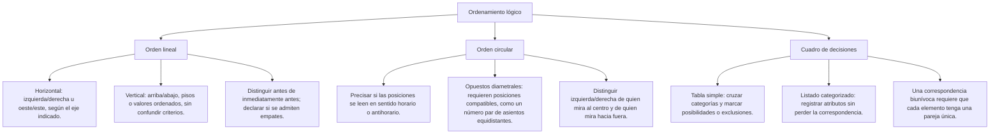

## 1. MARCO CONCEPTUAL Y ONTOLOGÍA
## 1. FICHA TÉCNICA Y MATRIZ DE COMPETENCIAS

| Parámetro | Especificación Oficial |
| :--- | :--- |
| **Eje Temático** | EJE I: Aptitud Académica |
| **Componente / Asignatura** | Razonamiento Lógico |
| **Tema Oficial N.°** | Tema VIII: Organización y orden lógico |
| **Referencia Prospecto UNSA** | Resolución de Consejo Universitario N.° 0028-2026 (Págs. 6-7, 44-45) |
| **Ponderación por Pregunta** | **1.124150000 pts** (Áreas: Ingenierías, Biomédicas, Sociales) |
| **Preguntas por Examen** | 4 preguntas en componente Lógico (Total: 4.4966000 pts de 20.00 pts de Aptitud) |
| **Nivel de Complejidad Cognitiva** | Bloom: Análisis Relacional, Modelado Espacial y Deducción Combinatoria |
| **Conexión Interuniversitaria** | **UNSA:** Ordenamiento lineal (horizontal/vertical), circular, tablas de doble entrada y cuadro de decisiones. **UNMSM (DECO):** Problemas contextualizados de asientos, carreras, edificios y correspondencia biunívoca. **UNI:** Relaciones de orden estricto, teoría de grafos posets (conjuntos parcialmente ordenados) y matrices booleanas. |

### Matriz de Indicadores de Logro Evaluados
1. **Secuencia lógica y orden temporal/jerárquico:** Organizar enunciados desordenados siguiendo relaciones de precedencia temporal o causal.
2. **Ordenamiento Lineal:** Resolver problemas de posiciones relativas y absolutas en rectas horizontales (izquierda/derecha, oeste/este) y verticales (pisos de edificios, estaturas, puntajes).
3. **Ordenamiento Circular:** Ubicar elementos simétricamente distribuidos alrededor de mesas redondas o fogatas, determinando diametralmente opuestos, a la derecha e izquierda relativas.
4. **Correspondencia y Cuadro de Decisiones:** Relacionar múltiples conjuntos disjuntos (personas, profesiones, ciudades, mascotas) mediante matrices lógicas de doble entrada y tablas de descarte cruzado.

---

## 2. MAPA TAXONÓMICO Y ONTOLOGÍA

### Ontología de las Relaciones de Orden
- **Relación de Orden Estricto (<):**
  - **Asimetría:** Si A < B, entonces no se cumple B < A.
  - **Transitividad:** Si A < B y B < C, entonces necesariamente A < C.
  - **Irreflexividad:** Para todo A, no se cumple A < A.
- **Adyacencia Estricta:** Dos elementos A y B están juntos o adyacentes si no existe ningún elemento X intercalado entre ellos (\text{dist}(A, B) = 1).
- **Equidistancia Simétrica:** En orden circular de n posiciones pares, el elemento diametralmente opuesto a la posición k es (k + n/2) \pmod n.

---

## 2. DESARROLLO TEÓRICO FORMAL - PARTE I
### 3. DESARROLLO TEÓRICO FORMAL

### 3.1 Ordenamiento Lineal

#### A. Horizontal (Lateralidad Clásica)
- **Convención estándar de examen de admisión:** A menos que el texto especifique la perspectiva de un observador externo o mirando al sur, se asume la perspectiva del papel (el postulante mira la hoja):
  - Izquierda = Oeste = Siniestra.
  - Derecha = Este = Diestra.
- **Diferencia entre "a la derecha" y "junto y a la derecha":**
  - *"A está a la derecha de B"*: Significa pos(A) > pos(B), pudiendo haber casilleros o personas de por medio.
  - *"A está junto y a la derecha de B"*: Significa pos(A) = pos(B) + 1 (adyacencia estricta sin intermediarios).

#### B. Vertical (Jerarquías, Alturas y Edificios)
- En edificios de N pisos: la numeración legal y arquitectónica comienza en el piso 1 (planta baja) y asciende: 1, 2, 3, \dots, N.
- *"A vive tantos pisos arriba de B como debajo de C"*: Implica punto medio aritmético:
  pos(A) - pos(B) = pos(C) - pos(A) \iff pos(A) = \frac{pos(B) + pos(C)}{2}

## 3. FORMULARIO FUNDAMENTAL Y LEYES BASE
### 4. FORMULARIO MAESTRO DE ORDENAMIENTOS

| Tipo de Ordenamiento | Regla Matemática / Geométrica | Fórmula / Propiedad Clave |
| :--- | :--- | :--- |
| **Lineal: Puntos Extremos** | En una fila de n asientos contiguos | Extremos son la posición 1 y la posición n. |
| **Lineal: Distancia Relativa** | Elementos entre A y B | \text{Elementos intermedios} = |pos(A) - pos(B)| - 1 |
