## 1. MARCO CONCEPTUAL Y ONTOLOGÍA
## 1. 🎯 FICHA TÉCNICA Y MATRIZ DE COMPETENCIAS

| Universidad | Tipo de Enfoque Evaluado | Nivel de Complejidad | Frecuencia Histórica |
| :--- | :--- | :---: | :---: |
| **UNSA** (Ordinario / CEPREUNSA) | Series alfanuméricas, matrices numéricas con figuras, distribuciones gráficas y sucesiones aritméticas/geométricas. | Intermedio | ⭐⭐⭐⭐⭐ (En todos los exámenes) |
| **UNMSM** (San Marcos) | Enfoque DECO: problemas contextualizados en finanzas, crecimiento poblacional, secuencias de producción industrial. | Intermedio-Alto | ⭐⭐⭐⭐⭐ |
| **UNI** (Ciencias / Ingeniería) | Sucesiones de segundo orden (cuadráticas), sucesiones recurrentes tipo Fibonacci generalizado y sumatorias polinómicas. | Avanzado-Extremo | ⭐⭐⭐⭐☆ |

### Capacidades Oficiales Evaluadas (Prospecto UNSA 2027)
1. Analizar e identificar patrones, regularidades y leyes de correspondencia numérica.
2. Inferir la regla de formación analítica en series numéricas lineales, cuadráticas, figurativas y mixtas.
3. Establecer relaciones operativas entre números para modelar situaciones problemáticas.
4. Aplicar propiedades básicas de la teoría de números (paridad, divisibilidad, primalidad) como herramienta de deducción rápida.
5. Emplear la estimación, acotación y aproximación de resultados como filtro de validación y descarte veloz de alternativas.

---

## 2. 🗺️ MAPA TAXONÓMICO Y ONTOLOGÍA DEL TEMA

```mermaid
graph TD
 ROOT["Razonamiento numérico"]
 B1["Sucesiones con regla explícita"]
 B1N1["Aritmética: diferencia constante entre términos sucesivos."]
 B1N2["Cuadrática: segunda diferencia constante para índices consecutivos."]
 B1N3["Geométrica: cociente constante cuando los términos anteriores son no nulos."]
 B1N4["Polinomiales de mayor grado: precisar la familia antes de extrapolar."]
 B1N5["Recurrencias: Fibonacci, Lucas o Tribonacci con valores iniciales dados."]
 B1N6["Alternadas: distinguir las reglas de las posiciones que se intercalan."]
 B2["Arreglos numéricos"]
 B2N1["Filas y columnas: escribir la regla que relaciona sus datos."]
 B2N2["Distribuciones figurativas: conservar los datos y posiciones del dibujo."]
 B2N3["Una lista finita no determina por sí sola una continuación única."]
 B3["Series y sumas"]
 B3N1["Sumas de enteros, pares, impares y cuadrados con cantidad de términos indicada."]
 B3N2["Suma aritmética finita: primer término, diferencia y número de términos."]
 B3N3["Serie geométrica infinita: $|q|<1$ para aplicar la suma usual."]
 B3N4["Estimación: justificar las cotas y comprobar el orden de magnitud."]
 ROOT --> B1
 B1 --> B1N1
 B1 --> B1N2
 B1 --> B1N3
 B1 --> B1N4
 B1 --> B1N5
 B1 --> B1N6
 ROOT --> B2
 B2 --> B2N1
 B2 --> B2N2
 B2 --> B2N3
 ROOT --> B3
 B3 --> B3N1
 B3 --> B3N2
 B3 --> B3N3
 B3 --> B3N4
```

---

## 2. DESARROLLO TEÓRICO FORMAL - PARTE I
### 3. 📖 DESARROLLO TEÓRICO FORMAL

### 3.1 Concepto Formal de Sucesión Numérica
Una sucesión numérica es una **función matemática discreta** cuyo dominio es el conjunto de los números enteros positivos \mathbb{Z}^+ = \{1, 2, 3, \dots, n\} y cuyo codominio es el conjunto de los números reales \mathbb{R}:
f: \mathbb{Z}^+ \to \mathbb{R}, \quad f(n) = t_n
Donde t_n representa el **término enésimo** o término general de la sucesión.

---

### 3.2 Sucesión Aritmética de Primer Orden (Lineal o Progresión Aritmética)
Es aquella en la que la diferencia entre dos términos consecutivos cualesquiera es una constante denominada **razón aritmética** (r).

**Forma general:**
t_1, \quad t_2 = t_1 + r, \quad t_3 = t_1 + 2r, \quad \dots, \quad t_n = t_1 + (n - 1)r

* **Fórmula canónica del término enésimo:**
  t_n = r \cdot n + t_0
  Donde t_0 es el **término anterior al primero** (t_0 = t_1 - r).
* **Número de términos (n):**
  n = \frac{t_n - t_1}{r} + 1 = \frac{t_n - t_0}{r}

---

### 3.3 Sucesión de Segundo Orden (Sucesión Cuadrática)
Es aquella cuya **segunda diferencia** entre términos de índices consecutivos es constante.

**Estructura:**
\begin{array}{ccccccccc}
t_0 & & t_1 & & t_2 & & t_3 & & t_4 \\
 & m_0 & & d_1 & & d_2 & & d_3 & \\
 & & 2a & & 2a & & 2a & &
\end{array}

## 3. FORMULARIO FUNDAMENTAL Y LEYES BASE
### 4. 📐 FORMULARIO MAESTRO DE SERIES Y SUMATORIAS

### 4.1 Sumatorias Fundamentales

| Nombre de la Serie | Expresión Matemática | Fórmula Cerrada |
| :--- | :--- | :---: |
| **Primeros n naturales** | \sum_{k=1}^n k = 1 + 2 + 3 + \dots + n | \frac{n(n + 1)}{2} |
| **Primeros n números pares** | \sum_{k=1}^n 2k = 2 + 4 + 6 + \dots + 2n | n(n + 1) |
| **Primeros n números impares** | \sum_{k=1}^n (2k - 1) = 1 + 3 + 5 + \dots + (2n - 1) | n^2 |
