## 1. MARCO CONCEPTUAL Y ONTOLOGÍA
## 1. 🎯 FICHA TÉCNICA Y MATRIZ DE COMPETENCIAS

| Universidad | Tipo de Enfoque Evaluado | Nivel de Complejidad | Frecuencia Histórica |
| :--- | :--- | :---: | :---: |
| **UNSA** (Ordinario / CEPREUNSA) | Razones aritméticas/geométricas, porcentajes, descuentos/aumentos sucesivos, reparto proporcional y regla de tres simple/compuesta. | Intermedio | ⭐⭐⭐⭐⭐ (Infaltable) |
| **UNMSM** (San Marcos) | Enfoque DECO: problemas de rendimiento laboral, mezclas comerciales, inflación, escalas de mapas y rendimientos de combustible. | Intermedio-Alto | ⭐⭐⭐⭐⭐ |
| **UNI** (Ciencias / Ingeniería) | Ruedas dentadas (engranajes), magnitudes proporcionales combinadas con funciones f(x), análisis dimensional y sistemas de tuberías. | Avanzado-Extremo | ⭐⭐⭐⭐⭐ |

### Capacidades Oficiales Evaluadas (Prospecto UNSA 2027)
1. Analizar situaciones problemáticas que involucren razones aritméticas y geométricas.
2. Comparar y relacionar magnitudes continuas y discretas en diversos contextos técnicos y cotidianos.
3. Interpretar y aplicar el cálculo de porcentajes, variaciones porcentuales y aplicaciones comerciales.
4. Establecer relaciones geométricas mediante escalas y proporcionalidad directa e inversa.
5. Deducir situaciones de variación directa e inversa resolviendo problemas mediante métodos analíticos y sintéticos.

---

## 2. 🗺️ MAPA TAXONÓMICO Y ONTOLOGÍA DEL TEMA

```mermaid
graph TD
 ROOT["Magnitudes y proporcionalidad"]
 B1["Razones y proporciones"]
 B1N1["Diferencia o razón aritmética: $a-b$."]
 B1N2["Cociente o razón geométrica: $a/b$, con b no nulo."]
 B1N3["Proporción discreta: términos medios distintos en la clasificación utilizada."]
 B1N4["Proporción continua: los términos medios coinciden."]
 B2["Modelos proporcionales"]
 B2N1["Directa: $y/x=k$, con denominador admisible."]
 B2N2["Inversa: $xy=k$ bajo las condiciones del modelo."]
 B2N3["Engranajes sin deslizamiento: comprobar dientes, radios y sentido de giro."]
 B2N4["Reparto: indicar si los pesos son directos, inversos o compuestos."]
 B3["Métodos"]
 B3N1["Regla de tres simple: identificar qué se mantiene constante."]
 B3N2["Regla compuesta: separar el efecto de cada magnitud y declarar productividad."]
 B3N3["Escala: convertir unidades antes de comparar plano y terreno."]
 B4["Porcentajes"]
 B4N1["Especificar la base de cada porcentaje."]
 B4N2["Cambios sucesivos: multiplicar factores, no sumar porcentajes sin revisar."]
 B4N3["Costo, venta, ganancia y pérdida: identificar cuál es la cantidad de referencia."]
 ROOT --> B1
 B1 --> B1N1
 B1 --> B1N2
 B1 --> B1N3
 B1 --> B1N4
 ROOT --> B2
 B2 --> B2N1
 B2 --> B2N2
 B2 --> B2N3
 B2 --> B2N4
 ROOT --> B3
 B3 --> B3N1
 B3 --> B3N2
 B3 --> B3N3
 ROOT --> B4
 B4 --> B4N1
 B4 --> B4N2
 B4 --> B4N3
```

---

## 2. DESARROLLO TEÓRICO FORMAL - PARTE I
### 3. 📖 DESARROLLO TEÓRICO FORMAL

### 3.1 Magnitud y Cantidad
* **Magnitud:** Todo aquello susceptible de ser medido, comparado y que experimenta variación de intensidad (ej. longitud, tiempo, masa, rapidez, número de obreros).
* **Cantidad:** Medida temporal o estado particular de una magnitud en un instante dado, expresada con un valor numérico y una unidad de medida (ej. 15 \text{ m}, 4 \text{ horas}, 8 \text{ obreros}).

---

### 3.2 Razones y Proporciones
1. **Razón Aritmética (r):** Comparación por sustracción.
   a - b = r \quad (a: \text{antecedente}, \quad b: \text{consecuente})
2. **Razón Geométrica (k):** Comparación por división.
   \frac{a}{b} = k \quad (b \neq 0)
3. **Proporción Geométrica:** Igualdad de dos razones geométricas.
   \frac{a}{b} = \frac{c}{d}
   * **Discreta:** Todos los términos son diferentes (b \neq c). El término d se llama **cuarta proporcional**.
   * **Continua:** Los términos medios son iguales (\frac{a}{b} = \frac{b}{c}).
     * b = \sqrt{a \cdot c} es la **media geométrica** o **media proporcional**.
     * c es la **tercera proporcional**.

---

### 3.3 Magnitudes Directa e Inversamente Proporcionales

#### A. Magnitudes Directamente Proporcionales (A \text{ D.P. } B)
Dos magnitudes son directamente proporcionales cuando al multiplicar o dividir a una de ellas por un número real positivo, la otra queda multiplicada o dividida por el mismo número. Su cociente permanece constante:
\frac{A}{B} = k \quad (\text{Constante})

## 3. FORMULARIO FUNDAMENTAL Y LEYES BASE
### 4. 📐 FORMULARIO MAESTRO DE APLICACIONES

### 4.1 Método Preuniversitario Causa - Circunstancia - Efecto (Regla de Tres Compuesta)
En lugar de multiplicar signos confusos (+ y -), se divide el problema en tres columnas fijas:

| 1. CAUSA (Los que realizan el trabajo) | 2. CIRCUNSTANCIA (Condiciones de tiempo) | 3. EFECTO (La obra y su resistencia) |
| :---: | :---: | :---: |
| Obreros, Máquinas, Animales, Habilidad, Rendimiento | Días, Horas diarias, Raciones, Eficiencia | Obra (m^3, m^2, volumen), Dificultad |

\frac{\text{(Causa)} \cdot \text{(Circunstancia)}}{\text{Efecto}} = \text{Constante}
\frac{\text{Obreros} \cdot \text{Rendimiento} \cdot \text{Días} \cdot \text{Horas/día}}{\text{Obra} \cdot \text{Dificultad}} = k

---

### 4.2 Fórmulas de Aplicaciones Comerciales (Porcentajes)
