## 1. MARCO CONCEPTUAL Y ONTOLOGÍA
## 1. 🎯 FICHA TÉCNICA Y MATRIZ DE COMPETENCIAS

| Universidad | Tipo de Enfoque Evaluado | Nivel de Complejidad | Frecuencia Histórica |
| :--- | :--- | :---: | :---: |
| **UNSA** (Ordinario / CEPREUNSA) | Traducción de lenguaje verbal a algebraico, problemas de edades (cuadros de doble entrada con pasado, presente y futuro) y equivalencias de balanzas. | Intermedio | ⭐⭐⭐⭐⭐ (En todos los exámenes) |
| **UNMSM** (San Marcos) | Enfoque DECO: problemas de edades contextualizados en árboles genealógicos familiares, años bisiestos y relaciones de producción. | Intermedio-Alto | ⭐⭐⭐⭐⭐ |
| **UNI** (Ciencias / Ingeniería) | Ecuaciones con condiciones de números enteros (\mathbb{Z}^+), ecuaciones diofánticas y restricciones lógicas de tiempo. | Avanzado | ⭐⭐⭐⭐☆ |

### Capacidades Oficiales Evaluadas (Prospecto UNSA 2027)
1. Utilizar letras y símbolos como representaciones rigurosas de incógnitas y relaciones de orden.
2. Traducir enunciados del lenguaje natural cotidiano a expresiones y modelos algebraicos precisos.
3. Reconocer relaciones de equivalencia, simetría y transitividad entre expresiones algebraicas.
4. Plantear y resolver situaciones problemáticas formulando ecuaciones de primer y segundo grado.
5. Resolver problemas de edades con uno, dos o más sujetos en diferentes tiempos cronológicos.

---

## 2. 🗺️ MAPA TAXONÓMICO Y ONTOLOGÍA DEL TEMA

```mermaid
graph TD
 ROOT["Ecuaciones y edades"]
 B1["Traducción a ecuaciones"]
 B1N1["Definir la incógnita y sus unidades."]
 B1N2["Precisar el alcance de doble, triple, excede y tanto como."]
 B1N3["Fracciones de una cantidad: identificar el todo."]
 B1N4["Soluciones enteras: comprobar restricciones del problema, no solo la ecuación."]
 B2["Edades"]
 B2N1["Una persona: organizar pasado, presente y futuro en una línea temporal."]
 B2N2["Varias personas: sumar o restar el mismo tiempo a todas."]
 B2N3["Diferencia constante: $(a+t)-(b+t)=a-b$."]
 B2N4["Año de nacimiento: considerar si ya ocurrió el cumpleaños; no asumir una igualdad entera sin ese dato."]
 B3["Equivalencias y balanzas"]
 B3N1["Equilibrio: aplicar operaciones equivalentes a ambos lados."]
 B3N2["Reducción en cadena: sustituir igualdades sin cambiar las unidades."]
 B3N3["Falsa suposición: comparar con un caso base y justificar cada ajuste."]
 B3N4["Comprobar el resultado en el enunciado original."]
 ROOT --> B1
 B1 --> B1N1
 B1 --> B1N2
 B1 --> B1N3
 B1 --> B1N4
 ROOT --> B2
 B2 --> B2N1
 B2 --> B2N2
 B2 --> B2N3
 B2 --> B2N4
 ROOT --> B3
 B3 --> B3N1
 B3 --> B3N2
 B3 --> B3N3
 B3 --> B3N4
```

---

## 2. DESARROLLO TEÓRICO FORMAL - PARTE I
### 3. 📖 DESARROLLO TEÓRICO FORMAL

### 3.1 Diccionario de Traducción Algebraica (Lenguaje Común a Lenguaje Simbólico)

| Enunciado Verbal | Traducción Matemática |
| :--- | :---: |
| El triple de un número, aumentado en 5 | 3x + 5 |
| El triple, de un número aumentado en 5 *(¡Atención a la coma!)* | 3(x + 5) |
| A es dos veces más que B (A es tres veces B) | A = 3B |
| A es dos veces B (A es el doble de B) | A = 2B |
| A excede a B en 8 unidades | A - B = 8 |
| El exceso de A sobre el triple de B es 12 | A - 3B = 12 |
| La suma de tres números enteros consecutivos | x + (x + 1) + (x + 2) = 3x + 3 |
| La suma de tres números enteros impares consecutivos | (2x - 1) + (2x + 1) + (2x + 3) |
| El cuadrado de la suma de dos números | (x + y)^2 |
| La suma de los cuadrados de dos números | x^2 + y^2 |

---

### 3.2 Teoría Rigurosa de Problemas sobre Edades

#### A. Caso I: Para un Solo Sujeto
Se trabaja sobre una **línea de tiempo** con una sola variable:
\begin{array}{ccccc}
\text{Pasado} & & \text{Presente} & & \text{Futuro} \\
\hline
\text{Hace } m \text{ años} & \longleftarrow & \text{Hoy} & \longrightarrow & \text{Dentro de } n \text{ años} \\
x - m & & x & & x + n
\end{array}

#### B. Caso II: Para Dos o Más Sujetos (Matriz Cronológica)

## 3. FORMULARIO FUNDAMENTAL Y LEYES BASE
### 4. 📐 FORMULARIO MAESTRO Y MÉTODOS DE RESOLUCIÓN

### 4.1 Método de la Regla de Conjunta (Equivalencias en Cadena)
Se utiliza para encontrar la equivalencia final entre dos elementos a partir de relaciones intermedias:
* Se disponen las equivalencias en columnas de modo que **el elemento que aparece a la derecha de una fila aparezca a la izquierda de la siguiente**.
* Se multiplican término a término los miembros de la izquierda y se igualan al producto de la derecha:
  \prod \text{Miembros de la Izquierda} = \prod \text{Miembros de la Derecha}
