## 1. MARCO CONCEPTUAL Y ONTOLOGÍA
## 1. 🎯 FICHA TÉCNICA Y MATRIZ DE COMPETENCIAS

| Universidad | Tipo de Enfoque Evaluado | Nivel de Complejidad | Frecuencia Histórica |
| :--- | :--- | :---: | :---: |
| **UNSA** (Ordinario / CEPREUNSA) | Áreas sombreadas por traslación de regiones, perímetros con semicircunferencias, conteo de figuras (segmentos, triángulos, cuadriláteros) y simetría. | Intermedio | ⭐⭐⭐⭐⭐ (En todos los exámenes) |
| **UNMSM** (San Marcos) | Enfoque DECO: áreas de terrenos irregulares, optimización de cercos perimétricos, doblado y corte de papel, vistas ortogonales. | Intermedio-Alto | ⭐⭐⭐⭐⭐ |
| **UNI** (Ciencias / Ingeniería) | Relaciones de áreas en triángulos mediante razones métricas, geometría fractal elemental, rotaciones espaciales y sólidos de revolución intuitivos. | Avanzado-Extremo | ⭐⭐⭐⭐⭐ |

### Capacidades Oficiales Evaluadas (Prospecto UNSA 2027)
1. Desarrollar la visualización espacial para el análisis de figuras bidimensionales y tridimensionales.
2. Identificar y relacionar elementos angulares y de paralelismo en configuraciones geométricas.
3. Analizar perímetros y áreas sombreadas en contextos no directos mediante traslación y compensación.
4. Descomponer y reconfigurar figuras complejas como estrategia sistemática de resolución.
5. Reconocer simetrías (axiales y centrales) y transformaciones rígidas (rotación, traslación).
6. Inferir resultados mediante algoritmos analíticos de conteo de segmentos, regiones y figuras convexas.

---

## 2. 🗺️ MAPA TAXONÓMICO Y ONTOLOGÍA DEL TEMA

```mermaid
graph TD
 ROOT["Razonamiento geométrico"]
 B1["Áreas"]
 B1N1["Trasladar o descomponer regiones sin deformarlas conserva el área."]
 B1N2["Diferencia de áreas: identificar la región total y la que se retira."]
 B1N3["Triángulos: usar bases y alturas correspondientes; revisar medianas y baricentro."]
 B1N4["Paralelogramos y trapecios: distinguir altura perpendicular y lado oblicuo."]
 B2["Perímetros y fronteras"]
 B2N1["Sumar las longitudes de la frontera solicitada, incluidos huecos si el enunciado los cuenta."]
 B2N2["Arcos: usar el ángulo correspondiente y sumar también los segmentos rectos que pertenecen al borde."]
 B2N3["Una proyección no conserva cualquier longitud; justificar las condiciones de un atajo rectilíneo."]
 B3["Conteo de figuras"]
 B3N1["Segmentos sobre una recta: elegir sus dos extremos entre puntos distintos."]
 B3N2["Triángulos y cuadriláteros: clasificar tamaños y evitar contar la misma figura dos veces."]
 B3N3["Bloques: distinguir volumen total, cubos visibles y caras expuestas."]
 B4["Visualización espacial"]
 B4N1["Simetría axial: reflexión respecto de una recta."]
 B4N2["Simetría central: correspondencia respecto de un punto."]
 B4N3["Doblado y perforación: reflejar cada pliegue en orden inverso."]
 B4N4["Vistas: frontal, superior y perfil, con orientación indicada."]
 ROOT --> B1
 B1 --> B1N1
 B1 --> B1N2
 B1 --> B1N3
 B1 --> B1N4
 ROOT --> B2
 B2 --> B2N1
 B2 --> B2N2
 B2 --> B2N3
 ROOT --> B3
 B3 --> B3N1
 B3 --> B3N2
 B3 --> B3N3
 ROOT --> B4
 B4 --> B4N1
 B4 --> B4N2
 B4 --> B4N3
 B4 --> B4N4
```

---

## 2. DESARROLLO TEÓRICO FORMAL - PARTE I
### 3. 📖 DESARROLLO TEÓRICO FORMAL

### 3.1 Métodos Maestros para el Cálculo de Áreas Sombreadas

#### A. Método de Traslación de Regiones
Consiste en trasladar una o más regiones sombreadas congruentes hacia zonas en blanco, completando figuras geométricas elementales y conocidas (cuadrados, sectores circulares, triángulos).
* **Condición de validez:** Las regiones deben ser rigurosamente simétricas o congruentes.

#### B. Método por Diferencia de Áreas
Cuando la región sombreada tiene forma irregular o no reconocible:
A_{\text{sombreada}} = A_{\text{figura total}} - \sum A_{\text{regiones no sombreadas}}

#### C. Propiedades Clave de Relaciones de Áreas en Triángulos
1. **Propiedad de la Mediana:** La mediana divide al triángulo en dos regiones de **igual área**:
   A_{\triangle ABM} = A_{\triangle MBC} = \frac{A_{\triangle ABC}}{2}
2. **Propiedad del Baricentro (G):** Las 3 medianas dividen al triángulo en **6 triángulos de igual área**:
   S_1 = S_2 = S_3 = S_4 = S_5 = S_6 = \frac{A_{\text{total}}}{6}
   Al unir el baricentro con los tres vértices, se forman 3 triángulos de igual área: \frac{A_{\text{total}}}{3}.
3. **Puntos Medios de los 3 Lados:**
   El triángulo central formado por la unión de los tres puntos medios tiene un área igual a la cuarta parte del total:
   A_{\text{central}} = \frac{A_{\text{total}}}{4}

---

### 3.2 Perímetros: Definición y Propiedades de Proyección

* **Definición Rigurosa:** El perímetro (2p) de una región es la **longitud de la frontera solicitada**; si se pide toda la frontera de una región con huecos, también se cuentan sus bordes interiores.

## 3. FORMULARIO FUNDAMENTAL Y LEYES BASE
### 4. 📐 FORMULARIO MAESTRO DE REGIONES SOMBREADAS CLÁSICAS

### Cuadrado de Lado L y sus Configuraciones Típicas de Examen

| Configuración Clásica | Representación Visual | Área Sombreada (A_s) |
| :--- | :--- | :---: |
| **Pétalo Simple (Hojita)** | Cuadrante con dos arcos de radio L trazados desde vértices opuestos | A_s = \frac{L^2}{2} (\pi - 2) |
