## 1. MARCO CONCEPTUAL Y ONTOLOGÍA
## 1. 🎯 FICHA TÉCNICA Y MATRIZ DE COMPETENCIAS

| Universidad | Tipo de Enfoque Evaluado | Nivel de Complejidad | Frecuencia Histórica |
| :--- | :--- | :---: | :---: |
| **UNSA** (Ordinario / CEPREUNSA) | Principios de adición y multiplicación, problemas de rutas y caminos entre ciudades, indumentaria/menús, y ordenamientos lineales simples. | Intermedio | ⭐⭐⭐⭐⭐ (En todos los exámenes) |
| **UNMSM** (San Marcos) | Enfoque DECO: formación de comisiones paritarias, contraseñas alfanuméricas seguras, rutas con condiciones de no retorno y grafos. | Intermedio-Alto | ⭐⭐⭐⭐⭐ |
| **UNI** (Ciencias / Ingeniería) | Permutaciones con repetición en redes de caminos (manzanas), permutaciones circulares complejas, ordenamiento con elementos juntos/separados. | Avanzado-Extremo | ⭐⭐⭐⭐⭐ |

### Capacidades Oficiales Evaluadas (Prospecto UNSA 2027)
1. Aplicar los principios fundamentales de conteo (aditivo y multiplicativo) con discernimiento de simultaneidad o exclusión mutua.
2. Determinar sistemáticamente el número de casos posibles mediante razonamiento analítico sin necesidad de listar todos los eventos.
3. Utilizar y construir diagramas de árbol estructurados para modelar tomas de decisiones secuenciales.
4. Resolver problemas de rutas, traslados y redes viales bajo restricciones de no retroceso o paso obligado por puntos clave.
5. Distinguir de forma intuitiva y rigurosa situaciones donde **interesa el orden** (permutaciones/variaciones) de aquellas donde **no interesa el orden** (combinaciones).

---

## 2. 🗺️ MAPA TAXONÓMICO Y ONTOLOGÍA DEL TEMA

```mermaid
graph TD
 ROOT["Conteo y agrupaciones"]
 B1["Principios de conteo"]
 B1N1["Suma: alternativas disjuntas; si se solapan, corregir las intersecciones."]
 B1N2["Producto: contar las opciones de cada etapa bajo las restricciones dadas."]
 B2["Rutas y caminos"]
 B2N1["Árbol: una rama por elección admitida."]
 B2N2["Red vial: distinguir recorridos sucesivos de alternativas."]
 B2N3["Cuadrícula: precisar direcciones permitidas y puntos de paso."]
 B2N4["Bloqueos: excluir solo las rutas que usan la zona prohibida."]
 B3["Importa el orden"]
 B3N1["Permutación lineal de n objetos distintos: $n!$."]
 B3N2["Circular: $(n-1)!$ para objetos distintos si se identifican giros, pero no reflejos."]
 B3N3["Repeticiones: dividir por las multiplicidades de los objetos indistinguibles."]
 B3N4["Variación: elegir y ordenar un subconjunto, con o sin repetición según se indique."]
 B4["No importa el orden"]
 B4N1["Combinación simple: $\binom{n}{k}$ para elegir k objetos entre n distintos."]
 B4N2["Equipos y comisiones: aplicar restricciones sin asignar cargos inexistentes."]
 ROOT --> B1
 B1 --> B1N1
 B1 --> B1N2
 ROOT --> B2
 B2 --> B2N1
 B2 --> B2N2
 B2 --> B2N3
 B2 --> B2N4
 ROOT --> B3
 B3 --> B3N1
 B3 --> B3N2
 B3 --> B3N3
 B3 --> B3N4
 ROOT --> B4
 B4 --> B4N1
 B4 --> B4N2
```

---

## 2. DESARROLLO TEÓRICO FORMAL - PARTE I
### 3. 📖 DESARROLLO TEÓRICO FORMAL

### 3.1 Principios Fundamentales del Conteo

#### A. Principio de Adición (El Conector "O")
Si un evento A puede ocurrir de m maneras diferentes y otro evento B puede ocurrir de n maneras diferentes, y ambos eventos **no pueden ocurrir simultáneamente** (son mutuamente excluyentes), entonces el evento A **o** B puede realizarse de:
\text{Total de formas} = m + n
* *Ejemplo:* Si puedes viajar de Arequipa a Lima por avión (3 aerolíneas) o por bus terrestre (5 empresas), el total de opciones para viajar es 3 + 5 = 8 maneras.

#### B. Principio de Multiplicación (El Conector "Y")
Si un evento o decisión A puede ocurrir de m maneras y, para cada una de estas, un segundo evento B puede ocurrir de n maneras de forma **secuencial o simultánea**, entonces ambos eventos A **y** B ocurren de:
\text{Total de formas} = m \cdot n
* *Ejemplo:* Si tienes 4 pantalones distintos y 5 camisas, el total de tenidas (pantalón y camisa) es 4 \times 5 = 20 formas.

---

### 3.2 Problemas de Rutas y Redes Viales (Método de los Caminos)

1. **Rutas entre Ciudades en Serie:**
   Si para ir de la ciudad A a la ciudad C se debe pasar obligatoriamente por la ciudad intermedia B:
   \text{Rutas } (A \to C) = (\text{Caminos de } A \text{ a } B) \cdot (\text{Caminos de } B \text{ a } C)
2. **Viajes de Ida y Vuelta sin Repetir Camino:**
   Si hay k caminos entre dos ciudades:
   * Total de viajes ida y vuelta: k \cdot k = k^2.
   * Total de viajes ida y vuelta **sin regresar por el mismo camino**: k \cdot (k - 1).
3. **Caminos en Cuadrículas Urbanas (Método del Triángulo de Pascal):**
   Para ir del vértice inferior izquierdo al superior derecho avanzando únicamente hacia el norte (\uparrow) y hacia el este (\rightarrow):
   * Cada intersección suma los caminos que llegan desde abajo y desde la izquierda:
     V_{(x, y)} = V_{(x-1, y)} + V_{(x, y-1)}

## 3. FORMULARIO FUNDAMENTAL Y LEYES BASE
### 4. 📐 FORMULARIO MAESTRO DE ANÁLISIS COMBINATORIO

| Tipo de Agrupación | Condición Fundamental | Expresión Matemática |
| :--- | :--- | :---: |
| **Factorial de un número (n!)** | Producto de los enteros consecutivos desde 1 hasta n (0! = 1) | n! = n(n - 1)(n - 2)\dots 1 |
| **Permutación Lineal (P_n)** | Intervienen todos los elementos en fila ordenada | P_n = n! |
