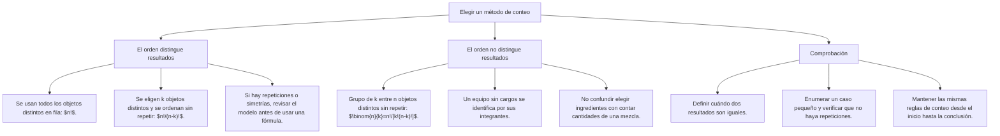

## 1. DESARROLLO TEÓRICO AVANZADO - PARTE II
   * Por fórmula combinatoria (cuadrícula de m \times n tramos):
     \text{Caminos Totales} = \frac{(m + n)!}{m! \cdot n!} = C_{m}^{m + n}

---

### 3.3 El Árbol de Decisiones Combinatorio
Una estructura matemática de grafo arbóreo que modela paso a paso las bifurcaciones de eventos.  
* El número total de hojas terminales en el árbol coincide con el número total de resultados posibles del espacio de opciones.

---

### 3.4 Clasificación de Agrupaciones: ¿Importa o NO Importa el Orden?

---

## 2. FORMULARIO MAESTRO, ARTIFICIOS Y HACKING PREUNIVERSITARIO
| **Permutación Circular (P_c(n))** | Elementos dispuestos en ronda cerrada alrededor de un centro fijo | P_c(n) = (n - 1)! |
| **Permutación con Repetición (P_n^{a, b, c})** | Elementos repetidos indistinguibles (a + b + c \le n) | P_n^{a, b, c} = \frac{n!}{a! \cdot b! \cdot c!} |
| **Variación Simple (V_k^n)** | Importa el orden, se seleccionan k elementos de un total de n | V_k^n = \frac{n!}{(n - k)!} |
| **Combinación Simple (C_k^n)** | **NO importa el orden**, se forman subgrupos de k elementos de un total de n | C_k^n = \frac{n!}{k!(n - k)!} |

---

### 6. 🧠 TÉCNICAS Y ARTIFICIOS DE CÁLCULO (Hacking Preuniversitario)

### Método de la Degeneración Rápida de Combinatorias
Para calcular combinatorias en exámenes de admisión sin escribir factoriales gigantes:
C_3^8 = \frac{8 \times 7 \times 6}{1 \times 2 \times 3} = \frac{336}{6} = \mathbf{56}
* **Regla rápida:** El índice inferior (3) te dice cuántos números consecutivos hacia atrás escribes en el numerador (8 \times 7 \times 6), y en el denominador colocas el factorial de ese índice (1 \times 2 \times 3). ¡Toma 3 segundos!

---

### 5. 💡 MNEMOTECNIAS DE COMBATE PREUNIVERSITARIO

### Mnemotecnia 1: La Regla de Oro del Orden
> **"COMBINACIÓN es de COMISIÓN (NO importa el orden)"**  
> Si formas una comisión con Pedro y María, es exactamente la misma comisión que con María y Pedro. No importa el orden \implies **Combinación (C_k^n)**.  
> Pero si eliges **Presidente y Secretario**, Pedro de presidente no es igual a María de presidente. Sí importa el orden \implies **Variación / Permutación**.

### Mnemotecnia 2: Elementos que van Siempre Juntos
> **"ENPAQUETA Y CUENTA COMO UNO"**  
> Si una pareja de enamorados debe sentarse siempre junta en una fila de 6 personas:
> 1. Junta a los 2 en un solo "bloque" imaginario.
> 2. Ahora tienes 5 elementos para permutar: 5!.
> 3. Multiplica por el orden interno de la pareja: 2!.  
> 👉 \text{Total} = 5! \cdot 2! = 120 \times 2 = \mathbf{240 \text{ formas}}.

---

## 3. ZONA DE TRAMPAS Y DISTRACTORES DE EXAMEN
### 7. 🚨 ZONA DE TRAMPAS Y DISTRACTORES ("¡PELIGRO EXAMEN!")

1. ⚠️ **Permutación circular en mesa sin orientar:**
   * En una mesa circular con 6 asientos, el número de formas de sentarse es (6 - 1)! = 5! = 120.
   * **El error común:** Marcar 6! = 720. La mesa circular elimina una posición fija por rotación simétrica.
2. ⚠️ **"Al menos uno" o "Por lo menos uno":**
   * En lugar de calcular: (1 hombre) + (2 hombres) + (3 hombres)...
   * **Aplica el Complemento:**
     \text{Casos favorables} = \text{Total de Casos} - \text{Casos donde NO hay ningún hombre}
3. ⚠️ **Ida y vuelta sin usar el mismo camino vs. sin repetir la misma ruta completa:**
   * *Sin usar el mismo camino:* Ningún tramo de vuelta puede ser idéntico al de ida.
   * *Sin repetir la misma ruta completa:* Solo se prohíbe que la combinación total de ida coincida idéntica con la de vuelta. Lee la palabra exacta del prospecto.

---

## 4. MODELOS DE EXAMEN Y APLICACIÓN DECO
### 8. 🌐 APLICACIÓN AL MUNDO REAL Y CONTEXTO DECO

### Seguridad Informática en Banca Móvil (Arequipa)
Una cooperativa de crédito en Arequipa exige que la clave dinámica de un usuario esté formada por 4 dígitos seguidos de 2 letras del alfabeto castellano (sin incluir la letra Ñ, es decir, 26 letras). Si los dígitos no pueden repetirse y la primera letra debe ser obligatoriamente una vocal:
* Elección de dígitos: 10 \times 9 \times 8 \times 7 = 5,040 formas.
* Elección de la primera letra (vocal): 5 formas (A, E, I, O, U).
* Elección de la segunda letra (cualquiera de las 26): 26 formas.
* Total de claves posibles por principio multiplicativo:
  \text{Total} = 5,040 \times 5 \times 26 = 5,040 \times 130 = \mathbf{655,200 \text{ claves únicas}}.

---
